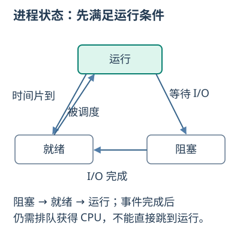

# 操作系统原理：重点与易错
## 第1章 操作系统引论
### 操作系统功能与基本特征

- 🔴 **核心知识**：OS是管理软硬件资源、组织工作流程并提供接口/环境的系统软件；功能含处理机、存储、文件、设备及接口管理。
- 🔵 **方法与例题**：特征为并发、共享、虚拟、异步；批处理重吞吐，分时重交互，实时重规定时限。
- ⚫ **易混易错**：并发是同时间段推进，并行是同刻执行；多核也并发，CPU与I/O也可并行。

## 第2章 操作系统结构与用户接口
### 用户态、内核态与系统调用

- 🔴 **核心知识**：用户态限制特权操作，内核态执行受保护的管理操作；系统调用是应用请求内核服务的程序接口。
- 🔵 **方法与例题**：准备参数→陷入内核→检查参数/权限→执行或阻塞等待→返回用户态。
- ⚫ **易混易错**：模式切换不必更换进程；库函数不一定发系统调用；缺页异常也可正常处理。

## 第3章 进程、线程与处理机调度
### 进程、线程与PCB

- 🔴 **核心知识**：进程是程序在数据集合上的一次运行活动，实体含程序、数据和进程控制块（PCB）；线程是调度执行单元。
- 🔵 **方法与例题**：进程分配资源；同进程线程共享地址空间/打开文件，各有PC、寄存器、栈；PCB保存状态、现场、调度与资源。
- ⚫ **易混易错**：程序静态、进程动态；教材以PCB为进程存在唯一标志，不要求整个进程常驻内存。

### 进程状态与切换

- 🔴 **核心知识**：就绪只缺CPU，运行占CPU，阻塞等事件；另有创建、终止以及按模型设置的挂起状态。
- 🔵 **方法与例题**：运行请求I/O→阻塞；I/O完成→就绪；获调度→运行；片到→就绪。
- ⚫ **易混易错**：阻塞通常不直接转运行；切换需存旧现场恢复新现场，进入内核态不等于换进程。

### 处理机调度

- 🔴 **核心知识**：FCFS先到，SJF短服务，优先级看等级，RR轮转，HRRN取(等待+服务)/服务最大者。
- 🔵 **方法与例题**：周转=C−A，带权周转=(C−A)/S；无阻塞简化模型等待=C−A−S，首次响应=首次获CPU−A。
- ⚫ **易混易错**：S>0，是否抢占先确认；平均等待低不表示无饥饿，RR片小会增加切换开销。

### 非抢占调度画时间线

- 🔴 **核心知识**：只有完成、阻塞等让出CPU时才重选当前已到达就绪任务，后来短任务不抢正在运行者。
- 🔵 **方法与例题**：P1到0需5、P2到1需3、P3到2需1，SJF为P1[0,5)、P3[5,6)、P2[6,9)。
- ⚫ **易混易错**：各等待为0、5、3，均8/3；不可预选未到任务，含I/O时须另扣阻塞时间。

### RR时间片与队列

- 🔴 **核心知识**：就绪任务按队列轮流至多运行一片，未完回队尾，新到加入队列。
- 🔵 **方法与例题**：P1/P2同到需3/2、片1，运行P1,P2,P1,P2,P1，完成C1=5、C2=4。
- ⚫ **易混易错**：同时到达与片到入队顺序服从题设；任务可提前结束，空队列时CPU可空闲。

### 多级反馈队列的升降与抢占

- 🔴 **核心知识**：多级反馈按优先级选队列，任务可因用满时间片而降级；新任务、抢占、提升和时间片处理规则都须先约定。
- 🔵 **方法与例题**：Q0片1/Q1片2，新任务进Q0；A需4到0、B需1到2，高队列抢占并保余片：A0—2、B2—3、A3—5。
- ⚫ **易混易错**：本例无I/O与切换开销；片内剩余时间不能自动重置，持续高队列请求可能使低队列饥饿，可约定定期提升。

### 按截止期执行EDF调度

- 🔴 **核心知识**：抢占式EDF在已到达未完成任务中选绝对截止时刻最早者；每次新任务到达或当前任务完成时重新比较。
- 🔵 **方法与例题**：A到0需3限5，B到1需1限2：A[0,1)→B[1,2)→A[2,4)，两者守时；恢复A只做剩余2。
- ⚫ **易混易错**：截止时刻不是执行时长；超过CPU能力的需求不能靠EDF全满足，开销/抢占与周期任务的模型条件要另看。

## 第4章 进程同步与死锁
### 同步、互斥与信号量

- 🔴 **核心知识**：互斥限制同一临界资源并行使用，同步规定先后条件；P/V是不可分割的原语。
- 🔵 **方法与例题**：记录型P先S−1，负则阻塞；V先S+1，≤0则唤醒。生产消费empty=N、full=0、mutex=1，先P数量再P互斥。
- ⚫ **易混易错**：S<0为等待数的负值；先持mutex等空位可能阻止消费者释放空位；临界区须覆盖完整更新。

### 死锁条件与处理

- 🔴 **核心知识**：死锁为多个进程互等资源且无外力无法推进；必要条件为互斥、请求并保持、不剥夺、循环等待。
- 🔵 **方法与例题**：预防破坏条件；避免保持安全；检测后通过撤销/剥夺等解除。固定资源顺序可破坏循环等待。
- ⚫ **易混易错**：饥饿不等死锁；多实例资源分配图有环不一定死锁；不安全不等于已经死锁。

### 银行家算法与安全序列

- 🔴 **核心知识**：Need=Max−Allocation，Available为当前可用；安全检查复制Work=Available，找Need≤Work者假完成并释放原Allocation。
- 🔵 **方法与例题**：Avail2，P1已1最大3、P2已2最大5：Need2/3；P1完Work3，P2完Work5，序P1→P2安全。
- ⚫ **易混易错**：增回已分配量，不是Max；请求还要先检≤Need、≤Available，试分配安全才批准。

### 读者写者的计数与互斥

- 🔴 **核心知识**：多个读者可共读，写者与其他读写互斥；计数锁保护readCount，rw锁保护共享对象。
- 🔵 **方法与例题**：首读者取得rw；后续读者只加计数；末读者释放rw。count 0→1锁rw→2→1→0解rw。
- ⚫ **易混易错**：读者优先可令写者饥饿；rw不能由每个读者都P一次，否则不能多读者并行。

### 等待图中的死锁检测

- 🔴 **核心知识**：等待图的点是进程，Pi正等待Pj持有的资源就画Pi→Pj；每类资源单实例时，图有环可判死锁。
- 🔵 **方法与例题**：P1持R1等R2，P2持R2等R1：P1→P2→P1成环；只有P1→P2一边时，P2仍可能完成释放资源。
- ⚫ **易混易错**：多实例有环不保证死锁；检测用当前等待请求，银行家用最大剩余需求查安全性，两者不能机械互换输入。

## 第5章 存储器与虚拟存储器
### 连续分配、分页与分段

- 🔴 **核心知识**：连续分配按空闲块安排；分页固定页/框，分段按逻辑模块且长度可变。
- 🔵 **方法与例题**：页号p=⌊A/S⌋，偏移d=A mod S；页表映射框f后地址=fS+d。分段须检查偏移<段长。
- ⚫ **易混易错**：S为页字节数；分页末页有内部碎片，分段/动态连续分配可有外部碎片；TLB未命中不等缺页。

### 虚拟存储与页面置换

- 🔴 **核心知识**：虚拟存储按需调入，利用时间/空间局部性；特征多次性、对换性、虚拟性。
- 🔵 **方法与例题**：OPT淘汰未来最久不用页，FIFO最早装入页，LRU过去最久未用页，CLOCK按访问位循环检查。
- ⚫ **易混易错**：缺页不必每次都置换；脏牺牲页需先写回；频繁换页导致抖动，容量并非无限。

### FIFO与LRU命中后状态

- 🔴 **核心知识**：FIFO命中不改装入次序，LRU命中刷新使用次序；比较须同容量、初态和访问串。
- 🔵 **方法与例题**：两空框，访问1,2,1,3：FIFO保原入序1/2故淘汰1；LRU第三步变旧2/新1故淘汰2。
- ⚫ **易混易错**：首次装入也是缺页；最近装入不等最近访问；FIFO可能有Belady异常。

### CLOCK访问位与指针

- 🔴 **核心知识**：命中置访问位1；缺页从指针看，1则清0并前移，0则淘汰，装入置1后前移。
- 🔵 **方法与例题**：[1(1),2(0),3(1)]指框0，换入4：清页1位→替页2，得[1(0),4(1),3(1)]、指框2。
- ⚫ **易混易错**：命中通常不移动置换指针；访问位不是页表存在位，CLOCK是近似LRU。

## 第6章 文件管理
### 文件组织、目录与链接

- 🔴 **核心知识**：逻辑结构分字节流/记录，物理分配分连续/链接/索引；目录关联名称，索引结点inode保存文件元数据。
- 🔵 **方法与例题**：偏移2300、块1024→逻辑块2、偏移252；索引[9,16,7,20]定位物理块7。硬链接共inode，符号链接存路径。
- ⚫ **易混易错**：inode通常不存文件名；关闭不等删除；普通硬链接不能跨文件系统，符号链接可能悬空。

### 位示图的块号与位号

- 🔴 **核心知识**：位示图每位对应一个块，位值表示空闲或占用应按题设；先确认块号、字号、位号的编号起点。
- 🔵 **方法与例题**：均从1编号先块号减1，除每字位数得商余，再各加1；每字32位，块100：99÷32=3余3，得字号4、位号4。
- ⚫ **易混易错**：均从0编号直接用块号除位数，商是字号、余是位号，不加1；混合编号须分别按各自起点换算。

## 第7章 输入输出与磁盘管理
### I/O控制、缓冲与SPOOLing

- 🔴 **核心知识**：查询轮询、中断通知、DMA成块直传、通道执行I/O程序；缓冲协调速度差。
- 🔵 **方法与例题**：假脱机（SPOOLing）用外存井/内存缓冲和后台程序排队，打印任务逻辑共享物理独占打印机。
- ⚫ **易混易错**：DMA仍需CPU初始化/收尾；设备驱动是软件、控制器是硬件；软件缓冲通常在主存。

### 磁盘调度

- 🔴 **核心知识**：FCFS到达序，SSTF每步最近，SCAN至端点反向，LOOK至最远请求反向，C-SCAN单向服务。
- 🔵 **方法与例题**：总移动量=Σ|本次磁道−前次磁道|；先确定范围、初向、同距规则及回程计数。
- ⚫ **易混易错**：SSTF可饥饿；SCAN必须看物理端点，SSD无机械寻道；旋转延迟不含传输时间。

### SSTF逐次选最近

- 🔴 **核心知识**：每服务一个请求，都从新位置重新比较剩余请求的距离。
- 🔵 **方法与例题**：头50，请求20,80,10，同距先向上：50→80→20→10，距离30+60+10=100。
- ⚫ **易混易错**：不可按距最初50的一次排序执行；同距规则可能改变路径和总量。

### SCAN与LOOK累计距离

- 🔴 **核心知识**：SCAN沿初向扫到磁盘端点才折返；LOOK在该方向最后请求处折返。
- 🔵 **方法与例题**：磁道0…99，头50向上，请求20/80：LOOK 50→80→20共90；SCAN 50→80→99→20共128。
- ⚫ **易混易错**：只统计所有请求完成前移动时，不加最后无用回程；C-SCAN返回端的移动是否计入须看题设。
