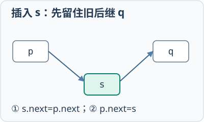

# 数据结构与算法：重点与易错
## 第1章 绪论与算法分析
### 数据结构与复杂度
- 🔴 **核心知识**：逻辑结构描述元素关系，存储结构描述机器表示；时间复杂度关注基本操作次数随规模n的增长趋势。
- 🔵 **方法与例题**：先确定规模和基本操作，再数执行次数；1+2+…+n属于O(n²)，每次范围减半通常属于O(log n)。
- ⚫ **易混易错**：O记号不是精确秒数；顺序代码取最大项，嵌套循环要看实际边界，不能见两层就直接写O(n²)。

## 第2章 线性表
### 顺序表
- 🔴 **核心知识**：顺序表连续存储，按下标访问O(1)；中间插入和删除需要移动后续元素，通常为O(n)。
- 🔵 **方法与例题**：在下标i插入时从表尾向右移动，删除时从i后一位开始左移；移动方向错会覆盖尚未保存的数据。
- ⚫ **易混易错**：动态数组尾部追加是均摊O(1)，扩容当次仍可能O(n)；容量、长度和最后元素下标不是同一个量。

### 链表

- 🔴 **核心知识**：链表用指针连接结点；已知前驱时插删可O(1)，按位置寻找前驱仍需O(n)。
- 🔵 **方法与例题**：在p后插入s先令s.next=p.next，再令p.next=s；删除后继时先保存待删结点，再跨过并释放。
- ⚫ **易混易错**：两条插入语句颠倒会丢失原后继；双链表要同时修改两个方向，头结点是否存数据按题目约定。

## 第3章 栈、队列、串与数组
### 栈与递归
- 🔴 **核心知识**：栈后进先出，支持入栈、出栈和取栈顶；递归调用栈保存参数、局部变量与返回位置。
- 🔵 **方法与例题**：括号匹配遇左括号入栈、遇右括号与栈顶配对；表达式和DFS题要画出每一步栈内容。
- ⚫ **易混易错**：栈空不能出栈；递归有终止条件仍可能因层数过深溢出，改显式栈不会自动降低复杂度。

### 队列与循环队列

- 🔴 **核心知识**：队列先进先出；循环队列用取模让下标回绕，常用队列实现BFS和任务缓冲。
- 🔵 **方法与例题**：预留一格时，空为front=rear，满为(rear+1) mod m=front，长度为(rear-front+m) mod m。
- ⚫ **易混易错**：队满条件取决于实现；rear可能指下一可写位置，也可能指队尾元素，必须先看题目约定。

### 串与KMP
- 🔴 **核心知识**：KMP利用模式串的相等真前后缀，失配时主串位置不回退，整体时间复杂度为O(n+m)。
- 🔵 **方法与例题**：模式ABABC的前缀函数为0、0、1、2、0；逐字符维护匹配长度，失配就沿前缀表继续回退。
- ⚫ **易混易错**：不同教材的next初值和下标定义不同；空串与空格串不同，字符数也不一定等于编码字节数。

### 数组、稀疏矩阵与广义表
- 🔴 **核心知识**：二维数组映射到连续地址；稀疏矩阵只保存非零三元组；广义表允许元素本身仍是表。
- 🔵 **方法与例题**：行优先偏移为i×列数+j，列优先偏移为j×行数+i，再乘元素字节数并加基址。
- ⚫ **易混易错**：先统一下标起点；三元组不再支持原二维下标直接定位；广义表长度与嵌套深度不能混同。

## 第4章 树与二叉树
### 二叉树性质
- 🔴 **核心知识**：二叉树左右子树有顺序；非空二叉树满足n0=n2+1，高度h最多有2^h-1个结点。
- 🔵 **方法与例题**：完全二叉树从1编号时，结点i的双亲为⌊i/2⌋，左右孩子为2i和2i+1，超出n则不存在。
- ⚫ **易混易错**：二叉树不是度为2的普通树；完全二叉树不等于满二叉树，根层编号会影响高度公式。

### 遍历与树的还原
- 🔴 **核心知识**：先序根左右，中序左根右，后序左右根，层序使用队列；递归写法只改变访问根的位置。
- 🔵 **方法与例题**：先序首项或后序末项确定根，再用中序划分左右子树并递归；结点不重复时可唯一还原。
- ⚫ **易混易错**：只有先序和后序通常不能唯一确定二叉树；划分左右子树时必须保持各序列中的相对次序。

### BST与AVL
- 🔴 **核心知识**：BST保持左小右大，AVL再限制高度差；选择时看动态有序查询是否要求最坏查找高度保证。
- 🔵 **方法与例题**：插入顺序为一条递增序列时，普通BST可能退化为链；AVL则在失衡祖先处旋转恢复高度。
- ⚫ **易混易错**：旋转维持中序顺序而非重新排序全部结点；平衡因子正负约定先声明，不能只靠树的外观判断。

### 堆
- 🔴 **核心知识**：堆是完全二叉树，大根堆父结点不小于孩子；数组中可用下标关系定位父子。
- 🔵 **方法与例题**：插入放末尾后上浮；删除堆顶用末元素替换后下沉；Top K通常维护容量为K的反向堆。
- ⚫ **易混易错**：堆只保证父子偏序，不保证数组整体有序；建堆O(n)，逐个插入建堆通常O(nlogn)。

### 哈夫曼树与B/B+树
- 🔴 **核心知识**：哈夫曼优化带权路径长度，B/B+树优化外存有序查找；两类树的目标与操作不能互相替代。
- 🔵 **方法与例题**：频率不同的符号压缩选哈夫曼；磁盘等值与范围索引选B+树，先把目标写清再选择结构。
- ⚫ **易混易错**：B+树叶层顺序连接服务范围扫描；哈夫曼权大通常靠根，不表示可以拿频率直接当作码长。

### AVL四类旋转
- 🔴 **核心知识**：插入后向上找首个失衡祖先，按路径前两步判LL、RR、LR、RL，再执行对应旋转。
- 🔵 **方法与例题**：30、10、20为LR：先对10左旋使20接到30左侧，再对30右旋，得到20根、10左、30右。
- ⚫ **易混易错**：旋转必须保留被移动的中间子树并更新高度；只转最后插入结点或只做双旋的一半都会出错。

### 哈夫曼合并与WPL
- 🔴 **核心知识**：每轮合并当前最小的两个权值，新权值放回候选集合；所有合并权值之和等于树的WPL。
- 🔵 **方法与例题**：权2、3、7、8先合5，再合12，最后合20；WPL为5+12+20=37，每一步都重选最小两项。
- ⚫ **易混易错**：左右编码0与1可交换但仍需前缀性质；不能只把原权值求和，或按初始排列不重新选最小。

## 第5章 图
### 图的存储
- 🔴 **核心知识**：邻接矩阵空间O(V²)，判断边快；邻接表空间约O(V+E)，适合稀疏图。
- 🔵 **方法与例题**：无向图一条边在矩阵中对称出现，在邻接表中通常存两次；有向图第i行表示从i发出的边。
- ⚫ **易混易错**：邻接点顺序会影响遍历序列；无向图度数和为2E，有向图入度和与出度和都为E。

### DFS与BFS
- 🔴 **核心知识**：DFS沿路径深入回退，BFS逐层扩展；二者都要访问标记，但无权最少边数应优先选BFS。
- 🔵 **方法与例题**：先写邻接顺序，再根据任务选栈或队列；邻接表实现通常O(V+E)，矩阵实现通常O(V²)。
- ⚫ **易混易错**：图不连通时单起点不能覆盖全图，要再选未访问起点；合法序列也可能随邻接顺序改变。

### 最小生成树
- 🔴 **核心知识**：MST在无向带权图中连接全部顶点并最小化总边权；Prim扩点集，Kruskal合并连通分量。
- 🔵 **方法与例题**：稠密图可比较矩阵Prim，稀疏图可按边排序Kruskal；结果有V−1条边且必须连通无环。
- ⚫ **易混易错**：它不保证各点对之间路径最短；图不连通只能得到森林，权值相同也可能存在多棵最优树。

### 最短路径
- 🔴 **核心知识**：无权用BFS，非负单源用Dijkstra，有负边单源可用Bellman-Ford，许多点对查询可用Floyd。
- 🔵 **方法与例题**：先检查方向、负权、起点数量与规模，再选算法；计算时记录中间状态，并说明不可达顶点。
- ⚫ **易混易错**：最短路径不等于MST；可达负环会让相关最短路没有有限值，不能只看算法名称忽略边界。

### 拓扑排序
- 🔴 **核心知识**：拓扑排序给出DAG中满足全部依赖的线性序列，可用入度表与队列实现。
- 🔵 **方法与例题**：先把入度为0的顶点入队，取出后删除其出边，把新产生的入度0顶点继续入队。
- ⚫ **易混易错**：无法输出全部顶点说明有环；拓扑序可能不唯一，多个入度0顶点的选择会影响结果。

### DFS深入与回退
- 🔴 **核心知识**：DFS进入顶点便标记，依邻接顺序递归；没有未访问邻点时返回上一层继续其余分支。
- 🔵 **方法与例题**：图A连B/C、B连D，按字母序从A出发，栈路径A→B→D，D走完回B再回A，最后访问C。
- ⚫ **易混易错**：回退不是再次输出旧顶点；存在环必须先标记再深入，显式栈还要注意压入顺序与递归顺序。

### BFS入队与层次
- 🔴 **核心知识**：BFS用队列保存已发现未展开顶点，发现即标记并入队；无权图首次发现的边数最少。
- 🔵 **方法与例题**：A连B/C，B连D：处理A后队列[B,C]，处理B后[C,D]，C之后才处理D，对应先近后远。
- ⚫ **易混易错**：等到出队才标记可能让同点重复入队；边权不同不能只数层数，需要另选适合的最短路算法。

### Prim跨集合选边
- 🔴 **核心知识**：以起点构成集合S，每轮选一端在S内另一端在外的最小边，把新端点并入S后重新检查。
- 🔵 **方法与例题**：AB2、AC5、BC1：从A先选AB2，S变{A,B}，再选BC1；不能一开始就选两端都在外的BC。
- ⚫ **易混易错**：候选边来自整个已接通集合，不仅是刚加入顶点；两端都在S内的边会成环，不能再选入。

### Kruskal排序与判环
- 🔴 **核心知识**：先按全部边权升序检查，只有两端属于不同分量才选，并用并查集合并，选满V−1条结束。
- 🔵 **方法与例题**：AB2、AC5、BC1先取BC1，再取AB2，三点已连通，之后AC5被跳过，因为两端已在同一分量。
- ⚫ **易混易错**：按全局最小边不等于永远接受该边；排序只给检查顺序，还必须执行判环并核对全图是否连通。

### Dijkstra确定与松弛
- 🔴 **核心知识**：边权非负时，每轮确定暂定累计距离最小的未确定点，再用该点距离加边权松弛邻点。
- 🔵 **方法与例题**：A到B2、A到C5、B到C1：先确定B的2，再把C从5改为3，不能把最小单边当最小累计距离。
- ⚫ **易混易错**：负边会破坏确定后不再改变的保证；恢复路径沿前驱倒推再反转，不可达点保留无穷距离。

### Bellman-Ford逐轮扫描
- 🔴 **核心知识**：对所有边反复松弛，至多V−1轮；再扫描仍能改善则存在从源点可达的负权环。
- 🔵 **方法与例题**：A→B2、A→C5、B→C−1，同步两轮距离先[0,2,5]，再把C改1；每轮必须说明读取哪个数组。
- ⚫ **易混易错**：原地更新一轮可传播多条边，与同步表中间状态不同；不可达负环不在本源点检测保证范围。

### Floyd开放中转点
- 🔴 **核心知识**：初始化两点距离矩阵，依次允许k作中转，更新Dij=min(Dij,Dik+Dkj)，k必须在最外层。
- 🔵 **方法与例题**：AB2、BC1、AC5，允许B中转后AC=min(5,2+1)=3；每轮说明当前允许了哪些中间顶点。
- ⚫ **易混易错**：不能把三重循环随意交换；最终对角线为负提示负环，相关点对不能继续解释为有限最短路。

## 第6章 查找
### 二分查找
- 🔴 **核心知识**：二分要求数据有序并支持随机访问，每次用mid排除一半区间，时间O(log n)。
- 🔵 **方法与例题**：保持low≤high；小于目标令low=mid+1，大于目标令high=mid-1，相等时返回。
- ⚫ **易混易错**：普通链表即使有序也没有数组二分的访问代价；边界少加或少减1可能造成死循环。

### 散列查找
- 🔴 **核心知识**：散列函数把键映射到槽位，冲突用开放定址或拉链处理；性能受函数和装填因子影响。
- 🔵 **方法与例题**：线性探测从初始地址逐槽检查；查找沿同一路径，遇到从未使用的空槽才可判失败。
- ⚫ **易混易错**：开放定址删除不能直接置空；平均O(1)不是最坏保证，散列表也不适合范围查询。

## 第7章 内部排序
### 插入、冒泡与选择排序
- 🔴 **核心知识**：插入扩展有序前缀，冒泡交换相邻逆序对，选择寻找剩余极值；不同一趟不能套同一结果。
- 🔵 **方法与例题**：先声明升降序和扫描方向，再画有序区；小规模基本有序常选插入，稳定要求排除简单选择。
- ⚫ **易混易错**：一次输入没有交换相等元素不能证明稳定；一趟只保证局部目标，不等于整个数组已经有序。

### 快速排序
- 🔴 **核心知识**：快速排序用枢轴划分两部分再递归；平均O(nlogn)，最坏O(n²)，通常不稳定。
- 🔵 **方法与例题**：末项作枢轴、按小于枢轴移左的规则，[4,1,3,2]一趟成[1,2,3,4]，枢轴2定位；之后递归处理两侧。
- ⚫ **易混易错**：不同划分法的交换顺序可能不同；不能把划分后的两侧误认为已经完全有序。

### 归并排序
- 🔴 **核心知识**：归并先排好子序列，再用双指针合并；最坏O(nlogn)，常规实现稳定但需辅助空间。
- 🔵 **方法与例题**：比较两个有序段首元素，把较小者写入结果；一段耗尽后复制另一段剩余元素。
- ⚫ **易混易错**：相等时先取左段才能保持稳定；外部排序是生成有序段后再多路归并。

### 堆、希尔、基数与排序选择
- 🔴 **核心知识**：堆保证最坏O(nlogn)且原地；希尔按增量分组插入；基数依赖有限位数和逐位稳定分配。
- 🔵 **方法与例题**：最坏界与小空间可选堆；整数定长键可评估基数；仍需结合稳定性、键类型、规模再决定。
- ⚫ **易混易错**：堆、希尔通常不稳定，基数性能依赖位数和基数；名称相近并不表示步骤可以相互替换。

### 插入排序扩有序区
- 🔴 **核心知识**：左侧前缀保持有序，每次取下一元素为暂存值，从右向左移走比它大的项，再放回空位。
- 🔵 **方法与例题**：[5,2,4,3]先插2得[2,5,4,3]，再插4得[2,4,5,3]，有序前缀逐趟增长而非交换到末尾。
- ⚫ **易混易错**：必须暂存待插元素再搬移，稳定实现只移动严格大于它的项；比较次数与元素移动次数不同。

### 冒泡与选择的一趟
- 🔴 **核心知识**：升序左到右冒泡将最大值送尾；简单选择先找最小值，再与当前未排区首项做一次交换。
- 🔵 **方法与例题**：[5,2,4,3]冒泡一趟[2,4,3,5]，选择一趟[2,5,4,3]，分别圈出已确定的尾和首元素。
- ⚫ **易混易错**：看到两两比较不一定是冒泡，必须看相邻交换；简单选择的远距离交换可能改变同键先后。

### 堆排序取顶与下沉
- 🔴 **核心知识**：升序先建大根堆，每次交换堆顶和未排区末项，缩小堆，再与较大孩子交换恢复堆性质。
- 🔵 **方法与例题**：[5,3,4,2]取5后变[2,3,4|5]，让2与4交换成[4,3,2|5]；竖线右侧不再参与调整。
- ⚫ **易混易错**：不是与任意一个孩子交换；堆只保证父子偏序，建堆O(n)与逐项插入的O(nlogn)不能混淆。

### 希尔排序按增量分组
- 🔴 **核心知识**：对相隔gap的元素做插入排序，逐次缩小增量直至1；同一组在数组中并非连续小片段。
- 🔵 **方法与例题**：[5,2,4,3]取gap2分成(5,4)与(2,3)，组内排后交错回填[4,2,5,3]，再用gap1。
- ⚫ **易混易错**：增量序列影响效率，不能统一背成固定O(nlogn)；跨组远移也使常规实现不保证稳定。

### 基数排序稳定收集
- 🔴 **核心知识**：最低位优先时从低位到高位分桶，每一轮按桶序收集，桶内保留上轮相对顺序。
- 🔵 **方法与例题**：[21,13,12]按个位变[21,12,13]，再按十位变[12,13,21]，每轮只改变当前位优先关系。
- ⚫ **易混易错**：桶内不稳定会破坏已排低位；复杂度依赖位数d与桶数r，不是任意键都能直接线性排序。

## 第8章 数据结构与算法选择
### 场景中的结构与算法选择
- 🔴 **核心知识**：先圈结果要求，再检查有序、边权、连通性、数据规模和内存限制；答案写算法与条件。
- 🔵 **方法与例题**：等值查散列，范围查B+树，Top K用堆，前缀查Trie，动态连通用并查集，无权最短路用BFS。
- ⚫ **易混易错**：不要见“最小”就选同一算法，也不要只背平均复杂度；资源限制不同会改变选择。
