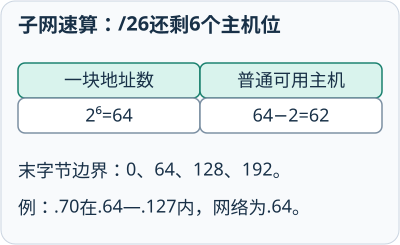
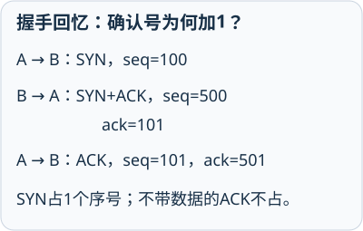
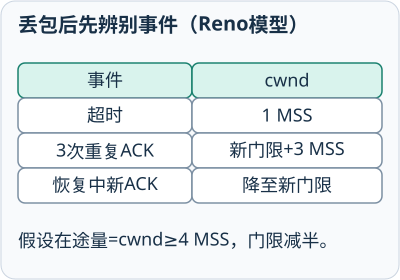

# 计算机网络：重点与易错
## 第1章 概述

### 网络组成、功能与拓扑

- 🔴 **核心知识**：网络由端系统、通信链路、交换设备和协议组成；核心任务是通信与资源共享。

- 🔵 **方法与例题**：范围看PAN/LAN/MAN/WAN；拓扑看总线、星型、环型、树型、网状。

- ⚫ **易混易错**：分类维度不能混用；物理拓扑与数据实际流动方式也可能不同。

### 速率、带宽与时延

- 🔴 **核心知识**：总时延由发送、传播、处理和排队时延构成；吞吐量通常不超过瓶颈链路能力。

- 🔵 **方法与例题**：发送时延 `L/R`；传播时延 `d/v`。先统一 bit、Byte、s、ms 再计算。

- ⚫ **易混易错**：发送时延取决于数据量和速率，传播时延取决于距离和传播速度。

### 电路交换与分组交换

- 🔴 **核心知识**：电路交换先建立专用通路；分组交换把数据分组并共享链路，是互联网的基础。

- 🔵 **方法与例题**：突发数据优先考虑分组交换；稳定持续业务可比较固定资源与时延要求。

- ⚫ **易混易错**：分组交换利用率高，但可能排队、丢包、乱序；存储转发会产生逐跳发送时延。

### 分层与地址

- 🔴 **核心知识**：应用、运输、网络、链路、物理层分别解决应用服务、进程通信、跨网转发、本跳交付和比特传输。

- 🔵 **方法与例题**：域名便于记忆，IP定位接口，MAC完成本跳交付，端口定位进程。

- ⚫ **易混易错**：路由器转发时通常更换链路层首部，端到端IP与运输层信息按协议继续传递。

### 协议、服务与封装

- 🔴 **核心知识**：协议规定同层实体的通信规则；服务是下层向上层提供的能力；封装是逐层加入控制信息。

- 🔵 **方法与例题**：发送：数据→段→IP数据报→帧→比特；接收按相反顺序解封装。

- ⚫ **易混易错**：协议不是服务；封装不是复制原数据；每层只解释本层控制信息。

## 第2章 物理层

### 介质与传输方向

- 🔴 **核心知识**：双绞线便宜易布线，光纤高速抗干扰，无线部署灵活；单工、半双工、全双工描述通信方向。

- 🔵 **方法与例题**：根据距离、速率、干扰、成本和移动性选介质；全双工可同时双向传输。

- ⚫ **易混易错**：“无线”不等于“移动”；光纤抗电磁干扰，但仍受弯折、连接和光功率影响。

### 比特率、码元速率与复用

- 🔴 **核心知识**：比特率单位bit/s，码元速率单位Baud；一个M状态码元理想携带 `log₂M` bit。

- 🔵 **方法与例题**：`Rb=Rs log₂M`；FDM分频带、TDM分时隙、WDM分波长、CDM分码片。

- ⚫ **易混易错**：Baud不能直接写成bit/s；WDM是光纤中的波长复用，不是新的交换方式。

### 信道容量与信噪比

- 🔴 **核心知识**：奈氏给理想无噪声低通信道上限，香农给有噪声信道容量上限。

- 🔵 **方法与例题**：奈氏 `2B log₂M`；香农 `C=B log₂(1+S/N)`；dB先转线性比 `10^(dB/10)`。

- ⚫ **易混易错**：B单位Hz，C单位bit/s；不能把20 dB直接当线性信噪比20代入。

## 第3章 数据链路层

### 帧、交换与VLAN

- 🔴 **核心知识**：链路层负责成帧、透明传输、差错检测和介质访问；交换机按源MAC学习、按目的MAC转发。

- 🔵 **方法与例题**：已知单播只发对应端口；未知单播和广播向除入端口外的同VLAN端口泛洪。

- ⚫ **易混易错**：交换机端口划分冲突域；VLAN划分广播域；不同VLAN通信需要三层转发。

### CRC差错检测

- 🔴 **核心知识**：CRC把数据补零后做模2除法，用余数形成校验字段；它用于检错，不直接纠错。

- 🔵 **方法与例题**：生成多项式最高次数为r：补r个0→模2除→取r位余数→附到数据后。

- ⚫ **易混易错**：模2减法就是异或，不借位；接收余数为0也不能证明绝对无差错。

### 停等与滑动窗口

- 🔴 **核心知识**：停等一次只允许一个未确认帧在途；滑动窗口允许连续发送，提高长时延链路利用率。

- 🔵 **方法与例题**：简化停等利用率 `T发送/(T发送+往返传播时间)`；窗口可发送量要扣除在途未确认数据。

- ⚫ **易混易错**：GBN常累计确认并回退重传；选择重传缓存乱序帧，只补缺失帧。

### 以太网与无线接入

- 🔴 **核心知识**：共享半双工以太网用CSMA/CD；交换式全双工以太网无碰撞；802.11主要用CSMA/CA。

- 🔵 **方法与例题**：有线看冲突检测与退避；无线看侦听、随机退避、ACK及可选RTS/CTS。

- ⚫ **易混易错**：不能把CSMA/CD套到现代全双工交换链路，也不能说CSMA/CA保证绝对无碰撞。

## 第4章 网络层

### 子网与路由

- 🔴 **核心知识**：CIDR前缀确定网络位；IP与掩码按位AND得网络地址，块首为网络地址、块尾为广播地址。

- 🔵 **方法与例题**：主机需求先求 `2^h-2`；块大小 `2^h`；VLSM按需求从大到小分配并对齐边界。

- ⚫ **易混易错**：前缀越长，子网越多但每网地址越少；地址块不能重叠，网络地址必须落在块边界。

### ARP与逐跳转发

- 🔴 **核心知识**：ARP只在本地链路把下一跳IP解析为MAC；同网查目的主机，异网查默认网关。

- 🔵 **方法与例题**：先用掩码判断同网，再确定下一跳，最后查询下一跳MAC并封装帧。

- ⚫ **易混易错**：ARP不会查询远端主机MAC；跨路由器时链路层地址逐跳改变。

### 最长前缀匹配与路由协议

- 🔴 **核心知识**：转发表有多条匹配时选择前缀最长者；RIP、OSPF、BGP分别服务不同路由范围和机制。

- 🔵 **方法与例题**：写出目的IP二进制高位，与各前缀比较；选匹配位数最多的表项。

- ⚫ **易混易错**：默认路由 `/0` 只在没有更具体匹配时使用；协议不同不能只比较“跳数”。

### IPv4与IPv6地址

- 🔴 **核心知识**：IPv4为32位，IPv6为128位；IPv6取消广播，使用组播和任播，路由器不执行分片。

- 🔵 **方法与例题**：IPv6每段省前导0，连续全0只能压缩一次 `::`；IPv4分片偏移单位为8B。

- ⚫ **易混易错**：IPv6地址长度不等于首部长度；IPv6基本首部40B；IPv4私有地址通常需NAT访问公网。

### RIP距离向量更新

- 🔴 **核心知识**：RIP按跳数度量，邻居报告距离加1形成候选距离，16跳表示不可达。

- 🔵 **方法与例题**：逐项记录目的网、旧下一跳、邻居报告、加1后的候选值和最终下一跳。

- ⚫ **易混易错**：原下一跳若报告距离变大也要更新；其他邻居出现更短候选时再切换。

### IPv4分片的长度与偏移
- 🔴 **核心知识**：每片首部占用MTU，非末片数据取8B整数倍；偏移按原始数据部分起点以8B为单位计数。
- 🔵 **方法与例题**：数据2000B、MTU620B、首部20B，数据片600、600、600、200，偏移0、75、150、225。
- ⚫ **易混易错**：总长度还要加各片首部；MF仅末片为0。IPv6中间路由器不分片，应返回Packet Too Big。

## 第5章 运输层

### TCP与UDP

- 🔴 **核心知识**：UDP无连接、面向报文、机制简单；TCP面向连接，提供可靠有序的全双工字节流。

- 🔵 **方法与例题**：实时或简单查询常选UDP；要求可靠按序时常选TCP，但业务消息边界和幂等仍由应用处理。

- ⚫ **易混易错**：TCP可靠不等于业务请求只执行一次；UDP无连接也不等于完全不能实现可靠应用。

### TCP序号、确认与连接建立

- 🔴 **核心知识**：TCP按字节编号，确认号表示下一期待字节；SYN和FIN各占一个序号。

- 🔵 **方法与例题**：三次握手：SYN(x)→SYN+ACK(y,x+1)→ACK(y+1)；载荷n字节通常使下一序号加n。

- ⚫ **易混易错**：纯ACK不占序号；四次挥手源于两个方向独立关闭；主动关闭方通常进入TIME_WAIT。

### 流量控制与拥塞控制

- 🔴 **核心知识**：流量控制保护接收端，拥塞控制保护网络；实际发送上限受 `min(rwnd,cwnd)` 约束。

- 🔵 **方法与例题**：可新增发送量 `max(0,min(rwnd,cwnd)-在途未确认量)`；慢开始后进入拥塞避免。

- ⚫ **易混易错**：接收窗口很大不代表网络不拥塞；快重传、快恢复和超时处理不能混为同一步。

### 拥塞窗口逐轮变化
- 🔴 **核心知识**：教材Reno简化：慢开始每RTT近翻倍，达ssthresh转每轮加1MSS；三重复ACK快重传并进入快恢复。
- 🔵 **方法与例题**：在途10MSS丢失：门限取5；三重复ACK时cwnd暂取5+3=8，新ACK到来降至5；超时则cwnd回1。
- ⚫ **易混易错**：门限减半按在途量并有2MSS下限；快恢复不能按超时处理。增长受ACK数量与实现限制，应先按题设。

## 第6章 应用层

### 名称、配置与应用服务

- 🔴 **核心知识**：DNS解析名字，DHCP提供地址配置，HTTP传Web内容，SMTP发邮件，POP3/IMAP取邮件。

- 🔵 **方法与例题**：先判断任务是解析、配置、请求资源、发送邮件还是读取邮件，再匹配协议和端口。

- ⚫ **易混易错**：端口是默认约定而非服务本身；HTTPS是HTTP经TLS保护，不代表内容必然可信。

### HTTP状态与排障

- 🔴 **核心知识**：HTTP是请求—响应协议；2xx成功、3xx重定向、4xx客户端侧、5xx服务器侧。

- 🔵 **方法与例题**：非持续TCP获取小对象的简化模型约 `2RTT+L/R`，只在题目明确忽略其他时延时使用。

- ⚫ **易混易错**：404通常是资源不存在，不等于DNS故障；收到HTTP状态码说明请求已到达应用响应阶段。

### DNS解析与DHCP配置

- 🔴 **核心知识**：DNS把域名映射到地址；DHCP通过Discover、Offer、Request、ACK自动提供网络参数。

- 🔵 **方法与例题**：能访问IP不能访问域名先查DNS；出现169.254地址先查链路、DHCP服务和中继。

- ⚫ **易混易错**：DNS故障不会直接把主机地址改成169.254；递归查询和迭代查询的责任主体不同。

### DNS递归与迭代查询
- 🔴 **核心知识**：主机通常向本地递归解析器要最终结果；解析器缓存未命中时，可依次向根、顶级和权威服务器迭代。
- 🔵 **方法与例题**：查www.example.com：先看缓存，解析器再逐级取得转介与地址，最后把结果返回主机并按TTL缓存。
- ⚫ **易混易错**：根通常返回转介，不保存每个站点地址；主机不必预知根服务器名，递归与迭代要看谁负责继续查。

### DHCP租约获取流程
- 🔴 **核心知识**：首次获取常用Discover、Offer、Request、ACK，依次寻找服务器、提供方案、选择请求、确认租约。
- 🔵 **方法与例题**：主机先广播Discover，收到Offer后广播Request表明选择，再由服务器ACK确认地址与掩码等参数。
- ⚫ **易混易错**：DHCP分配配置而非解析域名；续租不必重做完整广播流程，169.254地址只是自动配置失败的常见线索。

### TCP Socket收发与消息边界
- 🔴 **核心知识**：客户端连接指定主机端口，服务端绑定监听再accept；双方在已连接套接字上发送字节并关闭资源。
- 🔵 **方法与例题**：Python用with管理socket，sendall尽力发完给定字节；recv可能只返回一部分，按约定长度或分隔符循环收。
- ⚫ **易混易错**：TCP提供字节流，不保留send调用边界；recv返回空字节通常表示对端有序关闭，不是完整业务消息。

## 第7章 网络安全

### 防火墙与安全边界

- 🔴 **核心知识**：防火墙控制流量，IDS检测告警，IPS可主动阻断，TLS保护传输，VPN构建逻辑专用网络。

- 🔵 **方法与例题**：先明确保护目标和部署位置，再选择访问控制、检测、加密或隔离机制。

- ⚫ **易混易错**：VPN不自动保证终端安全；HTTPS不证明网站内容正确；代理不等于防火墙。

### 加密、摘要与数字签名

- 🔴 **核心知识**：加密保护机密性，摘要检测变化，签名验证来源与完整性，证书绑定身份和公钥。

- 🔵 **方法与例题**：大量数据常用对称加密；非对称机制常用于身份鉴别和会话密钥协商。

- ⚫ **易混易错**：签名不隐藏内容，加密不自动证明来源；MD5、DES旧题知识不能作为现代部署推荐。

### 按层定位

- 🔴 **核心知识**：排障按链路→IP配置→网关→公网IP→DNS→端口→应用响应逐层缩小范围。

- 🔵 **方法与例题**：每一步选一个验证工具：配置用ipconfig，连通用ping，路径用tracert，解析用nslookup。

- ⚫ **易混易错**：ping失败可能只是ICMP被过滤；ping成功也不能证明HTTP端口和业务正常。

## 第8章 互联网上的音频/视频服务

### 流媒体、实时传输与QoS

- 🔴 **核心知识**：流媒体边收边播；实时体验同时受吞吐量、时延、抖动、丢包和缓冲影响。

- 🔵 **方法与例题**：缓冲耗尽时间＝现有缓冲数据量÷(媒体消耗速率−网络输入速率)，只在消耗更快时计算。

- ⚫ **易混易错**：RTP不保证可靠重传；平均带宽足够仍可能因短时波动或抖动造成卡顿。

### 播放缓冲耗尽计算
- 🔴 **核心知识**：消费速率高于持续输入速率时，缓冲按两者差值减少；耗尽时间为现有数据量除以净消耗速率。
- 🔵 **方法与例题**：缓冲24Mbit、播放4Mbit/s、输入3Mbit/s，净消耗1Mbit/s，约24秒后耗尽。
- ⚫ **易混易错**：先统一bit与Byte；输入不低于消费时不能套正耗尽时间。可变速率需分阶段算，缓冲会增加启动等待。

## 第9章 无线网络和移动网络

### WLAN、无线接入与移动网络

- 🔴 **核心知识**：WLAN通过AP接入；802.11用侦听、随机退避和ACK避免冲突；移动网络还处理位置与切换。

- 🔵 **方法与例题**：比较无线方案时看频段、覆盖、干扰、信道和终端；隐藏站可用RTS/CTS缓解。

- ⚫ **易混易错**：AP不等于完整路由器；隐藏SSID不等于安全；无线与移动不是同义词。
