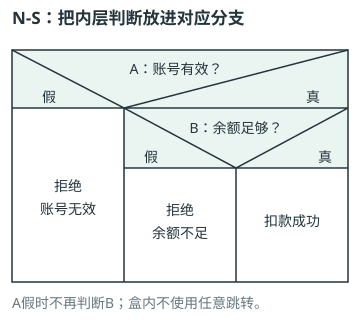
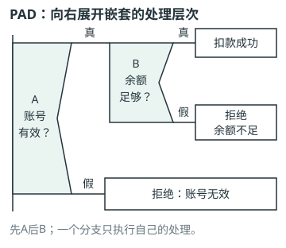
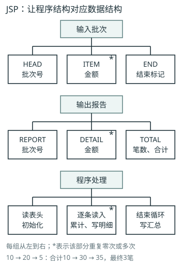

# 软件工程：重点与易错

## 第1章 软件工程概述

### 软件危机与工程化

- 🔴 **核心知识**：软件=程序+数据+相关文档；危机表现含进度、成本、质量、维护和文档问题。工程化以系统、规范、可度量方法贯穿生命周期。
- 🔵 **方法与例题**：方法提供技术做法、工具自动支撑、过程组织活动和控制；从需求到发布保留可追踪证据。
- ⚫ **易混易错**：软件无物理磨损但修改和环境变化会致失效；工程管理不等于只写文档或只追进度。

### 生命周期与验证确认

- 🔴 **核心知识**：生命周期从问题提出到退役；验证检查是否符合规定要求，确认检查是否满足预期用途和用户需要。
- 🔵 **方法与例题**：需求→设计→实现→测试→运行维护，阶段可迭代；设计评审属验证，业务验收提供确认依据。
- ⚫ **易混易错**：测试只是证据之一，验证/确认也可用评审和分析；维护不是生命周期之外的额外阶段。

## 第2章 软件过程与生命周期模型

### 过程模型选择

- 🔴 **核心知识**：瀑布分阶段/基线，原型澄清需求，增量逐步交付，螺旋由风险分析驱动迭代。
- 🔵 **方法与例题**：需求稳定/审查强可阶段控制；交互不清先原型；可拆功能用增量；技术风险高先验证高风险。
- ⚫ **易混易错**：模型可组合；迭代是反复完善，增量是增加功能；原型不必直接演变为产品。

### 敏捷、迭代与持续集成

- 🔴 **核心知识**：敏捷重反馈与适应，统一过程常用用例驱动/架构中心/迭代增量；持续集成频繁合入并自动检查。
- 🔵 **方法与例题**：短周期计划→实现测试→展示反馈→调整；持续交付保持可发布，持续部署进一步自动发布。
- ⚫ **易混易错**：敏捷不等不要文档/设计/计划，持续集成不等于把未测代码频繁上线。

## 第3章 可行性研究与需求工程

### 可行性与成本效益

- 🔴 **核心知识**：可行性检查技术、经济、操作及社会等条件，比较候选方案形成继续/调整/终止建议。
- 🔵 **方法与例题**：初投20万、年净收益8万，忽略时间价值静态回收期2.5年；计成本含开发、运行、维护、退出。
- ⚫ **易混易错**：静态回收期不等净现值；非量化合规/公共价值也须说明，不能只看开发费。

### 需求获取、质量与变更

- 🔴 **核心知识**：获取、分析、规格化、验证、管理组成需求工程；功能描述做什么，非功能描述质量条件，约束限定方案。
- 🔵 **方法与例题**：把“快”改为“500并发、100万记录下95%查询2秒内返回”，给条件、度量、阈值。
- ⚫ **易混易错**：正确、完整、一致、明确、可验证、可追踪；冲突须协商确认，不由开发私选。

### DFD、数据字典与需求模型

- 🔴 **核心知识**：DFD含外部实体、加工、数据流、数据存储；数据字典统一数据项/结构/流/存储定义。
- 🔵 **方法与例题**：父加工输入输出与子图边界保持平衡；数据/功能/行为模型分别描述结构、加工和状态事件。
- ⚫ **易混易错**：DFD箭头是数据流，不是控制先后；与程序流程图、UML图分清。

### 有穷状态机与需求约束

- 🔴 **核心知识**：状态机以状态、事件、初态、转移和条件描述行为；前置/后置及不变式补足操作约束。
- 🔵 **方法与例题**：图书可借+合格借出→借出；借出+归还→可借；不变式为一册最多一条未归还记录。
- ⚫ **易混易错**：未定义迁移不能默认允许；行为模型与DFD数据流不同，画图不自动证明实现满足约束。

## 第4章 总体设计与详细设计

### 总体设计与详细设计

- 🔴 **核心知识**：总体设计定架构、模块、全局数据和接口；详细设计定模块内部算法和局部数据。
- 🔵 **方法与例题**：读成绩→算均分→报表分三模块；MVC中控制器接查询→模型按规则取成绩→视图显示，属逻辑职责。
- ⚫ **易混易错**：模块调用结构不等组织架构；详细设计不能只留下函数名却无算法和异常处理。

### 内聚、耦合与信息隐藏

- 🔴 **核心知识**：内聚衡量模块内部联系，耦合衡量模块间依赖；信息隐藏把易变实现决定放到接口之后。
- 🔵 **方法与例题**：内聚常见弱到强：偶然、逻辑、时间、过程、通信、顺序、功能。只需金额却传整份客户记录为标记耦合。
- ⚫ **易混易错**：低耦合不等零通信；只凭函数长短/名字不能判内聚，private也不自动代表职责正确。

### 面向对象分析设计与UML

- 🔴 **核心知识**：对象含身份、状态和行为，类概括共同结构/操作；封装、继承、多态组织实现。
- 🔵 **方法与例题**：学生可多次借书：Student、BookCopy、Loan；日期归Loan；类图看结构，顺序图看消息，状态图看迁移。
- ⚫ **易混易错**：继承表达is-a，关联/组合表达联系与拥有；DFD不是UML，图书实体副本不等书目。

### 借阅对象与协作建模

- 🔴 **核心知识**：对象含身份/状态/行为；分析识别业务对象，设计明确职责/接口/协作，并由测试核验。
- 🔵 **方法与例题**：Student、BookCopy、Loan，日期放Loan；1学生有0..*次Loan，每Loan属1学生/1副本；服务协调借出记录和副本状态。
- ⚫ **易混易错**：继承是is-a；has-a应用关联/聚合/组合按生命周期判断；一个名词不一定独立成类。

### 嵌套判断的N-S与PAD图

- 🔴 **核心知识**：N-S用封闭盒的分区和嵌套表示选择，无流程箭头；PAD从左侧主干自上而下，向右展开分支层次。
- 🔵 **方法与例题**：先判账号A，仅A真再判余额B；TT扣款成功，TF余额不足，FT与FF均账号无效。内层B只属于A真分支。
- ⚫ **易混易错**：分支只执行选中一路，不能看见B真就跳过A；PAD折角不是普通流程图菱形，N-S不能画成盒外箭头连接。

### Jackson数据结构到程序结构

- 🔴 **核心知识**：JSP从输入输出数据结构组织程序，顺序对应依次处理，重复记录对应循环；不与Jackson系统开发JSD混同。
- 🔵 **方法与例题**：HEAD→ITEM重复→END，映射初始化→逐条累计→汇总；金额10、20、5使(count,sum)依次为(1,10)、(2,30)、(3,35)。
- ⚫ **易混易错**：每次循环要读下一条；HEAD后立即END应零次循环并输出0笔0合计，不能把DFD变换分析当同一方法。

### 界面的一致性、反馈与错误恢复

- 🔴 **核心知识**：同一业务术语与操作保持一致，提交时说明处理中或结果，输入错误应指出位置和修正方式并允许继续。
- 🔵 **方法与例题**：金额−20提示须大于0，保留收款人等非敏感输入；改正提交后显示处理状态，得到确定结果才给回执。
- ⚫ **易混易错**：禁用按钮不保证服务只执行一次；超时先查状态，勿直接认失败重交；保留输入不包括回显密码和验证码。

## 第5章 软件实现与软件测试

### 黑盒测试设计

- 🔴 **核心知识**：依据规格划有效/无效等价类、选边界及邻值，条件组合可用判定表。
- 🔵 **方法与例题**：年龄18…60：17/18/19/59/60/61；账号有效与余额足够列TT/TF/FT/FF四规则。
- ⚫ **易混易错**：每用例含前置、输入/操作、预期；只测30未覆盖边界，多个无效条件混在一例会遮蔽原因。

### 白盒覆盖与环形复杂度

- 🔴 **核心知识**：语句覆盖看语句，判定覆盖看各真假出口，条件覆盖看各基本条件取值，基本路径看线性独立路径。
- 🔵 **方法与例题**：单连通控制流图V=E−N+2；二分判定图也可判定数+1。A or B用(T,F)/(F,T)不满足判定假出口。
- ⚫ **易混易错**：优先明确短路模型；判定/条件覆盖一般互不包含，基本路径不等全部路径。

### 测试层次、集成与调试

- 🔴 **核心知识**：单元检查模块，集成检查协作，系统检查整体，验收确认业务目标；调试定位修复缺陷。
- 🔵 **方法与例题**：自顶向下用桩替代下层，自底向上用驱动模拟上层；修改后重跑受影响测试为回归。
- ⚫ **易混易错**：回归可贯穿各层，不是固定第五层；高覆盖不证明缺失需求已被检测。

### 语句与判定覆盖辨别

- 🔴 **核心知识**：语句覆盖要求每条可执行语句至少一次，判定覆盖要求判定的真/假结果都出现。
- 🔵 **方法与例题**：y=0;if x>0:y=1;输出y，x=1已执行全部语句；再加x=0才覆盖假出口，分别输出1/0。
- ⚫ **易混易错**：输出语句是否受if控制先看语法/缩进；全部语句执行不等所有分支都测过。

### 控制流图环形复杂度

- 🔴 **核心知识**：E为控制流边数，N为结点数，单连通函数V(G)=E−N+2，给独立路径数。
- 🔵 **方法与例题**：两个独立if的示例有6结点7边，V=3；取假假、真假、假真三路径，逐条引入新分支，真真另属组合路径。
- ⚫ **易混易错**：多出口switch不能机械当一个二分判定；不可达路径不能编造输入覆盖，复杂度不等路径覆盖率。

## 第6章 软件维护、质量与配置管理

### 维护、重构与再工程

- 🔴 **核心知识**：维护含改正、适应、完善、预防；重构保持外部可观察行为改善内部结构，再工程改造已有软件。
- 🔵 **方法与例题**：修缺陷→改正；适配平台→适应；加报表→完善；清理结构降低后患→预防。
- ⚫ **易混易错**：按目的分类而非按改代码行数；同一变更可多目的，逆向恢复设计不等直接生成新实现。

### 质量、基线与受控变更

- 🔴 **核心知识**：质量保证用标准/评审/测试/审计等建立信心；配置管理识别配置项、版本、基线及变更状态。
- 🔵 **方法与例题**：申请→影响分析→批准→实施→验证→更新基线/文档；需求、代码、测试、环境定义均可为配置项。
- ⚫ **易混易错**：基线需正式评审批准并受控修改；有Git不等已有完整配置管理，紧急修复仍要留授权与证据。

## 第7章 项目管理与风险管理

### 估算、计划与关键路径

- 🔴 **核心知识**：WBS分解范围，规模估计与工作量/工期不同；关键路径为无资源冲突模型中最长依赖路径。
- 🔵 **方法与例题**：A2→并行B4/C2→D3，总9，路径A-B-D；C缩1天不改总工期。
- ⚫ **易混易错**：人月不是月份；增加人员有沟通/培训成本，不能简单按人数等比例缩工期。

### 风险、人员与沟通

- 🔴 **核心知识**：风险是尚未发生的不确定事件，问题已发生；管理含识别、分析、应对、监控及责任人。
- 🔵 **方法与例题**：概率0.2、损失10万，暴露2万；应对可规避、减轻、转移、接受，配触发条件和预案。
- ⚫ **易混易错**：概率×损失是期望值非必然损失；安全/声誉等不宜只看金额，晚期加人可能拖慢。

### 关键路径与总工期

- 🔴 **核心知识**：ES/EF最早开始/完成，LS/LF最迟开始/完成；ES=max前驱EF，EF=ES+d；LF=min后继LS，LS=LF−d；TF=LS−ES。
- 🔵 **方法与例题**：A2→B4/C2→D3：ES为0/2/2/6，LS为0/2/4/6，TF为0/0/2/0。
- ⚫ **易混易错**：前推多前驱取最大、后推多后继取最小；多条关键路径可并存，资源冲突须另排程。

### CMM五级与过程改进

- 🔴 **核心知识**：经典CMM五级为初始、可重复、已定义、已管理、优化，分别强调临时执行、项目纪律、组织标准、定量管理、持续改进。
- 🔵 **方法与例题**：项目各有计划只体现可重复特征；组织统一过程并允许受控裁剪体现已定义；统计后找根因并验证改善才有优化证据。
- ⚫ **易混易错**：一条做法不能代替正式评级，成熟度不保证产品无缺陷；CMMI版本和评估规则不同，勿把经典名称当现行认证标准。

## 第8章 面向变化的软件开发方法

### 按证据组合工程方法

- 🔴 **核心知识**：按需求不确定性、交付可拆分性、技术风险及审查条件组合原型、增量、风险验证和受控变更。
- 🔵 **方法与例题**：报表每周变可短迭代+自动回归；受监管结算保留需求批准、追踪、严格测试与发布审计。
- ⚫ **易混易错**：不能仅凭行业标签指定唯一模型；轻量流程仍需关键证据和可恢复发布。

### 追踪、反馈与持续改进

- 🔴 **核心知识**：双向追踪连接目标、需求、设计、实现、测试、发布；度量用于找变化和改进效果。
- 🔵 **方法与例题**：变更一项需求，沿链找受影响模块与用例，修复后回归；迭代比较缺陷、周期和用户反馈。
- ⚫ **易混易错**：代码行/缺陷数量不直接等质量或个人绩效；缺少分母、场景与统计口径的指标可能误导。
