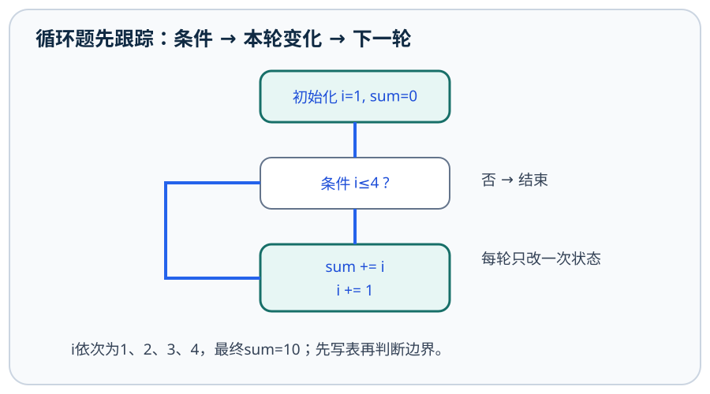
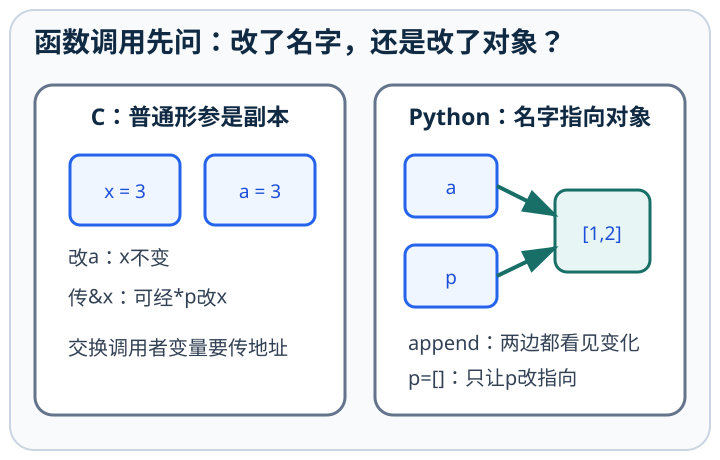
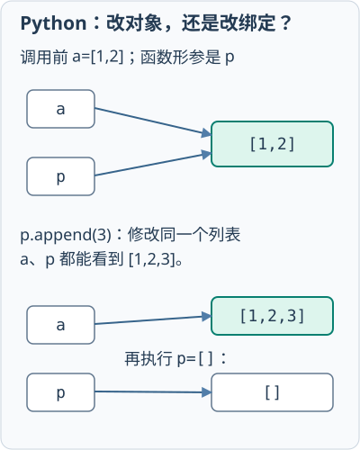
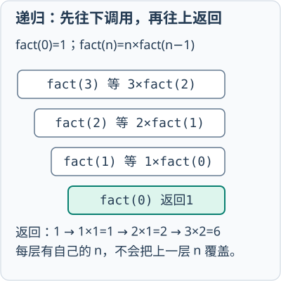
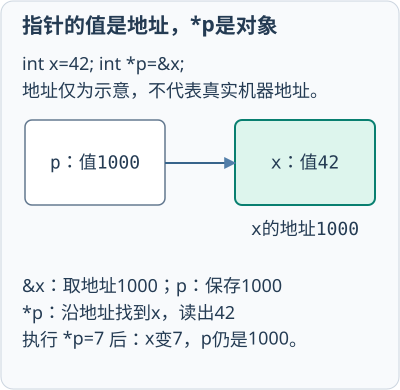
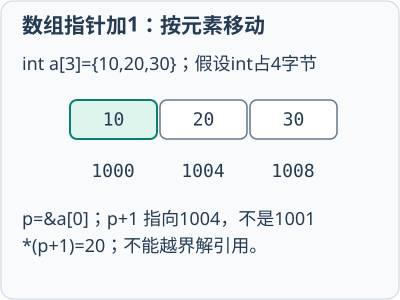
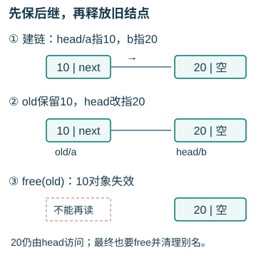

# C与Python程序设计

## 第1章 程序设计与算法
<!-- exam: A | 单选、判断 -->

### 算法、结构与逐句执行

- 🔴 **算法五个特征**：==有穷性要求有限步骤、有限时间内终止==；确定性要求每步含义明确无二义性；可行性要求每步能由有限次基本操作完成；==输入可零个或多个==；==输出须一个或多个==。
- 🔴 **程序与结构化程序设计**：程序是用程序设计语言描述的指令序列；结构化设计采用自顶向下、逐步求精、模块化思想，用顺序、选择和循环三种基本结构组织控制过程。
- ⚫ **语言范围**：本课C例采用现代C的基础规则，Python采用Python 3；语言语义与某个编译器/解释器实现细节分开判断。
<!-- test: 填空、单选、程序阅读 | 区分算法特征、三种结构与错误类型 -->

**先认识语言离机器多近：** 机器语言直接用指令编码；汇编语言以助记符表达机器指令，需要汇编器转换为目标代码；C、Python等高级语言提供更高层的表达。汇编器不是普通文本编辑器，也不等同于把高级语言翻译成机器代码的编译器。

**算法效率先数次数：** 顺序检查n个数寻找最大值需要约n次操作，时间量级`O(n)`；外层i从1到n、内层j从1到i，次数为`1+2+…+n=n(n+1)/2`，量级`O(n²)`；每轮把候选范围减半，约需`log₂n`轮。这里O记号说规模增长时的趋势，不是运行秒数。两段先后执行的线性循环相加仍为O(n)，不是相乘成O(n²)。具体数组和查找将在后续章节继续练。

### 三种基本结构

- 顺序结构：语句按书写顺序依次执行。
- 选择结构：根据条件选择不同分支。
- 循环结构：在条件满足时重复执行某段语句。

结构化程序通常由这三种结构组合而成。

### 基本程序结构

C 程序由函数组成，通常从 `main` 函数开始执行；`#include` 引入头文件声明，语句多以分号结束，`/*...*/` 或 `//` 用于注释。

```c
#include <stdio.h>

int main(void) {
    printf("hello\n");
    return 0;
}
```

Python 程序通常从文件第一条可执行语句开始，使用缩进表示代码块，`#` 后是单行注释。Python 3 区分大小写，缩进层次必须一致。

### 编译与解释

编译通常先把整个源程序翻译成目标程序，再执行；解释通常在运行过程中逐句翻译并执行。现代语言实现可能同时使用编译、字节码和虚拟机，因此“编译型”和“解释型”不是所有实现的绝对二分。

C语言通常先编译再运行；Python常先生成字节码，再由解释器或虚拟机执行。

### 程序错误

- 语法错误：违反语言书写规则，通常不能正常翻译或运行。
- 运行时错误：程序运行过程中发生，如除零、无效下标。
- 逻辑错误：程序能够运行，但结果不符合要求。

测试用于发现错误，调试用于定位并修改错误。

<details><summary>先预测：求最大值时为什么不能把初值固定为0？</summary>

若输入全为负数，0不属于输入却会被保留为“最大值”。非空输入应使用首元素初始化；空输入是否允许也要单独约定。
</details>

#### 自顶向下的任务分解
- 🔵 **完整任务**：读取一组合法成绩、计算均分、输出结果。先分“获取数据→校验→统计→展示”；再把统计细化为sum=0、count=0，逐个合法值更新sum与count，最后count>0才除。输入80、90、非法值−1，若约定拒绝非法值，状态(0,0)→(80,1)→(170,2)，−1不进入统计，均分85。
- ⚫ **边界**：空数据不能除以0；是否跳过非法项或终止程序须由需求明确。模块分解不是任意把连续几行拆成多个函数。

## 第2章 数据类型、变量与常量
<!-- exam: A | 单选、判断、填空 -->

### 类型、变量与转换

- 🔴 **C类型分类**：基本类型包括整型、字符型、浮点型等，另有枚举、void，以及数组、指针、结构体、联合等构造类型；C字符串通常用==以空字符结尾的char数组==表示，不是独立内建string类型。
- 🔴 **对象、变量与名称**：C变量具有声明类型和存储空间；Python名称绑定对象，对象有类型，重新赋值可改变绑定。Python常见基本类型为int、float、bool、str、complex，序列和映射在第8章展开。
- ⚫ **常量边界**：C字符常量如'A'、字符串字面量如"A"、整数常量如10和浮点常量如1.0含义不同；const限制通过该名字修改，不自动等同预处理宏。
<!-- test: 单选、程序阅读 | 判断类型、转换发生次序和数值是否丢失精度 -->

### 标识符

🔴 **标识符**用于给变量、函数命名。基础写法用英文字母/数字/下划线，首字符不能为数字，不能使用关键字，大小写有区别；Python 3还支持符合Unicode规则的非ASCII标识符，不能断言中文名一律非法。

例如 `score_1` 合法，`1score` 不合法；`name` 与 `Name` 是不同标识符。

### 变量与常量

C变量通常在使用前声明类型，例如：

```c
int age = 20;
float score = 85.5f;
```

Python变量通过赋值建立名称与对象的绑定：

```python
age = 20
score = 85.5
```

### 基本数据类型

- 整数：表示没有小数部分的数。
- 浮点数：近似表示带小数的数据。
- 字符：表示单个字符，C常用 `char`。
- 字符串：表示字符序列。
- 布尔：表示真和假，Python用 `True/False`；C条件中常用0表示假、非0表示真。

浮点数采用有限位二进制近似表示，部分十进制小数不能精确存储，因此比较时要注意误差。

C 的常用整数类型有 `short`、`int`、`long`，浮点类型有 `float`、`double`；具体占用字节数与实现有关，可用 `sizeof` 查看，不能在所有平台上把 `int` 固定理解为某一字节数。Python 的名称没有固定声明类型，同一个名称可先后绑定不同类型对象，但对象本身有明确类型，可用 `type()` 查看。

### 类型转换

隐式转换由语言自动完成，显式转换由程序员指定。把范围更大或精度更高的数据转成较小类型时，可能发生溢出或精度损失。C 可用 `(int)x` 转换，Python 常用 `int(x)`、`float(x)`、`str(x)`；Python 的 `int(3.9)` 得到 3，是向 0 截断，不是四舍五入。

**通俗理解：** 接收结果的类型不会倒过来改变已完成的运算。 C中`int a=7,b=2; double x=a/b;`先用两个整数相除并向0截断得到3，才把结果转成double的3.0；`double y=(double)a/b;`先把a转为7.0，b也参与浮点运算，得到3.5。接收变量是double不会倒过来改变已经完成的整数除法，后面再系统学习运算符规则。

<details><summary>先预测：C中`double x=7/2;`得到3.0还是3.5？</summary>

先执行两个int的整数除法得到3，再转成double保存为3.0。若要3.5，应让至少一个操作数先成为浮点数，如`7.0/2`。
</details>

## 第3章 运算符与表达式
<!-- exam: A | 单选、判断、填空、程序阅读 -->

### 运算符与求值顺序

- 🔴 **表达式**：由操作数和运算符按语法规则组成，求值产生值，有些还带修改变量等副作用。==算术、关系、逻辑、赋值、条件、位运算须分清==。
- 🔵 **优先级与求值顺序**：优先级决定怎样结合，结合性处理同级运算符如何分组，都不能普遍决定操作数实际求值先后。C的&&、||、逗号运算符等有明确顺序规则；不要对i++ + i++等未按规则排序的重复修改强算答案。
- ⚫ **安全边界**：现代C有符号整数溢出是未定义行为，除以0无合法数值结果；Python整数可扩展精度仍受资源限制。浮点除法和整数除法必须先看操作数类型。
<!-- test: 程序阅读、过程推演 | 先确定语言和类型，再推短路、自增及余数 -->

### 算术运算

- 🔴 **算术运算**：加、减、乘、除、求余；先由操作数类型确定具体语义。

- C中两个整数相除，结果仍按整数处理，小数部分被截去。
- Python中 `/` 是普通除法，`//` 是向下取整除法，`%` 是求余。

例如C语言 `7/2` 的结果为3；Python `7/2` 为3.5，`7//2` 为3。

负数时两种语言的整数除法方向不同。按现代 C 规则，`-7/2` 向 0 截断为 -3；Python 的 `-7//2` 向负无穷取整为 -4，并满足 `a=(a//b)×b+a%b`。因此不能把 Python 的 `//` 简单理解为“直接去掉小数部分”。

### 关系运算

关系运算用于比较大小或相等，结果为真或假。常见运算符有 `> < >= <= == !=`。

易混边界：C和Python中 `=` 是赋值，`==` 才是判断相等。

Python允许链式比较，例如`4 <= x <= 6`等价于同时检查`4 <= x`和`x <= 6`，并且中间表达式只求值一次；C必须写成`4 <= x && x <= 6`。

### 逻辑运算

C使用 `&&`、`||`、`!` 表示与、或、非；Python使用 `and`、`or`、`not`。

逻辑与要求两侧都为真，逻辑或只要一侧为真，逻辑非把真假取反。与、或常采用短路求值：结果已经确定时，右侧表达式可能不再计算。

Python的`and`和`or`会返回决定结果的操作数对象，不一定只返回True或False；放在if条件中时再按真假规则解释。C的`& | ^ ~ << >>`是整数位运算，逐个二进制位处理，与逻辑运算`&& || !`作用不同。

### 优先级

一般先算括号，再按运算符优先级计算。不确定时应使用括号明确顺序，不要只凭记忆猜测复杂表达式。

赋值运算可以和算术运算组合，如 `x += 2` 等价于把 `x + 2` 的结果重新赋给 `x`。C 还提供 `++`、`--`；`i++` 和 `++i` 单独成句时都使 i 增 1，但参与较大表达式时取值时机不同。Python 没有 `++`、`--` 运算符。

在表达式中，后置`i++`先产生i的旧值，再把i增1；前置`++i`先增1，再产生新值。例如i初值为1时，`j=-i++`令j为-1，随后i变为2。

C的复合赋值`x %= y`等价于按`x % y`求余后写回x，但左部只求值一次。逗号表达式按从左到右计算各子表达式，整个表达式的值是最后一项；函数实参之间的逗号主要是分隔符，不应与逗号运算符混为一谈。含多个自增和修改的复杂表达式应拆开写，避免依赖未明确的求值顺序。

例如C中`int x=0; int y=(x=2,x+3);`先把x改为2，再算x+3，最终x=2、y=5；括号中的逗号是运算符。`f(a,b)`中的逗号分隔两个实参，不能据此断言a一定先于b求值。

### 例题

**题目：** 在C语言中执行int x=0; if (0 && ++x) { }后，x的值是？
- A. 0
- B. 1
- C. 未定义
- D. 编译错误

<details>
<summary>查看答案与解析</summary>

**答案：** A

**解析：** 逻辑与左操作数为假时发生短路，右侧++x不执行，因此x仍为0。

</details>

#### 无符号数的位运算

位运算逐位处理整数，逻辑运算则判断整体真假并可能短路。先用**4位无符号模型**手算：A=1100、B=1010；&同位都1才1，|至少一位1即1，^不同为1。

| 操作 | 逐位结果 | 无符号十进制 |
| --- | --- | --- |
| A & B | 1000 | 8 |
| A按位或B | 1110 | 14 |
| A ^ B | 0110 | 6 |
| A右移1位 | 0110 | 6 |

C中可用`unsigned int a=12u,b=10u;`计算上述与/或/异或及`a>>1`；实际unsigned int宽度不是4位，4位只是低位示意。无符号右移高位补0，移位数必须小于提升后类型的位宽；有符号移位另看标准及类型，不能照抄此模型。`a&&b`则因两者均非0得到1，并非1000；`a&b`会计算两操作数，也没有&&的短路规则。

## 第4章 顺序结构与输入输出
<!-- exam: A | 单选、填空、程序阅读 -->

### 输入输出与顺序结构

- 🔴 **标准输入输出**：C的stdio.h声明标准I/O函数，Python用input/print等；==输入文本、转换数值、存入对象是不同步骤==。
- 🔵 **C格式匹配**：scanf的%d接int*，%f接float*，%lf接double*；printf的%f接经默认提升后的double。读char数组可用受宽度限制的%s，如char s[8]用%7s，为结尾空字符留位；%s遇空白结束，含空格整行宜用fgets。
- ⚫ **返回值**：scanf返回成功赋值项数；int x;若读取失败便不能把未初始化x当有效值。Python int(input())可能抛ValueError。
<!-- test: 填空、程序阅读 | 对齐格式符与参数类型，逐句更新变量并解释输出 -->

### C语言输入输出

- 🔴 **输出格式**：%d十进制int，%f浮点，%c字符，%s以空字符结尾的字符串；格式符须与参数类型匹配。

`printf` 用于格式化输出，`scanf` 用于格式化输入。

```c
int x;
scanf("%d", &x);
printf("%d\n", x + 1);
```

### Python输入输出

`input()` 读取一行文本，返回字符串；`print()` 输出内容。

```python
x = int(input())
print(x + 1)
```

如果需要数值计算，应使用 `int()` 或 `float()` 转换输入。

### 简单输出跟踪

```python
x = 3
y = x + 2
x = y * 2
print(x, y)
```

执行顺序为：`x=3`，`y=5`，再把 `x` 改为10，因此输出 `10 5`。理解顺序结构时要逐句更新变量，不要把变量初值和最终值混在一起。

### 例题

**题目：** Python 3程序a=input(); b=input(); print(a+b)，依次输入12和3，输出是什么？
- A. 15
- B. 123
- C. 12 3
- D. 发生类型错误

<details>
<summary>查看答案与解析</summary>

**答案：** B

**解析：** input返回字符串，字符串相加执行拼接。若需要数值相加，应先使用int转换。

</details>

## 第5章 选择结构
<!-- exam: A | 单选、判断、程序阅读 -->

### 条件与分支

- 🔴 **选择结构**：==按条件决定执行分支==；单分支、双分支和多分支可嵌套。C用if/else和switch，Python用if/elif/else。
- 🔵 **边界示例**：判断合格分数0≤s≤100且s≥60，先验证范围再划分等级；若按90、80、60分级，按从高到低测试，s=85依次跳过90、进入80分支，后续分支不再执行。
- ⚫ **分支归属**：C的else与最近且尚未匹配的if配对；Python靠缩进。C switch通常要求整型或枚举控制式，case是整型常量表达式，缺break会继续落入后续语句。
<!-- test: 程序阅读、过程推演 | 明确嵌套归属、分支次序和switch贯穿结果 -->

### C语言选择

```c
if (score >= 60) {
    printf("pass");
} else {
    printf("fail");
}
```

C用圆括号写条件，用大括号组织语句块。多个条件可使用 `else if`。

### Python选择

```python
if score >= 60:
    print("pass")
else:
    print("fail")
```

Python在条件后写冒号，并用缩进表示代码块。多个分支可使用 `elif`。

### 分支判断方法

先按当前变量值计算条件真假，只执行被选中的分支。多分支结构还要注意条件顺序，范围更大的条件写在前面可能使后面的分支永远无法执行。

C的条件运算符`条件 ? 值1 : 值2`先判断条件，为真取值1，否则取值2，例如`max = a>b ? a : b`。它适合简短的二选一表达式，包含多步操作时使用if/else更清楚。

### C语言 switch

`switch` 根据一个整数、字符或枚举表达式的值选择 `case` 分支，`default` 处理没有匹配项的情况。若分支末尾没有 `break`，执行会继续落入后续 `case`；这种贯穿行为有时有意使用，但更常是遗漏。

```c
switch (level) {
    case 1: printf("low"); break;
    case 2: printf("high"); break;
    default: printf("unknown");
}
```

Python 没有与传统 C `switch` 完全相同的语句，基础多分支通常使用 `if/elif/else`。

下面故意把较宽条件写在前面。先执行条件判断，再预测输出：

```c
int score = 90;
if (score >= 60) {
    printf("pass");
} else if (score >= 90) {
    printf("excellent");
} else {
    printf("fail");
}
```

<details><summary>先预测：这段程序输出pass、excellent还是fail？</summary>

输出`pass`。90满足第一个条件`score>=60`，其余分支不再判断；即使也满足`score>=90`，也不会输出`excellent`。要按成绩分档，通常应先判断更高阈值，再判断较低阈值。
</details>

## 第6章 循环结构
<!-- exam: A | 单选、判断、填空、程序阅读 -->

### 循环状态与边界

- 🔴 **循环要素**：初始化、继续条件、循环体、状态更新；==while先判断，可执行0次==；C的do…while==先执行后判断，至少1次==；Python无do…while语法。
- 🔵 **for的含义**：C for(初始化;条件;更新)按四要素运行；Python for逐项获取可迭代对象的元素。range(a,b,s)含a不含b，s≠0；s>0时向上，s<0时向下。
- ⚫ **break/continue范围**：break退出最近一层循环，continue转入该循环的下一轮流程；Python循环else在正常穷尽/条件变假时执行，因break退出则跳过。
<!-- test: 计算、过程推演 | 列每轮变量、条件、输出，检查0次与最后一次边界 -->

### while循环

`while` 在每次执行循环体前先判断条件，因此可能一次也不执行。

```python
i = 1
s = 0
while i <= 3:
    s = s + i
    i = i + 1
print(s)
```

循环依次把1、2、3加入 `s`，输出6。

C 的 `do...while` 先执行循环体，再判断条件，所以循环体至少执行一次：

```c
int i = 1;
do {
    printf("%d", i);
    i++;
} while (i <= 3);
```

Python 没有直接对应的 `do...while`，需要用 `while True` 配合条件和 `break` 表达先执行后判断的逻辑。

### for循环

C语言常用初始化、条件和更新三部分：

```c
for (int i = 0; i < 3; i++) {
    printf("%d", i);
}
```

输出 `012`。

Python常遍历序列或 `range`：

```python
for i in range(3):
    print(i)
```

`range(3)` 依次产生0、1、2，不包含3。

### break与continue

- `break` 立即结束当前最近一层循环。
- `continue` 跳过本轮剩余语句，进入下一轮。

它们不会自动结束整个程序，也不会同时结束所有嵌套循环。

### 循环状态变化



循环的状态由初始化、条件判断、循环体和变量更新共同决定。可列出“轮次、循环变量、条件结果、关键变量、输出”逐轮记录，尤其要检查第一次条件和最后一次更新；漏写更新可能形成死循环。

### 例题

**题目：** Python程序s=0; for i in range(1,5): s+=i。循环结束后s等于多少？只填写数字。

<details>
<summary>查看答案与解析</summary>

**答案：** 10

**解析：** range(1,5)依次产生1、2、3、4，因此s=1+2+3+4=10。

</details>

### 遇到continue，下一步去哪里

C的`for`遇到`continue`后仍执行更新表达式，再判断条件；`while`则直接回到条件，不会替你更新变量。下面两段都求1到4中奇数的和：

```c
int s = 0;
for (int i = 1; i <= 4; i++) {
    if (i % 2 == 0) continue;
    s += i;
}
```

```python
i, s = 0, 0
while i < 4:
    i += 1
    if i % 2 == 0:
        continue
    s += i
```

| 本轮i | 是否跳过累加 | 轮后s |
| --- | --- | --- |
| 1 | 否 | 1 |
| 2 | 是 | 1 |
| 3 | 否 | 4 |
| 4 | 是 | 4 |

Python例子把`i += 1`放在`continue`之前，保证每轮都会推进。若从`i=1`开始，把更新写在循环末尾，到了偶数2会反复`continue`，永远无法进入3。

嵌套循环逐层跟踪：外层`i=1..3`，内层`j=1..i`，执行次数为`1+2+3=6`；若内层遇到`j==2`就`break`，实际进入内层的次数变为`1+2+2=5`，且只退出内层。看到两层循环，先数边界，再判断总次数。

<details><summary>先预测：for(i=0;i&lt;3;i++)结束后i是多少？break发生在i==1时呢？</summary>

假设i在循环外声明，正常结束时i为3，因为最后一次更新后条件失败。若在i==1时执行break，立即退出且不执行本轮更新，i保留为1。若在for括号内声明i，则循环外不能直接访问该局部变量。

</details>

## 第7章 函数与模块化程序设计
<!-- exam: A | 单选、判断、程序阅读、场景题 -->

### 函数、参数与返回

- 🔴 **函数定义与接口**：C定义包含返回类型、函数名、形参声明列表及函数体；Python用def、函数名、参数列表及缩进函数体，按需要返回值。==形参写在定义中，实参写在调用中==。模块化把问题分成职责明确、接口清楚的部分。
- 🔴 **传参与作用域**：C按值传递，传入指针值可借地址修改调用方对象；Python传递对象引用对应的绑定，重绑定形参不会重绑定实参名称，修改可变对象可能被调用方观察到。
- 🔵 **递归条件**：必须有可达的终止条件，并使每次调用向该条件推进；调用栈保存每层参数与返回位置。
<!-- test: 程序阅读、过程推演 | 分别跟踪调用栈、局部变量、共享对象与返回值 -->

### 函数

函数是完成特定任务、可以被调用的程序单元。作用包括分解问题、减少重复代码、提高可读性和便于维护。

### 参数与返回值

- 🔴 **返回**：return把控制和需要的结果交给调用者，与print输出不同；C的void函数不返回值，Python无显式return值时返回None。

C语言示例：

```c
int add(int a, int b) {
    return a + b;
}
```

Python示例：

```python
def add(a, b):
    return a + b
```

### 局部变量和全局变量

在 C 中，函数参数和函数体内声明的名称属于函数或相应的 `{}` 块；在内层块声明同名变量会遮蔽外层变量，离开该块后内层变量不再可见。文件作用域名称定义在函数外，可被文件中后续函数使用；全局状态过多会增加程序理解和维护难度。

Python 的局部作用域主要以函数为边界，`if`、`for`、`while` 普通代码块不会创建新的局部作用域。名称查找通常遵循 LEGB：局部、外层函数、全局、内置；函数内只要对某名称赋值，该名称通常被视为局部名称，若确需修改全局或外层函数名称，分别使用 `global` 或 `nonlocal`。


**通俗理解：** Python 函数内执行 `a = []` 只是让局部名称改指向新列表；执行 `a.append(1)` 则修改传入的原列表。字符串和元组不可变，不能用相同方式原地改内容。





### 递归、关键字实参与模块

递归函数直接或间接调用自身，必须有可达的基本情形，并让每次调用都缩小问题。例如阶乘函数先处理`n==0`，否则返回`n*fact(n-1)`；手算时为每层写出参数和等待返回的位置，才能看清调用栈。



Python可按位置传参，也可用name=value指定关键字实参；普通形参名必须存在且不能与已给实参重复。带**kwargs的函数可按声明接收额外关键字，不可把所有未知名字一概判错。模块把相关函数和数据放入独立文件，通过`import`复用；导入模块不等于复制粘贴源码，模块顶层代码通常在首次导入时执行。

Python默认参数也在函数定义时求值。不可变默认值通常直观；列表等可变默认对象会被多次调用共享，常改写为默认值`None`并在函数内部创建新对象。

<details><summary>先预测：函数内`a=[]`和`a.append(1)`哪个会改变调用者列表？</summary>

重新绑定`a=[]`只改变函数内名称；`append`修改同一个可变列表，调用者可以看到变化。C中普通值形参是副本，要间接修改调用者对象需传地址。
</details>

#### 预处理与static局部状态
- 🔴 **预处理**：#include处理头文件包含，#define作宏替换，#if/#ifdef等作条件包含；预处理发生在通常的编译分析之前，宏无函数的参数类型检查。
- 🔵 **宏例**：#define SQUARE(x) ((x)*(x))，SQUARE(1+2)替换成((1+2)*(1+2))为9；缺少括号的x*x可能变成1+2*1+2为5。即使有括号也不应传i++，实参会被替换两次，引入重复修改问题。
- 🔴 **作用域与存储期**：作用域规定名字在哪里可见，存储期规定对象存在多久。普通局部变量通常自动存储期；static局部变量在整个程序运行期存在但名字仍仅在相应块内可见；extern声明可引用在别处定义且具有相应链接属性的对象。
```c
int next_count(void) {
    static int count = 0;
    count++;
    return count;
}
```
- 🔵 **调用轨迹**：此C静态存储期对象==在程序启动前仅初始化一次为0==；首次调用从0加到1并返回1，第二次从保留的1加到2并返回2。若去掉static，普通局部变量每次调用初始化0，每次均返回1。文件作用域static还可限制名称为内部链接，与局部static不是同一个“可见范围”结论。
- 🔴 **Python模块入口**：模块被直接运行时__name__为'__main__'，被导入时为模块名；if __name__ == '__main__':中的入口测试可避免在普通导入时执行演示代码。

## 第8章 数组、字符串与Python组合数据
<!-- exam: B | 单选、判断、程序阅读、场景题 -->

### 数组、字符串与容器边界

- 🔴 **C数组与字符串**：数组由连续存放的同类型元素构成，长度声明与合法下标区分；==长度n的合法下标0…n−1==。字符串以'\0'结束，==字符个数不含结束符，存储容量必须含结束符==。
- 🔴 **Python容器**：列表是可变序列，元组与字符串是不可变序列；字典为键值映射，键须可哈希；集合存不重复的可哈希元素。空字典{}、空集合set()，单元素元组(1,)。
- ⚫ **操作边界**：Python越界索引会报错，切片边界常被截取到有效范围；C不会保证自动检查越界，越界访问是未定义行为。
<!-- test: 单选、程序阅读 | 分清索引/切片、长度/容量、复制/别名和容器取值 -->

### C数组和字符串

数组保存一组相同类型的元素，常从下标0开始。长度为5的数组有效下标通常为0到4。

```c
int a[3] = {10, 20, 30};
printf("%d", a[1]);
```

输出20。C字符串是以空字符 `\0` 结束的字符数组，空间应给终止符留出位置。

二维数组可看作“元素仍是数组”的连续结构，例如 `int a[2][3]` 有 2 行、3 列，访问 `a[i][j]` 时两个下标都从 0 开始。数组越界不会由 C 自动安全拦截，可能破坏其他内存。

C数组作为函数参数时通常退化为首元素指针，函数内对形参使用`sizeof`得到的是指针大小，不能据此恢复原数组长度，因此常把长度另作参数传入。复制字符串时还必须确认目标数组容量足够容纳全部字符和结尾`\0`。

**数组大小和字符串长度分开数：** `char s[]="ab\0cd";`初始化数组含`a、b、\0、c、d`以及编译器补的末尾`\0`，故`sizeof s=6`字节。`strlen(s)`从首元素数到第一个空字符之前，故为2；它不负责报告整个数组容量。若传入函数成为`char *s`形参，`sizeof s`则是本平台指针大小。Python字符串不靠空字符结束，`len("ab\0cd")`为5，不能套C的strlen规则。

### Python列表和元组

列表有序、可修改，使用方括号；元组有序、通常不可修改，常使用圆括号。

```python
a = [10, 20, 30]
a[1] = 25
print(a[1])
```

输出25。

列表常用 `append(x)` 在尾部加入元素，`len(a)` 取得长度；元组适合表达创建后不应改变的一组值。Python 字符串也是有序序列，但不可原地修改，`s[0]='A'` 会报错，需要构造新字符串。

赋值`b=a`只让两个名字指向同一列表，任一方原地修改后另一方也能看到。`b=a.copy()`或`a[:]`创建浅拷贝，只复制外层容器；若元素仍是列表等可变对象，内层对象仍可能共享。需要递归复制嵌套对象时可使用`copy.deepcopy`，但也要考虑成本和对象语义。

`a.sort()`在原列表上排序并返回`None`，`sorted(a)`返回新的有序列表。函数的可变默认参数只在定义时创建一次，多个调用可能共享同一列表；常用`None`作默认值，并在函数内部新建列表。

### 字典和集合

字典保存“键—值”映射，适合按键查找；集合保存不重复元素，适合去重和集合运算。

```python
person = {"name": "Li", "age": 20}
print(person["age"])
```

输出20。

字典的键应可散列且通常唯一，赋给已有键会更新对应值；`key in d` 判断键是否存在。集合不保存重复元素，`x in s` 适合成员判断，但集合不应代替需要重复记录或稳定业务顺序的列表。

### 切片

Python切片 `a[start:stop]` 取从start开始到stop之前的元素，不包含stop。

```python
a = [0, 1, 2, 3]
print(a[1:3])
```

输出 `[1, 2]`。

词频统计先按输入约定规范化，再分词并累计。本题逗号后有空格，可用`lower().replace(',', '').split()`；若逗号本身分隔词且后面没有空格，如`red,blue`，应换成空格再`split()`，不能删成一个词`redblue`。真实文本须另定标点和分词规则。

<details><summary>先预测：`a=[[1]]; b=a.copy(); b[0].append(2)`后a是什么？</summary>

结果是`[[1,2]]`。浅拷贝只复制外层列表，a[0]和b[0]仍指向同一个内层列表。
</details>

#### 字符串操作与词频状态
- 🔵 **C长度例**：char s[6]="cat"; 数组容量sizeof s为6字节，strlen(s)为3；内容依次'c','a','t','\0'，后两项初始化为0。strlen声明在string.h，要求可访问范围内存在结束符。strcpy等复制函数不会自动检查目标容量。
- 🔵 **Python容器例**：文本'Cat cat dog'经lower().split()得到['cat','cat','dog']；计数初始{}，依次变{'cat':1}→{'cat':2}→{'cat':2,'dog':1}。按键取值counts['bird']会KeyError，用get('bird',0)可给缺省计数。
- ⚫ **可哈希条件**：字符串、整数等通常可作字典键/集合元素；列表不可哈希，含列表的元组也不能作键。字典保留插入顺序不等于按键大小排序，排序显示需明确sorted等规则。

#### 字典词频累计

约定逗号分隔单词，文本`Red,blue red`先经`lower().replace(',', ' ').split()`得到`['red','blue','red']`。从`counts={}`开始，每读一个word执行`counts[word]=counts.get(word,0)+1`；`get`在键不存在时取0。状态依次为`{'red':1}`→`{'red':1,'blue':1}`→`{'red':2,'blue':1}`，最后可核验计数总和等于3个词。

## 第9章 C指针、结构体与文件
<!-- exam: B | 单选、判断、填空、程序阅读、场景题 -->

### 指针类型与对象生命周期

- 🔴 **指针与指针变量**：指针值标识对象/函数的位置或空指针等状态；指针变量用于存放指针值。声明int *p规定所指类型，==&x取址，*p解引用==，p与*p是不同对象。
- 🔴 **结构体与文件流**：结构体把多个成员组合为一个记录；文件通过FILE*流读写，打开成功只是获得流，仍须检查后续读取、写入和关闭结果。
- ⚫ **对象生命周期**：未初始化、空指针、越界或对象已结束生命周期时，均不能据地址外观解引用。动态内存用malloc/free配对管理，不能对普通局部变量调用free。
<!-- test: 计算、程序阅读、过程推演 | 按所指类型算地址，跟踪结构成员和文件位置 -->

### 指针基础

🔴 **取址与解引用**：指针变量保存指针值。`&`用于取得变量地址，`*`用于通过指针访问其所指对象，称解引用。

```c
int x = 10;
int *p = &x;
*p = 20;
printf("%d", x);
```

`p`保存`x`的地址，`*p=20`修改该地址中的值，因此输出20。声明中的`int *p`表示p指向int对象；表达式中的`*p`表示访问所指值。

空指针不指向有效对象，不能直接解引用；未初始化指针的内容不确定，也不能拿来访问内存。理解指针时要分清“变量值、变量地址、指针保存的地址、解引用后的值”。

#### 长度运行时才知道，内存怎样申请和归还？

先在C程序中包含`<stdlib.h>`，它声明`malloc`和`free`。要保存运行时才知道长度的n个整数，可以向堆申请n*sizeof(int)字节：int *p=malloc(n*sizeof *p)。先确认n合法，再判断p是否为NULL；成功后p[0]到p[n-1]可用。free(p)释放那块对象，并没有自动把变量p改为空；此后*p无效。把p置NULL只处理这个变量，其他指向同一对象的指针也已失效。函数内普通局部变量在返回后结束生命周期，因此不能返回它的地址供外部继续读取。此处假定n已验证，且字节数乘法没有溢出。

<details><summary>n=3且int占4字节，要申请多少字节？free后p保存的地址值没变，能继续读*p吗？</summary>

需要12字节。free结束的是所分配对象的生命周期，旧地址值仍在也不能解引用；别名同样失效。

</details>

数组名在许多表达式中会转换为首元素地址，但数组和指针不是完全相同的对象。指针可以逐元素访问数组，数组本身仍具有固定的整体存储空间和长度信息，不能因此把两者视为同一种变量。

若p指向数组元素a[0]，则`p+k`指向a[k]，移动单位是所指元素而非固定1字节；该运算只有在同一数组对象及其末尾后一位置的边界内才有定义。

#### C指针与地址

**通俗理解：** 指针移动与修改所指内容要分开。 设`int a[3]={10,20,30}; int *p=a;`，本题int占4B、a的首地址为1000。此时p保存1000，`p+1`保存1004，`*(p+1)`为20。执行`p++; *p=25;`后，p保存1004，数组变为`[10,25,30]`；指针移动与修改所指元素是两步不同操作。

`a+3`是合法的末尾后一位置，可用作循环结束标记，但不能解引用；`a+4`已超出允许形成的位置。`(*p)++`增加当前元素的值，`p++`移动指针，不能互换。先辨别括号与类型，再按语句逐次更新地址和内容。





### 结构体

结构体把若干可以不同类型的数据组合成一个整体，适合表示学生、设备等具有多个字段的对象。

```c
struct Student {
    int id;
    float score;
};

struct Student s = {1, 85.0f};
printf("%d", s.id);
```

结构体变量用`.`访问成员，所以输出1；结构体指针通常用`->`访问成员。结构体与数组不同：数组元素类型相同，结构体成员可以类型不同。

结构体整体赋值会复制各成员的当前值；若成员本身是指针，复制的是地址，两个结构体仍可能共享所指对象。字符数组成员要用受容量约束的字符串操作，不能把数组当作可直接重新赋值的普通标量。

编译器可能为满足对齐要求在成员之间或末尾加入填充字节，所以结构体大小不一定等于各成员大小简单相加；具体对齐规则依实现，实际计算应以给定平台规则或`sizeof`结果为准。

### C文本文件

C使用`FILE *`表示文件流，常用`fopen`打开、`fclose`关闭；`fprintf/fscanf`按格式写读，`fgets/fputs`按文本行或字符串读写。

```c
FILE *fp = fopen("score.txt", "w");
if (fp != NULL) {
    fprintf(fp, "%d", 90);
    fclose(fp);
}
```

`"r"`用于读取，文件应已存在；`"w"`用于写入，通常会创建文件或清空原内容；`"a"`在文件末尾追加。打开后要检查是否成功，使用完应关闭文件。

文本模式按字符和行处理，某些平台会转换换行；二进制模式在模式串加`b`，按字节读写，不做文本换行转换。选择模式取决于文件格式，不能用文本函数解释任意二进制内容。

读取循环应直接检查`fgets`、`fscanf`等函数的返回值。`feof(fp)`只有在一次读取尝试已经到达文件末尾后才为真，不能用“先判断feof再读取”的写法可靠控制每一轮。

**先认识按行读取的接口：** `fgets(buf,n,fp)`把文件流fp中的字符放入缓冲区buf，至多读n−1个字符，再补字符串结束符`'\0'`；读到换行会保留`'\n'`。成功返回buf，未读到字符就遇文件末尾时返回NULL，发生读取错误也返回NULL。最后一行即使没有换行，只要正常读到了字符，也会先成功返回。

```c
/* 已包含stdio.h，以下位于main内；假定每行少于255个字符 */
FILE *fp = fopen("data.txt", "r");
if (fp == NULL) return 1;
char buf[256];
while (fgets(buf, sizeof buf, fp) != NULL) {
    printf("%s", buf);
}
fclose(fp);
```

数组容量256包含结尾的`'\0'`，不能读取256个正文字符再补结束符；若取消短行假设，一次成功读取可能只有一行的一部分。返回NULL也可能是读取错误，需要区分时可用`ferror(fp)`检查，其非0结果表示流上发生过错误。

远大于内存的文本不能一次读完，应逐行或按固定块读取并立即累计；按块读取时要把块尾未完成的单词留到下一块。若不同单词数量本身也超出内存，还需分区、把中间计数写盘，再归并结果。文件流和中间文件都要在成功与异常路径关闭。

<details><summary>先预测：函数返回局部变量地址后还能安全解引用吗？</summary>

不能。普通局部变量在函数返回后生命周期结束，该地址已经失效。可返回值、由调用者提供存储区，或按明确所有权返回动态对象。
</details>

#### 二维数组与指针声明
- 🔴 **声明区别**：int *p[3]是3个int*组成的数组；int (*q)[3]是指向“含3个int的一行数组”的指针。int a[2][3]在通常表达式中转为指向第一行的指针，q=a合法；q+1跨过一整行。
- 🔵 **二维地址例**：本题int占4B、a首地址1000，q+1为1012，*(*(q+1)+2)访问a[1][2]，地址1020。形参int a[][3]会调整为指向3元素行的指针，不能省略确定行宽所需的3。
- 🔴 **函数指针**：int (*op)(int,int)保存兼容函数的位置，op=add后op(2,3)调用add；int *f(int)则是返回int*的函数，括号位置改变含义。函数声明的参数/返回类型必须兼容。

#### 结构体、联合、枚举与别名
- 🔴 **类型用途**：struct各成员有各自存储区；union成员共享同一片存储区，通常按当前有效成员解释；enum定义具名整数常量；typedef给已有类型起别名，不会自动创建对象。
- 🔵 **结构体数组与链**：struct Student group[2]的group[1].id访问第二条记录；struct Node { int value; struct Node *next; };可通过指针链接同类结点，不能在结构体内直接嵌入一个完整自身成员，否则大小无法有限确定。
- ⚫ **大小边界**：联合大小至少容纳最大成员并满足对齐，不保证恰等于最大成员字节数；结构体大小也须考虑填充。enum常量是整数标签，不会自动变成字符串。

#### C二进制读取与定位
- 🔴 **函数参数**：fread(目标,元素大小,元素个数,流)返回实际完整读取的元素个数；fseek(流,偏移,基准)定位，成功返回0，基准如SEEK_SET/SEEK_CUR/SEEK_END；ftell返回位置指示信息，出错返回−1L。
```c
/* 假定fp已成功以rb打开，文件由同一实现的int逐个写成 */
int value;
if (fseek(fp, 2L * (long)sizeof value, SEEK_SET) == 0 &&
    fread(&value, sizeof value, 1, fp) == 1) {
    printf("%d\n", value);
}
```
- 🔵 **位置例**：文件为本机整数10、20、30，本题每个int占4B，定位偏移8后读1个int，得到30，位置前进到12；短文件可能读取不足，须检查返回值。
- ⚫ **可移植性**：直接写结构体/整数的原始字节受大小、字节序、填充影响，不是通用交换格式。文本流的位置偏移限制与二进制流不同，不能把任意文本字符序号直接当字节偏移。

#### 链表结点的改链与释放

数据结构课用`next`表示后继；在C中，后继地址存于结构体指针，释放结点前必须先保住仍需访问的后继。下例已包含`stdlib.h`，代码位于main内；两个分配失败分支也归还已取得的对象。

```c
typedef struct Node { int value; struct Node *next; } Node;
Node *a = malloc(sizeof *a), *b = malloc(sizeof *b);
if (a == NULL || b == NULL) { free(a); free(b); return 1; }
a->value = 10; a->next = b;
b->value = 20; b->next = NULL;
Node *head = a;
Node *old = head;
head = head->next;        /* 先保住20结点 */
free(old); old = NULL; a = NULL;
/* 此时head->value为20；不再读取已释放的10结点 */
free(head); head = NULL; b = NULL;
```



建链后head/a指10，a.next与b指20；改head后head和b同指20，old仍指10；释放old只结束10结点的生命周期，20仍可通过head访问。最后释放20后b也失效，因此清理别名。若先free(head)再读取head->next，会读取已结束生命周期的对象；地址数值未变也不合法。实际链表的插删规则见数据结构课，C在这里落实地址与所有权。

## 第10章 Python异常、模块与文件
<!-- exam: B | 单选、判断、程序阅读、排障题 -->

### Python按异常类型分支

- 🔴 **异常与模块**：==异常在运行中转移控制流==；模块是可导入的Python代码组织单位，包组织多个模块。import执行模块初始化并建立名称绑定，from m import x直接绑定导出的名字。
- 🔵 **异常分支顺序**：except从上到下匹配，第一个兼容处理器生效；else在try无异常时运行，finally用于通常应执行的清理。子类异常处理应放在广泛父类之前。
- ⚫ **文本与字节**：文本模式读写str并经过编码/解码，二进制模式读写bytes；encoding用于文本模式。with保证按上下文管理协议释放资源，不保证业务逻辑无错。
<!-- test: 程序阅读、过程推演 | 按异常类型走分支，按行转换统计并写出结果 -->

### 异常处理

```python
try:
    x = int("abc")
except ValueError:
    print("error")
```

字符串不能转换为整数，因此捕获`ValueError`并输出`error`。异常处理用于有计划地处理可预见问题，不应使用空的`except`隐藏所有错误。

打开不存在的路径通常产生`FileNotFoundError`，按错误编码解码文本可能产生`UnicodeDecodeError`，除数为零会产生`ZeroDivisionError`。按具体类型捕获能给出更准确的处理；无法恢复的异常应继续抛出，而不是统一忽略。

### with open

```python
with open("note.txt", "w", encoding="utf-8") as f:
    f.write("hello")
```

这段代码以文本写入方式打开文件并写入`hello`。读取可使用`read()`、`readline()`或遍历文件对象。`"w"`可能清空原内容，修改重要文件前应确认模式并做好备份。

<details><summary>先预测：文件不存在和UTF-8解码失败应使用同一个except吗？</summary>

不宜混为一个原因。前者通常是`FileNotFoundError`，后者通常是`UnicodeDecodeError`；分开处理才能分别提示路径或编码问题。
</details>

#### CSV转换统计与格式化
- 🔴 **CSV与JSON**：CSV表示以分隔符组织的表格记录，字段可能含引号和逗号，应用csv解析；JSON表示对象、数组、字符串、数值等结构，用json解析。读到的CSV字段默认仍为字符串，需要显式数值转换。
```python
import csv
from io import StringIO
source = StringIO('name,score\n甲,80\n乙,90\n')
total = 0
count = 0
for row in csv.DictReader(source):
    total += int(row['score'])
    count += 1
if count:
    print(f'{total / count:.1f}')  # 85.0
```
- 🔵 **中间状态**：首行作列名，甲行后(total,count)=(80,1)，乙行后为(170,2)，再求85.0。真实文件可with open(path, encoding='utf-8', newline='') as f交给csv；缺列、非法数值和空文件需有约定的处理策略。
- 🔴 **格式化与序列化**：f'{x:.2f}'保留两位小数形成文本；json.dumps(obj, ensure_ascii=False)形成JSON文本，json.loads(text)还原支持的数据结构。Python字典的单引号表示法不自动等于合法JSON。

#### 标准库、随机模拟与第三方生态
<!-- test: 场景题、程序阅读 | 区分标准库/第三方库与频率/概率，按数据任务选模块 -->
- 🔴 **导入与安装**：math、random、csv、json、turtle等为标准库模块，通常无需另装；NumPy做数组数值计算、Matplotlib做可视化等属于第三方库，需在当前运行环境安装。import不是安装命令。
```python
import random
rng = random.Random(7)
rolls = []
for i in range(10):
    rolls.append(rng.randint(1, 6))
hits = 0
for x in rolls:
    if x >= 5:
        hits += 1
print(hits / len(rolls))
```
- 🔵 **模拟规则**：randint(1,6)含两端，10次中若5或6出现h次，事件频率为h/10；扩大次数用于观察频率，有限样本不必等于理论概率2/6。固定种子有助复现本环境试验，不能据此把模拟结果当数学证明。
- 🔵 **可视化小任务**：已安装Matplotlib时，import matplotlib.pyplot as plt；plt.bar(['甲','乙'], [80,90]); plt.ylabel('score'); plt.show()生成两根高度80、90的柱。横轴是类别、纵轴是成绩，不能把类别编号当连续量解释。turtle绘图则依赖图形环境，服务器或无显示环境不保证能直接弹窗。
- ⚫ **保留范围**：网络自动化、科学计算细节及完整图像处理仍是后续应用专题，这些入门示例不代表教材计算生态全部内容已覆盖。

## 第11章 C与Python程序模型比较
<!-- exam: B | 单选、判断、程序阅读 -->

### C与Python语义比较

- 🔴 **跨语言比较顺序**：先确定语言版本、表达式类型，再确定语法、运算与存储模型，最后逐步执行。==C数组不自动扩容，Python列表可变长==；C数组赋值与Python名称重新绑定不能直接类推。
- 🔵 **同题检查**：输入7和2，分别计算商与余数，再输入−7和2；C整数除法−3余−1，Python //为−4、%为1，二者分别仍满足被除数=商×除数+余数。
- ⚫ **资源管理**：Python自动管理对象内存不表示文件、网络连接无需及时关闭；C可编译成机器代码也不表示任何C程序都快于任何Python程序。

| 项目 | C语言 | Python 3 |
|---|---|---|
| 代码块 | 大括号 | 缩进 |
| 语句结尾 | 多数使用分号 | 通常不需要分号 |
| 逻辑运算 | `&& || !` | `and or not` |
| 整除 | 整数 `/` | `//` |
| 输入 | `scanf` | `input` |
| 输出 | `printf` | `print` |
| 变量类型 | 通常先声明 | 赋值时绑定对象 |
| 常用序列 | 数组、字符数组 | 列表、元组、字符串 |
| 内存管理 | 可直接使用指针，需主动关注资源 | 由运行时自动管理对象内存 |
| 函数定义 | 声明返回类型和参数类型 | 使用 `def`，参数通常不写固定类型 |

### 例题

**题目：** 比较表达式7/2和-7/2在现代C整数运算与Python 3中的结果，并说明Python的//与/有什么区别。

<details>
<summary>查看答案与解析</summary>

**答案：** 现代C中整数7/2为3，-7/2向零截断为-3。Python 3的/执行真除法，7/2为3.5、-7/2为-3.5；//执行向下取整，7//2为3，-7//2为-4。

**解析：** 同一符号在不同语言和类型下可能具有不同语义，必须先确定语言、类型和运算规则。

</details>
