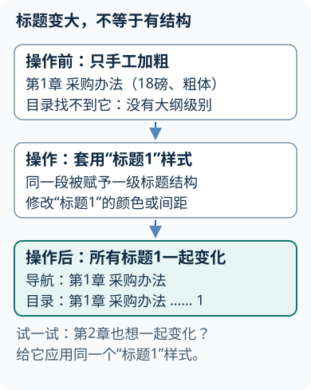
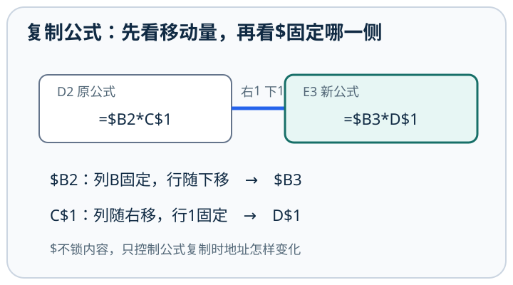
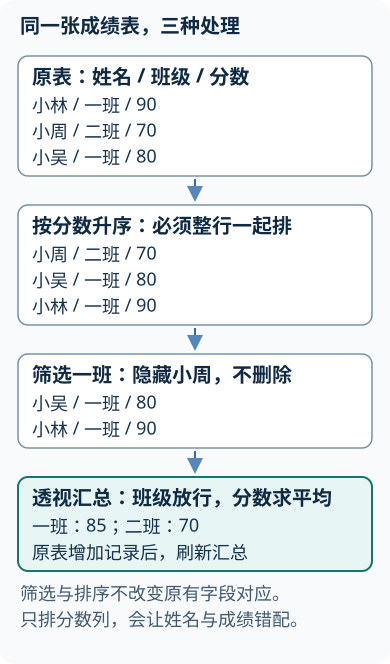

# Office 与 WPS 办公软件操作基础

## 第1章 办公环境与文件管理
<!-- exam: B | 单选、判断、场景题 -->

### 1. 常用组件

- Microsoft Word 对应 WPS 文字，主要处理文字、段落、页面、表格和长文档。
- Microsoft Excel 对应 WPS 表格，主要完成数据录入、计算、排序筛选、汇总和图表展示。
- Microsoft PowerPoint 对应 WPS 演示，主要制作和放映幻灯片。

### 2. 文件格式

#### 文件格式与兼容

传统WPS文字文件常见`.wps`扩展名，现代也常使用`.docx`等交换格式；扩展名相同也应结合具体软件和内容判断。

- 🔴 现代常用格式为 `.docx`、`.xlsx`、`.pptx`；旧版常见 `.doc`、`.xls`、`.ppt`；==含宏格式常见 `.docm`、`.xlsm`、`.pptm`==。PDF 适合保持版式和分发，不等于保留源文件全部编辑结构。

#### 文件类型、模板与操作环境

<!-- test: 填空、单选、过程推演 | 区分文档、模板、宏及格式转换 -->
- 🔴 **模板**：预先保存版式、样式等设置，供创建同类新文件使用；`.dotx/.xltx/.potx`分别是常用文字、表格、演示模板。宏是自动执行一组操作的命令序列，含宏文件须使用支持宏的格式，不能把宏等同病毒。
- 🔵 **操作例**：打开原报告→“文件→另存为”选择新目录和新名称→确认`.docx`→保存；需固定版式时另用“导出/另存为PDF”，重新打开PDF核对分页。把后缀改成`.pdf`不完成转换。
- ⚫ **版本条件**：以下菜单以Windows桌面Office 2019常见入口为例；WPS、网页版及其他版本按功能名寻找，不把宏支持、快捷键或默认表数视为一致。

### 3. 保存、另存为与恢复

#### 保存、恢复与备份

**打开密码与修改限制：** 文件打开密码用于阻止未授权者读取内容；“修改密码”或限制编辑用于控制修改，允许只读打开时就不保密。两者不能互相代替，启用修订也不会自动限制阅读。加密前仍需保存可恢复的备份。

- 保存：更新当前文件。
- 另存为：可改变名称、位置或格式，原文件可继续保留。
- 自动保存：按软件和账号条件持续或定时保存。
- 自动恢复：异常关闭后尝试找回临时版本。
- 备份：保存独立副本，防止误删、损坏或版本覆盖。

自动恢复不能代替主动保存；云同步也不能代替备份，因为误删和错误修改也可能被同步到其他设备。

先选择：要保留原始工作簿，同时生成一份不含公式、只便于交换单表数据的文件，应怎样做？

先保留`.xlsx`源文件，再用“另存为/导出”生成CSV并确认当前活动工作表、编码和分隔符。CSV通常只保存一张表的值，不保留公式、格式、图表和多个工作表。

### 4. Office 与 WPS 的共性和差异

两者都能处理常见办公格式，概念和常见操作相近。差异主要体现在菜单名称、入口位置、云服务、宏、插件、字体、公式、图表和高级协作能力。学习操作时应先理解功能与处理对象，再识别具体版本中的菜单入口，不要把某一版本的按钮位置当成永久规则。

## 第2章 文字编辑与格式
<!-- exam: A | 单选、判断、场景题 -->

### 1. 文档编辑

常见汉语全拼输入中，键盘字母`v`可代替带两点的`ü`，例如输入“女”的拼音可用`nv`，具体规则以输入法为准。

- 🔴 ==插入模式把新字符插入并向后推==，==改写模式用新字符覆盖当前位置已有字符==。桌面Word的Insert键是否切换改写取决于相关选项，不能断言任何版本按一次Insert都会切换。先看状态与设置，再用一个副本试输入，避免把改写误认为键盘漏字。

- 🔴 文字处理的基本操作包括输入、选定、插入、删除、移动、复制、查找、替换、撤销和恢复。

- `Backspace` 通常删除插入点左侧字符。
- `Delete` 通常删除右侧字符或清除所选内容。
- 剪切会把所选内容移出原位置并放入剪贴板；复制保留原内容。
- 格式刷复制的是格式，不是正文内容。

桌面Word中`Home/End`通常到当前行首/尾，`Ctrl+Home/Ctrl+End`到文档首/尾；不能照搬到所有应用。左侧选定区内单击常选一行、双击选一段、三击选全文；正文内双击通常选词，位置不同结果不同。`Ctrl+A`通常全选当前正文，`Ctrl+H`打开替换；“定位”可按页码、书签、脚注等对象跳转，不等于只搜索相同文字。

需要选择不相邻文字时，可在支持该操作的桌面版本中配合`Ctrl`继续选择。连续编号应使用同一列表和“继续编号”；手工输入的“1、2、3”不会随插入条目自动更新。

查找替换可先定位文字，再选择替换一次或全部；启用通配符前先在副本中试查，因为Word通配语法不同于文件名通配符。

**只把指定黑字改红：** 先保留副本，按`Ctrl+H`打开替换并展开“更多”。在“查找内容”输入“不谋而合”，光标留在查找框，通过“格式→字体”指定原字体颜色为黑色；再把光标移到“替换为”，输入同样文字并将替换字体颜色指定为红色。先“查找下一处”确认命中的文字及原格式，再只替换一处，核对文字未变、颜色已红且未误中其他颜色；确认后再“全部替换”。查找和替换框各有自己的格式条件，完成后清除不再需要的格式条件，避免下一次找不到本应命中的文字。菜单入口以本课桌面Word版本为准。

#### 编辑视图与段落设置

<!-- test: 单选、简答、过程推演 | 选择文档视图，设置正文与自动目录 -->
- 🔴 **视图分类**：打印布局检查页面、页边距和页眉页脚；Web版式侧重连续阅读；大纲按标题级别组织结构；草稿侧重正文编辑；阅读模式侧重浏览。改变视图不改变文件格式。
- 🔵 **正文排版**：选中正文段落→“开始→段落”对话框→两端对齐、首行缩进2字符、段后6磅→确认；行距固定值太小可能截字，最小值允许因内容增大。不要用空格或空行模拟缩进、段间距。
- 🔵 **目录操作**：分别选中章标题/节标题→应用“标题1/标题2”→在目录位置选择“引用→目录”→插入自动目录；增删标题后右击目录更新整个目录，只有页码变化时可仅更新页码。

### 2. 字符格式和段落格式

**换行不一定换段：** `Enter`结束当前段落并新建一段；`Shift+Enter`只在同一段内换行。例如同一条编号中分两行写地址，应使用软换行，否则可能多出一个编号。显示编辑标记时，段落标记与手动换行标记不同。

字形有粗体、斜体、下划线等；“磅”数越大字符通常越大，中文字号不能直接按数字大小比较，例如五号10.5磅、小四12磅、四号14磅。字数统计功能可统计全文或选中部分。拼写检查标出疑似错误；自动更正按规则替换输入，两者都不能保证语义正确。

- 🔴 字符格式作用于文字本身，包括字体、字号、字形、颜色、字符间距等。段落格式作用于整个段落，包括对齐、缩进、行距、段前段后间距、制表位、项目符号和编号。

中文排版中，拼音指南为汉字加注音，带圈字符给字符加圈，合并字符把多个字符组合在一个字符位置，双行合一把选中文字排成上下两行。纵横混排是在竖排段落中将局部数字或文字横向排列；横排中局部竖排应检查文字方向或文本框设置，不能把两种方向混淆。具体入口与呈现受版本限制。

### 3. 样式

- 🔴 样式是预先定义的一组格式。使用标题样式可以统一格式、建立大纲层次并生成自动目录。手工把一行文字加粗、放大，不等于应用了标题样式。

#### 样式与文档结构

#### 编辑、剪贴板与直接格式

**通俗理解：** 样式定义可复用格式与层次，局部直接格式可能覆盖它的默认外观。

先判断：把章节标题逐个加粗并调成18磅，能否可靠生成和更新自动目录？

不能。应为各级标题应用对应标题样式或正确大纲级别，再插入目录。直接格式只改变外观，没有稳定表达文档结构。

## 第3章 页面排版、表格与对象
<!-- exam: B | 单选、判断、场景题 -->

### 1. 页面、分页和分节

#### 分页、分节与页眉页码

- 🔴 页面设置包括纸张大小、方向、页边距、装订线、分栏等。==分页符只让后续内容从下一页开始==；==分节符把文档划分为可分别设置页面方向、页眉页脚、页码和分栏的节==。

分页符不能代替分节符；删除分节符还可能改变相邻部分的页面格式。

**通俗理解：** 连续分节可在同页设不同格式，分页本身不创建独立格式区域。

### 2. 图片和文本框

- 🔴 嵌入型图片像一个字符参与排版；浮动型图片可设置四周型、紧密型、衬于文字下方等环绕方式。文本框是独立容器，适合在页面指定位置放置文字。

裁剪主要改变图片显示区域，不一定删除原始图像数据。组合多个对象通常要求对象不是嵌入型。

### 3. 表格

Word表格中`Tab`通常移到下一单元格，在最后一格可能新增一行；`Enter`通常在当前单元格中另起段落，不等于转到下一格。跨页表格需要每页重复标题时，应对首部连续标题行设置“重复标题行”，复制一段外观相同文字不会自动跟随分页。

- 🔴 表格由行、列和单元格组成，可插入、删除、合并、拆分、调整大小和设置边框底纹。在表格中按 `Delete` 通常只是清除内容，并不删除行列结构。

#### Word表格计算与局部页面

- 🔴 **域**：由Word按规则生成、可更新的内容，如页码、目录和表格公式结果；不等于普通手工数字。
- 🔵 表格同一列上方为10、20，在合计格用“表格布局→公式”输入`=SUM(ABOVE)`得到30；源数改成15后选择结果域按F9更新为35，不能假定必然像Excel实时重算。
- 🔵 仅第3页横向：在第3页前、后各插入“下一页分节符”→光标放第3页节→“布局→方向→横向”，应用当前节。需要独立页眉时再取消链接；只改方向无需无条件改页眉。

### 4. 长文档功能

桌面Word也可拆分文档视图以同时查看同一文档不同位置，拆分视图并不拆成两个文件。

水印可由文字或图片构成，常作为页面背景说明用途或状态，作用范围需检查所在节与页眉关联。把正文改浅灰不等于添加水印；删除某节水印也应确认没有误改其他节。

#### 对象、表格与长文档

**拆分与合并表格：** 把光标放在要作为新表首行的那一行，使用“拆分表格”，拆分点按行划分。在列结构一致、非浮动的两张相邻表格之间，删除中间的段落标记通常能合并为一张表；复杂布局还需检查环绕和列宽。拖动标尺上的列边界可调整列宽，拖动图片角部控制点通常可保持纵横比；艺术字是有特殊外观的文字对象，不等于普通正文段落。

- 目录依赖标题样式或大纲级别。
- 题注用于给图表编号，交叉引用可引用题注编号。

**让图号与正文引用一起更新：** 在正文插入第一幅图片并选中它，用“引用→插入题注”，标签选“图”，得到“图1”；在正文输入“见”后，用“引用→交叉引用”，引用类型选“图”，引用内容选“只有标签和编号”，选中该题注并插入，得到“见图1”，不是手工键入数字。随后在这幅图之前插入一幅新图，并同样插入题注。回到文档主体按`Ctrl+A`、`F9`更新域，核对原图题注变成“图2”，正文仍指向原图且变成“见图2”；若交叉引用仍显示旧编号，再选中该引用按F9核验。主体全选更新不保证覆盖页眉、页脚、文本框等独立区域，其中的域需分别检查更新。仅插入图片而未给它添加题注，不会自动加入图号序列。
- 页眉页脚位于页面上、下边距区域。

#### 邮件合并、修订与批注

- 邮件合并由主文档、数据源和合并域组成，可批量生成信函、标签或证书。
- 修订记录文档的增删改，批注用于交流意见。删除批注不等于接受修订。

先设计：报告封面无页码，正文从1开始，附录改为横向页面，需要哪些结构操作？

在封面与正文、正文与附录之间插入分节符；正文节取消与前节页眉页脚链接并把页码起始值设为1；附录所在节单独设为横向。仅插入分页符无法隔离页码和方向设置。

#### 邮件合并的完整操作

<!-- test: 简答、过程推演 | 用三条记录生成三份不同收件人的通知 -->
- 🔴 **邮件合并**：将主文档的固定内容与数据源中每条记录的变量字段合成批量文档；==合并域是字段引用，不是直接输入的尖括号文字==。

| 姓名 | 班级 | 编号（文本） |
|---|---|---|
| 李明 | 一班 | 001 |
| 王芳 | 二班 | 002 |
| 张华 | 一班 | 003 |

1. 🔵 在Excel中按表录入，首行唯一字段名，一行一名收件人，编号预先设文本；保存并关闭数据源。
2. 🔵 Word写“同学，请凭编号报到”，选择“邮件→开始邮件合并→信函”；“选择收件人→使用现有列表”，指定文件及工作表，确认首行为标题。
3. 🔵 在“同学”前插入“姓名”合并域，在“编号”后插入“编号”域；在编辑收件人列表中核对三条记录均勾选。
4. 🔵 “预览结果”切换到第2条，应看到“王芳同学，请凭编号002报到”；确认不是三页都叫李明。
5. 🔵 “完成并合并→编辑单个文档→全部”，核对3份结果，再保存或导出PDF；保留主文档与数据源。筛选为一班时只生成李明、张华两份。

- ⚫ **易错**：合并域显示`«姓名»`不代表已完成合并；编号若先作为数值丢了前导0，改字体不能补回原数据。

## 第4章 电子表格基础与公式
<!-- exam: A | 单选、判断、填空、计算、场景题 -->

### 1. 对象层次

- 🔴 ==工作簿是一个表格文件==，==工作表是工作簿中的表页==，单元格是行列交叉形成的基本单位，==单元格地址先写列号再写行号==，如 `B3`。

#### 单元格类型与公式基础

- 🔴 单元格可存放文本、数值、日期时间、逻辑值和公式。公式通常以等号 `=` 开头。学号、身份证号、电话号码等标识信息即使全是数字，也常应按文本保存。

输入身份证或以0开头编号前，可先把单元格设为文本，或用英文单引号提示后续按文本录入；事后只改显示格式不一定恢复已丢失的前导0。清除内容（如Delete）通常保留单元格结构；删除单元格并上移或左移会改变布局，还可能影响公式引用。单个数值拖填充柄在常见桌面版可配合`Ctrl`切换复制与序列填充，版本不同应检查填充选项和预览结果。

Excel的1900日期系统中，序列数1对应1900年1月1日；日期底层可参与天数差计算。它保留了1900年不存在的2月29日兼容行为，跨该历史边界不能机械按真实日历解释。常见默认“常规”格式中数值靠右、文本靠左，但手工对齐会覆盖外观，不能只凭左右对齐断定类型。

在同一单元格中换行，Windows桌面表格常用`Alt+Enter`，这不同于在下方单元格录入。拆分窗格可同时查看工作表不同区域，冻结窗格是在滚动时固定选定行列，两者都不会把数据复制成两份。

1900与1904日期系统基准不同，跨文件复制需核对基准。按文本保存的“10”“2”可能按字符次序排列，不等于数值10与2的大小顺序，排序前先统一类型。

在工作表标签上，先选起点再按`Shift`选终点可成组选中连续工作表；按`Ctrl`逐个单击可选不连续工作表。成组编辑会影响所有选中表，完成后要取消组合。

合并单元格通常只保留左上角单元格内容，其余非空内容可能被丢弃，应先整理并查看警告。删除整张工作表在Excel中通常不能靠撤销找回，先备份或另存版本；不要把清除内容、删除单元格、删除工作表当成一种操作。`Ctrl+N`通常新建工作簿，`Ctrl+Home`到工作表开头，`Ctrl+End`到已用区域末端；不同软件与当前编辑状态可能改变快捷键作用。

#### 自动填充与自定义序列

填充柄是选中区域右下角的小方点。复制公式会按引用规则变化；延续数值序列时，可先输入1、2并一起选中后拖动，不能把“复制一个数”和“延续一组数”混为一谈。

像“优秀、良好、合格”这样的固定次序，可以建立自定义序列。Windows桌面版Excel通常从“文件→选项→高级”中的常规设置进入自定义序列编辑；在输入框中每个项目单独一行，再添加。之后从序列中的项目开始拖动填充柄，可按这一顺序延续；也可按自定义序列排序。

输入连续字符串“优秀良好合格”只表示一个项目，空格也不宜当作明确的分项方式。不同Excel/WPS版本的入口可能不同，关键是先建立有独立项目和先后顺序的列表，再选择复制、填充或排序操作。

### 2. 单元格引用

#### 相对、绝对与混合引用

- 相对引用 `A1`：复制公式时行列随位置变化。
- 绝对引用 `$A$1`：行列都固定。
- 混合引用 `$A1`：列固定，行变化。
- 混合引用 `A$1`：行固定，列变化。

复制或填充公式前，先判断哪些引用应随位置变化、哪些行列必须固定，再决定 `$` 的位置。

**通俗理解：** 复制公式先算位移，再看每个行号、列号是否被美元符号固定。

- 🔵 **例**： 若 `B2` 是数量、`C2` 是单价、`F1` 是统一税率，`D2` 可写为 `=B2*C2*(1+$F$1)`。向下填充后，数量和单价会变为 `B3`、`C3`，税率仍引用 `$F$1`。

### 3. 常用函数

- `SUM` 求和，`AVERAGE` 求平均，`MAX/MIN` 求最大最小。
- `COUNT` 统计数值单元格，`COUNTA` 统计非空单元格。
- `IF` 根据条件返回不同结果。
- `COUNTIF/SUMIF` 完成单条件计数、求和。
- `ROUND` 按指定位数四舍五入。
- `LEFT/RIGHT/MID` 截取文本。

`IF(条件,条件成立时的值,条件不成立时的值)`先判断条件，再返回对应结果。例如B2已核验为0—100的有效数值成绩，及格线为60，可写`=IF(B2>=60,"及格","不及格")`：59返回“不及格”，60返回“及格”。若成绩可能空白或写“缺考”，应先约定这些情况如何处理，不能未经检查就把它们套入此数值例。

函数参数的区域和条件必须对应；`COUNT` 不统计普通文本；公式显示 `######` 的常见原因是列宽不足，不代表数据已经丢失。

`AVERAGE`对引用区域中的空白与普通文本通常不计数，但数值0参与分母。例如B2:B5为60、0、空白、文本“缺考”，平均值为`(60+0)/2=30`；不能把空白自动当0，也不能把0自动忽略。`COUNTIF(区域,条件)`如`=COUNTIF(B2:B5,">=60")`按条件计数，`SUMIF(条件区域,条件,求和区域)`如`=SUMIF(A2:A5,"一班",B2:B5)`按班级求成绩和，两个区域需逐行对应。

**多条件计数：** `COUNTIFS(区域1,条件1,区域2,条件2,…)`要求同一行同时满足各条件。例如A2:A5为班级、B2:B5为成绩，`=COUNTIFS(A2:A5,"一班",B2:B5,">=60")`统计一班且及格的人数，各条件区域形状要相同。它表达“且”；若要“或”，分别计数相加时需防止同一行被重复统计。

### 4. 查找函数

#### 函数、查找与错误值

- 🔴 查找函数根据关键值，在表格中找到对应记录并返回指定字段。

- `VLOOKUP`在表区域第一列查找，再返回指定列的值。==第四个参数使用`FALSE`或`0`表示精确匹配==；使用`TRUE`、`1`或省略时通常为近似匹配，查找列一般应按升序排列。
- `XLOOKUP`把查找区域和返回区域分开指定，在支持它的现代版本中默认精确匹配，还可指定“未找到”时显示的内容。Office、WPS及不同版本的函数支持情况不同，交换文件前应检查兼容性。

常见错误：VLOOKUP 的返回列必须位于查找列右侧；精确匹配找不到时常返回`#N/A`；近似匹配没有满足排序条件时可能得到错误结果。

#### 函数参数与可核验的查找

<!-- test: 填空、计算、过程推演 | 写完整函数并检查复制后的引用及版本支持 -->
- 🔴 **运算与跨表引用**：括号可明确运算顺序；`='期末成绩'!B2`引用另一工作表，冒号如`B2:B5`是连续区域，`&`连接文本。现代Excel一表有1048576行、16384列（至XFD），旧`.xls`兼容范围更小。
- 🔵 **查找例**：A2:B4为`001 李明 / 002 王芳 / 003 张华`，D2输入文本002；`=VLOOKUP(D2,$A$2:$B$4,2,FALSE)`返回王芳。参数依次是查找值、表区域、返回列序号、匹配方式；列序号2相对所选区域计数。数值2不一定匹配文本002。
- 🔵 **文本与舍入例**：A1为“2026001”，`=LEFT(A1,4)`得“2026”，`=RIGHT(A1,3)`得“001”，`=MID(A1,5,3)`得“001”；`=ROUND(3.456,2)`得3.46。单纯显示两位小数不更改底层3.456。
- ⚫ **版本条件**：XLOOKUP并非Excel 2016/2019内置功能；支持版可写`=XLOOKUP(D2,A2:A4,B2:B4,"未找到")`。不能因新公式在本机可用，就认定交付到旧版一定可计算。

### 5. 常见错误值

**循环引用：** 在A1输入`=A1+1`，计算A1需要先知道A1，形成自我依赖；A1引用B1而B1又引用A1，也构成循环。先画出依赖方向，再改为引用原始输入格。只有明确启用并控制迭代的模型才可能有意使用循环，普通汇总表出现循环一般是范围误包含了结果格。

- `#DIV/0!`：除数为零或空。
- `#VALUE!`：数据类型或参数不合适。
- `#NAME?`：函数名或名称无法识别。
- `#REF!`：引用失效。
- `#N/A`：没有找到可用匹配值。

先推演：公式`=$B2*C$1`从D2复制到E3后变成什么？

变成`=$B3*D$1`。目标位置向右1列、向下1行；B列被`$`固定，行2变3；C列相对移动到D，行1被固定。

若继续比较从D2复制到F4，位移是向右2列、向下2行，公式变为`=$B4*E$1`。

## 第5章 数据管理、分析与图表
<!-- exam: A | 单选、判断、场景题 -->

### 1. 排序与筛选

#### 排序、筛选与验证

- 🔴 排序改变记录顺序，可按一个或多个关键字进行。==筛选只是暂时隐藏不符合条件的记录，不会删除数据==。==排序时应扩展选择整条记录==，否则可能破坏同一行字段间的对应关系。

### 2. 分类汇总与数据透视表

#### 分类汇总与数据透视表

传统分类汇总通常先按分类字段排序，再计算每组的和、平均值或计数。数据透视表可通过拖放字段快速分组、汇总和交叉分析，源数据改变后通常需要刷新。

#### 把四条记录变成部门月报

原表四行：技术部一月10、技术部二月20、行政部一月5、行政部二月8。创建透视表后把部门放行、月份放列、金额放值且汇总方式选求和。先手算技术部行应为10、20、合计30；一月列合计15。若值区显示计数而不是求和，先检查金额是否混成文本。给原表增加技术部一月7，刷新后对应格应由10变17；增加到原数据范围外还需扩展数据源。

把月份放行、部门放列，总金额会变吗？原表新增记录后只保存文件够不够？

只是交换展示维度，总额仍是43。通常要刷新透视表；新记录超出原数据范围时还需扩展数据源或使用可扩展的表格源。

#### 从原表到分类汇总的操作

<!-- test: 简答、计算、过程推演 | 排序、分类汇总和透视表分别做出可核对的结果 -->
原表A1:C5字段为部门、月份、金额，记录依次为“技术部 一月 10”“行政部 一月 5”“技术部 二月 20”“行政部 二月 8”。
1. 🔵 在副本中选择整块A1:C5→“数据→排序”→确认有标题→部门升序。结果中同部门两条记录连续，金额仍跟随原记录。
2. 🔵 “数据→分类汇总”→分类字段“部门”→函数“求和”→汇总项“金额”→确定。核对技术部30、行政部13、总计43；未先排序会产生同部门的分散小计。
3. 🔵 单击左侧分级显示按钮折叠明细，查看部门小计；要恢复原记录结构，用分类汇总的“全部删除”，不手工删原数据行。
4. 🔵 透视表另从原始明细创建：“插入→数据透视表”→检查A1:C5和新工作表→部门拖到行、月份到列、金额到值→值字段设置为求和。技术部一月10、二月20，行政部5、8；列总计15、28，总额43。
- ⚫ **条件**：Excel“表格”对象内分类汇总命令可能不可用，可在副本转为普通区域或选透视表；源数据增加后透视表要刷新并检查数据源范围。

### 3. 数据验证和条件格式

- 🔴 数据验证限制可以输入的数据类型、范围或列表；条件格式根据规则改变显示格式。两者作用不同，也都不等于文件加密。

#### 输入规则、可见行求和与打印

- 🔵 限制B2:B20只能输入0—100整数：选区→“数据→数据验证”→整数、介于0和100→设置停止型错误提示→试输入101核对拒绝；粘贴等操作仍需复核，验证不能替代数据审计。
- 🔵 对同一区域用“开始→条件格式→突出显示单元格规则”设置小于60为红底；它只变显示，不阻止输入。筛选后的可见金额可用`=SUBTOTAL(109,C2:C5)`求和；普通SUM仍会包含被筛掉的明细。

#### 图表、打印与保护边界

- 🔵 冻结首行用“视图→冻结窗格→冻结首行”；打印重复首行另用“页面布局→打印标题”将顶端标题行设为`$1:$1`，预览第2页确认。两者分别服务屏幕滚动和纸张输出。

### 4. 工作表保护与文件加密

- 单元格锁定：标记哪些单元格在工作表保护启用后不能修改；仅设置“锁定”而未保护工作表时，通常不会限制编辑。
- 工作表保护：限制修改单元格、格式、对象等，主要防止误操作。
- 工作簿结构保护：限制新增、删除、移动、隐藏或重命名工作表等结构操作。
- 文件加密：需要密码才能打开文件，主要保护内容机密性。

保护工作表或工作簿不等于强加密，不能阻止所有技术手段访问内容；文件打开密码也不能代替备份。忘记密码可能导致数据无法使用，设置前应按单位制度妥善保管。

### 5. 图表

- 柱形图、条形图适合类别比较。
- 折线图适合展示时间趋势。
- 饼图适合少量类别的构成比例。
- 散点图适合观察两个数值变量的关系。

图表由标题、坐标轴、数据系列、图例、数据标签等组成。图表应服务数据结论，不能只追求装饰效果。

### 6. 打印

打印页码范围中，连字符表示连续页、逗号分开不连续部分，例如`2-5,10,12`表示第2到5页加第10、12页，共6页。确认打印的是页码范围、活动工作表还是整个工作簿；屏幕冻结标题不同于设置打印时每页重复标题行。

打印前检查打印区域、纸张方向、页边距、缩放、分页、重复标题行列、页眉页脚和打印预览。冻结窗格只是滚动时保持标题可见，不是打印设置，也不是禁止编辑。

先选择：要统计各部门销售额、可展开查看月份，并在源数据增加后更新结果，优先使用什么功能？

优先使用数据透视表，把部门和月份放入行列区域，把销售额放入值区域；源数据变化后刷新。若只需要一个固定条件总额，可使用SUMIF等公式，不能把筛选后肉眼相加当成可重复流程。

## 第6章 演示文稿设计与制作
<!-- exam: B | 单选、判断、场景题 -->

### 1. 幻灯片与视图

- 🔴 普通视图用于编辑，==幻灯片浏览视图适合调整顺序==，备注页用于编辑演讲备注，幻灯片放映视图用于全屏演示。

### 2. 主题、版式和母版

- 主题统一颜色、字体和效果。
- 版式规定占位符的位置和种类。
- 母版统一控制多个版式的默认外观。
- 占位符属于版式结构，文本框是单独插入的对象。

需要全局修改时优先使用母版，不要逐页重复操作。直接设置的单页格式可能覆盖母版默认格式。

### 3. 切换、动画和链接

#### 动画、切换与放映

- 🔴 切换发生在幻灯片之间；动画作用于一页中的对象；超链接和动作按钮用于跳转到幻灯片、文件或网页。动画应检查对象、效果、开始方式、顺序和持续时间。

切换不是对象动画；动画越多也不代表演示效果越好。

### 4. 放映

对象动画常按作用分为进入、强调、退出和动作路径：进入让对象出现，强调突出已出现对象，退出使对象离开，动作路径控制沿路线移动。让已有箭头沿流程移动应考虑路径，让箭头先出现再闪烁则是进入与强调的组合；页面之间仍使用切换。

放映类型要跟使用者匹配：演讲者放映通常全屏并由讲者控制；个人浏览可在窗口中查看；展台浏览适合无人值守，常结合自动换片和循环。放映时常可用方向键、空格或Page Down前进，左方向键或Page Up后退；输入数字再回车可跳到指定页，具体按版本及放映设置核对。

- 🔴 排练计时记录换片时间，录制放映可保存旁白、墨迹和计时，演讲者视图可显示备注、下一页和时间。放映前应检查媒体路径、字体、链接、动画顺序和目标设备兼容性。

<!-- test: 单选、简答、过程推演 | 用母版统一标题，使节点依次出现并自动换片 -->

#### 主题、母版与版式

1. 🔵 “视图→幻灯片母版”，选对应顶层母版，在标题占位符设置字体和标志→关闭母版视图；“开始→版式”给页面应用相应版式。
2. 🔵 选第一个流程节点→“动画→出现”，再对后续节点逐个添加；打开动画窗格排列顺序，选择“单击时/与上一动画同时/上一动画之后”，分别预览，不能只看对象在画布的位置。
3. 🔵 页面渐变选“切换”；需自动播放，在切换中设置自动换片时间并按需应用全部→放映设置使用计时、循环→从头播放完整一轮。
- ⚫ **检查结果**：母版上的标志应在使用该版式的页面出现；每页节点按指定次序出现；最后一页按设置返回开头。若只有一页标题不变，检查标题是不是普通文本框或被直接格式覆盖。
- 🔴 **备注与讲义**：备注页供演讲者附说明；打印讲义可一页多张幻灯片，均不等同于把备注文字自动放到观众看到的页面。

### 例题

Windows桌面版PowerPoint常用`F5`从头放映、`Shift+F5`从当前页放映、`Esc`退出。无人值守展示需先设置每页自动换片时间或排练计时，在放映设置中启用使用计时，并按需选择展台浏览/循环放映；只勾“循环”不会自动产生换片时间。发布前实际运行一轮，核对视频、动画和最后一页能否正确返回开头。

**题目：** 希望同一张幻灯片中的流程图节点依次出现，应设置（ ）。
- A. 幻灯片切换
- B. 对象动画并调整动画顺序
- C. 页面边距
- D. 打印讲义

查看答案与解析

**答案：** B

**解析：** 切换作用于幻灯片页面之间，对象依次出现属于页内动画，并需在动画窗格中安排顺序。

先排障：修改母版标题字体后，有一页标题没有变化，优先检查什么？

先检查该页是否使用对应版式、标题是否仍是占位符，以及是否存在覆盖母版的直接格式。母版提供默认值，单页直接格式可能优先显示。

#### 按操作选择演示视图

- **普通视图**用于编辑当前幻灯片上的文字、图片与图表：要修改标题文字或裁剪某图，应进入该页并选中具体对象。
- **幻灯片浏览视图**显示多张整页缩略图，便于选中整页、拖动调序、复制或删除幻灯片；它不用于直接改某段文字或某幅图的内部内容。
- **备注页**用于补充演讲者讲稿，并可检查幻灯片与备注的打印布局；备注不会自动成为观众屏幕上的正文。**放映视图**用于全屏演示及测试动画、切换和链接，不能替代普通视图编辑对象。
- **先分操作层次**：将第5页移到第2页是整页排序；把第5页图表标题改字是页内对象编辑；统一各页默认标题格式才进入母版。浏览视图能选中整页，不表示能编辑该页内的文本与图片。

## 第7章 Office综合应用
<!-- exam: B | 场景题、排障题 -->

#### 按任务组合工具

实际办公任务通常同时涉及多个功能。选择工具时先判断“处理对象”和“预期结果”，再确定功能入口和应用范围。

| 任务情境 | 优先功能 | 为什么 | 使用边界 |
|---|---|---|---|
| 同一模板批量生成通知、证书或信封 | Word/WPS文字的邮件合并 | 主文档负责固定版式，数据源提供姓名等变化字段 | 少量一次性文档可手工制作；数据源必须字段清楚、记录准确 |
| 制作章节多、页眉页码不同的报告 | 标题样式、分节、题注、目录 | 样式建立结构，分节隔离页面设置，题注支持自动编号和引用 | 只手工加粗不能生成可靠目录；分页符不能代替分节符 |
| 汇总考勤、销售或成绩并找异常数据 | Excel/WPS表格的公式、筛选、条件格式、数据透视表 | 结构化记录便于计算、筛选和分组汇总 | 关键编号宜按文本存储；排序必须扩展整条记录 |
| 展示月度变化和类别对比 | 折线图展示趋势，柱形图展示类别比较 | 图表把数据关系转为视觉信息 | 图表不能代替原始数据核验，饼图不适合类别过多 |
| 统一修改整套演示的字体和版式 | 主题、母版和版式 | 从结构层统一控制，避免逐页重复修改 | 单页直接格式可能覆盖母版默认值 |
| 多人审阅制度或报告 | 修订、批注、版本副本 | 修订记录内容变更，批注表达意见，版本副本便于回退 | 删除批注不等于接受修订，云同步不等于独立备份 |

#### 按办公结果选择功能
<!-- test: 场景题、单选 | 分清批量成文、隐藏记录、分组小计与交叉汇总 -->
- 🔵 **同模板逐人通知**选邮件合并，变化字段来自每条记录；只找一班学生并临时显示用筛选，筛选不生成逐人文档。
- 🔵 **按部门插入小计并折叠明细**选先排序再分类汇总；**部门×月份交叉分析、换维度**选透视表。固定单条件总额用SUMIF就可完成，无需为了一个数建立复杂报表。
- 🔵 **每章独立页眉或局部横向**用分节；只需下一页开始用分页；**整套幻灯片统一默认字体**用母版，单个流程节点依次出现用对象动画。选择先看作用对象与范围。

### 1. 通用操作链

明确输出要求 → 识别处理对象 → 选择对应功能 → 设置参数和应用范围 → 预览或核对结果 → 保存可编辑源文件并按要求导出。

例如“每页标题相同但正文不同”的演示，应优先修改母版或版式；“只有第3页横向”的文档，应在第3页前后建立节并单独设置方向。功能选择取决于作用对象：母版控制整套演示的默认结构，分节控制文档中局部页面设置。

#### 综合交付例：成绩表、通知与汇报

<!-- test: 简答、过程推演 | 从明细数据生成个人通知和班级汇总，检查链接交付 -->
- 🔵 **输入**：成绩表含学号（文本）、姓名、班级、成绩；先检查学号唯一、成绩数值和缺考编码，再用IF判断结果、透视表按班级求平均或计数。
- 🔵 **输出**：Word连接成绩表生成个人通知，预览一名及格与一名不及格学生；PowerPoint用柱形图比较班级平均分，在备注中保留统计口径；保存可编辑源文件后分别导出PDF。
- 🔵 **核对**：通知人数应等于选定收件人记录数；透视表总人数应与原始有效记录数一致；抽查一条记录的姓名、成绩及通知对应关系。
- ⚫ **链接实验**：复制Excel图表到Word，分别选择嵌入与粘贴链接；源表改数据并更新链接时只有链接对象跟随源变化，独立嵌入副本不会自动随原文件更新。移动源文件后重新打开文档检查断链，交付前固定链接或一并提供可用源文件。

### 2. 公式与数据任务的核对链

先确认数据类型和单位，再写公式；复制公式前判断相对引用和绝对引用；得到结果后用数量级、抽样记录或手工小算例复核。工作表保护可减少误改，但不能保证公式本身正确，也不能代替文件加密和备份。

### 3. 嵌入、链接与兼容边界

交付保护要区分：文件打开密码用于限制读取；修改密码或只读建议用于限制或提醒编辑，允许只读打开时不保护内容机密性；备份用于误删损坏后的恢复。三者分别解决访问、修改与恢复，不能用“已加密码”概括全部能力。

#### 链接、协作与交付检查

- 🔴 ==嵌入对象把副本放入当前文件==，携带方便但文件可能变大；==链接对象引用外部文件==，源文件更新时可联动，但移动或删除源文件会导致链接失效。跨设备提交前应检查字体、媒体、外部链接、宏和版本支持，必要时同时保留源文件和PDF等交付版本。

先规划：要批量生成100份通知并交付PDF，同时保留以后修改能力，应怎样组合工具和文件？

先在表格中清理收件人数据，用文字处理的邮件合并生成并抽查通知，保留主文档和数据源，再导出PDF交付。PDF用于确认版式，可编辑源文件用于后续修订；敏感字段和隐藏内容需在分享前检查。

