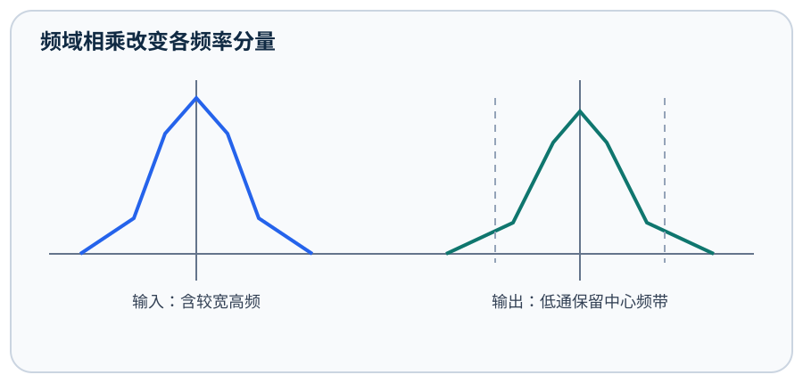
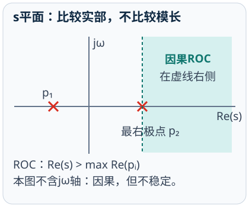

# 信号与系统

## 第1章 信号与系统概述
<!-- exam: A | 单选、判断、填空、计算 -->

### 1. 信号分类与基本参数

连续时间信号`x(t)`在连续时刻定义，离散时间信号`x[n]`只在整数序号定义；模拟信号的幅度连续，数字信号的时间和幅度通常都离散。周期信号满足`x(t)=x(t+T)`，最小正`T`是基本周期。正弦信号`A cos(ωt+φ)`满足`f=ω/(2π)`、`T=1/f`。

能量`E=∫|x(t)|²dt`有限且非零的是能量信号；平均功率`P=lim(T→∞)1/(2T)∫[-T,T]|x(t)|²dt`有限且非零的是功率信号。有限时长脉冲通常是能量信号，非零周期信号通常是功率信号；不能把“幅值小”直接等同于能量小。

### 2. 波形变换与典型信号

`x(t-t0)`向右延迟`t0`，`x(-t)`沿纵轴反折，`x(at)`在`|a|>1`时压缩、`0<|a|<1`时展宽。处理`x(a t+b)`时先令新自变量等于原信号关键点，再求变换后位置，避免凭口诀弄反平移。**通俗理解：** 可以把横轴上的关键点看作图钉：先算每个图钉搬到哪里，再连接波形。

单位阶跃`u(t)`描述从某时刻开始持续存在；单位冲激`δ(t)`满足面积为1和筛选性质`∫x(t)δ(t-t0)dt=x(t0)`。连续时间中`du(t)/dt=δ(t)`。偶部与奇部分解为`xe(t)=[x(t)+x(-t)]/2`、`xo(t)=[x(t)-x(-t)]/2`。

先算：x(t)=3cos(4πt+π/6)的周期是多少？

`ω=4π rad/s`，所以`T=2π/ω=0.5 s`。初相位不改变周期。

## 第2章 连续时间系统的时域分析
<!-- exam: A | 单选、判断、简答、状态判断、计算 -->

### 1. 系统性质逐项检验

线性要求`T{a x1+b x2}=aT{x1}+bT{x2}`；时不变要求输入延迟后输出只发生同样延迟；因果系统在时刻`t0`不能使用`t0`之后的输入；BIBO稳定要求每个有界输入产生有界输出；无记忆系统只使用当前输入。

判断必须逐项代入。`y(t)=2x(t)+1`零输入时输出不为零，因此非线性；`y(t)=x(t+1)`使用未来输入，非因果；`y(t)=t x(t)`线性但时变。线性、时不变、因果和稳定互不自动推出。

### 2. 零输入响应与零状态响应

线性系统总响应可分为零输入响应与零状态响应。零输入响应来自电容、电感等初始储能，令外部输入为零；零状态响应令初始状态为零，只看输入引起的输出。两者相加的前提是系统线性。

一阶系统`y'(t)+a y(t)=b x(t)`在输入为零时解为`K e^{-at}`，常数`K`由初始值决定；零初始条件下可用卷积或变换求零状态响应。做微分方程题先写输入、初始条件和求解区间，不能把零状态响应当作总响应。

逐项判断：y(t)=x(t-2)是否线性、时不变、因果、稳定？

四项都满足：延迟运算保持叠加；输入平移会使输出同样平移；只使用过去输入；有界输入延迟后仍有界。

## 第3章 卷积与零状态响应
<!-- exam: A | 单选、判断、计算、简答 -->

### 1. 冲激响应与LTI系统

LTI系统对单位冲激的零状态响应称为`h(t)`。任意输入可视为移位冲激的叠加，因此连续系统`y(t)=x(t)*h(t)=∫x(τ)h(t-τ)dτ`，离散系统`y[n]=Σx[k]h[n-k]`。冲激输入`δ(t-t0)`的输出直接是`h(t-t0)`。

对LTI系统，因果等价于`h(t)=0,t<0`；BIBO稳定的充分必要条件是`∫|h(t)|dt<∞`，离散系统则为`Σ|h[n]|<∞`。这些结论只适用于LTI系统。

### 2. 卷积的中间步骤

图解卷积按“反折—平移—相乘—积分”执行：先把`h(τ)`反折为`h(-τ)`，再平移成`h(t-τ)`，找它与`x(τ)`的重叠区间，最后在该区间积分。区间端点随`t`变化时，输出通常要分段表示。**通俗理解：** 这就像把一张透明纸上的波形滑过另一张纸，重叠面积就是当前输出。

离散例：`x[n]=h[n]=1`仅在`n=0,1`成立。逐项滑动得到`y[0]=1`、`y[1]=2`、`y[2]=1`，所以结果为`[1,2,1]`。有限序列长度分别为`Lx,Lh`时，完整线性卷积长度是`Lx+Lh-1`。

先算：x(t)=δ(t-1)，h(t)=e^{-t}u(t)，输出是什么？

利用冲激移位性质，`y(t)=h(t-1)=e^{-(t-1)}u(t-1)`。冲激使响应整体右移1秒。

## 第4章 傅里叶变换与频域分析
<!-- exam: A | 单选、判断、填空、计算、简答 -->

### 1. 傅里叶级数与频谱

周期信号可分解为基频及整数倍谐波。复指数形式`x(t)=Σ Ck e^{jkω0t}`，其中`ω0=2π/T0`，`Ck=(1/T0)∫[一个周期]x(t)e^{-jkω0t}dt`。周期信号的频谱是离散谱线；非周期信号常用连续傅里叶变换描述。

实偶信号的频谱通常为实偶，实奇信号的频谱通常为虚奇。波形越尖锐，往往需要更多高频谐波逼近；只保留低频会使边沿变圆。

### 2. 傅里叶变换与滤波

连续时间傅里叶变换`X(jω)=∫x(t)e^{-jωt}dt`，逆变换由频谱恢复时域。时移对应频谱乘`e^{-jωt0}`，只改变相位；时域尺度压缩会使频谱展宽并带来幅度因子。

时域卷积对应频域相乘：`y=x*h ↔ Y=XH`；时域相乘对应频域卷积。LTI滤波器用`H(jω)`改变各频率分量，低通保留低频、抑制高频。**通俗理解：** 可以把滤波器看作按频率设置的门卫：允许通带内分量通过，并削弱阻带内分量。

先预测：x(t-t0)的幅度谱会变化吗？

不会。其频谱为`X(jω)e^{-jωt0}`，复指数的模为1，因此幅度谱不变，相位增加线性项`-ωt0`。

## 第5章 拉普拉斯变换与Z变换
<!-- exam: A | 单选、判断、填空、计算、简答 -->

### 1. 拉普拉斯变换、系统函数与ROC

双边拉普拉斯变换`X(s)=∫x(t)e^{-st}dt`，`s=σ+jω`。同一代数式配合不同收敛域ROC可能对应不同信号，因此答案必须同时写变换式和ROC。极点不属于ROC；有理因果系统的ROC在最外极点之外，稳定系统的ROC必须包含`jω`轴。

零初始条件下`H(s)=Y(s)/X(s)`。微分方程经变换成为代数方程：导数对应`sY(s)`，若使用单边拉普拉斯还要带入初始值。求解顺序通常是变换方程、解`Y(s)`、部分分式展开、反变换并核对初始条件。

### 2. Z变换与差分方程

双边Z变换`X(z)=Σx[n]z^{-n}`。右边序列ROC通常在最外极点之外，左边序列在最内极点之内；离散有理因果系统稳定时ROC还必须包含单位圆。

零初始条件下`H(z)=Y(z)/X(z)`。例如`y[n]-a y[n-1]=x[n]`得到`H(z)=1/(1-a z^{-1})`；因果时ROC为`|z|>|a|`，若`|a|<1`则单位圆位于ROC内，系统稳定。

先判断：H(z)=1/(1-0.5z⁻¹)且系统因果，是否稳定？

因果ROC为`|z|>0.5`，包含单位圆，所以稳定。只看极点0.5还不够，仍需结合ROC和因果条件。

## 第6章 抽样定理与离散化
<!-- exam: A | 单选、判断、计算、简答 -->

### 1. 采样、混叠与重建

对最高频率为`fm`的带限信号，理想无混叠恢复通常要求`fs>2fm`；`2fm`是奈奎斯特速率边界。实际ADC前放抗混叠低通滤波器，并为滤波过渡带留余量。低于条件时，频谱副本重叠，高频会伪装成低频，采样后无法仅靠软件唯一恢复。

正弦频率`f`以`fs`采样后，落入基带的混叠频率可按`|f-kfs|`选择最小非负值判断。例如`9 kHz`信号以`10 kHz`采样，会表现为`1 kHz`。该计算只描述采样序列中的等效频率，不表示原模拟信号真的变为1 kHz。

### 2. 量化与数字化链路

数字化链路为抗混叠滤波→抽样保持→量化→编码。`N`位均匀量化共有`2^N`级，满量程范围`V`时步长约为`Δ=V/2^N`，理想量化误差绝对值通常不超过半个量化步长。

最高频率4 kHz的信号理论奈奎斯特速率为8 kHz；8位、0～5 V ADC的量化步长约`5/256=19.5 mV`。采样率改善时间分辨率，量化位数改善幅值分辨率，二者不能互相替代。

## 第7章 系统分析方法的联系
<!-- exam: B | 单选、判断、填空、简答、场景题 -->

### 1. 按任务选择分析域

时域适合观察波形、初始状态、瞬态和卷积；频域适合观察带宽、谐波和滤波；复频域适合微分/差分方程、极点、因果性和稳定性。选择工具前先判断连续或离散、是否LTI、是否有初始条件以及变换是否收敛。

### 2. 同一系统的三条证据链

LTI系统可从三种视角互相核对：时域用`h`和卷积，频域用`H(jω)`相乘，复频域用`H(s)`或`H(z)`观察零极点。抽样把连续频谱周期复制，滤波再选择所需副本；卷积与频域相乘说明三种方法描述的是同一系统。

做综合题的顺序是：确认输入与初始状态→选择时域或变换域→写适用条件→计算中间量→用因果性、稳定性、单位和极限情况复核。形式相似的公式不能跨越适用条件套用。
