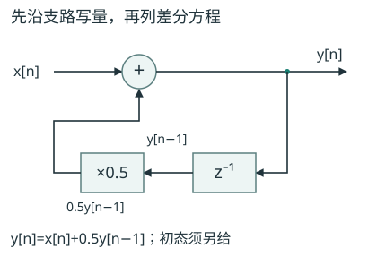
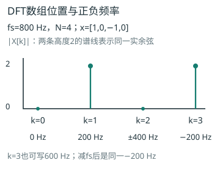
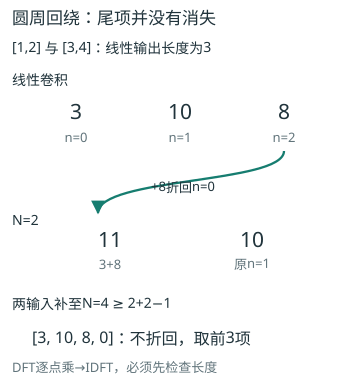
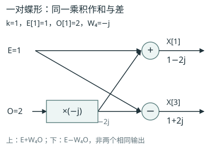

# 信号与系统

## 第1章 信号与系统概述
<!-- exam: A | 单选、判断、填空、计算 -->

### 1. 信号分类与基本参数

- 🔴 **连续时间与离散时间信号**：==x(t)在连续时间轴上定义==；==x[n]只在整数序号n处定义==，n不是连续秒数。
- 🔴 **模拟与数字信号**：模拟信号幅值连续取值；数字信号用离散符号表示，通常时间、幅值均离散。时间是否离散与幅值是否离散须分别判断。
- 🔴 **周期信号**：存在正周期T使所有t满足x(t+T)=x(t)，最小正T为基本周期；离散信号要求存在正整数N使x[n+N]=x[n]。
- 🔵 **正弦参数**：x(t)=Acos(ωt+φ)，A为幅度、ω为角频率（rad/s）、φ为初相位；f=ω/(2π)，非零ω时T=2π/|ω|。

- 🔵 **连续信号能量**：==`E=∫[−∞,∞]|x(t)|²dt`==；满足==0<E<∞==称能量信号。
- 🔵 **平均功率**：`P=lim(T→∞)(1/2T)∫[−T,T]|x(t)|²dt`；满足0<P<∞称功率信号。
- ⚫ **分类边界**：有限时长且平方可积的非零脉冲是能量信号；平方可积于一个周期的非零周期信号是功率信号。仅仅“时长有限”不能保证幅值无奇点或平方可积。

#### 能量积分不要漏掉平方

- 🔵 **能量积分过程**：单位阶跃u(t)在t<0为0、t>0为1。因此`x(t)=e^(−2t)u(t)`只需在0到∞积分。先求幅度平方`|x|²=e^(−4t)`，再算`E=∫₀∞e^(−4t)dt=[−e^(−4t)/4]₀∞=1/4`；上限指数趋于0，下限为−1/4，两者相减才得到正能量。不能直接积分e^(−2t)而得1/2。

- ⚫ **正弦平均功率**：相比之下，非零正弦Acos(ωt+φ)会持续存在，总能量无穷，但一个周期内cos²平均为1/2，所以平均功率为`A²/2`。这不是电路中的瓦特公式，除非信号与负载单位等另有物理定义；这里是信号平方的数学度量。

- ⚫ **先分解：** 任一信号的偶部和奇部可以分别保持反折后不变/变号。例如x(t)=1+t，反折x(−t)=1−t，所以偶部为1、奇部为t，两者之和恢复原信号。

### 离散周期性与信号分类边界
<!-- test: 填空、单选、计算 | 区分连续/离散与模拟/数字，求离散正弦基本周期 -->
- 🔴 **确定信号与随机信号**：能用确定函数预先描述的信号是确定信号；具体取值不能预先确定、须用统计规律描述的是随机信号。
- 🔵 **离散正弦**：`x[n]=cos(Ωn+φ)`周期存在的条件是Ω/(2π)为有理数，最小正整数N须满足ΩN=2πk。Ω=3π/4时，3N=8k，最小N=8；Ω=1 rad/样本时1/(2π)非有理数，因此无整数基本周期。==连续时间非零频率正弦总有周期==，与此不同。
- 🔵 **离散能量功率**：`E=Σ[n=−∞..∞]|x[n]|²`，`P=lim(N→∞)Σ[n=−N..N]|x[n]|²/(2N+1)`；有限非零能量意味着平均功率0。零信号以及能量功率都无穷的信号，不能硬分进“非零能量/非零功率”两类。
- ⚫ **单位冲激区别**：连续δ(t)以单位面积及筛选性质定义，不是某一点普通函数值为1；离散δ[n]在n=0取1，其余0，可直接求和。

#### 时间变换与冲激阶跃

- 🔵 **时间变换**：`x(t-t0)`向右延迟`t0`，`x(-t)`沿纵轴反折，`x(at)`在`|a|>1`时压缩、`0<|a|<1`时展宽。处理`x(a t+b)`时先令新自变量等于原信号关键点，再求变换后位置，避免凭口诀弄反平移。

- ⚫ **通俗理解：** 可以把横轴上的关键点看作图钉：先算每个图钉搬到哪里，再连接波形。

- 🔵 **尺度平移图核对**：下面另用在[0,3]非零的信号解释x(2t−4)：先将宽度压为1.5，再右移2，得到[2,3.5]。把2从括号里提出，才能读出平移量。

- 🔴 **单位阶跃u(t)**：t<0取0、t>0取1，表示从0时刻开始持续存在；t=0的单点约定通常不影响普通积分。
- 🔴 **单位冲激δ(t)**：支撑在t=0，积分面积为1，满足筛选性质∫x(t)δ(t−t0)dt=x(t0)（x在该点连续）；它以广义函数定义。
- 🔵 **阶跃与冲激**：广义导数du(t)/dt=δ(t)；不要与离散差分u[n]−u[n−1]=δ[n]混用微分记号。
- 🔵 **奇偶分解**：xe=[x(t)+x(−t)]/2，xo=[x(t)−x(−t)]/2，x=xe+xo；前者反折不变，后者反折变号。

先算：x(t)=3cos(4πt+π/6)的周期是多少？

`ω=4π rad/s`，所以`T=2π/ω=0.5 s`。初相位不改变周期。

## 第2章 连续时间系统的时域分析
<!-- exam: A | 单选、判断、简答、状态判断、计算 -->

#### 线性、时不变、因果与稳定

- 🔴 **线性**：对任意允许输入及常数a、b，T{ax1+bx2}=aT{x1}+bT{x2}，同时满足==叠加性与齐次性==。
- 🔴 **时不变**：若x(t)产生y(t)，则x(t−t0)应产生y(t−t0)，对任意平移量均成立。
- 🔴 **因果**：任一时刻的输出只由当前及过去输入决定，不依赖未来输入。
- 🔴 **有界输入有界输出稳定（BIBO）**：每个有界输入均产生有界输出；不能只凭某一个测试输入正常便证明稳定。
- 🔴 **无记忆**：某时刻输出仅取决于同一时刻输入；若使用过去输入或内部储能状态则有记忆。

- 🔵 **性质反例**：判断必须逐项代入。`y(t)=2x(t)+1`零输入时输出不为零，因此非线性；`y(t)=x(t+1)`使用未来输入，非因果；`y(t)=t x(t)`线性但时变。线性、时不变、因果和稳定互不自动推出。

#### 把时不变检验写成两条路线

- 🔵 **时不变两路径检验**：以`y(t)=t x(t)`、延迟t0为例：先延迟输入再过系统，得到`y1=t x(t−t0)`；先过系统再延迟输出，得到`y2=(t−t0)x(t−t0)`。两式一般不同，所以时变。它仍然线性，因为乘以同一个t不破坏输入的叠加和比例。相比之下，固定延迟系统`y=x(t−2)`的两条路线都得到x(t−t0−2)，所以时不变。

#### 零输入、零状态与总响应

- 🔴 **零输入与零状态**：线性系统总响应可分为零输入响应与==零状态响应==。零输入响应来自电容、电感等初始储能，令外部输入为零；零状态响应令初始状态为零，只看输入引起的输出。两者相加的前提是系统线性。

- 🔵 **一阶齐次响应**：一阶系统`y'(t)+a y(t)=b x(t)`在输入为零时解为`K e^{-at}`，常数`K`由初始值决定；零初始条件下可用卷积或变换求零状态响应。做微分方程题先写输入、初始条件和求解区间，不能把零状态响应当作总响应。

逐项判断：y(t)=x(t-2)是否线性、时不变、因果、稳定？

四项都满足：延迟运算保持叠加；输入平移会使输出同样平移；只使用过去输入；有界输入延迟后仍有界。

### 一阶总响应与二阶根的含义
- 🔵 **完整初值例**：t≥0，`y′+2y=1，y(0+)=3`。零输入解`yzi=3e^(−2t)`；零状态阶跃解先设常值特解1/2，再由初值0得`yzs=(1−e^(−2t))/2`；总和`y=1/2+(5/2)e^(−2t)`。代回t=0得3，t→∞得1/2。
- 🔴 **二阶齐次方程**：`y″+2αy′+ω0²y=0`的根由`r²+2αr+ω0²=0`决定。α>ω0为两个不同负实根（过阻尼），α=ω0为重根（临界阻尼），0<α<ω0为共轭复根（欠阻尼）；这里假定α、ω0为正。
- 🔵 **两初值算例**：`y″+3y′+2y=0，y(0)=1，y′(0)=0`，根−1、−2，故`y=Ae^(−t)+Be^(−2t)`。初值给A+B=1、−A−2B=0，解A=2、B=−1；`y=2e^(−t)−e^(−2t)`。二阶需要两个独立初始条件，不能只给一个初值就确定全部系数。
- ⚫ **理解**：零输入是初始储能自己衰减，零状态是输入从静止状态建立响应；强迫响应与零状态响应不是任意情况下的同义词。

## 第3章 卷积与零状态响应
<!-- exam: A | 单选、判断、计算、简答 -->

#### 冲激响应与LTI判据

- 🔴 **线性时不变系统（LTI）**：==同时满足线性与时不变==；以下冲激响应及卷积描述的是零状态响应。
- 🔴 **冲激响应h(t)**：系统在零初始状态下对单位冲激δ(t)产生的输出；离散系统对单位样值δ[n]的输出记h[n]。
- 🔵 **零状态卷积公式**：连续y(t)=∫[−∞,∞]x(τ)h(t−τ)dτ；离散y[n]=Σ[k=−∞..∞]x[k]h[n−k]。输入δ(t−t0)时输出为h(t−t0)。

- 🔴 **LTI因果稳定判据**：对LTI系统，==因果等价于==`h(t)=0,t<0`；BIBO稳定的充分必要条件是`∫|h(t)|dt<∞`，离散系统则为`Σ|h[n]|<∞`。这些结论只适用于LTI系统。

#### 卷积反折、平移与重叠

- 🔵 **卷积四步**：图解卷积按“反折—平移—相乘—积分”执行：先把`h(τ)`反折为`h(-τ)`，再平移成`h(t-τ)`，找它与`x(τ)`的重叠区间，最后在该区间积分。区间端点随`t`变化时，输出通常要分段表示。

- ⚫ **通俗理解：** 这就像把一张透明纸上的波形滑过另一张纸，重叠面积就是当前输出。

- 🔵 **连续卷积图核对**：把t=0.5、1、1.5时的重叠长度0.5、1、0.5连接起来：前半段随进入长度增大，后半段随离开长度减小，区间外没有重叠。

- 🔵 **离散卷积**：离散例：`x[n]=h[n]=1`仅在`n=0,1`成立。逐项滑动得到`y[0]=1`、`y[1]=2`、`y[2]=1`，所以结果为`[1,2,1]`。有限序列长度分别为`Lx,Lh`时，完整线性卷积长度是`Lx+Lh-1`。

先算：x(t)=δ(t-1)，h(t)=e^{-t}u(t)，输出是什么？

利用冲激移位性质，`y(t)=h(t-1)=e^{-(t-1)}u(t-1)`。冲激使响应整体右移1秒。

### 把连续卷积写成完整分段式
<!-- test: 计算、过程推演 | 随t移动积分上下限，得到连续矩形卷积的每段表达式 -->
- 🔵 **与图相同的单位矩形**：x(τ)、h(τ)均在0≤τ≤1取1，其余0。h(t−τ)非零要求t−1≤τ≤t；与x的[0,1]相交得积分区间`[max(0,t−1),min(1,t)]`。
- 🔵 **逐段积分**：t<0无交集；0≤t≤1时积分0到t，y=t；1≤t≤2时积分t−1到1，y=2−t；t>2无交集。因此输出在[0,2]为峰值1的三角形。t=0.5、1、1.5时分别0.5、1、0.5，与两幅图一致；积分对象为两幅度乘积，不总是单纯长度。
- 🔴 **阶跃与冲激响应**：零状态LTI系统阶跃响应g=h*u；若h为普通可积函数，则`g(t)=∫[−∞,t]h(τ)dτ`，广义意义下`h=dg/dt`。例如h=e^(−t)u(t)，g=(1−e^(−t))u(t)，不能把两者当相同波形。
- ⚫ **理解**：每一个输出时刻t都对应一次独立的反折、平移和重叠计算；积分用的是τ，t在这次积分中当作常数。

## 第4章 傅里叶变换与频域分析
<!-- exam: A | 单选、判断、填空、计算、简答 -->

### 1. 傅里叶级数与频谱

- 🔵 **复指数傅里叶级数**：周期信号可分解为基频及整数倍谐波。复指数形式`x(t)=Σ Ck e^{jkω0t}`，其中`ω0=2π/T0`，`Ck=(1/T0)∫[一个周期]x(t)e^{-jkω0t}dt`。周期信号的频谱是离散谱线；非周期信号常用连续傅里叶变换描述。

- 🔴 **实信号频谱对称**：对于实信号，==实偶时傅里叶变换为实偶==，==实奇时为纯虚奇==；该结论在变换存在或采用适当广义变换的意义下成立。波形越尖锐，往往需要更多高频谐波逼近；只保留低频会使边沿变圆。

#### 傅里叶奇偶与系数

- 🔵 **三角傅里叶系数**：周期为T0、ω0=2π/T0的实信号也可写成`x(t)=a0/2+Σ[n≥1](an cos(nω0t)+bn sin(nω0t))`。系数为`a0=(2/T0)∫周期x(t)dt`，`an=(2/T0)∫周期x(t)cos(nω0t)dt`，`bn=(2/T0)∫周期x(t)sin(nω0t)dt`。常数项是a0/2，不是a0。

- ⚫ **奇偶与半波对称**：在关于0对称的一个周期上积分：偶信号乘奇sin仍为奇函数，bn全部为0；奇信号的a0与an为0。若还满足`x(t+T0/2)=−x(t)`的半波对称，偶次谐波系数为0；只有奇偶性本身不能断言“所有偶次谐波都消失”。

- 🔴 **完整算一组系数：** 取周期2π的方波，一个周期中−π<t<0为−1，0<t<π为1，端点取0。它是奇信号，所以a0=an=0，ω0=1。由于x(t)sin(nt)是偶函数，

- 🔵 **方波系数积分**：`bn=(2/π)∫₀π sin(nt)dt=2[1−cos(nπ)]/(nπ)`。

- ⚫ **方波非零谐波**：n偶数时cos(nπ)=1，所以bn=0；n奇数时cos(nπ)=−1，所以bn=4/(nπ)。前两项非零项为`(4/π)sin t+(4/3π)sin 3t`，后面还有5、7等奇次谐波。先手算b1=4/π、b2=0再看结论，比只记“方波有高频”更具体。在跳变处级数取左右极限的平均0，有限谐波近似不能精确复原竖直边沿。

- 🔵 **两种系数转换**：若使用前面的复指数形式，正n时`Cn=(an−jbn)/2`，负n的系数为其共轭，C0=a0/2；同一波形的两种系数不要混写。

### 2. 傅里叶变换与滤波

- 🔴 **连续傅里叶变换**：连续时间傅里叶变换`X(jω)=∫x(t)e^{-jωt}dt`，逆变换由频谱恢复时域。时移对应频谱乘`e^{-jωt0}`，只改变相位；时域尺度压缩会使频谱展宽并带来幅度因子。

- 🔴 **卷积与滤波**：==时域卷积对应频域相乘==：`y=x*h ↔ Y=XH`；时域相乘对应频域卷积。LTI滤波器用`H(jω)`改变各频率分量，低通保留低频、抑制高频。

- ⚫ **通俗理解：** 可以把滤波器看作按频率设置的门卫：允许通带内分量通过，并削弱阻带内分量。

- ⚫ **傅里叶尺度性质**：尺度性质必须同时处理频率轴与幅度：若`x(t)↔X(jω)`，则`x(at)↔(1/|a|)X(jω/a)`，a≠0。由积分替换τ=at，可看出时间尺度改变也改变积分长度，所以有1/|a|，不是只把频谱拉宽。

- 🔵 **频谱尺度算例**：例如原幅度谱仅在|ω|≤10 rad/s非零，y=x(2t)的频谱在|ω|≤20内非零，频谱幅度乘1/2；时间压缩2倍、频带展宽2倍。若只时移x(t−t0)，则幅度不变、相位乘e^(−jωt0)；两种性质处理的动作不同。

- 🔵 **核对图中频率**：输入含1 kHz与8 kHz分量，理想低通只放行|f|≤3 kHz，故输出保留1 kHz、滤去8 kHz。图用f（Hz），前文ω=2πf（rad/s），不可直接把3 kHz写成3 krad/s。

先预测：x(t-t0)的幅度谱会变化吗？

不会。其频谱为`X(jω)e^{-jωt0}`，复指数的模为1，因此幅度谱不变，相位增加线性项`-ωt0`。

### 变换对、逆变换与无失真传输
<!-- test: 填空、计算 | 使用统一ω约定写变换对，执行时移、调制和理想低通分析 -->
- 🔵 **逆变换约定**：采用`X(jω)=∫x(t)e^(−jωt)dt`时，`x(t)=(1/2π)∫X(jω)e^(jωt)dω`，正反变换的2π因子不能同时省略。

| 时域 | 频域 | 条件或约定 |
| --- | --- | --- |
| δ(t) | 1 | 广义变换 |
| 1 | 2πδ(ω) | 广义变换 |
| e^(−at)u(t) | 1/(a+jω) | a>0 |
| 在−T/2至T/2为1的矩形 | T sinc(ωT/2) | sinc(v)=sin(v)/v，sinc(0)=1 |

- 🔵 **性质组合例**：`x(t)=e^(−2(t−1))u(t−1)`是e^(−2t)u(t)右移1，故`X=e^(−jω)/(2+jω)`。若再乘cosωct，频谱为`[X(j(ω−ωc))+X(j(ω+ωc))]/2`，不能把调制误写成单纯相位变化。
- 🔴 **无失真传输**：信号所占频带内`H(jω)=K e^(−jωtd)`，K为常数，输出`y(t)=Kx(t−td)`；要求幅度响应为常数、相位为线性，只有幅度平坦不足以保证波形不失真。
- 🔵 **理想低通冲激响应**：H=1（|ω|≤ωc）、其余0，逆变换得`h(t)=sin(ωct)/(πt)`，t=0按极限为ωc/π。它在t<0也非零，故这一理想滤波器不可作为严格实时因果系统直接实现。

#### 信号内积与正交

把两个信号放在**同一观察区间**比较，内积先逐点相乘再相加或积分。本课约定离散内积`〈x,h〉=Σ[n∈D]x[n]h*[n]`，连续情形为`∫[D]x(t)h*(t)dt`；星号`*`在这里表示复共轭，不是卷积，`a+jb`共轭后为`a−jb`，实数共轭仍为自身。自内积`〈x,x〉`就是该区间的模平方和或积分。

**算一个正交例。** 在n=0、1上，x=[1,1]，h=[1,−1]。两项乘积分别为1和−1，内积为0，因此它们在此区间正交；两者能量却分别是2，并非两个信号都不存在。只取n=0时内积为1，就不能沿用原来的正交结论。正交不是每一时刻的乘积都为0，也不自动等于随机意义的独立。

**为什么必须共轭？** x=[1,j]时，`〈x,x〉=1×1+j×(−j)=2`；不共轭而算`1+j²=0`会把非零信号误判为零能量。傅里叶分析就是用复指数作比较对象，通过这种乘积累计提取各频率成分；这里先会算内积，不要求证明完备基理论。

#### 相关与延迟匹配

相关是在不同相对移位下反复计算内积，用于比较波形是否对齐。这里固定约定为`r_xh[l]=Σ[n]x[n]h*[n−l]`，l为整数滞后；有限序列在给定下标范围外补0。若x是模板h向右延迟d拍得到的相同波形，本约定的匹配峰通常出现在l=d；改变相关的定义或交换x、h，滞后的正负解释也要随之改变。

**滑动一个两点模板。** 模板h[0]=1、h[1]=2，观测x[0..3]=[0,1,2,0]。逐项代入而不是只凭图猜峰值：

| l | 非零模板覆盖处的乘积 | r_xh[l] |
|---|---|---|
| 0 | x[0]×1+x[1]×2=0+2 | 2 |
| 1 | x[1]×1+x[2]×2=1+4 | 5 |
| 2 | x[2]×1+x[3]×2=2+0 | 2 |

其余整数移位在本例得到0。峰在l=1，说明模板向右移1拍与x中的[1,2]对齐。峰值5也是模板的能量1²+2²。若把模板整体乘2，原始相关值也乘2，所以不同能量模板之间不能只用未归一化峰值大小断言相似性更强。

本节是**零延拓的线性相关**，不采用模N下标。它与卷积不同：相关对模板做共轭移位，卷积按`h[l−n]`反折平移；不能在没有说明约定时互换结果。交换两序列有`r_hx[l]=r_xh*[−l]`，本例反过来比较时峰在−1。

## 第5章 拉普拉斯变换与Z变换
<!-- exam: A | 单选、判断、填空、计算、简答 -->

### 1. 拉普拉斯变换、系统函数与ROC

- 🔵 **双边拉普拉斯变换**：X(s)=∫[−∞,∞]x(t)e^(−st)dt，s=σ+jω；须连同使积分收敛的收敛域（ROC）给出。
- 🔴 **ROC与极点**：==极点不属于ROC==；同一代数式配不同ROC可能对应不同信号。
- 🔵 **因果与稳定判据**：有理因果系统ROC为Re(s)>最右极点实部；BIBO稳定须ROC包含jω轴。连续系统比较极点实部，不能按极点模长套Z域规则。

- 🔵 **微分方程变换顺序**：零初始条件下`H(s)=Y(s)/X(s)`。微分方程经变换成为代数方程：导数对应`sY(s)`，若使用单边拉普拉斯还要带入初始值。求解顺序通常是变换方程、解`Y(s)`、部分分式展开、反变换并核对初始条件。

- 🔵 **同式不同ROC**：例如`h₁(t)=e^(-2t)u(t)`和`h₂(t)=-e^(-2t)u(-t)`都能得到代数式`H(s)=1/(s+2)`：前者是右边信号，ROC为`Re(s)>-2`，包含虚轴且因果稳定；后者是左边信号，ROC为`Re(s)<-2`，不含虚轴且非因果不稳定。同一个分母不能替代ROC判断。下图另示意含右半平面极点的因果系统，其ROC不包含虚轴。

#### 部分分式与反变换

- 🔴 **部分分式题设**：以因果系统`y′(t)+2y(t)=x(t)`、零初始状态、输入`x(t)=e^(−t)u(t)`为例。使用变换对`e^(−at)u(t)↔1/(s+a)`、ROC为Re(s)>−a：

1. 输入X=1/(s+1)，零初始时导数变换为sY。
2. `(s+2)Y=X`，所以`Y=1/[(s+1)(s+2)]`。
3. 设`Y=A/(s+1)+B/(s+2)`，通分后分子为`A(s+2)+B(s+1)=1`。令s=−1得A=1，令s=−2得B=−1。
4. 逐项反变换，`y(t)=(e^(−t)−e^(−2t))u(t)`，因果ROC为Re(s)>−1。

- 🔵 **初值与方程复核**：核对t=0+时y=0；对t>0求导后代入，`y′+2y=e^(−t)`，输入和初始条件均满足。这里代s=−1、−2是在通分后的恒等多项式中求系数，不是在极点上宣布原变换收敛。

- ⚫ **非零初值项**：若初值改为y(0−)=3，单边变换中`L{y′}=sY−3`，因此另加零输入项`3/(s+2)`，总响应为`[e^(−t)+2e^(−2t)]u(t)`（针对t≥0的响应表示）。非零初始状态不能继续只写Y=HX。

#### Z变换与差分方程

- 🔴 **Z变换与ROC**：双边Z变换`X(z)=Σx[n]z^{-n}`。有理右边序列的ROC在最外极点之外，有理左边序列的ROC在最内极点之内（还须留意0、∞端点）；离散有理因果系统稳定时ROC还必须包含单位圆。

- 🔵 **差分方程变换**：零初始条件下`H(z)=Y(z)/X(z)`。例如`y[n]-a y[n-1]=x[n]`得到`H(z)=1/(1-a z^{-1})`；因果时ROC为`|z|>|a|`，若`|a|<1`则单位圆位于ROC内，系统稳定。

#### 先递推三个数，再看懂Z变换

- 🔵 **递推与幂级数**：系统y[n]=0.5y[n−1]+x[n]，从静止开始，输入只在n=0为1，其余为0。先不做变换：y[−1]=0，得到y[0]=1、y[1]=0.5、y[2]=0.25，单位样值响应就是h[n]=(0.5)^n u[n]。Z变换把延迟一拍变成乘z^−1；零初始下Y=0.5z^−1Y+X，移项得H=Y/X=1/(1−0.5z^−1)。将它展开为1+0.5z^−1+0.25z^−2+…，每一项系数就是刚算的h[n]。因果序列的级数在|z|>0.5收敛，包含单位圆，因此稳定。若y[−1]不是0，输出还包含初始状态的响应，不能把总Y直接写成HX。

沿用y[n]=0.5y[n−1]+x[n]。单位样值输入下，零初始的y[3]为多少？若y[−1]=2，y[0]又是多少？

零初始时y[3]=0.125；若y[−1]=2，则y[0]=0.5×2+1=2。初始状态改变会增加零输入响应，总输出不能仍只套零状态的H。

先判断：H(z)=1/(1-0.5z⁻¹)且系统因果，是否稳定？

因果ROC为`|z|>0.5`，包含单位圆，所以稳定。只看极点0.5还不够，仍需结合ROC和因果条件。

### 离散频率响应与反变换
- 🔴 **DTFT**：离散时间傅里叶变换`X(e^jΩ)=Σx[n]e^(−jΩn)`，以2π为周期；Ω单位rad/样本。它等于Z变换在单位圆z=e^jΩ上的取值，前提是单位圆处于ROC内。
- 🔵 **幂级数反变换**：`X(z)=1/(1−0.5z⁻¹)`、ROC |z|>0.5时，展开为Σ(0.5z⁻¹)^n（n≥0），读出x[n]=0.5^n u[n]。若ROC改为|z|<0.5，须按负次时序展开，会得到左边序列，不能沿用同一答案。
- 🔵 **一阶离散低通**：`y[n]=0.5y[n−1]+0.5x[n]`，零状态H(z)=0.5/(1−0.5z⁻¹)，因果ROC |z|>0.5。Ω=0时H=1，Ω=π时H=1/3，说明高频被削弱；它有递归反馈，属于无限长冲激响应IIR。
- 🔴 **FIR对照**：`y[n]=(x[n]+x[n−1])/2`无输出反馈，h[0]=h[1]=1/2，其余0，为有限长冲激响应FIR。输入1、0、0且初始静止时，输出1/2、1/2、0；不能把输入延迟项误当输出反馈。

#### 差分方程的非零初值响应

单边Z变换只把n≥0的输出收入`Y₊(z)=Σ[n=0..∞]y[n]z⁻ⁿ`，因此延迟一拍时必须另外留下过去的状态：

`Σ[n=0..∞]y[n−1]z⁻ⁿ = y[−1]+z⁻¹Y₊(z)`。

左端n=0这一项就是y[−1]；其余项令m=n−1后得到z⁻¹Y₊，不能直接漏掉首项。

**同一系统，输入与初态分开算。** 系统`y[n]=0.5y[n−1]+x[n]`从n=0开始分析，给定y[−1]=4，输入x[n]=u[n]（n≥0时均为1）。先递推：y[0]=0.5×4+1=3，y[1]=0.5×3+1=2.5，y[2]=2.25。再用两条证据链核对：

| n | 零输入：保留y[−1]=4，令x=0 | 零状态：令y[−1]=0，保留单位阶跃 | 总响应 |
|---|---|---|---|
| 0 | 2 | 1 | 3 |
| 1 | 1 | 1.5 | 2.5 |
| 2 | 0.5 | 1.75 | 2.25 |

零输入解为`yzi[n]=4(0.5)^(n+1)=2(0.5)^n`；零状态是h与阶跃的卷积，`yzs[n]=Σ[k=0..n](0.5)^k=2−(0.5)^n`。两者相加得到`y[n]=2+(0.5)^n，n≥0`，n=0和长期极限2都能检查。

**带初值列变换式。** `Y₊=0.5[y[−1]+z⁻¹Y₊]+X₊`，移项得`Y₊=H(z)X₊+0.5y[−1]/(1−0.5z⁻¹)`，其中`H=1/(1−0.5z⁻¹)`是零状态系统函数。输入单位阶跃时`X₊=1/(1−z⁻¹)`；第二项恰好给上面的零输入响应。y[−1]与y[0]不是同一个时刻，给了初态就不能只写总Y=HX。

#### 离散频率响应的幅相与零点

先看**求和器而非平均器**：`y[n]=x[n]+x[n−1]`，冲激响应h=[1,1]。零状态DTFT给出`H(e^jΩ)=1+e^(−jΩ)`，Ω单位rad/样本；它与前面带1/2系数的移动平均器增益相差2倍。

利用`e^jθ+e^−jθ=2cosθ`提出半拍相位：

`H= e^(−jΩ/2)[e^(jΩ/2)+e^(−jΩ/2)] = 2cos(Ω/2)e^(−jΩ/2)`。

所以一般幅值是`2|cos(Ω/2)|`。在−π<Ω<π内cos(Ω/2)>0，相位可取−Ω/2；超出这个区间须处理余弦负号对应的π相位变化，不能把有符号余弦直接当幅值。

| Ω | 直接计算H | 幅值 | 一种相位表示 |
|---|---|---|---|
| 0 | 2 | 2 | 0 |
| π/2 | 1−j | √2 | −π/4 |
| −π/2 | 1+j | √2 | π/4 |
| π | 0 | 0 | 不定义 |

H(z)=1+z⁻¹的零点为z=−1，位于单位圆的Ω=π处；因此交替变化的稳态分量在这里被消除。零点处幅值为0，不能再声称存在唯一相位。这个有限两点FIR因果稳定，但频率响应仍是每2π重复的离散频率函数。

#### 延迟加法框图读方程

框图中的`z⁻¹`在本节表示**延迟一拍**，把输入该块的v[n]变为v[n−1]；乘法器标0.5表示缩放，求和结点按所标正负号相加减。先沿箭头写每条支路的时域量，再列等式，不要只看图中几个方块的左右顺序。

沿图读：主支路把x[n]送到加法结点，输出y[n]分出反馈支路；延迟后为y[n−1]，乘0.5得0.5y[n−1]，正号送回，因此`y[n]=x[n]+0.5y[n−1]`。零初始时把延迟换成z⁻¹得到`Y=X+0.5z⁻¹Y`，解`H=Y/X=1/(1−0.5z⁻¹)`；因果ROC为|z|>0.5，包含单位圆。

**给定初态再走两拍。** y[−1]=0，x[0]=1、x[1]=0时，y[0]=1、y[1]=0.5。若初态y[−1]=2，则同一输入的首输出为2，不能只由零状态H忽略初态。若延迟块接在**输入支路**而不是输出反馈上，就会得到`y[n]=x[n]+0.5x[n−1]`，它没有输出递归、H=1+0.5z⁻¹；接线对象不同，分母与响应均不同。

## 第6章 抽样定理与离散化
<!-- exam: A | 单选、判断、计算、简答 -->

### 1. 采样、混叠与重建

- ⚫ **抗混叠条件**：对最高频率为`fm`的带限信号，理想无混叠恢复通常要求`fs>2fm`；`2fm`是奈奎斯特速率边界。实际ADC前放抗混叠低通滤波器，并为滤波过渡带留余量。低于条件时，频谱副本重叠，高频会伪装成低频，采样后无法仅靠软件唯一恢复。

- 🔵 **混叠频率**：正弦频率`f`以`fs`采样后，落入基带的混叠频率可按`|f-kfs|`选择最小非负值判断。例如`9 kHz`信号以`10 kHz`采样，会表现为`1 kHz`。该计算只描述采样序列中的等效频率，不表示原模拟信号真的变为1 kHz。

### 2. 量化与数字化链路

- 🔴 **数字化顺序**：==抗混叠滤波→抽样保持→量化→编码==；各环节分别处理带宽、取样时刻、幅值等级与代码表示。
- 🔵 **量化步长**：N位均匀量化有2^N级，满量程范围V时Δ=V/2^N；误差界见下文中点重建条件。

- 🔵 **图中采样条件**：原信号最高4 kHz，理论奈奎斯特速率8 kHz；fs=10 kHz时副本分开，6 kHz时重叠。
- ⚫ **时间与幅值分辨**：采样率与量化位数分别约束时间、幅值信息，不能互相替代。

### 频谱复制与量化误差的范围
- 🔵 **理想冲激采样**：采样周期Ts、ωs=2π/Ts，`xs(t)=Σx(nTs)δ(t−nTs)`；频域`Xs(jω)=(1/Ts)ΣX(j(ω−kωs))`。副本间隔ωs，复制幅度含1/Ts；理想重建低通在目标频带增益取Ts，以抵消这个因子。
- 🔵 **混叠中间计算**：f=9 kHz、fs=10 kHz，折回时先用k=1得9−10=−1 kHz，对实余弦与+1 kHz等效；k=0仍9 kHz，须选落入[0,fs/2]的表示。复指数的正负频率含义不可直接用绝对值全部抹掉。
- 🔴 **量化条件**：对均匀量化、无过载、每档中点代表该区间时，误差绝对值≤Δ/2；若以区间下端代表，则误差界与偏置不同。8位0～5 V、Δ=5/256≈19.53 mV，中点代表时误差幅值界约9.77 mV。
- ⚫ **理解**：抗混叠滤波必须在采样前削去可能折回的模拟分量；采样后两个不同模拟输入已经给出相同序列，普通数字滤波不能凭空分辨原来是哪一个。

## 第7章 系统分析方法的联系
<!-- exam: B | 单选、判断、填空、简答、场景题 -->

### 1. 按任务选择分析域

- 🔵 **分析域选择**：时域适合观察波形、初始状态、瞬态和卷积；频域适合观察带宽、谐波和滤波；复频域适合微分/差分方程、极点、因果性和稳定性。选择工具前先判断连续或离散、是否LTI、是否有初始条件以及变换是否收敛。

### 2. 同一系统的三条证据链

- 🔵 **三域互相核对**：LTI系统可从三种视角互相核对：时域用`h`和卷积，频域用`H(jω)`相乘，复频域用`H(s)`或`H(z)`观察零极点。抽样把连续频谱周期复制，滤波再选择所需副本；卷积与频域相乘说明三种方法描述的是同一系统。

### 同一系统交叉验算与状态方程
<!-- test: 计算、简答 | 用微分方程、冲激响应和频率响应复核同一系统，辨认状态与输出 -->
- 🔵 **RC低通的三种表示**：RC=1 s，输入x为电源电压、输出y为电容电压，关联方向KCL给`y′+y=x`。零状态H(s)=1/(s+1)，因果h=e^(−t)u(t)，H(jω)=1/(1+jω)。单位阶跃输入用卷积得`y=∫₀ᵗe^(−τ)dτ=1−e^(−t)`，与一阶微分方程解一致。
- 🔴 **状态变量**：给定某时刻状态及此后输入，就能确定此后系统行为的==一组最少独立变量==。状态方程描述状态怎样变化，输出方程描述由状态和输入怎样形成输出；状态不必就是可直接测到的输出。
- 🔵 **最小状态例**：取v=uC为状态，`v′=−v/(RC)+x/(RC)，y=v`。若输出改为电阻电流，则`y=(x−v)/R`，状态方程不变、输出方程改变。v(0)非零时输出还含零输入响应，不能只写Y=HX。
- 🔵 **负反馈代数**：前向G(s)，反馈F(s)，相减节点e=x−Fy，y=Ge，则闭环`H=G/(1+GF)`。G=1/(s+1)、F=k时H=1/(s+1+k)，因果系统只有k>−1才渐近稳定；“有负号”不能代替检查闭环极点。

### 按目标与初值选择分析工具
<!-- test: 场景题、简答 | 根据瞬态、带宽或非零初值选时域/傅里叶/拉普拉斯方法 -->
- 🔵 **选择例**：问某开关动作后电容电压如何变化且已知初始储能，选微分方程或带初值的单边拉普拉斯；问稳态各频率被放大多少，选频率响应；已知短序列和冲激响应逐点求输出，直接卷积和更简便。
- ⚫ **相近错选**：只做Y=XH会漏非零初始响应；傅里叶频率响应不单独描述开关初态；只求极点位置可判断部分性质，却不能替代求出完整波形系数。

#### Parseval能量核对

同一信号可以在时域或频域计算能量，但必须使用同一变换的归一化。本节星号仍表示共轭，模平方`|x|²=x x*`。对可积能量信号，采用第4章的ω变换约定，有`E=∫|x(t)|²dt=(1/2π)∫|X(jω)|²dω`；采用本课DTFT时，有`Σ[n]|x[n]|²=(1/2π)∫[−π,π]|X(e^jΩ)|²dΩ`。

**先核对两点序列。** x[0]=x[1]=1，其余0，时域能量为1²+1²=2。由第5章H=[1,1]的相同计算，`X=1+e⁻jΩ`，所以`|X|²=(1+e⁻jΩ)(1+e^jΩ)=2+2cosΩ`。一个周期内cos积分为0，频域给`(1/2π)×(2×2π)=2`，与时域相同。这里的2不是“频率为2”，而是两点序列的能量。

第8章采用前向无系数、逆向1/N的N点DFT；对应有限序列的Parseval式是`Σ[n=0..N−1]|x[n]|²=(1/N)Σ[k=0..N−1]|X[k]|²`。例如该章四点x=[1,2,0,0]的DFT为[3,1−2j,−1,1+2j]：时域为5，频域模平方为9、5、1、5，合计20，必须除N=4才得到5。

公式因子不能跨变换搬用：DTFT按一个2π周期积分，DFT对N个点求和；若某书采用其他归一化，能量公式也要相应调整。有限能量与周期功率信号的统计口径不同，本节不把无限长非衰减正弦的总能量硬算成有限值，也不把数学信号能量直接当作瓦特。

## 第8章 离散傅里叶变换与快速算法
<!-- exam: A | 单选、判断、填空、计算、简答 -->

#### DFT与IDFT的四点计算

**从N个样值到N个频率系数。** 离散傅里叶变换DFT（Discrete Fourier Transform）把有限样值x[0]至x[N−1]表示为N个复指数分量的系数。本章统一采用：

`X[k]=Σ[n=0..N−1]x[n]e^(−j2πkn/N)，k=0,…,N−1`；

`x[n]=(1/N)Σ[k=0..N−1]X[k]e^(+j2πkn/N)，n=0,…,N−1`。

n为样值下标，k为频率索引，N为变换长度，j²=−1。正变换指数负号，逆变换指数正号且除N；有的教材会把系数分到两侧，不能混用。对一个N点数组，DFT同时对应它按N周期延拓后的傅里叶表示；它不表示原模拟信号必定在N点处周期重复。

**把旋转权重先列出来。** N=4时`W₄=e^(−j2π/4)=−j`，其幂循环为`1,−j,−1,j`。取x=[1,2,0,0]，只有n=0与n=1有贡献：

| k | x[0]的贡献 | x[1]的贡献2W₄^k | X[k] |
|---|---|---|---|
| 0 | 1 | 2 | 3 |
| 1 | 1 | −2j | 1−2j |
| 2 | 1 | −2 | −1 |
| 3 | 1 | 2j | 1+2j |

**逆变换不是照抄正变换。** 现在用X=[3,1−2j,−1,1+2j]恢复四个样值。逆权重为`1,j,−1,−j`的相应幂，求和后还要除4：

| n | 四项加权和 | 除4后的x[n] |
|---|---|---|
| 0 | 3+(1−2j)−1+(1+2j)=4 | 1 |
| 1 | 3+(2+j)+1+(2−j)=8 | 2 |
| 2 | 3−(1−2j)−1−(1+2j)=0 | 0 |
| 3 | 3+(−2−j)+1+(−2+j)=0 | 0 |

恢复为原数组，说明符号与1/4因子在此例相容。若漏1/4，会得到原值的4倍；若改变输入长度或零填充长度，要重新写N，不能一直除4。

#### DFT索引与正负频率

采样率fs以Hz给出时，N点DFT频率间隔为`Δf=fs/N`，未重排数组中的k对应`f_k=kfs/N`。但离散频率每fs重复，靠后的频点也能用负频率解释：k>N/2时，可写`f_k=(k−N)fs/N`。这两种表示描述同一组采样复指数，不是两个互不相关的新频点。

**例：fs=800 Hz，N=4。** Δf=200 Hz，k=0、1、2、3依次可标为0、200、400、−200 Hz。k=2是奈奎斯特边界，+400与−400在采样时刻等价；数组k=3不应误称为带内的600 Hz新分量，常用基带表示是−200 Hz。

取x[n]=cos(2π×200n/800)，前四点为[1,0,−1,0]，DFT为[0,2,0,2]。k=1与k=3分别对应+200和−200 Hz，合在一起表示实余弦；不能只保留一侧后仍称它是同样的实信号。实序列满足`X[N−k]=X*[k]`（按模N理解索引）；这表示共轭，不一定是两数完全相同。本例系数恰为实数，而前一节1−2j与1+2j就能看到共轭关系。

k、Ω=2πk/N（rad/样本）和Hz是三种不同量；只有给定fs才能把索引换成实际Hz。DFT栅格变密不代表凭空得到原数据中没有的新信息，不能把补零当成提高采样率。

#### 圆周卷积与补零

线性卷积在有效范围外把序列补0，输出长度为Lx+Lh−1。N点**圆周卷积**则按模N索引：`yc[n]=Σ[m=0..N−1]x[m]h[(n−m) mod N]`，n=0,…,N−1；N点DFT的逐点乘积做IDFT，直接得到的是圆周卷积，不会自动变为完整线性卷积。

**先用两个短序列区分。** x=[1,2]，h=[3,4]。线性卷积逐项为y[0]=1×3=3，y[1]=1×4+2×3=10，y[2]=2×4=8，即[3,10,8]。若只取N=2：

- yc[0]=x[0]h[0]+x[1]h[1]=3+8=11；因为(0−1) mod2=1。
- yc[1]=x[0]h[1]+x[1]h[0]=4+6=10。

结果[11,10]是线性输出下标2的8折回下标0，与3相加，不是丢掉尾项后得到[3,10]。

**用DFT计算线性卷积时怎么补？** 选`N≥Lx+Lh−1`，并将两输入补0到同样的N，再做两次DFT→系数逐点相乘→IDFT。本例最小N为3；为便于二基FFT也可选4，输入变为[1,2,0,0]和[3,4,0,0]，结果[3,10,8,0]，取前3项就是线性卷积。长度3也可以做DFT，并非所有DFT都要求2的幂；只为套本章的二基FFT才选2的幂长度。N小于所需长度时会时域折回，不能仅因计算使用FFT就声称无失真。

#### FFT偶奇分解与蝶形

快速傅里叶变换FFT（Fast Fourier Transform）是**计算同一DFT的快速算法**，不是另一种频谱定义。这里选N为2的幂，讲二基按时间抽取的一层分解：先把偶下标x[0],x[2],…与奇下标x[1],x[3],…分别做N/2点DFT，记为E[k]、O[k]。

令`W_N=e^(−j2π/N)`，对k=0,…,N/2−1有：

`X[k]=E[k]+W_N^k O[k]`；

`X[k+N/2]=E[k]−W_N^k O[k]`。

共同的乘积只算一次，分别做和与差；交叉的连线形似蝴蝶，称蝶形运算。减号属于下方输出，不能把两输出都写成加法，也不能漏奇分支的旋转权重。

**仍算[1,2,0,0]。** 偶序列[1,0]的2点DFT为E=[1,1]，奇序列[2,0]为O=[2,2]。k=0时权重1，X[0]=1+2=3，X[2]=1−2=−1；k=1时权重W₄=−j，先得`W₄O[1]=−2j`，再得X[1]=1−2j、X[3]=1+2j，按索引整理就是前面直接DFT的结果。

逐层分治使常见二基FFT的运算量由直接DFT的O(N²)降至O(N log₂N)，数学结果仍依相同DFT约定。实际数值计算可能有舍入误差。其他FFT可处理不同长度，但本节不要求8/16点全蝶形图、倒位序实现细节或程序源码；先会核对一层偶奇、权重和输出索引。
