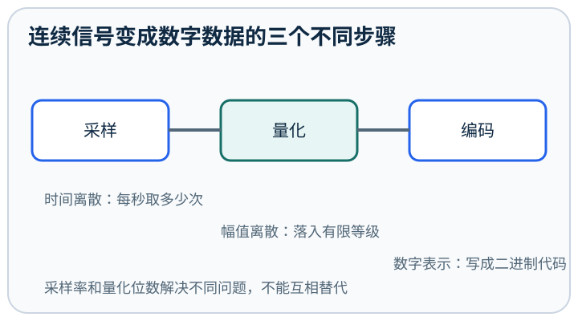
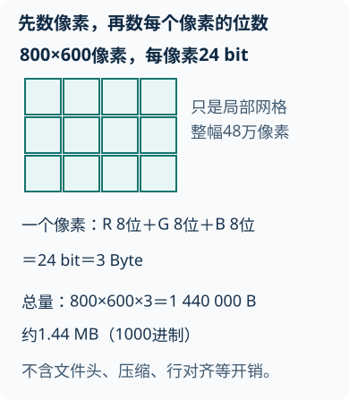
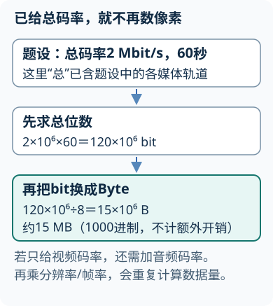
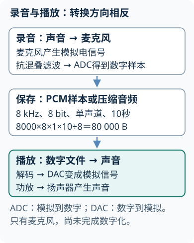
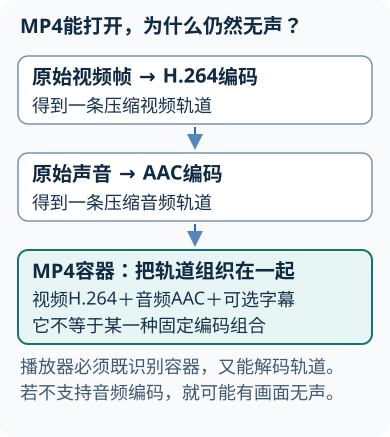
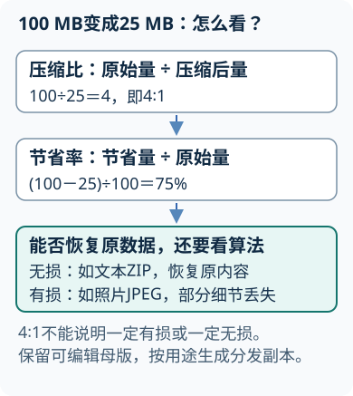

# 多媒体技术基础

## 第1章 多媒体技术概论
<!-- exam: B | 单选、判断 -->

### 1. 多媒体

多媒体是对文本、图形、图像、声音、动画、视频等多种数字媒体进行获取、处理、存储、集成、传输和展示的技术。

主要特点：

- 多样性：信息可用多种媒体形式表达。
- 集成性：不同媒体由计算机统一组织和处理。
- 交互性：用户可控制信息呈现和系统响应。
- 数字化：媒体转化为计算机可处理的数据。
- 实时性：音视频等常要求按时间连续处理。

其中交互性是多媒体系统区别于传统单向复合媒体的重要特点。

### 2. 常见媒体类型

另一组教材分类按信息经过的环节区分：感觉媒体是人能直接感知的声音、图像等；表示媒体是表达它们的编码方式；表现媒体（有的题称显示媒体）是键盘、显示器、扬声器等输入输出设备；存储媒体是磁盘、光盘等记录介质；传输媒体是电缆、光纤等传送通道。同一条视频链路可以涉及多个角色，不能把感知内容与承载设备当成同类。

- 文本：字符和符号信息。
- 图形：由点、线、曲线等几何元素描述。
- 图像：由像素组成的视觉信息。
- 音频：声音数字化后的数据。
- 动画：连续画面产生运动效果。
- 视频：连续图像帧，通常还包含音频。

### 3. 超文本与超媒体

超文本通过链接把文本节点组织成非线性结构；超媒体把链接对象扩展到图片、音频、视频等多种媒体。超媒体包含超文本思想，但媒体形式更丰富。

### 4. 多媒体系统组成

**VR与AR：** 虚拟现实（Virtual Reality，VR）用计算机生成环境，结合头部或手部跟踪使用户能沉浸其中并交互；增强现实（Augmented Reality，AR）把数字对象叠加到真实环境中。观看普通三维动画不必然是VR：画面立体只是表现方式，是否能随用户动作改变视角、操作对象，才关系到交互与沉浸。

通常包括硬件平台、操作系统和驱动、媒体处理软件、创作工具、多媒体数据和应用系统。硬件负责采集、处理、存储、输入输出和通信，软件负责编辑、集成和控制。

### 5. 常见多媒体硬件

输入和采集设备包括键盘、鼠标、扫描仪、数码相机、麦克风、摄像头和采集卡；输出设备包括显示器、投影仪、打印机、扬声器和耳机；存储设备用于保存媒体数据；网卡等通信设备用于传输。

声卡主要完成声音的输入、输出和处理，显卡主要承担图形图像显示与计算，采集卡把外部音视频信号送入计算机。设备分类要看它在系统中的主要功能，同一设备也可能同时具有输入和输出能力，例如触摸屏既显示信息又接收触摸操作。

先判断：网页自动播放图文视频但用户不能选择路径，是否一定体现了强交互性？

不一定。它体现多样性和集成性，但强交互性要求用户操作能改变内容选择、顺序或系统响应。媒体种类多不等于交互程度高。

## 第2章 多媒体计算机系统与数字化
<!-- exam: A | 单选、判断、填空、计算 -->

### 1. 采样、量化、编码

- 采样：在时间上按一定间隔取得信号值，使时间离散化。
- 量化：把连续幅值归入有限等级，使幅值离散化。
- 编码：把量化结果转换成数字代码。

三者顺序不能颠倒。位数越多，量化级数越多，表示通常越精细，但数据量也增大。n位可表示 `2^n` 个不同状态。

对最高频率为 `f_max` 的限带信号，为避免频谱混叠，奈奎斯特速率为 `2f_max`，一般采用 `f_s > 2f_max` 保证频谱分离。实际系统通常在采样前使用抗混叠低通滤波器，并留出一定余量。提高采样率只能获得更密的时间样本，不能恢复采集前已经丢失的信息。

**通俗理解：** 把连续声音画成一条曲线，采样像沿水平方向按固定时刻拍照，量化像把每张照片中的曲线高度归到有限刻度，编码再给每个刻度写上二进制编号。因此采样率决定时间上取点多密，量化位数决定幅值刻度多细，两者不能互相替代。类比中的“照片”只是瞬时测量值；实际采集还要在采样前限带，超过可表示频率后形成的混叠不能靠事后提高位数恢复。

### 2. 基本单位

- bit（位）是最小二进制单位。
- Byte（字节）通常等于8 bit。
- KB、MB在不同环境中可能按1000进制或1024进制使用，换算时必须先统一约定。
- 码率表示单位时间的数据量，常用 bit/s。

### 3. 基础容量关系

- 位图原始容量约为：宽×高×每像素位数÷8。
- PCM音频容量：采样率×量化位数×通道数×时间÷8。
- 按码率保存的音视频容量：总码率×时间÷8。

已经给出压缩后的总码率时，通常不再重复乘像素、位深和帧率。

**通俗理解：** 未压缩媒体的容量可以看成“格子数量×每格占用位数”：图像的格子是像素，PCM 音频的格子是各通道每秒取得的样本。码率则已经把单位时间产生多少数据汇总好了，所以容量直接用码率乘时间。这个模型只估算媒体数据主体；文件头、索引、容器以及可变码率会使实际文件与理论值略有差异。

### 4. 容量估算方法与示例

容量估算遵循“识别媒体类型 → 选择关系式 → 统一单位 → 代入计算 → 标明近似值”的顺序。

- 一幅未压缩位图为800×600像素、24位色，原始容量约为 `800×600×24÷8=1 440 000 B`，按1000进制约1.44 MB；若采用1024进制，应按相同单位体系换算。

先遮住图中结果：如果宽、高都加倍，色深不变，容量变成几倍？宽和高各乘2，像素数乘4，因此容量是原来的4倍，而不是2倍。

- 8 kHz、8 bit、单声道PCM录音10秒，容量为 `8000×8×1×10÷8=80 000 B`，约80 kB。
- 总码率为2 Mbit/s的视频播放60秒，容量为 `2×60÷8=15 MB`（按1000进制）。这里已经给出总码率，不再乘分辨率或帧率。

再改一个条件：若题目给的是视频码率2 Mbit/s，另有音频128 kbit/s，则先合计为2.128 Mbit/s；60秒约15.96 MB。只有“总码率”才能直接覆盖全部轨道，不能漏加音频，也不能把已经包含的音频再加一遍。

结果是理论数据量或近似值；实际文件还可能包含容器、文件头、索引等开销，压缩编码也可能采用可变码率。

**示例（容量估算）：** 某课程视频 2 小时，平均码率 2.5 Mbit/s。  
容量约为 `2.5 × 10^6 × 3600 × 2 / 8 ≈ 2.25×10^9 B`，约 `2.25 GB`。  
考试中关键是统一单位：码率通常按 bit/s，最终换算成 Byte 要除以 8。

### 临界采样的边界

“两倍最高频率”是理论边界，并非任何信号恰好在两倍处采样都可恢复。例如正弦波恰在每半周期过零点被采样，得到的样值可能全为零，无法辨认原幅度。基础计算可先求奈奎斯特速率，具体系统还需留出滤波过渡带，并说明信号带限和重建条件。

先计算：最高频率18 kHz的带限音频，理论最低采样率是多少？16 bit量化有多少个等级？

奈奎斯特速率为36 kHz，实际采样率应高于边界并留出滤波余量；16 bit可表示`2^16=65536`个量化等级。

## 第3章 数字图形与图像
<!-- exam: A | 单选、判断、计算、场景题 -->

### 1. 位图与矢量图

位图由像素组成，适合照片和色彩细腻的画面，放大后容易出现像素和锯齿。矢量图由几何公式描述，适合标志、图标和线条图形，缩放时可重新计算绘制。

主要区别可从组成单位、缩放效果、适用对象和文件大小影响因素比较。

### 2. 分辨率与颜色深度

刷新率以Hz表示屏幕每秒刷新的次数，分辨率表示水平和垂直像素规模。1920×1080、60Hz分别回答“有多少像素”和“每秒刷新多少次”；提高刷新率不等于增加像素数。

图像分辨率常用水平像素×垂直像素表示。颜色深度表示每个像素使用的位数，n位理论上最多表示 `2^n` 种颜色。

PPI常表示单位长度上的像素数量，DPI常用于描述打印或输出设备的点密度，两者不能在所有场景中完全等同。

### 3. 颜色模型

- RGB：红、绿、蓝三色光相加，主要用于显示器等发光设备。
- CMYK：青、品红、黄、黑，主要用于彩色印刷。
- HSV/HSB：用色相、饱和度、明度描述颜色，便于调色。
- YCbCr：分离亮度和色度，常用于图像、视频处理和压缩。

屏幕上的RGB颜色不保证印刷后完全一致，因为RGB与CMYK的色域和成色方式不同。

### 4. 常见图像格式

- BMP：常见位图格式，压缩较少或不压缩，文件通常较大。
- JPEG/JPG：有损压缩，适合连续色调照片，不适合反复编辑保存。
- PNG：无损压缩，支持透明，适合网页图像和图标。
- GIF：颜色数量有限，支持简单动画和透明。
- TIFF：常用于高质量图像、扫描和出版。
- SVG：矢量图格式，适合图标和可缩放图形。
- PSD：常用于保留图层等编辑结构。

### 5. 图像处理基本对象

**蒙版怎样保留退路：** 复制原始图层或保留原文件，给副本添加图层蒙版；在蒙版上涂黑隐藏对应区域、涂白恢复显示，灰色产生部分透明。例如抠人物时先粗选主体，再用软边画笔在蒙版边缘微调，误擦时改用白色画回来。直接橡皮擦删除像素后，关闭文件再打开可能无法恢复；蒙版不改原像素，但交付源文件仍需保留图层。

**画笔是一串笔尖印章：** 连续笔画由沿路径排列的笔尖印记组成。间距大时能看到分离的圆点，间距小则连成线；硬度高边缘清晰、硬度低边缘柔和；渐隐控制笔触参数随长度变化。大小决定笔尖直径，不能用调大小代替调间距或硬度。

图层用于分开管理对象；选区限定编辑范围；蒙版控制显示和隐藏；路径表示矢量轮廓。非破坏编辑强调保留原始素材、使用调整图层或蒙版，并保存可编辑源文件。

先选择：可任意缩放的单位标志和带半透明阴影的网页截图，分别优先用什么形式？

标志优先使用SVG等矢量形式；截图属于位图，可用支持Alpha透明的PNG。选择取决于内容结构和后续用途。

### 6. 选区、修图与图层怎样配合

Alpha通道用灰度保存选区强度：白色为选中、黑色为未选中、灰色为部分选择；与“图层蒙版白显黑藏”的用途相关，但它本身不自动删除像素。图层面板的眼睛图标控制可见性，隐藏与删除图层不同。

在Windows桌面Photoshop默认键位中，椭圆选框配合`Shift`可限制为正圆，`X`交换前景色与背景色，`Ctrl+Backspace`用背景色填充选区或图层；实际效果还要检查当前选择、锁定与工具设置，快捷键可自定义。

**先把范围选准：** 普通套索自由描边，多边形套索沿直线连点，磁性套索沿明显边缘吸附。磁性套索的宽度决定在指针周围多大范围内寻找边缘，对比度阈值决定多明显的边缘才被接受；背景复杂时先缩小搜索宽度、提高边缘要求并手工加固定点，不是把宽度调大就一定更准。

抗锯齿通过边缘少量过渡像素减轻阶梯感，通常尽量保留轮廓细节；羽化把选区边界扩展成较宽的透明过渡，适合柔和融合。给证件照人物抠边时，过大的羽化会让轮廓发虚，两者不能当成同一个开关。选区可保存为Alpha通道并重新载入；Alpha保存选择强度，不是RGB颜色通道，也不自动更改原图颜色。

**仿制图章的三步：** 在Windows桌面Photoshop中先用`Alt`单击干净区域确定样本，再移动到瑕疵处涂抹，观察纹理方向和边缘。可新建透明图层并按需要选“当前和下方图层”等采样范围，保留原图；若只采样一个空透明层，通常没有可复制的像素。笔刷不透明度控制作用强度，混合模式控制新旧颜色如何组合，二者都不能替代选对样本。

背景层通常带有专门限制，先转换为普通图层，才能像普通层那样自由调整层级和透明区域。自由变换针对选中的图层或对象缩放、旋转、斜切和透视等，修改画布尺寸则改变整个画布边界。先确定目标对象，再拖动控制点并确认变换；反复缩小放大位图可能丢失细节，智能对象可减少直接重采样的损失，但不能凭空还原源图没有的细节。

先排障：新建透明层后用仿制图章涂抹没有效果，最先查哪两件事？

先查是否已设置有效采样点，以及采样范围是否只选了当前空层。确认样本来自有内容的可见层，再检查不透明度、选区和图层锁定。不要先删除原图重来。

## 第4章 数字音频
<!-- exam: A | 单选、判断、计算、场景题 -->

声音进入计算机的一般链路是：声波 → 麦克风转换为模拟电信号 → 放大与抗混叠滤波 → ADC采样、量化、编码 → 数字音频数据。播放时大体相反：数字数据经解码和DAC转换为模拟电信号，再由扬声器转换为声波。

计算机内部通常用不同电平承载0和1，是因为半导体开关易于高速、稳定地实现逻辑运算、存储和复制。要区分：声音是物理信号，麦克风输出的是模拟电信号，采样编码后得到数字数据，而数字数据仍需由电、光或无线电等物理信号承载。

### 1. 音频的主要参数

声音的响度、音调、音色回答不同问题：响度是主观强弱感受，与声压和频率等有关；音调主要对应基频高低；音色由谐波、包络等决定，可区分同音高的不同乐器。录音时先选择安静环境，保持合理且稳定的麦距、避免喷麦与过载，并录一段环境底噪供后期判断；后期降噪不能保证补回削波或已经丢失的细节。

- 采样率：每秒采样次数。
- 量化位数：每个样本使用的位数。
- 通道数：单声道、双声道等。
- 码率：单位时间传输或存储的数据量。

采样率、位数和通道数增加，原始数据量通常增大；音质还受声音源、设备和编码方式影响，不能只看一个参数。

### 2. 波形音频与MIDI

波形音频记录声音采样值，可表现人声和环境声。MIDI记录音符、力度、音色和控制信息，不直接记录真实声波，文件通常较小，但播放效果依赖音源。

### 3. 常见音频格式

WMA（Windows Media Audio）属于音频编码/格式家族；WMV（Windows Media Video）侧重视频。名称相近仍需区分音频与视频，不能把二者当成同一种媒体数据。

- WAV：是容器，常保存PCM，也可以保存压缩音频。
- MP3、AAC：常见有损压缩格式。
- FLAC：无损压缩格式。
- MIDI：演奏控制数据，不是录音格式。

WAV是容器而不是“无压缩”的同义词；MIDI记录演奏事件，也不是人的声音波形录音。

### 例题

**题目：** 44.1 kHz、16 bit、双声道PCM音频，未压缩1秒的数据量约为（ ）。
- A. 44.1 kB
- B. 88.2 kB
- C. 176.4 kB
- D. 705.6 kB

查看答案与解析

**答案：** C

**解析：** `44100×16×2×1÷8=176400 B`，按1000进制约176.4 kB。

## 第5章 动画与数字视频
<!-- exam: B | 单选、判断、计算 -->

### 1. 动画基本概念

动画通过连续显示不同画面形成运动感觉。基本概念有帧、帧率、时间轴、关键帧和补间。

- 逐帧动画：每个关键画面分别制作，控制精细但工作量大。
- 运动补间：系统生成对象位置、缩放、旋转等中间变化。
- 形状补间：系统生成矢量形状之间的变化。

基础关系：动画时长＝总帧数÷帧率；总帧数＝时长×帧率。

### 2. 视频主要参数

#### 元件、实例与时间轴

在传统Flash/Adobe Animate制作语境中，舞台是最终呈现画面的范围，工作区可临时放置素材；放在舞台外不等于会进入导出的成片。时间轴按帧记录状态：普通帧延续已有内容，关键帧保存新的关键状态，空白关键帧从无内容开始。桌面默认快捷键通常为`F5`插入帧、`F6`插入关键帧、`F7`插入空白关键帧，键位可自定义，判断仍应看实际帧内容。

**让背景不闪、人物会动：** 把背景与人物放在不同层，背景层延长持续帧；人物在起止关键帧设置位置，再使用相应补间。若背景只存在第1帧而后面是空白关键帧，后续就会消失。需要补间的对象类型与补间种类必须相容，不能把任意位图直接当作可形变的矢量形状。

元件是库中可复用的定义，舞台上的实例是对该定义的一次使用；多个实例可有不同位置、缩放或颜色效果，修改元件定义会影响引用它的实例。图形元件的动画随父时间轴播放，影片剪辑拥有独立时间轴，按钮用不同状态响应指针操作。要让角色在主时间轴停住时仍继续独立眨眼，通常选影片剪辑；要逐帧对齐口型，图形元件更便于同步控制。

遮罩层决定被遮罩层哪些区域可见：上层遮罩的有效形状像一个移动窗口，下层内容只在窗口覆盖处显示。让圆形遮罩从左到右移动，可逐渐揭示下层标题；只移动标题但遮罩不变，会改变显示位置，不能保证相同的揭示过程。按目标运行环境预览，避免把创作窗口效果直接当最终输出。

视频的重要参数包括分辨率、帧率、位深、码率、编码格式和音频参数。分辨率表示画面像素数量，帧率表示每秒画面数，码率影响单位时间数据量。

分辨率相同的视频，因码率、编码方法、帧率和内容复杂度不同，质量和文件大小仍可能不同。

### 3. 编码器与容器

编码器规定音视频怎样压缩和解压，如H.264、H.265等；容器把视频、音频、字幕和其他信息封装在一起，如MP4、MKV、MOV、AVI。

文件扩展名通常反映容器，不能唯一确定内部编码方式。

**通俗理解：** 编码器像行李的折叠和压缩方法，容器像装行李的箱子：H.264、H.265 规定视频数据怎样压缩，MP4、MKV 则把视频、音频、字幕等轨道组织在一起。看到 `.mp4` 只能知道“箱子”类型，不能断定里面一定使用哪种视频或音频编码；设备能打开容器，也不代表具备解码其中每条轨道的能力。

### 4. 流媒体

旧题中的RealMedia是曾用于网络音视频与流式播放的媒体体系名称；学习时抓“边接收边播放及缓存”的机制，不把某个旧品牌当作所有流媒体的唯一标准。

流媒体允许边接收边播放，可用于直播或点播。主要指标包括网络吞吐、启动时间、缓冲、时延和抖动。自适应码率会根据网络状况切换不同清晰度，以减少卡顿。

先计算：10秒动画按25帧/秒制作，需要多少帧？MP4扩展名能否确定内部一定是H.264？

需要250帧。不能仅凭扩展名确定编码器；MP4是容器，内部视频可以采用不同编码。

## 第6章 多媒体数据压缩
<!-- exam: A | 单选、判断、填空、计算、场景题 -->

### 1. 压缩的作用

空间冗余来自相邻像素常相似，时间冗余来自相邻视频帧常重复，统计冗余来自符号概率不均匀。例如静止背景不用每帧重存所有变化量；熵编码可给高概率符号较短码字，但必须满足可解码的编码规则，不能随意省略比特。

压缩可以减少存储空间和传输带宽需求，提高传输与处理效率。压缩利用数据中的重复、相关或人眼人耳不敏感的信息。

### 2. 无损压缩与有损压缩

- 无损压缩：解压后可恢复原数据，适合文本、程序、图标和需要继续编辑的资料。
- 有损压缩：允许丢弃部分信息换取更高压缩比，常用于照片、音频和视频分发。

有损压缩不是“文件损坏”，而是在允许的质量范围内减少数据；但反复有损保存可能逐步降低质量。

**通俗理解：** 无损压缩像把衣服折叠装箱，展开后每件内容都能原样恢复；有损压缩像为长篇材料制作保留重点的精简版，主动舍弃人眼或人耳较不敏感的信息来换取更小体积。这个类比不表示有损部分可以在解压时找回，也不表示无损文件一定很小：可压缩程度取决于数据冗余，编辑母版和长期归档通常更重视可恢复性，分发副本才常在质量与体积间取舍。

### 3. 压缩比

压缩比常写为 `原始数据量÷压缩后数据量`，数值越大表示压缩程度越高；空间节省率可写为 `(原始量－压缩后量)÷原始量×100%`。两者含义不同，不能直接混用。

### 例题

**题目：** 需要压缩程序并保证解压后每个字节完全一致，应选哪种方式？
- A. RAR无损归档
- B. 使用有损MPEG视频编码
- C. 使用MP3音频编码
- D. 使用JPEG有损图像编码

查看答案与解析

**答案：** A

**解析：** 无损归档能恢复原始字节，适合程序和文档。有损媒体编码以舍弃部分信息换取更小体积，不能用于保存任意程序。容器或扩展名本身不能完整决定内部编码；本题已明确B使用有损编码。

## 第7章 多媒体作品设计与应用
<!-- exam: C | 单选、判断、场景题 -->

### 1. 基本制作流程

需求分析和确定受众 → 设计内容结构与脚本 → 采集制作素材 → 编辑集成 → 测试修改 → 发布维护。

### 2. 设计原则

**分镜与素材管理：** 把作品按镜头或页面拆开，每行记录“序号、画面、解说/字幕、时长、素材名和转场”。例如教学镜头03可写“点击保存按钮，字幕提示保存路径，5秒，clip_03_save.mp4，直接切换”。分镜先验证信息顺序，避免拍完才发现缺关键动作。素材按图片/音频/视频分目录，名称可用“序号_内容_版本”，保留授权记录和原件，修改副本；不要只用“最终版2”覆盖全部历史。

- 内容正确，结构清楚。
- 突出重点，减少无关装饰。
- 导航一致，反馈及时。
- 文字可读，声音清楚，画面适当。
- 兼顾无障碍、版权、隐私和设备兼容。

### 3. 常见应用

多媒体广泛用于教育培训、文化传播、数字出版、会议展示、广告设计、公共服务和网络通信。选择媒体形式要服从信息特点和使用目的。

先规划：面向手机网络制作三分钟操作教学视频，发布前至少检查哪些环节？

确认受众、屏幕和网络条件，编写脚本；准备有授权的素材和字幕；选择合适分辨率、码率、容器与编码；检查同步、导航和可读性；在目标设备测试，并保留可编辑源文件。

