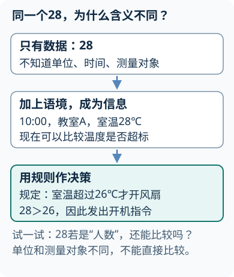
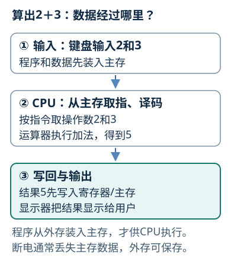
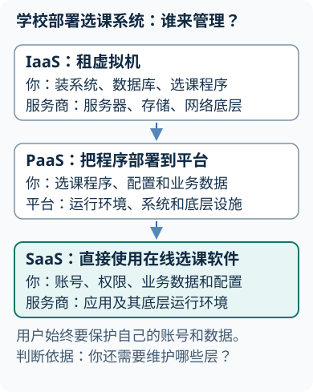
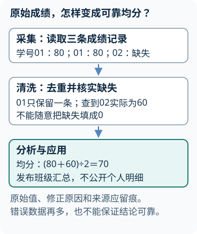
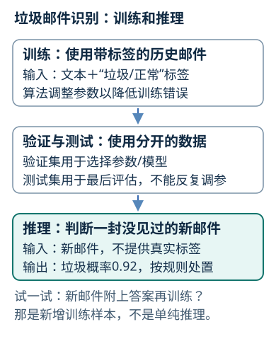
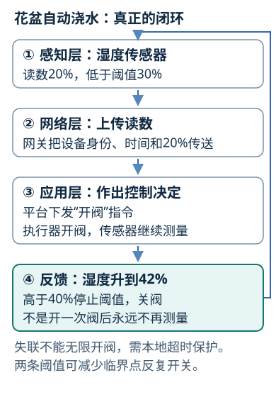
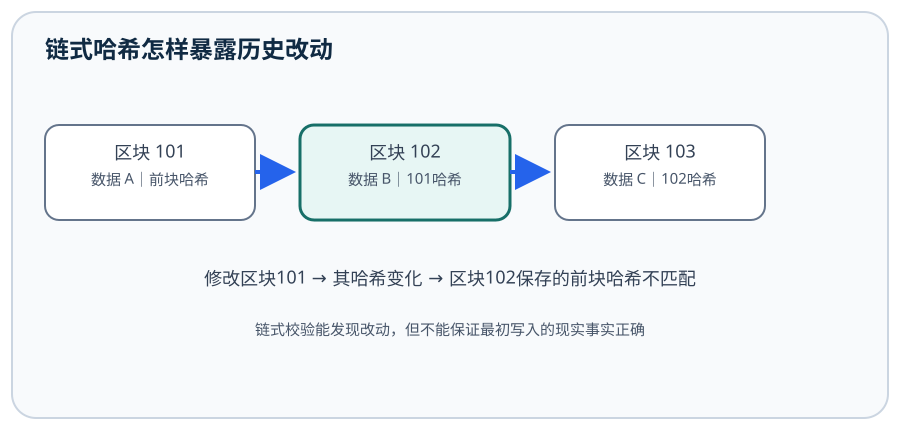

# 大学计算机基础与新技术

## 第1章 信息、计算与计算思维
<!-- exam: B | 单选、判断、简答、场景题 -->

### 1. 数据、信息与知识

数据是可记录和处理的符号，信息是数据结合语境后表达的含义，知识则是在信息之间建立可解释、可复用的联系。`28`只是数据；“今天室温28℃”形成信息；结合人体舒适区判断是否开空调，才使用了知识。

信息特征包括依附、传递、共享、时效、价值和真伪等方面。同一信息可由文字、图像或声音承载；可以共享不等于可以绕过授权传播，有价值也不等于对每位接收者价值相同。

**通俗理解：** 数据像尚未贴说明的测量值，语境和单位把它变成信息，结合规则和经验后才能支持决策；来源不可靠的数据不会因解释得流畅就自动可信。

遇到网络统计图，先核对发布主体、原始数据、时间范围、统计口径和单位，再用独立来源交叉验证。图表制作精美、转发量大、结论符合直觉，都不能代替证据。

先判断：截图写着“就业率95%”，能否直接比较两所学校？

不能。至少还要核对毕业年份、样本范围、就业定义、统计截止时间和数据来源。口径不同的百分比不能直接比较。

### 2. 计算思维与问题求解

计算思维不是“会用计算机”，而是把问题组织成可执行、可检验的步骤。常用方法包括分解、抽象、模式识别和算法设计：先把复杂任务拆成子任务，保留影响结果的关键属性，寻找重复结构，再给出有限且明确的步骤。

算法应具备有穷性、确定性、可行性、输入和输出。流程图中矩形表示处理，菱形表示判断，平行四边形表示输入输出。面对“统计一组成绩的最高分”，可将首个成绩作为当前最大值，逐个比较并更新，遍历结束后输出；只写“找出最高分”还不是可执行算法。

**场景方法：** 设计宿舍报修流程时，输入是房间、故障类型和描述；分解为登记、分派、维修、验收；抽象掉与处理无关的聊天内容；用状态变化检验是否出现“未维修却已完成”。计算思维的结果可以由人执行，不限于编程。

先想条件：查找通讯录中的某人，能否直接使用二分查找？

先确认数据是否已经按查找字段排序。已有有序数据可用二分查找；无序且数据量小时，顺序查找往往更合适，不能为一次查找先付出高昂排序成本。

## 第2章 信息表示与计算机系统
<!-- exam: A | 单选、判断、填空、计算、简答 -->

### 1. 数制转换与容量单位

位置计数法按位权求值。一位八进制对应3位二进制，一位十六进制对应4位二进制。十进制整数转二进制可反复除2取余并倒序，小数部分可反复乘2取整数并按顺序排列。

十六进制`2F=2×16+15=47`；二进制`101101`按位权也可算得45。容量题必须先区分bit与Byte：`1 Byte=8 bit`。存储题常按`1 KiB=1024 B`，网络速率的k、M通常按1000计算，以题意为准。

先计算：1024×768、24位真彩色、未压缩图像约占多少MiB？

每像素24 bit即3 Byte，容量为`1024×768×3=2,359,296 B=2.25 MiB`。分辨率、色深和压缩率必须分开处理。

### 2. 文本、图像与声音编码

ASCII主要覆盖英文字符和控制符；Unicode为字符分配统一码位，UTF-8是Unicode的一种变长编码方式。字符“1”和整数1用途不同、编码不同；编码是表示规则，不等于加密。

中文信息处理还会区分输入码、交换码或国标码、机内码和字形码：输入码服务键盘或输入法录入，交换码用于约定字符编号，机内码用于系统内部存储处理，字形码用点阵或轮廓描述显示输出。传统GB2312题中，机内码常由区位/国标编码的两个字节最高位置1得到；具体转换必须按题目给出的编码标准，不能推广到Unicode和UTF-8。OCR则从扫描图像识别字符，结果仍需校对，不能把图片扩展名改成文本格式来代替识别。

位图按像素记录颜色，未压缩容量近似为`水平像素×垂直像素×色深÷8`；矢量图用几何对象描述，缩放时不依赖固定像素。图像分辨率影响像素数量，色深影响单个像素可表示的颜色数。

声音数字化经历采样、量化和编码。未压缩音频容量近似为`采样频率×量化位数×声道数×时长÷8`。提高采样频率或量化位数通常增加数据量；文件若已压缩，不能继续直接套未压缩公式。

### 3. 存储程序与系统组成

冯·诺依曼结构以存储程序为核心，指令和数据以二进制存入存储器，由控制器按地址取指执行。五大部件是运算器、控制器、存储器、输入设备和输出设备；运算器、控制器与寄存器等组成CPU。

寄存器、Cache、主存和外存形成存储层次：越靠近CPU通常越快、越小、每位成本越高。RAM常作易失性主存，ROM或Flash保存断电后仍需保留的内容，SSD和HDD属于外存。操作系统属于系统软件，文字处理软件属于应用软件。

输入输出设备负责采集、呈现或交互，存储介质负责保存信息。麦克风采集声音，扬声器播放声音；录音机是记录和播放的设备，磁带等是承载记录的介质。设备也可能内置存储，因此“是输入输出设备”和“内部能够存信息”并不矛盾。

总线可按任务区分：数据总线传数据，地址总线说明访问位置，控制总线传读写等控制信号。n根二进制地址线最多区分`2^n`个地址；按字节编址才对应最多`2^n B`的地址空间。例如20根地址线可区分`2^20`个字节地址，即1 MiB，实际安装的内存可能小于此上限。

BIOS/UEFI是启动固件，先完成必要的硬件初始化和启动检查，再引导操作系统；它不等于Windows本身。计算机“裸机”通常指尚未配置软件的硬件系统，系统软件与应用软件则是按职责区分的两类软件。

**易错边界：** CPU不等于主机，更不等于整个计算机系统；字长不等于存储容量；主频高也不能脱离指令数、每条指令用时和存储等待判断整机性能。

## 第3章 操作系统、文件与软件
<!-- exam: B | 单选、判断、简答、场景题 -->

### 1. 文件、目录与路径

目录负责组织和定位文件。绝对路径从根位置开始，相对路径以当前工作位置为参照，能否正确解析取决于当前目录。

扩展名通常提示格式和默认打开方式，但只改扩展名不会重新编码内容。把`photo.jpg`重命名为`photo.pdf`只是换了标签，真正转换格式需要软件读取原格式后按目标格式重新编码。

压缩包用于封装并减少文件总体积，不一定是安装包。复制产生独立副本，移动改变位置，快捷方式或符号链接只保存目标引用；删除目标后，引用可能失效。

在Windows文件管理器中，不按修饰键、用鼠标左键拖动普通文件到可写的普通文件夹：同一逻辑卷内通常默认移动，不同卷之间通常默认复制。例如D卷拖到E卷通常复制，D卷一个文件夹拖到同卷另一文件夹通常移动；Ctrl拖动可指定复制，Shift拖动可指定移动。特殊对象、程序内部拖放或权限限制可能采用不同规则，要看鼠标旁的操作提示。

创建快捷方式不等于复制目标文件。常见方法有：在目标文件夹空白处右击，选择“新建→快捷方式”并填写目标路径；例如Windows 7可对目标对象右击，选择“发送到→桌面快捷方式”；或在文件管理器中用Alt拖动、Ctrl+Shift拖动，按提示创建链接。右键拖动后也可从菜单明确选择建立快捷方式。入口文字依版本而异，判断结果时看它保存的是目标引用，还是一份独立文件副本。

### 2. 操作系统资源与工具选择

操作系统管理处理器、内存、文件和设备，并向应用程序提供接口。进程是运行中的程序实例，同一程序可有多个进程；关闭窗口不一定结束全部后台进程。任务管理器用于观察进程和资源占用，文件管理器负责文件目录操作。

Windows中`ipconfig`查看本机网络配置，`ping`测试基本连通性，`tracert`观察路由；Linux中`pwd`显示当前目录、`ls`列目录、`cd`切换、`cp`复制、`mv`移动或改名。应先确定要观察什么，再选择工具。

安装软件要核对来源、权限和依赖，卸载应使用系统或软件提供的入口。直接删除安装目录可能留下服务、配置和注册信息。

### 3. 系统软件和应用软件

操作系统、设备驱动等属于系统软件，为其他程序提供运行基础；表格处理、图书馆管理、学籍管理、下载工具等属于应用软件，服务具体任务。名字里出现“管理”，不等于它就在管理整台计算机的资源。

例如，学籍管理程序由Windows或其他操作系统调度CPU、分配内存和访问文件，因此它是应用软件；操作系统承担的是所有程序共同需要的底层资源管理。

### 4. 窗口、菜单与系统工具

同一桌面上可以打开多个窗口，通常只有一个活动窗口接收当前键盘输入，其他窗口仍可能在后台运行。单击通常选择或定位，双击是按系统间隔连续进行的组合动作，可能打开对象，不能简单理解成两次独立单击。右击常打开对象的快捷菜单，灰色菜单项通常表示当前条件下不可用。

普通可调整大小的窗口可拖动边框改变大小，也可最小化、最大化或还原；是否出现滚动条取决于内容和视图区，不是每个窗口都有。支持的窗口可双击标题栏最大化或还原；旧版Windows 7启用Aero Snap时，拖到屏幕上边缘也可最大化。具体入口和任务栏可放置的位置受系统版本限制，不能把某版本的操作当成所有系统的共同规则。

| 要完成的任务 | 优先使用的入口或工具 |
| --- | --- |
| 查看卡住的进程、CPU和内存占用 | 任务管理器 |
| 查看硬件状态或设备驱动 | 设备管理器 |
| 查找文件、复制移动文件 | 文件管理器 |
| 调整日期与时间 | 系统日期时间设置；常可从任务栏时钟进入 |
| 卸载软件 | 系统应用管理或控制面板的卸载入口 |

Windows 7的控制面板类别视图中，“卸载程序”位于“程序”类别；新系统的设置分类可能不同。管理员账户拥有更高权限，Administrator是内置管理员账户的常见名称，但账户可以重命名或禁用；日常任务不宜无条件使用最高权限。

### 5. 常用快捷键与剪贴板

| 操作 | 常用快捷键 |
| --- | --- |
| 切换活动应用窗口 | Alt+Tab |
| 显示或恢复桌面 | Win+D |
| 关闭当前应用窗口 | Alt+F4 |
| 在支持保存的编辑器中保存文档 | Ctrl+S |
| 打开开始菜单 | Win键或Ctrl+Esc |
| 将活动窗口截图复制到剪贴板 | Alt+PrtScn |
| 切换持续大写输入状态 | Caps Lock |

剪贴板用于临时传递复制、剪切或截图内容，粘贴后通常仍可再次粘贴。传统剪贴板的内存机制不等于文件已经保存；现代系统还可能提供历史与同步功能。快捷键有上下文条件，例如Ctrl+S需要应用支持保存，Win+D是显示桌面而非轮换应用窗口。

### 6. 睡眠、休眠与失去响应

传统S3睡眠把会话状态留在仍供电的RAM中，恢复较快；S4休眠把会话保存到非易失存储中的休眠文件，随后可让主存断电，恢复时再读回。现代设备也可能使用其他待机方式，不能把所有省电状态都称为同一种睡眠。

程序失去响应不等于系统正常暂停，可能与资源耗尽、阻塞或故障有关。先用任务管理器确认受影响的进程与占用，能正常保存和关闭时优先这样做，再考虑结束进程；不要直接把所有问题归为“重装系统”。

先选择：网页打不开，第一步用ping还是直接重装浏览器？

先分层定位：检查本机网络配置和其他网站，再用`ping`判断基本连通性，必要时检查DNS。重装浏览器不能验证网络路径。

## 第4章 云计算与服务模型
<!-- exam: B | 单选、判断、简答、场景题 -->

### 1. 云计算特征与服务模型

云计算通过网络按需提供计算、存储、网络、平台或软件服务，常见特征包括按需自助、广泛网络访问、资源池化、快速伸缩和可计量服务。虚拟化是常见支撑技术，但使用虚拟机不自动等于采用完整云服务。

IaaS提供虚拟机、存储和网络，用户通常管理操作系统及以上部分；PaaS提供应用运行环境和开发平台，用户侧重应用和数据；SaaS直接交付软件功能。判断服务模型的关键是“用户还要管理到哪一层”。

**通俗理解：** IaaS像租毛坯机房，PaaS像租带运行环境的工作间，SaaS像直接使用成品服务；实际责任仍以配置和共享责任模型为准。

在线协作文档属于SaaS；需要自行配置操作系统和网络时可选IaaS；只上传代码、由平台管理运行环境时更接近PaaS。选择还要比较合规、迁移、可用性和总成本。

### 2. 部署模式与云边协同

公有云面向多个客户提供共享资源，私有云服务于单一组织，混合云连接不同环境。部署模式描述资源面向谁和如何治理，服务模型描述交付到哪一层，两者不能混为一类。

边缘计算把部分处理放到数据源附近，以降低时延、减少回传或在断网时保持控制；云端适合集中管理、长期存储和跨设备分析。工厂毫秒级停机保护应在本地或边缘执行，历史汇总和模型训练可放云端。

先分工：摄像头每秒产生大量视频，哪些工作放边缘，哪些放云？

边缘可完成实时过滤、告警和隐私脱敏，只上传事件或特征；云端负责长期汇总、跨站点分析和模型更新。分工由时延、带宽、隐私和断网可用性共同决定。

## 第5章 大数据与数据处理
<!-- exam: B | 单选、判断、简答、场景题 -->

### 1. 数据处理流程与质量

大数据常用Volume、Velocity、Variety和Value概括数据量、速度、类型多样性和价值密度。4V是分析框架，不是硬性门槛；数据量大不代表真实、完整或有价值。

数据处理通常经历采集、清洗、存储、处理、分析、展示和治理。清洗处理缺失、重复、异常、格式不一致和错误单位，治理贯穿全程，包含权限、质量、元数据、生命周期和责任划分。

同一订单地址既有“湖南省邵阳市”又有“邵阳”，若汇总前不统一编码，就会被拆成两组；重复订单若不去重，总销售额会虚高。清洗规则应留痕，不能为了结果好看任意删异常值。

### 2. 数据挖掘任务与分布式处理

分类预测离散类别，回归预测连续数值，聚类在无标签时按相似性分组，关联分析发现项目共同出现的关系，异常检测寻找偏离常态的样本。判断任务先看期望输出。

HDFS把大文件分块并在多节点保存副本，MapReduce把批处理分为Map与Reduce阶段，YARN负责资源管理和调度；Spark可在内存中组织多阶段计算。分布式处理扩展容量和算力，也会引入网络、协调、数据倾斜和故障恢复问题。

先判断任务：预测房价、客户分群、发现异常转账分别是什么？

房价是连续值，属于回归；无标签客户分组属于聚类；偏离常态的转账属于异常检测。若已有“欺诈/正常”标签训练，则可改为分类。

## 第6章 人工智能与机器学习
<!-- exam: B | 单选、多选、判断、简答、场景题 -->

### 1. 人工智能、机器学习与学习范式

人工智能研究让机器完成感知、推理、规划、决策和生成等任务。机器学习是人工智能的重要分支，深度学习通常是使用多层神经网络的一类机器学习方法；人工智能还包括知识表示、搜索和规划。

监督学习使用带标签样本，无监督学习从无标签数据发现结构，强化学习通过状态、动作和奖励学习策略。垃圾邮件识别是分类，房价预测是回归，客户分群是聚类，游戏智能体根据得分调整动作属于强化学习。

### 2. 训练、推理与可靠使用

训练阶段根据样本和损失调整参数，推理阶段使用已训练模型处理新输入。训练集学习参数，验证集选择模型和超参数，测试集用于最终评估。训练准确率高而测试表现差，常说明过拟合。

生成式AI可生成文本、图像、音频或代码，输出流畅不代表事实已核实。高风险场景要核对来源、保护敏感数据、检查偏差，并保留人工复核和责任边界。

先判断：测试集成绩不好，可以反复按测试结果调参数吗？

不宜。反复按测试集调参会让测试信息泄漏到训练决策中。调参主要使用验证集，测试集留作末次评估。

## 第7章 物联网
<!-- exam: B | 单选、判断、简答、场景题 -->

### 1. 物联网体系与闭环控制

物联网常分感知层、网络层、平台或处理层、应用层。传感器采集信息，网络传输数据和命令，网关完成汇聚、协议转换或边缘处理，平台管理设备、数据和规则，执行器改变现场状态。

智慧灌溉中，湿度传感器产生数据，网关上传或本地判断，平台结合阈值决定是否灌溉，执行器控制阀门，再由传感器反馈结果。只有上传而没有执行和反馈时，是监测链路，不是闭环控制。

### 2. 身份、安全与失联处理

设备标识用于区分设备，网络地址用于通信定位，用户身份用于认证授权，三者不能混用。常见风险包括默认弱口令、固件漏洞、通信窃听、伪造设备、权限过大和隐私泄露。

措施包括唯一身份、最小权限、加密通信、安全更新、日志监测和网络分区。控制系统还要定义断网、传感器异常和命令冲突时的安全状态。

先处理：温度从25℃突然跳到180℃，应立即全速制冷吗？

先核对量程、变化速率和其他传感器，可进入受限控制并报警。单点异常若直接驱动执行器，可能把传感器故障扩大为事故。

## 第8章 区块链
<!-- exam: C | 单选、判断、简答、场景题 -->

### 1. 区块、哈希、签名与共识

区块链按顺序连接包含交易记录的区块。哈希把内容映射为固定长度摘要，内容变化通常会改变摘要；数字签名验证签署者和内容完整性；共识帮助多个节点对记录顺序或状态形成一致。

“难以篡改”来自链式哈希、多副本和共识的共同约束，不保证输入事实真实。合法主体若写入错误数据，链只能帮助发现后续改动，不能判断现实事实。

**通俗理解：** 哈希链像每页都写着上一页指纹的账本，改旧页会使后续校验断裂；它能暴露修改，却不能阻止最初写入错误事实。

### 2. 类型选择与智能合约边界

公有链通常开放参与，联盟链由许可成员共同维护，私有链由单一组织控制。智能合约是满足条件时按规则执行的程序，仍可能有代码漏洞、权限错误和外部数据源风险。

多家互不完全信任的机构需共同维护可追溯记录时，可评估联盟链；单一可信组织内部的高性能事务，普通数据库通常更直接。选择要比较信任、吞吐、隐私、治理和维护成本。

## 第9章 计算机发展与典型应用
<!-- exam: B | 单选、判断、简答、场景题 -->

### 1. 计算机发展与应用类型

教材常按核心电子器件概括代际：电子管、晶体管、集成电路和大规模或超大规模集成电路。分代描述技术主线，不能理解为某一年所有设备同时换代。

常见应用包括科学计算、数据处理、过程控制、辅助设计、网络通信和人工智能。气象数值模拟侧重科学计算，工资结算侧重数据处理，生产线反馈调节侧重过程控制；分类时看主要任务。

### 2. 信息系统与数字化建设

信息系统由人员、流程、数据、软件、硬件和网络共同组成。技术应服务业务目标，并考虑数据质量、权限、安全、维护和成本。购买设备或部署软件不代表流程已优化、数据已治理或人员已经会使用。

医院上线预约系统时，若科室排班分散、号源责任不清、患者信息重复，服务器再快也不能消除业务冲突。应先明确流程和数据责任，再决定系统怎样支持。

## 第10章 新一代信息技术的综合应用
<!-- exam: B | 单选、多选、判断、简答、场景题 -->

### 1. 按约束组合技术

先明确业务目标、输入输出和成功标准，再识别时延、数据规模、隐私、可靠性、联网条件和多方协作约束，最后说明每项技术解决的问题和带来的风险。

设备预测维护系统可由物联网采集，边缘节点低时延过滤，云平台长期存储，大数据工具汇总分析，AI模型预测异常。组合越多越会增加接口、成本、安全和运维复杂度，因此每一项都必须有清楚作用。

| 主要约束 | 优先考虑 | 仍需检查 |
|---|---|---|
| 毫秒响应、可能断网 | 本地或边缘计算 | 安全降级、设备能力 |
| 弹性资源、集中管理 | 云计算 | 隐私、迁移、持续费用 |
| 海量异构数据 | 大数据处理 | 数据质量是否先过关 |
| 从样本预测或生成 | 机器学习或生成式AI | 泛化、偏差、人工复核 |
| 多方共同维护记录 | 联盟链等共享账本 | 是否真的缺少可信中心 |

先设计：校园能耗系统需5秒内关停异常设备，并做年度分析，怎样分工？

物联网采集；网关或边缘节点在5秒内判断并执行，断网时按安全规则工作；云端保存长期数据并做跨楼宇分析；有足够样本时再用模型辅助预测。无需因“数据共享”自动加入区块链。

场景题按“目标—约束—技术—风险—控制”作答：先说解决什么，再说明为何匹配，最后给出失败条件和人工控制。只罗列热门技术名词不能形成完整答案。
