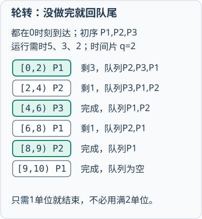
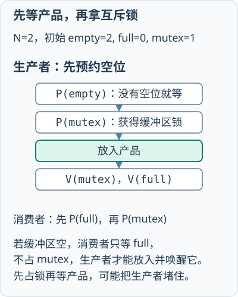
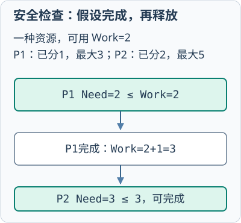
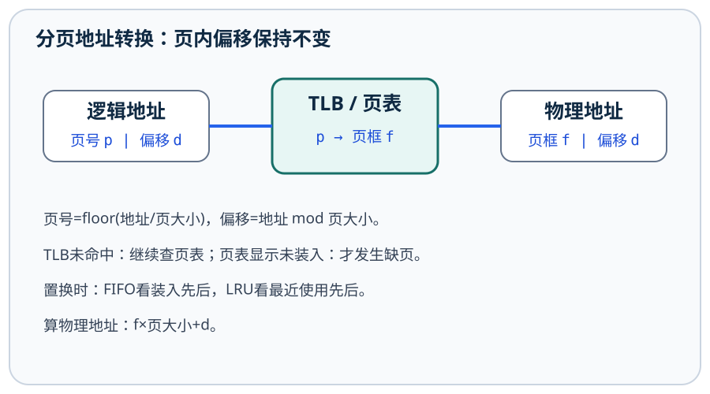
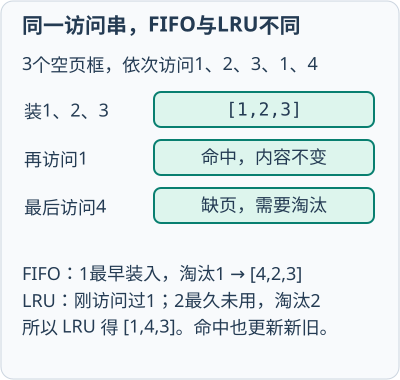
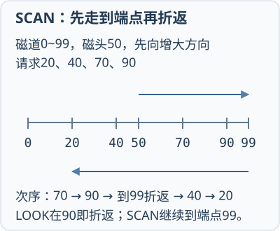

# 操作系统原理讲义

## 第1章 操作系统引论
<!-- exam: A | 单选、判断 -->

### 操作系统功能与基本特征

- 🔴 **操作系统（OS）**：==控制和管理计算机硬件与软件资源==、==合理组织计算机工作流程==，并为用户和其他软件提供方便接口与环境的程序集合，==是系统软件==。
- 🔴 **主要功能**：==处理机管理==（创建/控制进程并调度CPU）、==存储管理==（分配/回收、地址转换、保护、扩充）、==文件管理==（按名存取、目录、共享保护）、==设备管理==（分配、驱动、I/O控制），并提供==用户接口与程序接口==。
- 🔴 **基本特征**：==并发、共享、虚拟、异步==；并发和共享相互依存。并发描述==同一时间段内多个活动共同推进==，并行描述==同一时刻多个活动同时执行==；多核上也存在并发。
- 🔴 **四特征含义**：共享指并发活动受控共同使用资源，可互斥共享或同时共享；虚拟指把物理实体变为逻辑对应物，如虚拟处理机/虚拟地址空间；异步指进程受资源及调度影响，以不可预知速度推进。
- ⚫ **系统分类依据**：==批处理重资源利用与吞吐==，==分时重及时交互==，==实时重规定时限内完成==。单道/多道按内存中作业组织区别；不能把“所有批处理都单道”作为结论。
<!-- test: 填空、简答 | 写全基本特征、管理功能及三类系统的设计目标 -->

### 常见分类

- 批处理系统：成批提交作业，吞吐量较高，交互性弱。
- 分时系统：多个用户按时间片共享主机，强调及时交互。
- 实时系统：在规定时间内响应，分硬实时和软实时。
- 网络操作系统：为网络资源共享和通信提供服务。
- 分布式操作系统：把多台计算机组织成统一系统。
- 嵌入式操作系统：面向专用设备，资源受限、可靠性要求高。

### 常见类型判断

银行夜间集中处理大量账单，突出吞吐量，具有批处理特点；多人同时登录服务器交互，强调响应，具有分时特点；汽车制动、工业控制必须在截止时间内完成，属于实时应用。实时系统的关键是可预测、守时，而不是平均速度最高。

网络操作系统强调各主机自主并提供共享服务；分布式操作系统更强调把多台机器组织成统一整体。二者都使用网络，但透明程度和管理方式不同。

#### 多处理机、网络与多媒体系统
- 🔴 **对称多处理（SMP，Symmetric Multiprocessing）**：多个处理器地位对等，共享主存和I/O，操作系统需协调调度、同步和共享数据访问。处理器亲和性尽量让线程留在近期运行的CPU，以利用缓存；负载均衡又可能要求迁移。
- 🔵 **并行例**：四核执行含串行20%、可完全并行80%的任务，忽略调度通信开销，加速比=1/(0.2+0.8/4)=2.5，并非4。共享内存有并发读写，仍要锁或其他同步。
- 🔴 **网络与多媒体需求**：网络OS强调主机间通信与资源共享；分布式系统还需协调远端故障、命名及一致性。多媒体连续流重持续吞吐、缓冲和时限，如25帧/秒平均每40ms需一帧。
- ⚫ **范围**：这里建立调度、同步和时限的基础联系；分布式一致性算法、具体流媒体调度和内核实现仍需专题学习。

## 第2章 操作系统结构与用户接口
<!-- exam: B | 单选、判断、场景题 -->

### 用户态、内核态与系统调用

- 🔴 **内核与接口**：内核是实现资源管理等核心机制的部分；命令接口和图形界面供用户操作，==程序接口以系统调用供应用请求服务==。
- 🔴 **中断与异常**：外中断通常由==设备/时钟等外部事件==引起；异常由==当前指令执行引起==，如缺页、除零。系统调用利用受控陷入请求服务，不是设备中断。
- 🔴 **特权指令与执行状态**：特权指令仅允许在内核态执行，如修改受保护的控制寄存器；用户态通过受控陷入请求内核服务。中断、异常可引发进入内核的控制转移，==普通函数调用不会自动提权==。
- ⚫ **层次结构**：分层把系统分成依赖受控的层，便于验证和维护，但层间调用可能增加开销；模块化通过明确接口组织功能，与宏内核/微内核分类不是完全相同的维度。

### 一次系统调用的基本路径

用户程序准备参数并执行系统调用指令 → CPU切换到内核态 → 内核检查参数和权限 → 执行文件、进程或设备服务 → 返回结果并切回用户态。用户态和内核态的分离既保护关键资源，也让应用通过受控接口共享系统能力。

**通俗理解：** 进入内核与更换进程是两件事。 例如read所需数据已经在内核缓存中，内核可立即返回，仍由原进程继续执行；若必须等磁盘I/O，原进程才可能阻塞，调度器转而运行别的就绪进程。前者是权限模式切换，后者还改变了执行主体。修改页表等操作会影响地址隔离，不能交给任意用户代码直接执行。

### 内核组织方式

宏内核把进程、内存、文件和设备等多数服务放在内核空间，调用路径短、性能较高，但模块故障影响范围较大；微内核只保留调度、地址空间和通信等核心机制，其他服务更多运行在用户态，隔离性较好但通信开销可能增加。现代系统常采用模块化或混合设计，不能只按名称推断全部实现细节。

#### 系统保护与安全
- 🔴 **保护域与访问矩阵**：保护域是一组可访问对象及允许操作的集合；访问矩阵以域为行、对象为列记录权限。访问控制表（ACL，Access Control List）按对象列出可访问主体和权限，能力表按主体保存可访问对象和操作。
- 🔵 **权限例**：用户甲对文件F有读、无写权限，读取经检查可通过，写入被拒绝；不能因甲已登录就默认可写所有文件。进程隔离靠受控地址映射与权限检查，特权服务仍须核验请求参数。
- ⚫ **安全边界**：认证确认身份、授权控制操作、审计保留记录；最小权限减少误用影响。恶意程序、漏洞与资源耗尽不只靠文件读写位解决，备份也不替代访问控制。

## 第3章 进程、线程与处理机调度
<!-- exam: A | 单选、判断、计算、场景题、简答 -->

### 进程、线程与PCB

- 🔴 **进程的特征与实体**：==动态性、并发性、独立性、异步性==；进程实体由==程序段、相关数据段和进程控制块（PCB）==组成。进程是程序在数据集合上的一次运行活动；引入线程后，==线程是处理机调度和执行的基本单位==，==进程是资源分配的基本单位==。
- 🔴 **程序与线程状态**：程序是静态指令集合；进程是动态活动。同进程线程共享地址空间与打开文件，但各有程序计数器、寄存器和栈；PCB保存标识、状态、现场及调度/资源信息，教材以==PCB为进程存在的唯一标志==。
- 🔵 **调度指标**：==周转T=完成时刻C−到达时刻A==；带权周转=T/服务时间S，S>0；首次响应=首次获CPU时刻−A。==无I/O阻塞的单CPU简化题等待W=T−S==；吞吐量=完成任务数/观察时长。
- ⚫ **三级调度**：高级调度决定作业进入内存，中级调度处理挂起/调入，低级调度选择就绪进程上CPU。阻塞是在等待事件，挂起是暂时移出主要内存运行集合，不能混同。
<!-- test: 计算、过程推演 | 画调度时间线，分别计算周转、等待与首次响应 -->

### 程序、进程和线程

**小例子：** 浏览器可以用不同进程隔离页面，一个页面进程内部又可用多个线程分别处理界面、网络和脚本。某线程破坏本进程共享内存可能影响同进程其他线程，但通常不能直接读写另一个受保护进程的地址空间。

### 基本状态


- 🔴 **就绪**：==除 CPU 外，运行条件已经具备==。
- 🔴 **运行**：==正在使用 CPU==。
- 🔴 **阻塞**：==正在等待某个事件或资源==。

==阻塞进程必须先因事件完成变为就绪，不能直接变为运行==。进程切换需要保存和恢复现场，通常比同一进程内的线程切换开销大。

### 调度方法的基本比较

- 先来先服务 FCFS：按到达顺序，简单公平，但短作业可能被长作业拖延。
- 短作业优先 SJF：优先服务时间短的作业，平均等待时间较短，但长作业可能饥饿。
- 优先级调度：优先运行高优先级任务，可用“老化”缓解低优先级饥饿。
- 时间片轮转 RR：每个就绪进程轮流使用一个时间片，适合分时系统。

==时间片过大时，RR 的效果会接近 FCFS==；时间片过小时，进程切换次数和调度开销会增加。

最高响应比优先HRRN综合等待时间W与服务时间S，优先取`R=(W+S)/S=1+W/S`较大的作业，通常采用非抢占方式。例：时刻4处理机空闲，A在0到达需6单位时间，B在1到达需2单位时间，A为`1+4/6≈1.667`，B为`1+3/2=2.5`，先B。短作业初始占优，长作业等待会提高比值；每次选择时都要更新W，不能用一组旧比值排完全部作业。

**先排就绪队列：** P1、P2、P3分别在时刻0、1、2到达，运行时间为5、3、1。采用非抢占SJF、不计切换开销，时刻1能让P2替换P1吗？P1完成后该选谁？

时刻0只有P1已到达，先运行P1；非抢占意味着它不中途被新来的短进程替换。时刻5 P1完成，就绪队列是P2(3)、P3(1)，选P3。时间线为`P1[0,5)→P3[5,6)→P2[6,9)`。按P1、P2、P3次序，周转为5、8、4，减去各自运行时间得等待0、5、3，平均等待为8/3。SJF从当前已到达的就绪进程中选最短，不能先选时刻0尚未到达的P3；若题目改成抢占式最短剩余时间优先，就要在新进程到达时重新比较。



### 场景中的调度、同步和通信

- 收银前台要让多个任务轮流获得 CPU、保持交互响应，体现调度；时间片轮转适合交互任务，但不能保证某笔业务一定最先完成。
- 多个收银线程同时修改同一库存数量，需要互斥，避免更新互相覆盖；“先扣库存再生成出库记录”等先后关系还涉及同步。
- 线程间共享地址空间，交换数据快但相互影响大；进程间地址空间隔离，通常要通过管道、消息队列、共享内存等 IPC 通信。
- 临界区应覆盖完整的共享状态更新。例如“读取库存—判断—扣减”若被拆开保护，多个线程仍可能依据同一个旧库存完成扣减。线程同步约束进程内的执行次序和共享资源访问。

分析并发场景时先找被争用的对象：若要求“==同一时刻只能一个访问==”，属于互斥；若要求“==必须先 A 后 B==”，属于同步；若多个执行主体互相等待对方持有的资源，则需要进一步分析死锁。

<details><summary>先判断：一个线程等待磁盘读取完成时，应处于就绪态还是阻塞态？</summary>

应处于阻塞态，因为它当前在等待I/O事件，拿到CPU也不能继续执行。磁盘完成后，系统先把它转为就绪态，之后再由调度器选择进入运行态。
</details>

## 第4章 进程同步与死锁
<!-- exam: A | 单选、判断、多选、场景题、简答 -->

### 临界区与原子操作

- 🔴 **临界区管理要求**：==空闲让进、忙则等待、有限等待、让权等待==；临界区是访问临界资源的代码段，临界资源是一次只许一个执行主体使用的资源。
- 🔴 **同步机制**：软件互斥算法、硬件原子指令、信号量和管程等用于协调并发。原子操作执行期间不可被同类操作插入破坏；仅把变量声明为普通整数不保证加减原子性。
- 🔴 **原语**：完成某种特定功能、==执行具有原子性的一段操作过程==，可由若干条机器指令组成，P、V操作是典型例子。“不可分割”描述并发观察下的整体效果，不表示一定只有一条指令；多核实现不能只靠关闭本核中断。
- ⚫ **忙等与阻塞**：自旋锁等待时仍消耗CPU，阻塞等待可让出CPU；短临界区和多核可能适合自旋，不能断言锁都满足让权等待。
<!-- test: 简答、过程推演 | 按P/V顺序推计数、检查安全序列，辨别死锁处理策略 -->

### 同步与互斥

信号量只能通过 P、V 操作改变。P 表示申请资源或等待条件，V 表示释放资源或发出通知。互斥信号量通常初值为 1，资源信号量初值通常等于资源数量。

经典记录型信号量允许取负值：`P(S)`先令`S=S-1`，若结果小于0，就把当前进程放入等待队列并阻塞；`V(S)`先令`S=S+1`，若结果小于或等于0，就从等待队列唤醒一个进程。两种原语内部都必须原子执行。`S>0`表示还有S个可申请资源，`S=0`表示无空闲且无人等待，`S<0`表示有`-S`个等待进程。这里采用教材中的记录型约定；有些软件API把计数保持非负并另存等待队列，不能混用读数。

**先推一步：** 一份共享资料，初始`S=1`。甲执行P后S=0并进入；乙再执行P后会怎样？

乙使S变为−1，进入等待队列，不能访问资料。甲完成后V使S从−1变成0，同时唤醒乙；乙得到这次交接的使用权，继续先前P之后的代码，不再重复P。此时仍无空闲资源，所以S为0并不意味着乙应该继续等待。乙结束后V，S才回到1。

常见模型：

- 生产者—消费者：生产者等待空缓冲区，消费者等待满缓冲区，访问缓冲区时还要互斥。
- 读者—写者：多个读者可以同时读，写者与其他读写必须互斥。
- 管程：把共享数据和操作封装起来，由系统保证管程内部互斥。

#### 缓冲区空了，消费者怎样等？

**通俗理解：** 缓冲区空时，消费者不能取数据，也不能抱着锁一直等，否则生产者进不来。把“缓冲区非空”这个等待条件命名为notEmpty。消费者在它上面wait（等待）：暂时释放管程锁并睡眠；生产者获得锁、放入数据后发signal（通知）。消费者醒来还要重新获得锁，并用while再次检查是否为空，因为唤醒不保证此刻条件仍成立。互斥解决同一时刻谁能改数据，条件变量解决此刻能不能做。

<details><summary>消费者在notEmpty上wait时释放什么？被唤醒是否就能立刻无条件取数据？</summary>

释放管程的互斥锁并等待；醒来需重新获得锁，用while重查非空条件，其他消费者可能已经取走数据。

</details>

### 死锁

- 🔴 **死锁**：一组进程各自等待组内其他进程所持资源，若无外力作用便无法继续推进。
- 🔴 **四个必要条件**：==互斥==——资源一次只许一个进程使用；==请求并保持==——已占有资源的进程继续请求新资源，并保留已有资源；==不剥夺==——已获得资源在使用完之前不能被其他进程强行夺走；==循环等待==——存在进程等待链，链中每个进程都等待下一个进程占有的资源并首尾成环。
- 🔵 **预防对应关系**：把可共享资源改为共享以破坏互斥（并非所有资源都能共享）；一次申请全部所需资源可破坏请求并保持，但利用率可能低；允许对可恢复资源剥夺以破坏不剥夺；统一按资源编号递增申请可破坏循环等待。选择时必须说明资源能否共享、剥夺及请求是否已知。
- ⚫ **条件边界**：==四条件是死锁发生的必要条件==，缺一则不能形成此类死锁；满足它们提供死锁可能性，并不能仅凭四个名词判定当前所有系统已死锁，多实例资源还需进一步检测。

安全状态表示存在一种进程完成顺序，使所有进程都可以依次获得资源并结束。安全状态一定没有死锁；==不安全状态只是有可能发生死锁，不等于已经死锁==。

#### 同步、互斥与信号量

假定缓冲区能放N件产品，初始为空。empty=N表示空位数，full=0表示产品数，mutex=1保护缓冲区结构。生产者先P(empty)申请空位，再P(mutex)进入临界区，放入产品后V(mutex)、V(full)。消费者先P(full)，再P(mutex)，取出后V(mutex)、V(empty)。

```text
生产者：生产一件 → P(empty) → P(mutex) → 放入缓冲区 → V(mutex) → V(full)
消费者：P(full) → P(mutex) → 取出缓冲区 → V(mutex) → V(empty) → 消费
```

**先推一步：** N=2，尚无其他进程竞争。生产者完整放入一件后，`(empty,full,mutex)`是多少？消费者取出这件后呢？

初始为`(2,0,1)`；生产者P(empty)后`(1,0,1)`，P(mutex)后`(1,0,0)`，放入后V(mutex)、V(full)，得到`(1,1,1)`。消费者P(full)、P(mutex)后为`(1,0,0)`，取出并依次释放后恢复`(2,0,1)`。只在没有等待和进行中的预约时，empty、full才可直接当作当前空位、产品数相加；执行中不能机械认为empty+full始终等于N。

顺序的原因在于：等待空位或产品时，不应占住对方完成工作所需的互斥锁。如果生产者先持有mutex，再因缓冲区满而等待empty，消费者可能无法进入临界区取走产品，双方就不能继续。信号量原语的实现还必须保证自身更新的原子性。



#### 银行家算法与安全序列

银行家算法用Max记录最大需求，Allocation记录已分配，==Need=Max−Allocation==记录剩余需求。安全检查把Available复制到Work；==每找到一个Need不超过Work的未完成进程==，就假定它获得所需资源并完成，把它原已占用的Allocation加回Work。若全部进程能依次完成，状态安全。

例如只有一种资源，可用2个。P1已分配1个、最大需求3个，P2已分配2个、最大需求5个。P1剩余需2个，可先完成；净释放原占用的1个后，Work从2变3。此时P2剩余需3个，也能完成，得到P1→P2安全序列。这里是假设性检查，不是把真实资源立即回收。若找不到安全序列，应避免本次试分配，但不能因此断言当前已经死锁。




**先试一笔：** 在上例初始状态下，P2申请1个资源，是否批准？

<details>
<summary>查看试分配与回退</summary>

P2原Need=3，申请1不超需求且Available=2够分。试分配后Available=1，P2的Allocation从2变3、Need从3变2；P1的Need仍为2。安全检查从Work=1开始，两个进程都不能完成，找不到安全序列，所以撤销这笔试分配，恢复Available=2、P2的Allocation=2、Need=3，让P2等待。这里是拒绝新增申请，不是宣告初始安全状态已发生死锁。

</details>

#### 读者写者的计数与互斥
- 🔴 **读者优先基本方案**：共享计数readCount=0，互斥量mutex=1保护计数，rw=1保护读写资源。读者执行P(mutex)、readCount++，若第一个则P(rw)，再V(mutex)；读完后P(mutex)、readCount--，若最后一个则V(rw)，再V(mutex)。写者P(rw)→写→V(rw)。
- 🔵 **状态例**：首读者把count从0改1并取得rw；第二读者把1改2，无须再次P(rw)；首读者退出到1不释放rw，末读者退出到0才释放。写者必须等全部读者退出。
- ⚫ **公平边界**：连续到来的读者可能令写者饥饿，读者优先不能当作读写公平方案；可增加公平入口机制控制到达次序。
- 🔴 **哲学家进餐**：每人先拿左筷再等右筷，所有人都拿一支时形成循环等待。按筷子编号统一从小到大申请可破坏循环等待，或用至多N−1人进入取筷区等方案；让每人永远同时占两支需要原子申请机制，不能只写两条普通取筷语句。

#### 死锁处理与请求检查
<!-- test: 场景题、过程推演 | 区分预防/避免/检测，审核新资源请求 -->
- 🔵 **场景与依据**：要从制度上杜绝锁顺序相反导致的循环等待，可统一资源申请顺序，属于预防；==资源有多个实例且事先知道各进程最大需求==，可用银行家算法避免进入不安全状态；若没有最大需求，不能直接套银行家数据检查。仅把低优先级进程提优先级解决的是饥饿，不会自动打破资源死锁。
- 🔴 **四种策略**：预防预先破坏必要条件，如固定资源申请顺序；避免在分配时保持安全，如银行家算法；检测允许先发生再检查等待关系；解除通过撤销进程或剥夺可恢复资源等打破死锁。
- 🔵 **银行家请求步骤**：对进程i请求向量Request，先检Request≤Need[i]，再检Request≤Available；通过后试改Available−=Request、Allocation[i]+=Request、Need[i]−=Request，调用安全检查。不安全则恢复试改值并等待；可分配与安全是两个检查。

## 第5章 存储器与虚拟存储器
<!-- exam: A | 单选、判断、填空、计算、场景题 -->

### 内存分配与地址空间

- 🔴 **存储管理功能**：==内存分配与回收、地址转换、存储保护、共享和逻辑扩充==。装入可分绝对、可重定位和动态运行时装入，地址绑定时机决定程序能否方便浮动。
- 🔴 **内部/外部碎片**：==已分配区域内未利用部分==是内部碎片；==已分配区域之间零散空闲且难以满足连续请求==的是外部碎片。分页消除连续分配的外部碎片问题，但==末页仍可能有内部碎片==。
- ⚫ **虚拟存储特征**：==多次性、对换性、虚拟性==；依赖局部性、地址转换硬件和外存支持，逻辑容量仍受地址宽度、系统实现和外存空间约束。
<!-- test: 计算、过程推演 | 做地址变换、首次适应分配和页框置换表 -->

### 连续分配与碎片

- 🔴 **连续分配**：一个进程的基本存储区占连续物理空间；固定分区与动态分区是不同安排。

固定分区预先划定，可等大或不等大，但不随当前作业大小变化；动态分区才按申请划分。首次适应通常按地址递增扫描；最佳适应若希望遇首个够大者即停，应按尺寸递增组织。遍历顺序和空闲区尺寸不是同一个量。

#### 连续分配的查找与合并
- 🔴 **适应算法**：首次适应按空闲地址顺序找第一个足够块；循环首次适应从上次位置继续；最佳适应选足够块中最小者；最坏适应选最大者。最佳适应可能留下很多小碎片，不保证全局最佳。
- 🔵 **状态例**：按地址递增的空闲块大小[100,500,200]，请求180：首次适应跳过100并拆500成剩320，结果[100,320,200]；最佳适应拆200余20，结果[100,500,20]。这里假设从块低地址分配且不计管理开销。

### 分页与分段

分页把逻辑空间分成固定大小的页，把物理内存分成同样大小的页框。页表记录页号到页框号的映射。分页便于离散分配，主要产生内部碎片。

设页大小为 `S`、逻辑地址为 `A`，则页号 `p=⌊A/S⌋`，页内偏移 `d=A mod S`。页表把页号 `p` 映射到页框号 `f` 后，物理地址为 `f×S+d`。例如页大小为1024 B、逻辑地址为2500，则页号为2、页内偏移为452；若第2页装入页框5，物理地址为 `5×1024+452=5572`。

分段按程序的逻辑部分划分，如代码段、数据段和栈段，每段长度可以不同。段表记录段基址和段长。分段便于共享和保护，但可能产生外部碎片。

**通俗理解：** 快表/转换检测缓冲区（TLB，Translation Lookaside Buffer） 是缓存近期页表项的高速存储器。TLB 未命中只表示要查页表，并不等于页面不在内存；只有页表表明页面未装入时才发生缺页。

**段页式把两种思想接起来：** 用户空间先按代码、数据等逻辑段划分，每段内部再分成固定页，物理内存按页框分配。逻辑地址为`段号、段内页号、页内偏移`：先查段表找到本段页表，再查页表取得物理页框，最后拼接原偏移。假设页大小1024 B、段2的页表把页1映射到框5，逻辑地址`(段2,页1,偏移100)`转成`5×1024+100=5220`。每次还要检查段、页范围及权限；分段管理逻辑空间，分页管理物理分配，不能颠倒。



### 虚拟存储

#### 虚拟存储与页面置换

- 🔴 **缺页处理**：访问页不在内存→缺页异常→检查访问合法→取空框或选牺牲页（脏页先写回）→从外存调入→更新页表/TLB→重新执行被中断指令。==缺页是异常==，置换只在没有可用框且策略需要时发生。
- 🔵 **有效访问时间模型**：若普通内存访问耗时m、缺页概率p、缺页一次总耗时F（含最终重执行访问），EAT=(1−p)m+pF；m=100ns、p=10⁻⁴、F=10ms，则约1099.99ns，说明小概率慢路径仍可显著影响平均值。


虚拟存储利用局部性，只把当前需要的部分装入内存，使程序看到的逻辑空间可以大于物理内存。

- 时间局部性：最近访问的内容可能再次访问。
- 空间局部性：某地址附近的内容可能很快被访问。

常见页面置换方法：

- 最佳 OPT：淘汰未来最久不用的页，只作理论比较。
- 先进先出 FIFO：淘汰最早进入的页，可能出现增加页框反而缺页更多的现象。
- 最近最少使用 LRU：淘汰过去最长时间未访问的页。
- CLOCK：循环检查访问位，近似实现 LRU。

抖动是进程频繁缺页换页、实际执行效率很低的现象，常与分配页框不足或并发程度过高有关。

**CLOCK逐格走：** 三个页框按环排列，内容与访问位为`[1(1),2(0),3(1)]`，指针指向框0。访问一个已在内存中的页就把其访问位置1。现在页4缺页且必须置换：先看框0的页1，位1改0并向前走；框1的页2位0，选它淘汰，装页4并置位1，指针移到框2。结果`[1(0),4(1),3(1)]`。下一次命中页1只把其位改1，通常不移动置换指针。扫描遇1先给第二次机会，遇0才淘汰；并非每次都从框0重找，也不等同于精确LRU。

以两个初始为空的页框、访问串1、2、1、3、1、2为例：FIFO在第三次访问1时只命中，不更新装入次序，后续依次淘汰1、2、3，共缺页5次；LRU第三次访问1会更新最近使用记录，访问3时淘汰2，随后访问1命中，最后访问2才再次缺页，共缺页4次。比较时必须保持页框数、初始状态和访问序列相同。

下面另用**3个初始空页框、访问串1、2、3、1、4**跟踪命中后的队列变化。不要沿用上一例的2页框条件；本图仍在同一访问串和容量下比较两种策略。



### 覆盖、交换与虚拟存储辨析

覆盖由程序员或编译工具事先把互斥使用的程序段放到同一内存区域，主要解决早期内存不足；交换由操作系统把整个进程暂时移到外存再调回；虚拟存储由系统和硬件按页或段自动调入所需部分。三者都能缓解内存限制，但管理粒度和透明程度不同。

逻辑地址是程序使用的地址，物理地址是主存单元的实际地址。动态地址转换由硬件在程序运行时完成，使程序装入不同物理位置仍可执行，并为保护、共享和虚拟存储提供基础。

静态重定位在装入时按物理位置一次调整有关地址；动态重定位在运行时通过硬件解释逻辑地址，便于程序浮动。例：逻辑偏移100、基址4000，得到物理地址4100；系统按受控流程迁移进程并把映射基址改6000后，同一逻辑偏移对应6100，不必让程序自行逐条修改逻辑地址。

内存保护常通过基址/限长、页表权限位等实现。保护的目的不是禁止一切共享，而是让共享只能通过受控区域和权限进行。


## 第6章 文件管理
<!-- exam: B | 单选、判断、场景题 -->

### 文件结构与基本操作

- 🔴 **文件与文件系统**：==文件是具有名称的相关信息集合==；文件系统负责按名存取、组织目录、分配回收外存空间、共享保护与维护元数据。
- 🔴 **逻辑结构与物理结构**：逻辑结构从用户看有==流式（无结构）文件和记录式（有结构）文件==；物理结构描述数据块如何存放，包括==连续、链接、索引分配==。顺序存取/随机存取是访问方法，不能与分配方式直接等同。
- 🔵 **基本操作**：创建分配元数据，打开把目录信息接入打开文件表，读写推进文件偏移，定位改变偏移，关闭释放打开状态；==关闭不等于删除文件==。
<!-- test: 单选、计算、简答 | 区分结构与操作，按逻辑偏移找物理块并计算位图位置 -->

文件物理分配方式：

- 连续分配：顺序和随机访问快，但扩展困难。
- 链接分配：扩展方便，但随机访问差。
- 索引分配：通过索引块保存数据块地址，支持随机访问，但需要额外索引空间。

索引分配怎样定位一个字节？先把文件内偏移除以块大小，商是逻辑块号，余数是块内偏移，再用逻辑块号查索引表。例如每块1024 B、文件偏移2300 B，则逻辑块号为2、块内偏移为252；若索引表从0开始为`[9,16,7,20]`，应查第3项得到物理块7，访问该块内偏移252。这里管理的是文件数据块，不是进程页表；相似的除余步骤不代表两种管理对象相同。

目录可分单级、两级、树形和图形目录。绝对路径从根目录开始，相对路径从当前目录开始。

硬链接让多个目录项指向同一个 inode，通常不能跨文件系统；符号链接保存目标路径，可以跨文件系统，但目标删除后可能失效。

外存空闲空间可用空闲表、空闲链表、位示图或成组链接等方法管理。位示图用一个二进制位表示一个磁盘块是否空闲，便于寻找连续空闲块，但位图本身也需要空间。文件保护通常结合所有者、用户组和访问权限，控制读、写、执行等操作。

位示图也可跟踪主存空闲页框，位0/1的含义须先声明。若块号、字号、位号均从1开始，每字32位，块100对应`字号=floor((100−1)/32)+1=4`、`位号=(100−1)%32+1=4`。从0编号时没有这两处加1，不能混用。

按用途，用户编写的业务程序、文档属于用户文件，操作系统自身运行所需属于系统文件，公用函数模块可称库文件。“可执行”只是内容或属性，不等于必为系统文件。多级目录允许不同用户目录保存相同文件名，定位还须结合路径。

## 第7章 输入输出与磁盘管理
<!-- exam: B | 单选、判断、场景题、简答 -->

### I/O层次与设备分配

- 🔴 **I/O软件层次**：==用户层I/O软件→设备独立性软件→设备驱动程序→中断处理程序→硬件==；设备独立性提供统一命名、分配、缓冲和错误处理等通用机制，驱动处理具体设备差异。
- 🔴 **设备分配**：独占设备一次分配给一个进程，共享设备允许多进程受控使用，虚拟设备通过假脱机等把独占设备变为逻辑共享。逻辑设备名到物理设备的映射使应用不必绑定具体设备。
- 🔵 **磁盘访问时间**：T≈==寻道时间+旋转延迟+传输时间==。若转速r转/分，随机请求平均旋转延迟≈30/r秒；7200转/分约4.17ms，不能把整圈8.33ms当平均值。
<!-- test: 计算、过程推演 | 比较缓冲流水和磁盘调度路径，区分DMA与通道 -->

### I/O 控制

- 程序查询：CPU 不断检查设备状态，控制简单但浪费 CPU 时间。
- 中断方式：设备完成后通知 CPU，提高 CPU 与设备并行程度。
- DMA：控制器直接在设备与主存间成块传送，CPU 负责初始化和结束处理。

### 磁盘调度

- FCFS：按请求到达顺序，公平简单。
- SSTF：先服务离当前磁头最近的请求，平均寻道较短，但远端请求可能长期等待。
- SCAN：磁头像电梯一样沿一个方向移动，到端点后反向。
- LOOK：只移动到本方向最远请求，不必走到物理端点。
- C-SCAN：只沿一个方向服务，回程不服务，等待更均匀。

机械磁盘访问时间主要由寻道时间、旋转延迟和传输时间组成；固态硬盘没有机械寻道过程。

### 设备管理中的易混概念

设备驱动程序是操作系统控制具体设备的软件，向上提供统一接口、向下处理设备寄存器和中断。设备控制器是硬件部件，负责执行主机发来的 I/O 命令。二者不能混为一种软件或硬件。

通道是具有较强 I/O 控制能力的专用处理部件，能够执行通道程序并进一步减轻 CPU 负担。按 CPU 介入程度比较，程序查询需要持续轮询，中断方式在事件发生时介入，DMA适合成块传输，通道还能执行专门的I/O程序。




#### 单缓冲、双缓冲与假脱机
- 🔴 **缓冲分工**：单缓冲允许设备把下一块放入缓冲区，但同一缓冲区正在复制到用户区时不能被覆盖；双缓冲在两个区间轮换，使设备输入与用户复制/处理进一步重叠，前提是不会争用同一数据区。
- 🔵 **流水例**：每块设备输入T=8ms、复制M=1ms、CPU处理C=5ms。单缓冲简化稳态每块约max(T,C)+M=9ms；双缓冲在复制与处理合并且足够重叠的模型中约max(T,M+C)=8ms。首块启动与末块排空另算，不能直接对任意短任务乘稳态间隔。
- 🔴 **SPOOLing全称与组成**：==外部设备联机并行操作==（Simultaneous Peripheral Operations On-Line），==借助输入/输出井、内存缓冲及后台管理程序实现假脱机==。打印进程先提交到输出井，后台依队列发送物理打印机，应用看到逻辑打印设备。
