# 数据库技术讲义

## 第1章 数据库系统概论
<!-- exam: A | 单选、判断 -->

### 数据库、DBMS与三级模式

- 🔴 **数据与数据库**：数据是描述事物的符号记录；数据库（DB）是==长期存储在计算机内、有组织、可共享的数据集合==。
- 🔴 **系统特点与人员**：数据库系统强调数据结构化、共享性高、冗余度低、数据独立性高和统一控制。数据库管理员（DBA）负责模式与存储定义、权限、安全、备份恢复及运行维护；数据库管理系统（==DBMS）是核心管理软件==，数据库系统（DBS）是包含数据、软件、人员和运行环境的整体。
- ⚫ **模型三要素**：数据结构、数据操作、完整性约束。概念模型面向现实信息，逻辑模型面向DBMS支持的组织方式，物理模型面向存储实现。
<!-- test: 填空、简答 | 区分DB/DBMS/DBS/DBA，写出两级映像与两种独立性 -->

数据管理技术常按人工管理、文件系统、数据库系统三个阶段理解：前者由程序各自安排数据；文件系统提供文件组织，但应用之间仍容易重复和不一致；数据库系统由DBMS统一定义、共享和控制数据。目录管理是组织文件的具体功能，不是与这三个阶段并列的第四阶段。

**贯穿例子：** 教务系统把“学生、课程、选课”作为共享数据。学生信息和课程信息分别保存，选课记录只引用学号和课程号，避免每选一门课就重复保存姓名、课程名。教师查成绩、学生查课表使用不同外模式；底层从普通文件改为索引存储时，只要逻辑表和接口不变，应用程序通常不必随之重写，这就是数据独立性的实际意义。

### 数据模型

常见模型：

- 层次模型：树形结构，一个结点通常只有一个双亲。
- 网状模型：图状结构，可表达多对多关系，但结构较复杂。
- 关系模型：用二维表表示数据，概念简单、使用广泛。
- 面向对象模型：以对象、类和继承等组织复杂数据。

### 三级模式与两级映像

- 🔴 **外模式**：面向具体用户或应用的局部视图。
- 🔴 **模式**：数据库的全局逻辑结构。
- 🔴 **内模式**：数据的物理存储结构。

外模式/模式映像支持逻辑数据独立性，模式/内模式映像支持物理数据独立性。一个数据库通常只有一个模式和一个内模式，可以有多个外模式。

#### DBMS内部与数据库类型
- 🔴 **主要模块**：查询处理器完成解析、语义检查、优化和执行；存储管理器管理记录、页面、缓冲和存取路径；事务管理器协调并发和恢复；系统目录保存模式、约束、权限与统计等元数据。
- 🔵 **一条查询的路径**：SELECT先检查表列与权限，再由优化器选择扫描/索引及连接方案，执行器经缓冲管理器读取页，返回元组；SQL写法相同可以有不同物理执行计划。
- 🔴 **数据库类型的基础边界**：关系数据库用关系和约束组织数据；键值、文档、列族、图数据库有不同数据组织和查询接口。文档保存结构化文档，图数据库突出顶点、边和路径；不能从“非关系”推出无模式、无事务。
- ⚫ **扩展范围**：分布式数据分片和副本分别解决容量/并行与可用性，但带来跨分片查询和副本一致性代价；本课不展开一致性协议证明。

## 第2章 概念模型与E-R方法
<!-- exam: A | 单选、判断、场景题 -->

### E-R建模

- 🔴 **实体型与实体集**：实体是可区别的客观事物，实体型用名称及属性描述同类实体，==实体集是同型实体的集合==；E-R即实体—联系模型。一个学生是实体，“学生”及学号姓名结构是实体型。
- 🔴 **联系的度与基数**：度是参与联系的实体型个数，自反联系可发生在同一实体型内部；1:1、1:n、m:n描述两个方向的最大对应数量，全参与/部分参与另说明是否必须参加。
- ⚫ **属性分类**：简单/复合、单值/多值、存储/派生属性从不同依据分类，如年龄可由出生日期推导，不宜重复维护不一致的值。
<!-- test: 单选、过程推演 | 从业务规则确定联系基数、码和外码位置 -->

在常见 E-R 图中，矩形表示实体，椭圆表示属性，菱形表示联系，连线旁的 1、n 或 m 表示基数。参与约束还要回答实体是否必须参加该联系：例如“每条选课记录必须属于一名学生”是全参与，而“学生可以暂时未选课”是部分参与。

**先预测：** “学生选课程”中，学生、学号、选课各应用哪种图形？

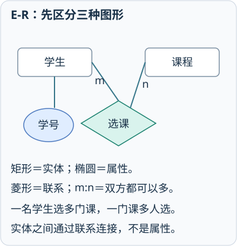

学生是矩形实体，学号是椭圆属性，选课是菱形联系；一人多课、一课多人，是m:n。

### E-R 转关系的基本规则

1. 每个实体通常转换为一张表。
2. 1:n 联系把“1”端主码放入“n”端作为外码。
3. m:n 联系单独建立联系表，通常包含两端主码和联系属性。
4. 多值属性单独建表。
5. 1:1 联系可在适当一方加入外码，通常选择全参与方。

**先预测：** 院系10有小林和小周，院系20有小吴。院系id应放在哪张表作外键？

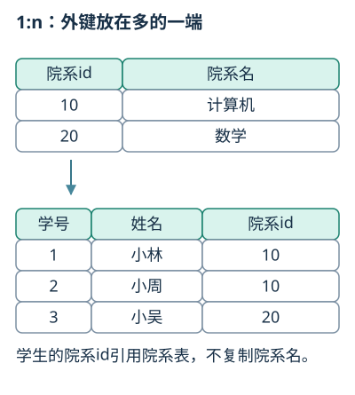

放在学生表这一“多”端，引用院系表的id，不必把院系名称复制进每个学生记录。

**先预测：** 学号1选C1和C2，学号2选C1，怎样保存三次选课及成绩？

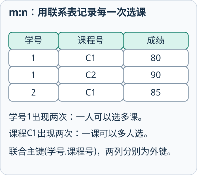

本例约定同一名学生对同一门课程只保留一次选课记录。新建选课联系表，每个学生—课程配对占一行，学号与课程号共同确定成绩，两列可联合为主键。若允许跨学期重修，原配对就不再唯一，需要纳入学期、选课编号等符合业务规则的标识。

**同一配对可能发生多次：** 读者1在10月1日和10月10日先后借同一本书B1，是两次借阅，不能都用`(读者1,B1)`作主键。可把借阅建成关联实体，令两次借阅编号分别为L1、L2，每条记录保存读者号、图书号、借出日期和归还日期；读者/图书与借阅各形成1:n联系。编号识别一次事件，双方编号仍分别引用原实体。

注意：外码放在 1:n 的多端；m:n 不能简单在一方添加单个外码，否则无法保存多个对应关系。

## 第3章 关系模型与完整性
<!-- exam: A | 单选、判断、多选、场景题 -->

### 关系模式与关系实例

- 🔴 **关系模式与关系**：关系模式R(U,D,DOM,F)描述关系名、属性集、域及映射、依赖约束；关系是某一时刻符合模式的元组集合。==模式相对稳定，关系实例随增删改变化==。
- 🔴 **关系性质**：列同质、不同列可来自同一域、属性名有区别；元组与属性在数学模型中均无固定顺序，元组不能重复，属性取值原子化。SQL表默认可有重复行，不能把SQL的多重集直接当作理论关系集合。
- ⚫ **完整性分类**：实体完整性、参照完整性、用户定义完整性；参照约束允许哪些NULL组合由列约束及外码匹配规则共同决定，主码组成列均不得为空。
<!-- test: 填空、单选 | 从候选码判主属性，检查三类完整性而非只看当前样例 -->

### 基本术语

- 关系：一张符合关系模型要求的二维表。
- 元组：表中的一行。
- 属性：表中的一列。
- 域：属性允许的取值集合。

### 各类键

- 🔴 **超码**：能够唯一标识元组的属性组，可以含多余属性。
- 🔴 **候选码**：不含多余属性的最小超码。
- 🔴 **主码**：从候选码中选定的主要标识。
- 🔴 **主属性**：出现在任一候选码中的属性。
- 🔴 **外码**：引用本表或其他表候选码/主码的属性。

主码一定是候选码，但候选码不一定被选为主码。一个表可以有多个候选码，通常只选一个主码。

### 三类完整性

- 实体完整性：主码值唯一且非空。
- 参照完整性：外码为空或等于被参照表中已存在的键值。
- 用户定义完整性：类型、范围、格式和业务规则。

NULL 表示未知、缺失或不适用，不等于 0，也不等于空字符串。判断 NULL 应使用 `IS NULL` 或 `IS NOT NULL`。

## 第4章 关系代数
<!-- exam: B | 单选、判断、填空 -->

### 关系代数

- 🔴 **关系代数**：以关系为运算对象、运算结果仍为关系的抽象查询语言；==选择σ筛行，投影π取列且去重==，连接组合满足条件的元组。
- 🔵 **相容与积**：并、差、交要求属性个数相同且对应属性来自相容域；若R有m行a列、S有n行b列，则R×S有mn行、a+b列。θ连接可看作对笛卡尔积施加条件；等值连接可保留两份连接列，自然连接消去重复同名列。
- ⚫ **除法条件**：R(X,Y)÷S(Y)输出X中与S所有Y值配对的值；“至少一门”与“所有课程”不能互换。
<!-- test: 计算、过程推演 | 写每一步选择/投影/连接/除的具体结果集合 -->

- 🔴 **集合运算**：并取两关系全部元组并去重，交取共有元组，差R−S只取R中不在S中的元组。

自然连接按所有同名属性相等进行连接，并只保留一份同名列；同名属性不一定业务含义相同，所以不能看到同名就盲目自然连接。

**先预测：** Student有`(1,小林,CS)、(2,小周,MA)、(3,小林,CS)`，依次为sid、name、dept。先选择CS再投影name，关系代数得到几行？

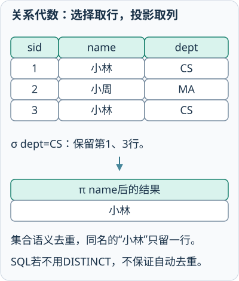

选择保留第1、3行；关系代数按集合语义投影name后去重，只剩一行“小林”。若用SQL获取同样集合结果，需要明确使用DISTINCT。

### 选择、投影与除法综合例

下面改用一组独立数据，姓名与上图去重例不同。设有学生关系 `Student(sid,name,dept)`，数据为`(1,小林,CS)、(2,小周,EE)、(3,小吴,CS)`；选课关系 `SC(sid,cid)` 为`(1,DB)、(1,NET)、(2,DB)、(3,DB)、(3,NET)`。

**题目：** 写出“计算机系学生姓名”的关系代数表达式并求中间结果；再说明怎样找出“DB和NET都选了的学生”。

<details>
<summary>查看答案与解析</summary>

**答案：** 先选择`σ_dept='CS'(Student)`，得到sid为1、3的两行；再投影`π_name(...)`，得到`{小林,小吴}`。查两课都选者，令Need={DB,NET}：sid1和sid3均有两项，sid2缺NET，故SC÷Need得{1,3}；连接Student并投影姓名得{小林,小吴}。

**解析：** 选择只减少行，投影只保留列且按集合语义去重；除法表达“对Need中的每个课程都存在对应选课”。若只查DB或NET任意一门，应使用选择条件而不是除法。

</details>

## 第5章 关系数据库标准语言SQL
<!-- exam: A | 单选、判断、填空、场景题 -->

### SQL数据语义与NULL

- 🔴 **SQL全称与语义**：==结构化查询语言（Structured Query Language）==集数据定义、查询、操纵、控制等功能于一体；==SELECT默认保留重复行，DISTINCT去重==，==只有ORDER BY明确要求排序==。
- 🔵 **NULL三值逻辑**：与NULL的普通比较结果为UNKNOWN；WHERE/HAVING只保留TRUE。用IS NULL检测空值；COUNT(*)数行，COUNT(列)忽略该列NULL，AVG/SUM等通常也忽略NULL。
- ⚫ **语句边界**：DELETE无WHERE删除全部行；UPDATE无WHERE更新全部行；参数、类型和约束决定能否执行，不能只凭SQL关键字判断结果。
<!-- test: 填空、程序阅读、过程推演 | 依FROM/WHERE/分组/HAVING/投影/排序追踪结果 -->

### SQL 分类

- 数据定义语言 DDL：`CREATE`、`ALTER`、`DROP`。
- 数据查询语言 DQL：`SELECT`。
- 数据操纵语言 DML：`INSERT`、`UPDATE`、`DELETE`。
- 数据控制语言 DCL：`GRANT`、`REVOKE`。
- 事务控制：`COMMIT`、`ROLLBACK`。

`DELETE` 删除满足条件的行，可配 WHERE；`DROP` 删除数据库对象及其定义；`TRUNCATE` 通常快速清空表数据并保留表结构，具体事务行为依 DBMS。

### 建表与约束

```sql
CREATE TABLE Student (
  id   INT PRIMARY KEY,
  name VARCHAR(30) NOT NULL,
  age  INT CHECK (age >= 0),
  dept_id INT,
  FOREIGN KEY (dept_id) REFERENCES Department(id)
);
```

常用约束：`PRIMARY KEY`、`FOREIGN KEY`、`UNIQUE`、`NOT NULL`、`CHECK`、`DEFAULT`。

组合主键可写为`PRIMARY KEY(sid,cid)`：两列合起来唯一，不表示每列单独唯一，且主键组成列均不得为NULL。`CHECK(score BETWEEN 0 AND 100)`只排除明确为假的范围条件；score为NULL时比较为UNKNOWN，通常仍通过CHECK。要求成绩必填时，还要声明`score INT NOT NULL`。外键也不自动等于非空，是否允许缺失引用须结合NOT NULL等约束。

修改数据时，`INSERT INTO 表(列...) VALUES(值...)`插入一行，`UPDATE 表 SET 列=表达式 WHERE 条件`修改匹配行，`DELETE FROM 表 WHERE 条件`删除匹配行。UPDATE或DELETE省略WHERE会作用于全表。例如`UPDATE Account SET balance=balance-50 WHERE id=1;`只把账户1余额减50，不是把余额直接改成50。

### 查询基本结构

```sql
SELECT [DISTINCT] 列或表达式
FROM 表
WHERE 行条件
GROUP BY 分组列
HAVING 组条件
ORDER BY 排序列 [ASC|DESC];
```

逻辑上通常先处理 FROM、WHERE、GROUP BY、HAVING，再得到 SELECT 结果并排序。`WHERE` 在分组前筛选行，`HAVING` 在分组后筛选组。

下面的查询先保留成年学生，再按院系分组，只显示人数不少于5人的院系，并按人数降序排列：

```sql
SELECT dept_id, COUNT(*) AS student_count
FROM Student
WHERE age >= 18
GROUP BY dept_id
HAVING COUNT(*) >= 5
ORDER BY student_count DESC;
```

这里 `WHERE` 处理分组前的行，`HAVING` 处理分组后的组，二者不能任意互换。

**先手算，再运行：** Student只有四行`(1,小林,18,10)、(2,小周,17,10)、(3,小吴,20,10)、(4,小陈,19,20)`，四个值依次为id、name、age、dept_id。把上面查询中的人数门槛改为`HAVING COUNT(*) >= 2`，结果是什么？

<details>
<summary>按查询顺序检查</summary>

1. WHERE去掉17岁的小周，剩id为1、3、4的三行。
2. GROUP BY按dept_id分组：10组有2行，20组有1行。
3. HAVING只保留人数至少2的10组。
4. SELECT得到`(dept_id=10, student_count=2)`，只有一行，排序不再改变结果。

`COUNT(*) >= 2`不能直接塞进WHERE：分组前还不存在每组人数。

</details>

**先预测：** 沿用前面四个学生，将人数门槛改为2，WHERE、GROUP BY、HAVING后各剩什么？

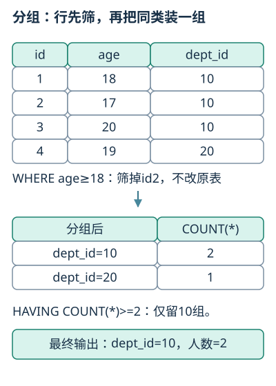

WHERE先去掉17岁者；分为10组2人、20组1人；HAVING只保留10组，结果人数为2。

### 连接查询

- `INNER JOIN`：只保留匹配行。
- `LEFT JOIN`：保留左表全部行，右表无匹配时补 NULL。
- `RIGHT JOIN`：保留右表全部行。
- `FULL JOIN`：保留两侧全部行，并非所有 DBMS 支持。

需要保留左表无匹配行时，针对右表的过滤条件通常应放在 `ON` 中；放在 `WHERE` 中可能把补出的 NULL 行过滤掉，使左连接接近内连接。

例如Reader为`(1,小林)、(2,小周)`，Borrow为`(1,B01)、(1,B02)`。按reader_id左连接后得到`(1,小林,B01)、(1,小林,B02)、(2,小周,NULL)`；内连接只有前两行。若要统计每位读者借了多少本，左连接后按读者编号和姓名分组，并用`COUNT(b.book_id)`，结果为小林2本、小周0本（假定book_id非空）。不能用COUNT(*)统计借阅数，它会把小周补出的那一行也计为1。

**先写出连接结果：** 按上面Reader和Borrow的数据，小周会消失吗？小林会有几行？

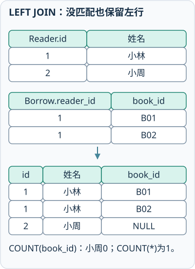

小林匹配到两本书，产生两行；小周没有匹配，但LEFT JOIN仍保留一行并将右侧字段补NULL。图中的NULL是缺失标记，不是字符串“NULL”。

### 子查询与集合运算


`IN` 判断值是否属于子查询结果集合，`EXISTS` 判断子查询是否至少返回一行。相关子查询会引用外层查询中的列。

`UNION` 合并并去重，`UNION ALL` 保留重复。参与集合运算的查询应有相同列数，对应数据类型应兼容。

`NOT IN` 的子查询结果若含 NULL，可能产生未知结果；反向存在性判断常优先考虑 `NOT EXISTS`。

例如查找从未借书的读者，可用相关子查询：

```sql
SELECT r.reader_id, r.name
FROM Reader AS r
WHERE NOT EXISTS (
  SELECT 1 FROM Borrow AS b
  WHERE b.reader_id = r.reader_id
);
```

内层条件引用外层当前读者；只要存在匹配借阅记录，`NOT EXISTS`就为假。字符串模式中`LIKE 'A%'`表示以A开头，`_`只匹配一个字符。需要由查询结果创建新表时，不同DBMS使用`CREATE TABLE ... AS SELECT`或`SELECT ... INTO`，不能混为通用写法。

### 例题

**题目：** 有Reader(reader_id,name)和Borrow(reader_id,book_id)两张表。写SQL查询借阅图书数量超过5本的读者姓名及借阅数量。

<details>
<summary>查看答案与解析</summary>

**答案：** SELECT r.name, COUNT(*) AS borrow_count FROM Reader r JOIN Borrow b ON r.reader_id=b.reader_id GROUP BY r.reader_id, r.name HAVING COUNT(*) > 5;

**解析：** WHERE筛明细行，HAVING筛分组结果；读者姓名需通过连接取得。

</details>

#### 数据库编程与触发器
<!-- test: 场景题、程序阅读 | 在约束、触发器和参数绑定之间按职责选择 -->
- 🔴 **游标、存储过程与触发器**：游标让程序逐行获取查询结果；存储过程是保存在数据库中并可调用的程序；触发器在指定表/视图事件发生时由系统自动执行。触发事件可含INSERT/UPDATE/DELETE，执行时机可有BEFORE/AFTER等，具体语法依DBMS。
- 🔵 **触发过程例**：把“库存不得为负”设为CHECK约束；若还要把每次库存变化记入历史表，可用UPDATE触发器读取旧值/新值并插入历史。修改10→7，主表保留7，历史记录旧10、新7；若事务回滚，其事务内历史写入通常一起回滚。约束能直接表达的规则优先用约束，触发器不能代替清晰的事务边界。
- 🔵 **参数化接口示例（Python标准库sqlite3）**：下例自行创建Student(sid,name)，?是SQLite接口占位符，不是跨DBMS通用语法。
```python
import sqlite3
con = sqlite3.connect(':memory:')
try:
    con.execute('CREATE TABLE Student(sid INTEGER PRIMARY KEY, name TEXT)')
    con.execute('INSERT INTO Student VALUES(?, ?)', (1, '小林'))
    rows = con.execute('SELECT name FROM Student WHERE sid=?', (1,)).fetchall()
    print(rows)  # [('小林',)]
    con.commit()
except Exception:
    con.rollback()
    raise
finally:
    con.close()
```
- ⚫ **边界**：参数绑定用于值，不能任意把表名当值绑定；游标逐行处理有额外开销，集合式SQL能表达的任务通常先考虑集合处理。

## 第6章 视图、索引与数据库设计
<!-- exam: B | 单选、判断、场景题、简答 -->

### 数据库设计流程

- 🔴 **设计阶段**：==需求分析→概念结构设计→逻辑结构设计→物理结构设计→实施→运行维护==。概念设计形成E-R等模型，逻辑设计转为关系模式并优化，物理设计选择存储与存取路径。
- 🔴 **视图与索引**：视图由查询定义用户可见的数据；索引是附加存取结构。视图可用于逻辑抽象和受控授权，索引主要改善访问效率，两者都不能代替完整性约束。
- ⚫ **SQL程序与宿主语言**：应用通过接口把SQL交给DBMS，读取结果并处理异常；参数绑定传值，字符串拼接SQL文本会破坏数据与命令的边界。

### 视图

视图是由查询定义的虚表，可简化复杂查询、限制用户看到的数据，并增强逻辑独立性。普通视图通常不实际保存结果；物化视图会保存结果并需要刷新。

含多表连接、聚合或 DISTINCT 的复杂视图通常不能直接更新。

例如只让部门10报表人员看编号和姓名，可定义：

```sql
CREATE VIEW Dept10Report AS
SELECT emp_id, name FROM Employee WHERE dept_id=10;
```

**通俗理解：** 然后只授予该账号对视图的SELECT权限，并核对角色是否另有基础表读取权限。若仍能直接查Employee，账号就可能绕过视图读取工资或其他部门；“建了视图”本身不等于权限已隔离。

### 索引

索引用额外存储和维护成本换取查询速度。B+ 树索引适合等值和范围查询，哈希索引适合等值查询。经常用于筛选、连接、排序且选择性较高的列更适合建索引。

索引并非越多越好：插入、删除和更新时必须维护索引；对索引列做函数、隐式类型转换或前导通配符，也可能降低索引利用率。

选择性表示条件能把结果缩小到什么程度；高选择性列通常更有定位价值。覆盖索引是指查询所需列都能直接从索引取得，可减少回表读取，但会让索引更宽、写入维护更重。

场景选择可先看查询条件：订单号精确等值查询适合唯一索引；按下单时间或金额范围筛选、排序适合 B+ 树类有序索引；性别、是否删除等取值很少的列，普通索引未必有明显收益。联合索引还受列顺序影响，不能看到多个查询列就任意建索引。

#### 索引与物理设计

**通俗理解：** 联合索引(a,b)可以按以下有序排列理解：先按a、同a再按b排序，(1,2)、(1,8)、(2,1)、(2,9)。查a=2可直接定位后一段；查a=2且b=9可继续缩小。只查b=9时，相同b散在不同a段，通常不能直接形成一段定位范围，数据库也可能采用全索引扫描或特定优化，所以不是“绝对用不上”。先写排列顺序，再判断条件能否确定有序起点。

<details><summary>索引为(部门,成绩)，查指定部门内的成绩范围，与仅按成绩范围查找，哪一个更容易确定一段连续范围？</summary>

指定部门后可在该部门内部按成绩连续定位；只给成绩可能跨多个部门分段。实际优化器仍可能选其他访问方法，不能断言后一查询绝对不走索引。

</details>

索引与约束作用不同：索引主要用于加速访问，唯一约束用于保证不重复。DBMS 可能借助唯一索引实现约束，但“性能结构”和“数据规则”仍是两个层面的概念。

**先预测：** 假设叶层依次有10、20、30、40，查id=30与查20到40各怎样缩小范围？

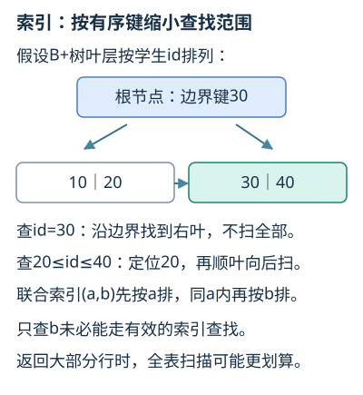

等值查询沿根节点边界定位目标叶；范围查询定位起点后顺叶层扫描，不能把所有索引都理解为哈希查找。

### 数据库设计阶段

完整任务可按“业务对象和规则 → E-R实体联系 → 表、主外键和约束 → 函数依赖与规范化 → 索引和存储”推进。每一步都要用业务规则校验，发现遗漏时应回退修改，而不是把六个阶段当成互不联系的名词表。

#### 查询执行与优化
<!-- test: 场景题、过程推演 | 判断逻辑改写等价性与扫描/索引/连接选择 -->
- 🔴 **记录、页与缓冲**：记录保存一个对象的字段，页/块是磁盘I/O的基本单位之一，缓冲池在内存缓存数据页。行存便于取整行，列存有利于只读少量列的批量聚合，均需结合更新及压缩代价。
- 🔵 **连接执行例**：R有3行、S有4行，朴素嵌套循环逐对测试最多12次；若两表按连接键有序，可用归并连接同步推进；等值连接还可对一侧建散列表，再探测另一侧。散列连接不是任意不等式连接的直接替代。
- 🔴 **逻辑优化与物理优化**：逻辑优化改写等价关系表达式，如尽早选择、投影以减少中间数据；物理优化选择索引、连接顺序及连接算法，依赖统计信息和成本估计。
- 🔵 **中间结果例**：Student有1000行，SC有10000行，只查CS学生。先筛Student得到100行再连接，常能减少处理中间行；把LEFT JOIN右表过滤从ON搬到WHERE则可能删除补NULL行，不能一律把“下推”当等价。
- ⚫ **聚簇边界**：聚簇存放使某属性相近记录物理靠近；普通二级索引不保证整张数据表按它排序。有索引也可能因返回大部分数据而选择全表扫描。

## 第7章 关系数据理论
<!-- exam: B | 单选、判断、场景题 -->

### 函数依赖与规范化

- 🔴 **函数依赖的正式条件**：对关系模式R的任意合法关系r，任取t₁、t₂，==若t₁[X]=t₂[X]必有t₁[Y]=t₂[Y]==，则X→Y。它是业务约束，当前有限样例恰无重复不能证明依赖成立。
- 🔴 **完全、部分与传递依赖**：X→Y且X的任何真子集都不能决定Y为完全依赖；有真子集能决定Y为部分依赖。若X→Y、Y不能决定X且Y→Z，Z不包含在Y中，可形成Z对X的传递依赖；范式判断还须区分主属性与非主属性。
- ⚫ **规范化目的**：减少冗余和插入、删除、修改异常；判断依据是所有候选码及给定依赖，主码只是选中的一个候选码。
<!-- test: 计算、简答 | 求闭包、检验候选码最小性、判断范式并证明分解性质 -->

规范化用于减少数据冗余和插入、删除、更新异常。

- 🔴 **1NF**：每个属性值不可再分。
- 🔴 **2NF**：在 1NF 基础上，非主属性完全依赖候选码，消除部分依赖。
- 🔴 **3NF（直观条件）**：在 2NF 基础上，非主属性不传递依赖候选码。
- 🔴 **BCNF**：每个决定因素都是候选码或超码，要求通常比 3NF 严格。

范式越高不代表查询一定越快。工程中可能为性能进行有限反规范化，但必须采取一致性维护措施。

### 从依赖推导候选键与分解

设R(学号,课程号,姓名,成绩)，业务约束为“学号决定姓名”“学号与课程号共同决定成绩”，没有其他依赖。学号和课程号的闭包可得到全部属性，而单独任一个都不能，所以它们构成候选键。姓名只依赖学号，属于非主属性对候选键的部分依赖，因此R不满足2NF。

可分为学生(学号,姓名)和选课(学号,课程号,成绩)。公共属性学号能决定学生表全部属性，在给定依赖下连接可恢复原关系，且原依赖仍能在分表中检查。分解的目的在于把“学生叫什么”和“学生某课得多少分”分别保存，不是看到复合主键就必须拆分。

**先预测：** 同一学生在C1和C2两行重复姓名，若只改一行，会出现什么问题？

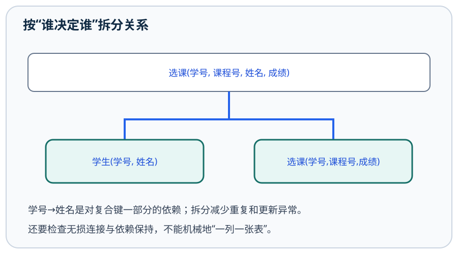

同一学号出现两个姓名。把学号决定的姓名放入学生表，选课表只存学号、课程号和成绩，再按学号连接。

对复杂候选键情况，应使用形式定义：对每个非平凡函数依赖X→A，3NF要求X是超键或A是主属性；BCNF则要求X为超键。这里的主属性指属于任一候选键的属性，不仅是所选主键中的属性。数据样例没有重复只能说明当前取值，不能代替业务函数依赖。

#### 闭包的逐步算法

**通俗理解：** 求属性集X的闭包时，先令结果为X；反复扫描每条函数依赖，只要左部已包含在结果中，就把右部加入结果，直到不再增长。若结果覆盖关系全部属性，X是超码；再逐个删除X中的属性验证最小性，才能确定候选键。

例如R(A,B,C,D,E)，F={A→B，B→C，AD→E}：从AD开始，A→B加入B，B→C加入C，AD→E加入E，得到ABCDE；删除A后D不能推出其他属性，删除D后ABC不能推出E，因此AD是候选键。

#### 无损连接与依赖保持

对二元分解R→R1、R2，在给定函数依赖下，如果公共属性`R1∩R2`能函数决定R1或R2的全部属性，则该分解无损。依赖保持要求各分表内可检查的依赖合起来仍能推出原依赖。

例如R(A,B,C)且A→B，分成R1(A,B)与R2(A,C)：公共属性A能决定R1，因此连接无损，A→B也保存在R1。无损只保证连接不会产生伪元组，并不自动保证全部依赖都能在单个分表中检查。

#### 多值依赖与4NF
- 🔴 **多值依赖X↠Y**：给定X时，Y的取值集合独立于剩余属性Z=U−X−Y的取值集合；同一X下合法元组应包含Y与Z值的必要组合。若Y⊆X或X∪Y=U，则是平凡多值依赖。
- 🔵 **交叉组合例**：R(学生,爱好,语言)，甲有爱好{棋,球}、语言{中,英}且互相独立，须有(甲,棋,中)、(甲,棋,英)、(甲,球,中)、(甲,球,英)。学生↠爱好且学生↠语言；增加一门语言需为各爱好组合增行，产生冗余。
- 🔴 **4NF条件**：关系满足1NF，且每个非平凡多值依赖X↠Y的X都是超码。上述学生不能唯一确定原表一行，违反4NF；分成(学生,爱好)和(学生,语言)可消去独立组合冗余并无损连接。
- ⚫ **边界**：只有业务确实独立才作这种分解；若某爱好仅对应某语言，强行取笛卡尔组合会制造事实。4NF专题推导比本节基础例更复杂，不能据此宣称已覆盖全部依赖理论。

## 第8章 事务、并发控制与恢复
<!-- exam: A | 单选、判断、多选、场景题、简答 -->

### ACID与事务边界

- 🔴 **事务**：==用户定义的数据库操作序列==，是逻辑工作单位，可由一条或多条SQL组成；正常以COMMIT提交，失败或主动撤销以ROLLBACK回滚。
- 🔴 **ACID全称**：==原子性（Atomicity）、一致性（Consistency）、隔离性（Isolation）、持久性（Durability）==。一致性依赖正确事务及约束；隔离性不是说系统绝不并发。
- ⚫ **故障分类**：事务故障撤销事务，系统故障需日志恢复未落盘提交结果并处理未完成事务，介质故障需备份与后续日志；不同故障不能都只靠一次ROLLBACK解决。
<!-- test: 单选、简答、过程推演 | 画优先图、检查两段锁、用日志判断撤销与重做 -->

### 并发异常

- 丢失修改：一个事务的写入覆盖另一个事务的修改。
- 脏读：读到其他事务尚未提交的数据。
- 不可重复读：同一事务两次读取同一行结果不同。
- 幻读：同一条件两次查询，满足条件的行集合发生变化。

共享锁 S 允许多个事务读，排他锁 X 不允许其他事务同时读写该数据。封锁可提高隔离性，但可能产生死锁。

#### 冲突可串行化与优先图

记号`r1(X)`表示事务T1读X，`w2(X)`表示事务T2写X。同一数据项上，来自不同事务且至少一个是写操作时发生冲突，两个读操作不冲突。按调度先后为每对冲突操作画边Ti→Tj，得到优先图。图无环则调度冲突可串行化，拓扑序就是等价串行顺序；有环则不能通过交换非冲突操作变成串行调度。

例：`r1(X), w1(X), r2(X), w2(X)`中，T1的写发生在T2读写之前，画T1→T2，图无环，等价于先T1后T2。若另一个数据Y又产生T2→T1，就形成环，不能判为冲突可串行化。

上述说法针对基于锁的冲突控制模型。采用多版本并发控制时，普通快照读取可能读取旧版本而不与写锁直接冲突，不能把“写者阻塞所有读者”推广到所有数据库的每一种读取方式。

#### 两段锁：先取得，再释放

两段锁协议2PL把一个事务的锁操作分成两阶段：增长阶段可申请锁但不释放；第一次释放锁后进入收缩阶段，此后只能释放，不能再申请新锁。所有事务遵守2PL，可保证调度冲突可串行化，但仍可能死锁，例如T1持有X等Y、T2持有Y等X。

- 🔴 **严格两段锁（严格2PL）**：在2PL基础上，将排他锁X保留到事务提交或回滚，防止其他事务读写尚未完成的修改。共享锁S与其他事务的S兼容；X与其他事务的S、X均不兼容。这里区分的是不同事务对同一数据项的锁。

**先判断：** 某事务依次执行`加锁A→读A→加锁B→写B→解锁A→加锁C`，哪里违反2PL？

<details>
<summary>查看阶段边界</summary>

解锁A是从增长阶段进入收缩阶段的边界，随后加锁C违反“释放之后不再申请”。若C也确实需要，应在第一次解锁之前完成申请，具体先后还要遵守业务操作要求。

</details>

SQL 标准常见隔离级别从低到高为读未提交、读已提交、可重复读和串行化。它们与并发异常的最小对应关系如下：

- 读未提交：可能读到其他事务尚未提交的数据，即脏读。
- 读已提交：避免脏读，但同一行前后两次读取仍可能不同，即不可重复读。
- 可重复读：SQL标准最低要求避免脏读和不可重复读，仍可出现幻读；具体DBMS实现可能提供更强保证。
- 串行化：并发效果等价于事务串行执行，隔离最强，等待和冲突开销通常也最大。

隔离级别越高，通常能减少更多并发异常，但也可能增加等待和冲突；不同 DBMS 对快照、多版本并发和各级别细节的实现不完全相同。

**先预测：** T1把余额100改50但未提交，T2读到50，随后T1回滚，这是什么异常？

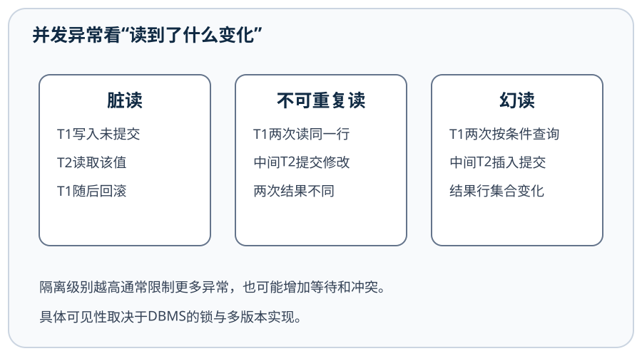

脏读：T2读取了T1未提交的数据，不能因为没有第二次查询就排除异常。

**读时间线再辨别：** 另一事务已经提交后，原事务再读发现余额变化，与查询人数增加，是同一种异常吗？

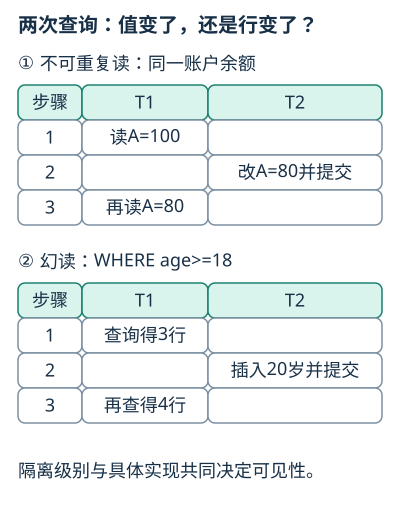

<details>
<summary>对照两条具体时间线</summary>

前者针对同一行的值变化，是不可重复读；后者针对条件查询所得行集合变化，是幻读。脏读的关键则是读到未提交数据，不能仅凭“前后不一样”判断。

</details>

### 订单场景中的机制选择

收银系统把“写订单、扣库存、记付款状态”放在同一事务中，是因为这些操作应全部成功或全部失败，主要体现原子性和一致性。多个收银端并发修改同一商品库存时，需要由锁、隔离级别或数据库提供的原子更新控制并发，避免丢失修改和超卖。

数据库事务保证它所覆盖的数据操作，但不能自动保证网络请求绝不重复。客户端超时重试可能把同一订单再次提交，因此业务层还应使用唯一订单号、唯一约束或幂等键。TCP 的可靠有序传输也不能替代数据库事务：TCP 保证一条连接中的字节流，不理解“订单只能创建一次”的业务含义。

**先安排提交位置：** 账户1向账户2转50元，假定两账户存在、余额充足、没有并发。要扣款、入账都成功才提交，失败时怎样处理？

<details>
<summary>查看事务成功与失败分支</summary>

```sql
START TRANSACTION;
UPDATE Account SET balance = balance - 50 WHERE id = 1;
UPDATE Account SET balance = balance + 50 WHERE id = 2;
```

应用检查两次更新都成功，才执行`COMMIT;`；任一步失败则执行`ROLLBACK;`，撤销本事务已完成的更新，不能再执行成功分支的COMMIT。事务开始语句也可依DBMS使用BEGIN等写法。不能在扣款后就提交：那会把扣款单独变成已提交结果，第二次失败后回滚无法撤销前一次事务，破坏转账整体的原子性。真实系统还要检查影响行数、余额条件和并发，本例先隔离事务边界这一任务。

</details>

隔离不是越强越好。提高隔离级别通常能减少并发现象，但可能增加等待、冲突和开销；实际系统要在正确性要求与并发性能之间取舍。

### 日志与备份

日志记录数据库更新和事务状态，可用于故障恢复。预写日志 WAL 的基本思想是“先写日志，再把相关数据页写入磁盘”。`COMMIT` 表示提交，`ROLLBACK` 表示回滚。

事务故障通常只影响某个事务，系统故障会使内存状态丢失，介质故障还可能破坏磁盘数据。恢复时可依据日志撤销未提交事务、重做已提交但尚未写回的数据；检查点记录一个已知恢复位置，用于减少故障后需要扫描的日志范围。

备份是独立的数据副本，日志用于重做或撤销操作，两者作用不同。RAID 提高可用性但不能代替备份。

恢复时先列事务状态，再决定操作。若日志依次为`<T1 start>`、`<T1,A,10,20>`、`<T1 commit>`、`<T2 start>`、`<T2,B,5,8>`后系统故障，则T1已经提交，应在需要时REDO把A恢复为20；T2没有提交，应UNDO把B恢复为5。提交成功要求提交记录稳定写入，但不要求所有数据页立即写盘。

**先预测：** 另看一个单事务：A从100改80，日志和提交记录已持久化，数据页仍为100就崩溃，应恢复成多少？

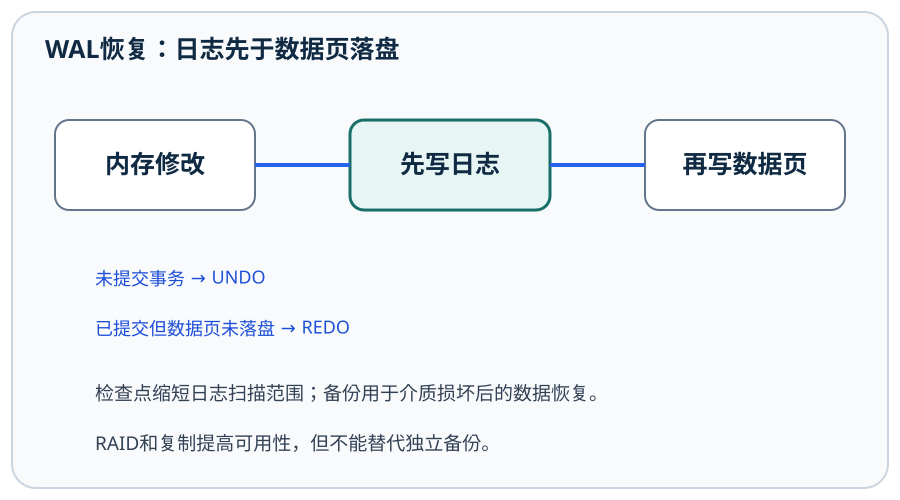

应REDO为80：事务已提交，不能因为数据页未及时写回而丢失提交结果。图使用教材UNDO/REDO日志模型。

#### WAL与恢复的判定条件
- 🔴 **先写日志（WAL，Write-Ahead Logging）**：相关更新日志先于数据页持久化；确认提交前，应按系统协议使提交记录及必要日志持久化。缓冲区脏页尚未写回不表示事务不能提交。
- 🔵 **简化UNDO/REDO例**：采用立即更新、允许未提交页落盘且提交不强制所有数据页落盘的模型。初值X=100，日志有T1把X改120并提交，T2再把X改90但未提交，随后故障。恢复需确保T1的120生效，撤销T2的90；若有值已正确落盘，按恢复协议避免重复造成错误。UNDO依撤销信息，REDO依重做信息，并非所有DBMS都逐条照此最简流程实现。
- ⚫ **备份与检查点**：检查点缩短恢复扫描/重做范围，不等于完整备份；完整备份加后续日志可恢复到允许时间点，备份同样需要演练恢复。

## 第9章 数据库安全性
<!-- exam: B | 单选、判断、场景题 -->

### 认证、授权与审计

- 🔴 **安全性与完整性**：==安全性保护数据免受未授权访问、泄露或破坏==；==完整性保持数据正确、有效和相容==。二者有联系但目标不同。
- 🔴 **访问控制**：身份认证回答“是谁”，授权回答“可以做什么”，审计记录“做过什么”；自主访问控制可由拥有者授权，强制访问控制按安全标记及规则实施，基于角色的访问控制把权限赋给角色再分配用户。
- ⚫ **防护层次**：最小权限、视图、参数化查询、加密、备份、审计协同使用。加密不替代授权，脱敏不等于删除原数据，审计日志也需要防篡改。

对象所有者、数据库管理员或已获得转授权能力的用户才能继续向他人授予相应权限。SQL中可用`WITH GRANT OPTION`允许被授权者继续转授；回收权限时还要检查授权链及具体DBMS的级联规则。直接授予用户的权限与用户通过角色获得的权限来源不同，排障时要分别检查。

例如只负责查询报表的账号可授予指定视图的 `SELECT` 权限，不必获得基础表的修改权限。人员岗位变化或离职时，应及时复核并收回相应权限。审计日志用于记录关键访问和变更，但日志本身也要限制访问、防止篡改并设置合理留存周期。

#### 分析型数据与新型数据库的比较
- 🔴 **数据仓库与OLAP**：仓库集成面向主题、相对稳定的历史数据用于分析；联机分析处理（OLAP）重多维聚合，联机事务处理（OLTP）重短事务及业务更新。ETL表示抽取、转换、装载，需校验口径与质量。
- 🔵 **分析例**：每日订单记录经清洗统一币种和日期，按时间、地区、商品维度汇总销售额；从全年到月份是下钻，从地区明细到全省是上卷，按某月份筛一个子集是切片。该汇总不能替代原订单逐笔扣库存事务。
- 🔴 **内存数据库**：主要数据常驻内存以减少存储访问延迟，仍可通过日志、快照和复制实现持久化；掉电保护须看其配置和恢复机制，不能断言“在内存就不持久”。
- 🔴 **区块链与数据库**：区块链以链式散列、复制和共识等维护多方共同确认的追加记录，适合缺少单一可信管理者的协作场景；普通数据库可通过管理员及事务机制高效更新和查询。追加可验证不保证输入事实真实，也不等于适合高频任意修改。
- ⚫ **范围保留**：此处讲类型、数据流和选型边界；大数据存储架构、内存数据库内部恢复、多维模型设计及共识算法仍待专题补充，未据此关闭教材后续各章全部缺口。
