# 数据结构与算法讲义

## 第1章 绪论与算法分析
<!-- exam: A | 单选、判断、计算 -->

数据结构研究数据元素之间的关系及其在计算机中的表示和操作。

### 1. 三个层面

- 逻辑结构：数据元素之间的逻辑关系。
- 存储结构：逻辑关系在计算机中的实际表示。
- 数据运算：对数据的查找、插入、删除、排序等操作。

逻辑结构可分集合、线性、树形、图状结构；存储结构常见顺序、链式、索引和散列存储。同一种逻辑结构可以采用不同存储方式。

抽象数据类型 ADT 从使用者角度规定“数据对象、关系和允许的操作”，不限定具体实现。例如“栈”规定后进先出和入栈、出栈操作，既可以用数组实现，也可以用链表实现。ADT、逻辑结构和存储结构的关系是：先规定数据及操作，再选择合适的机器表示。

### 2. 算法与复杂度

算法应具有有穷性、确定性、可行性、输入和输出。程序可以长期运行，但算法必须在有限步骤后结束。

时间复杂度描述基本操作次数随规模增长的数量级，空间复杂度描述算法额外占用空间的数量级。复杂度通常关注规模很大时的增长趋势，忽略常数系数和低阶项；同一算法还可能区分最好、平均和最坏情况。常见增长速度：

`O(1) < O(log n) < O(n) < O(n log n) < O(n²) < O(2^n)`

基础识别：一次直接访问通常是 O(1)，遍历 n 个元素通常是 O(n)，两层各执行 n 次的循环通常是 O(n²)，每次把范围减半通常是 O(log n)。

例如循环变量从 1 开始每次乘 2，直到超过 n，执行次数约为 `log₂n`；两个先后执行的 O(n) 循环合起来仍是 O(n)，不是 O(n²)。

分析复杂度时先确定“规模 n”和“基本操作”，再数基本操作的执行次数。例如：

```text
for i = 1 .. n:
    for j = 1 .. i:
        操作一次
```

总次数为 `1+2+…+n=n(n+1)/2`，最高阶是 `n²`，所以时间复杂度为 `O(n²)`。若循环每次令 `i=2i`，则执行约 `log₂n` 次。顺序执行的代码复杂度取最大项；嵌套执行通常相乘，但必须依据实际循环边界，不能看到两层循环就直接判为 `O(n²)`。

递归算法还要同时考虑递归层数和每层工作量。例如二分查找每层只做常数工作并把规模减半，递推式可写为 `T(n)=T(n/2)+O(1)`，结果为 `O(log n)`；二叉树遍历每个结点只访问一次，虽然有两次递归调用，总工作量仍为 `O(n)`。

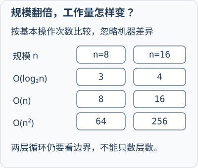

**通俗理解：** 时间复杂度像观察“工作量随人数怎样增长”，而不是拿秒表测一次运行。规模翻倍时，O(n) 的工作量大致翻倍，O(n²) 可能变成四倍；具体运行秒数还会受语言、机器和数据影响，所以复杂度只描述增长趋势。

## 第2章 线性表
<!-- exam: A | 单选、判断、场景题 -->

线性表是由同类型数据元素构成的有限序列，除首尾外每个元素有唯一前驱和后继。

### 1. 顺序表

顺序表用连续存储单元依次保存元素。

优点：随机访问快，可根据下标 O(1) 取元素；存储密度高。缺点：中间插入、删除通常要移动元素；固定数组容量不易动态扩展。

### 2. 链表

链表用结点保存数据和指针，结点不必连续。

- 单链表：每个结点只有后继指针。
- 双链表：同时有前驱和后继指针。
- 循环链表：尾结点指回头部，可循环访问。

链表按位置查找通常为 O(n)；在已知插入位置前驱时，插入和删除可为 O(1)。链式存储便于动态扩展，但每个结点需要指针空间，不能像数组一样直接按下标访问。

头结点是为统一操作而设置的附加结点，通常不保存有效数据。头指针指向链表首地址，两者不能混同。

### 3. 基本操作怎样执行

顺序表在位置 `i` 插入元素时，要从表尾开始把 `i` 及其后的元素依次右移，再写入新元素；删除位置 `i` 时，把后续元素依次左移。平均情况下移动元素数量与 n 同阶，所以插入、删除为 `O(n)`。

单链表在已知前驱结点 `p` 后插入新结点 `s`，指针顺序是：

```text
s.next = p.next
p.next = s
```

若顺序反过来，先执行 `p.next=s`，原后继地址就会丢失。删除 `p` 的后继结点时：

```text
q = p.next
p.next = q.next
释放 q
```

这些操作本身是 `O(1)`，但“找到第 i 个位置或其前驱”仍需从表头遍历，通常为 `O(n)`。双链表删除结点时还要同时修改前驱的后继指针和后继的前驱指针，不能只改一侧。

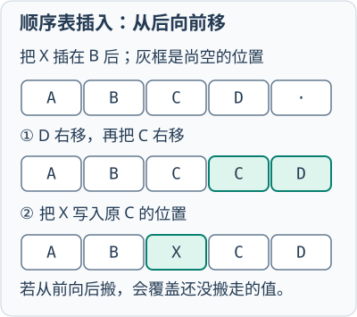

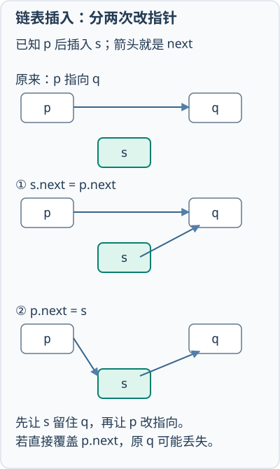

### 3. 按操作需求选择结构

结构选型不能只看数据名称，要看最频繁的操作和使用条件：

- 订单只在尾部追加，又经常按下标随机查询：动态顺序表/动态数组更合适，尾部追加平均较快，按下标访问 O(1)。
- 订单按到达顺序依次处理：队列更符合先进先出；若要让紧急订单优先，则考虑优先队列。
- 经常在已知结点附近插入、删除，且不要求下标随机访问：链表能减少元素搬移。
- 经常按唯一订单号等值查询：散列表平均查找接近 O(1)；还要求按编号范围查询或排序输出时，更适合有序表或 B+ 树类索引。

真实系统常组合多种结构，例如顺序容器保存显示次序，散列表建立“订单号→订单”的索引。链表只有在已知相关结点位置时插删才可 O(1)，先查找位置仍可能是 O(n)；动态数组尾部追加是均摊 O(1)，扩容那一次可能需要 O(n) 搬移。

## 第3章 栈、队列、串与数组
<!-- exam: A | 单选、判断、填空、计算、场景题 -->

### 1. 栈

栈是只在一端进行插入和删除的线性表，遵循后进先出 LIFO。插入称入栈，删除称出栈，操作端称栈顶。

典型用途：函数调用和递归、括号匹配、表达式求值、深度优先搜索、撤销操作。

栈空时不能出栈，栈满时不能向定长顺序栈继续入栈。

**例题：** 一个栈用数组实现，数组长度 12，现有 10 个订单 ID 已入栈（下标从 0 开始），再执行 `push` 入栈两次。  
第一次入到下标 10，第二次入到下标 11，此时栈刚好满。  
若再 `push` 一次，应报告栈溢出，不能继续写入。

### 2. 队列

队列在队尾插入、队头删除，遵循先进先出 FIFO。典型用途：任务排队、打印缓冲、广度优先搜索、消息队列。

**通俗理解：** 栈像一摞只能从顶部取放的盘子，最后放上的先取走；队列像单入口、单出口的排队通道，先到的先离开。这个直觉只描述受限的操作次序，栈和队列本身都可以用数组或链表实现。

循环队列把顺序存储空间首尾相接，解决普通顺序队列的“假溢出”。常见实现会牺牲一个单元或增加计数变量来区分队空和队满，判定规则必须与实现约定一致。

若长度为 m 的数组采用“牺牲一个单元”方案，常用约定是：队空 `front=rear`，队满 `(rear+1)%m=front`，队列长度为 `(rear-front+m)%m`。这里的 `%m` 使下标到达数组末尾后回到 0。

循环队列入队时先判断队满，把元素写入 `rear` 所指位置，再令 `rear=(rear+1)%m`；出队时先判断队空，读取 `front` 所指元素，再令 `front=(front+1)%m`。例如 `m=6、front=4、rear=1`，队列长度为 `(1-4+6)%6=3`，有效元素跨越数组末尾分布在下标4、5、0。

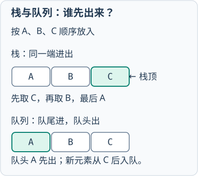

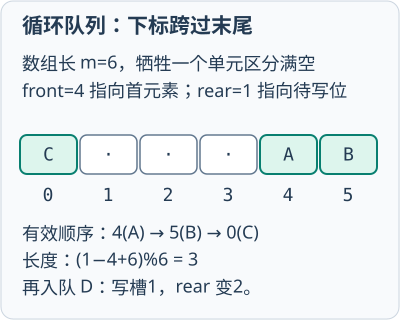

优先队列不是简单按到达先后出队，而是优先取出关键字最高或最低的元素，常用堆实现。医院分诊、任务调度等场景若还要求“同一优先级先到先服务”，可把优先级和到达序号组成复合关键字。双端队列允许在两端插入和删除，适合滑动窗口等双端操作，但它不自动提供优先级规则。

### 3. 串与模式匹配

串是由零个或多个字符组成的有限序列。空串长度为 0，空格串含空格字符，二者不同。

朴素模式匹配逐个位置尝试，最坏效率较低；KMP 利用模式串自身的前后缀信息，失配时主串位置不回退，时间复杂度为 O(n+m)。KMP 的关键是利用已经匹配出的前后缀信息减少重复比较，`next` 数组记录模式串失配后的回退位置。

理解 KMP 时先求模式串每个前缀的“最长相等真前后缀长度”。模式串 `ABABC` 的前缀函数为 `[0,0,1,2,0]`：读到第4个字符时，前缀 `ABAB` 的最长相等真前后缀是 `AB`，长度为2；读到 `C` 时不再匹配，回退到0。主串失配后不移动已经确认过的字符，只根据该表调整模式串位置。不同教材的 `next` 下标和初值约定可能不同，做题前必须确认采用的是长度表还是回退下标表。

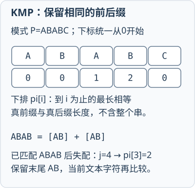

这里统一把**从0开始的前缀长度表**写作`pi`：`pi[i]`针对`P[0..i]`，不是不加说明地套用某一版`next`。以`ABABAC`为例：

| 前缀 | 最长相等真前后缀 | pi值 |
|---|---|---|
| A | 空串 | 0 |
| AB | 空串 | 0 |
| ABA | A | 1 |
| ABAB | AB | 2 |
| ABABA | ABA | 3 |
| ABABAC | 空串 | 0 |

**先预测回退：** 若已经匹配`ABABA`，下一字符却不能匹配模式的`C`，是否全部从头重来？不用：已匹配长度`j=5`，令`j=pi[j-1]=pi[4]=3`，保留末尾`ABA`作为新一轮已匹配前缀，再用**当前同一个文本字符**尝试匹配`P[3]`。仍失配则继续按`pi[j-1]`回退；只有比较处理完当前字符后才前进文本位置。整个模式表末项为0，不代表任何阶段失配都直接回到0。

### 4. 多维数组与稀疏矩阵

多维数组的逻辑结构可以按行、列理解，但在内存中仍按一维连续地址保存。C 语言二维数组采用行优先存储，同一行元素地址连续。若数组大部分元素为 0，称为稀疏矩阵，可只记录非零元素的行、列和值，即三元组存储，以空间换取额外的定位处理。

数组适合按下标随机访问，但在中间插入元素通常需要移动后续内容；矩阵的三元组表示节省空间，却不再能直接用原二维下标 O(1) 取得任意元素。

若二维数组 `A[m][n]` 按行优先存储，每个元素占 `w` 字节，下标从0开始，则 `A[i][j]` 地址为 `base+(i×n+j)×w`；按列优先则为 `base+(j×m+i)×w`。例如 `A[3][4]` 每元素4字节，基址1000，则 `A[2][1]` 的行优先地址为 `1000+(2×4+1)×4=1036`。

稀疏矩阵三元组通常记录 `(行号, 列号, 值)`。普通转置可以逐列扫描原三元组表；快速转置先统计转置后每一行的非零元素数量，再计算各行在结果表中的起始位置，从而一次放置全部三元组。广义表允许元素本身仍是表，常用“表头+表尾”递归描述；其长度看最外层元素个数，深度看括号嵌套层数，两者不能混同。

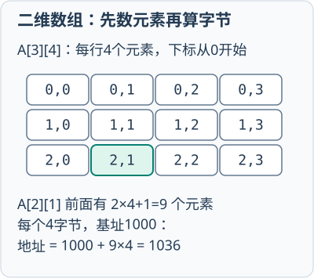

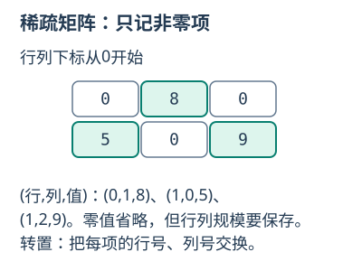

## 第4章 树与二叉树
<!-- exam: A | 单选、判断、填空、计算 -->

树是 n 个结点的有限集合，n=0 时为空树。非空树有唯一根结点，其余结点被分成若干互不相交的子树。

### 1. 基本术语

- 结点的度：孩子数量。
- 树的度：所有结点度的最大值。
- 叶结点：度为 0 的结点。
- 深度：从根向下的位置层次。
- 高度：从结点到最深叶的最长路径尺度。

含 n 个结点的非空树有 n−1 条边。

若`n_k`表示度为k的结点数，一条边恰好对应一个孩子，因此`Σ(k×n_k)=n−1`，而`n=Σn_k`。两式相减得`n_0=1+n_2+2n_3+3n_4+…`。例如度1、2、3、4的结点分别有4、2、1、1个，叶结点为`1+2+2×1+3×1=8`；度1结点不改变叶数，但仍影响总结点数。这个式子也能退化为二叉树的`n_0=n_2+1`。

### 2. 二叉树

二叉树每个结点最多有两个有序子树，分别为左子树和右子树。二叉树不是“度为 2 的树”，因为结点可以只有一个孩子，且左右次序不能交换。

满二叉树的每层结点数达到最大；完全二叉树除最后一层外均满，最后一层结点从左向右连续排列。完全二叉树适合用数组顺序存储。

常见性质：非空二叉树中，叶结点数 n0 与度为 2 的结点数 n2 满足 `n0=n2+1`。

若根为第 1 层，则第 k 层最多有 `2^(k-1)` 个结点，高度为 h 的二叉树最多有 `2^h-1` 个结点。完全二叉树按层序从 1 编号时，结点 i（i>1）的双亲为 `⌊i/2⌋`，左右孩子为 `2i` 和 `2i+1`（编号不超过结点总数时）。

**例题：** 高度为 4 的二叉树最多有 `2^4-1=15` 个结点。  
某完全二叉树有10个结点，若根为第1层，其高度为`⌊log₂10⌋+1=4`层。高度、结点深度和平均查找长度是不同概念；若根深度按0计算，这10个结点的深度和为19，平均深度为1.9，不能用`log₂n`直接代替。

### 3. 遍历

- 先序：根—左—右。
- 中序：左—根—右。
- 后序：左—右—根。
- 层序：从上到下、从左到右。

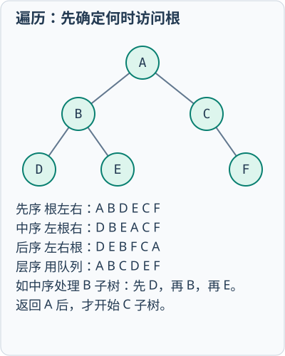

遍历命名取决于“根”在左右子树访问中的位置。二叉排序树的中序遍历结果为递增序列（重复键规则另定）。

递归遍历只需改变“访问根”的位置：

```text
PreOrder(T):
    if T为空: return
    访问 T
    PreOrder(T.left)
    PreOrder(T.right)
```

中序把“访问T”放在两次递归之间，后序放在最后。非递归先序和中序通常使用栈，层序使用队列。由“先序+中序”或“后序+中序”且结点值不重复时可以唯一还原二叉树；只有先序和后序通常不能唯一确定，因为无法判断只有一个孩子时它位于左侧还是右侧。

**通俗理解：** 遍历像按固定路线巡视一栋分左右房间的建筑。“先、中、后”说的是何时访问当前房间，左右子树的相对顺序仍是先左后右；层序则像按楼层逐层巡视，需要队列保存下一层入口。

### 4. 特殊树

- 二叉排序树 BST：左子树键小于根，右子树键大于根；平均查找较快，但极端情况下会退化为链表。
- 平衡二叉树 AVL：任一结点左右子树高度差绝对值不超过 1，用旋转保持平衡。
- 堆：完全二叉树，大根堆中父结点不小于孩子，小根堆中父结点不大于孩子。
- 哈夫曼树：带权路径长度 `WPL=Σ(叶权值×根到叶的路径长度)` 最小的二叉树，用于构造前缀编码。权值越大的叶通常越靠近根。
- B 树/B+ 树：多路平衡查找树，适合磁盘索引；B+ 树记录通常在叶层，叶结点有序相连，便于范围查询。

这些树的优化目标不同：AVL 控制查找高度，堆快速取得极值，哈夫曼树降低带权路径代价，B/B+ 树减少外存访问。堆只保证父子之间的偏序关系，不保证从根到叶以外的所有元素整体有序。

构造哈夫曼树时，每轮选择当前权值最小的两个结点合并，新结点权值为二者之和，再放回集合。权值 `2、3、7、8`：先合并 `2+3=5`，再合并 `5+7=12`，最后合并 `8+12=20`，WPL等于所有合并权值之和 `5+12+20=37`。左右分支编码可约定0和1，但只要保持前缀码性质，具体码字可能不同。

## 第5章 图
<!-- exam: B | 单选、判断、计算、状态判断、场景题 -->

图由顶点集合和边集合组成。无向图的边没有方向，有向图的边称有向边或弧。

- 顶点的度：无向图中与该顶点关联的边数。
- 入度/出度：有向图中指向/离开顶点的边数。
- 路径：顶点和边相接形成的序列。
- 连通图：无向图任意两点之间有路径。
- 强连通图：有向图任意两点相互可达。

无向图所有顶点度数之和等于边数的 2 倍；有向图入度之和、出度之和都等于边数。

### 1. 存储方式

- 邻接矩阵：二维数组表示边，判定两点是否相邻快，空间 O(n²)，适合稠密图。
- 邻接表：每个顶点连接其邻接点表，空间约 O(n+e)，适合稀疏图。

无向图的邻接矩阵关于主对角线对称，一条边在矩阵中出现两次；邻接表中通常也保存两个邻接结点。有向图矩阵第 `i` 行表示从顶点 `i` 发出的边，第 `j` 列反映进入顶点 `j` 的边。邻接表的实际遍历序列会受链表中邻接点排列顺序影响。

### 2. 遍历与典型算法思想

图的遍历要从一个起点出发，访问所有可达顶点且不重复访问。由于图可能存在环，DFS 和 BFS 都必须维护 `visited` 集合。遍历结果还取决于邻接点的访问顺序；题目没有规定时，应先声明采用顶点编号或字母升序。

#### 深度优先搜索 DFS

DFS（Depth-First Search）先沿一条路径不断深入，当前顶点没有未访问邻接点时再回退。递归实现利用系统调用栈，也可以显式使用栈。

```text
DFS(v):
    visited[v] = true
    输出 v
    for 每个与 v 相邻的顶点 w:
        if not visited[w]:
            DFS(w)
```

关键点是**进入顶点后立即标记**，再继续访问邻接点；否则含环图可能在两个顶点之间反复递归。递归返回的位置就是“回溯点”。显式栈实现若希望得到与递归相同的升序访问结果，通常要按相反顺序压入邻接点。

#### 广度优先搜索 BFS

BFS（Breadth-First Search）先访问距离起点1条边的顶点，再访问距离2条边的顶点，使用队列保存已经发现但尚未展开的顶点。

```text
BFS(s):
    visited[s] = true
    s 入队
    while 队列非空:
        v = 队头出队
        输出 v
        for 每个与 v 相邻的顶点 w:
            if not visited[w]:
                visited[w] = true
                w 入队
```

BFS 应在**入队时标记**，不能等出队才标记；否则同一顶点可能被多个前驱重复入队。对于无权图，顶点第一次被发现时经过的边数最少，因此 BFS 可以求起点到各顶点的最少边数，并可用 `parent` 数组恢复路径。

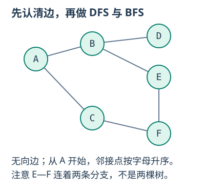

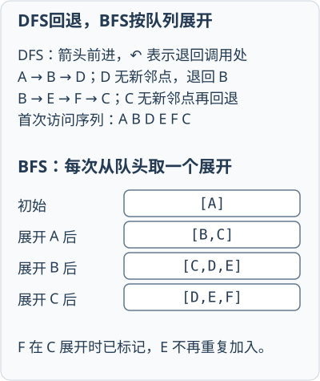

图中规定邻接点按字母升序。DFS 从 A 出发得到 `A→B→D→E→F→C`：访问 B 后先深入 D，D 无新邻接点便回退到 B，再进入 E、F、C。BFS 得到 `A→B→C→D→E→F`：初始队列为 `[A]`，处理 A 后为 `[B,C]`，处理 B 后为 `[C,D,E]`，处理 C 后加入 F，变为 `[D,E,F]`。

若图不连通，从一个起点只能访问所在连通分量。要遍历整个图，需要按顶点顺序检查：每遇到一个尚未访问的顶点，就以它为新起点再执行一次 DFS 或 BFS。这样得到的是深度优先森林或广度优先森林。

采用邻接表时，每个顶点和每条边只处理常数次，时间复杂度为 `O(V+E)`；采用邻接矩阵时，需要为每个顶点扫描一整行，时间复杂度为 `O(V²)`。两者都需要 `O(V)` 的访问标记，递归栈或队列最坏也可能达到 `O(V)`。

### 例题

**题目：** 对图示无向图从 A 开始遍历，邻接点按字母升序。分别写出 DFS、BFS 序列，并说明 BFS 队列在处理 A、B、C 后的内容。

<details>
<summary>查看答案与解析</summary>

**答案：** DFS 为 `A、B、D、E、F、C`；BFS 为 `A、B、C、D、E、F`。BFS 处理 A 后队列为 `[B,C]`，处理 B 后为 `[C,D,E]`，处理 C 后为 `[D,E,F]`。

**解析：** DFS 记录当前路径和回溯点；BFS 在邻接点首次入队时立即标记。若邻接点顺序改变，合法遍历序列也可能改变，因此必须先固定访问顺序。

</details>

### 3. 最小生成树：Prim与Kruskal

把五栋教学楼接入一张网络：边权是铺设线路的费用，目标是**全部接通，总费用最低**。连通无向带权图的一棵生成树有 `V−1` 条边；所有生成树中总权值最小的叫最小生成树（Minimum Spanning Tree，MST）。边权可以为负；权值相同时，最小生成树可能不唯一。

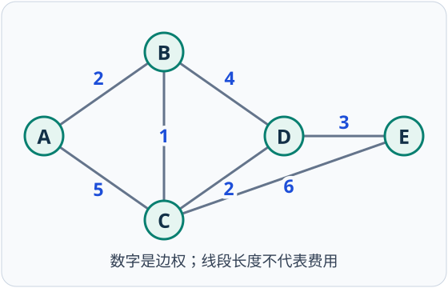

后面的Prim、Kruskal、Dijkstra和Floyd统一使用此图。边为 `AB=2、AC=5、BC=1、BD=4、CD=2、CE=6、DE=3`，均为无向边；没有画出的边不存在。不要用图上两点的几何距离代替边权。

#### Prim：从已接通的楼群向外扩展

`S` 表示已接通顶点集合。每次选**一端在S、一端在S外**的最小权边，再把新顶点加入S。不能只看刚加入的顶点，也不能选两端都在S内的边。

```text
S = {起点}; T = 空边集
while |S| < V:
    在所有跨越 S 与 S外 的边中找权值最小边 (u,v)
    若不存在：图不连通，不能生成一棵覆盖全图的树
    把 S外 的端点加入 S，把 (u,v) 加入 T
返回 T
```

从A开始；若边权相同，按边的字母名称排序选择。

| 已接通S | 当前可选边 | 本轮选择 | 累计费用 |
| --- | --- | --- | --- |
| {A} | AB2、AC5 | AB2 | 2 |
| {A,B} | AC5、BC1、BD4 | BC1 | 3 |
| {A,B,C} | BD4、CD2、CE6 | CD2 | 5 |
| {A,B,C,D} | CE6、DE3 | DE3 | 8 |

得到 `AB、BC、CD、DE`，4条边连接5个点，费用为8。矩阵实现每次扫描未加入顶点，时间为 `O(V²)`；邻接表配合二叉堆可做到 `O(E log V)`，稠密图常用前者。

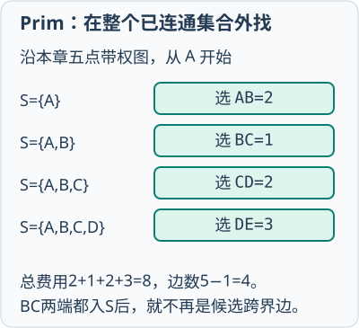

#### Kruskal：先看全图最便宜的线路

Kruskal不固定从哪个楼开始。先把**所有边**按权值升序排列：两端属于不同连通分量就接通；已经连通则跳过，避免成环。并查集（Disjoint Set Union）用 `find` 判断属于哪个分量，用 `union` 合并分量。

```text
每个顶点单独作为一个分量; T = 空边集
按边权升序检查边 (u,v):
    if find(u) != find(v):
        T加入(u,v); union(u,v)
    若已选 V−1 条边：结束
```

| 检查顺序 | 判断 | 选择后的分量 |
| --- | --- | --- |
| BC1 | B、C未连通，选 | {A}、{B,C}、{D}、{E} |
| AB2 | A与B所在分量不同，选 | {A,B,C}、{D}、{E} |
| CD2 | C与D所在分量不同，选 | {A,B,C,D}、{E} |
| DE3 | D与E所在分量不同，选 | {A,B,C,D,E} |

此时已选4条边，结束；若继续检查BD4，B、D已连通，再选会形成 `B—C—D—B` 环。排序通常决定总时间 `O(E log E)`，适合稀疏图。图不连通时，算法只能得到最小生成森林。

**先预测：** Prim从A出发，第一条边能否选择全图最便宜的BC1？如果预先选了AB、BC，再选AC会怎样？

<details>
<summary>展开核对选边条件</summary>

不能先选BC：它的两端都不在起始集合 `{A}` 内。预先选AB、BC后，A、B、C已经连通，再选AC会形成环。Prim看“跨集合的最小边”，Kruskal看“不会成环的全局最小边”，两者不要混用。

</details>

### 4. 单源最短路径：Dijkstra

若问题变成“从A到每栋楼走多远”，目标是**各条路径的长度最小**，不是全网总建设费用最低。Dijkstra用于边权非负的单源最短路径（Single-Source Shortest Paths），有向图、无向图都适用。

`dist[v]` 是当前已发现的起点到v的最短距离，`prev[v]` 记录前驱，`S` 是已确定最终距离的顶点集合。所谓**松弛（relaxation）**，就是发现绕经u更短时，用 `dist[u]+w(u,v)` 更新 `dist[v]`。

```text
dist[源点] = 0; 其他dist = ∞; S = 空集
重复至无可达的未确定顶点:
    在S外选dist最小的u，将u加入S
    对u的每个尚未确定的邻点v:
        if dist[u] + w(u,v) < dist[v]:
            dist[v] = dist[u] + w(u,v)
            prev[v] = u
```

仍用上面的同一幅图，从A出发。表内距离按A、B、C、D、E排列，表示**本轮松弛后**的状态。

| 本轮确定 | S | dist[A,B,C,D,E] | 发生的更新 |
| --- | --- | --- | --- |
| 初始化 | ∅ | [0,∞,∞,∞,∞] | 只有源点为0 |
| A | {A} | [0,2,5,∞,∞] | B←A，C←A |
| B | {A,B} | [0,2,3,6,∞] | C经B变成3，D经B变成6 |
| C | {A,B,C} | [0,2,3,5,9] | D经C变成5，E经C变成9 |
| D | {A,B,C,D} | [0,2,3,5,8] | E经D变成8 |
| E | 全部 | [0,2,3,5,8] | 无更短路径 |

恢复A到E的路径：从E沿前驱倒推 `E←D←C←B←A`，再反转为 `A→B→C→D→E`，长度 `2+1+2+3=8`。未能到达的顶点保留∞，不能编造前驱。

**轮到你：** 处理B之后，为什么下一轮确定C而不是D？如果到D已知为6，为什么还不能宣布它是最终答案？

<details>
<summary>展开核对距离变化</summary>

C的暂定距离为3，D为6，要先选未确定顶点中距离最小的C。随后经C得到 `3+2=5`，比6小，所以D仍能改进。Dijkstra每轮选最小的**累计距离**，不是选全图最小边，也不是只选当前顶点的最小邻边。

</details>

朴素矩阵实现为 `O(V²)`，邻接表加二叉堆通常为 `O((V+E) log V)`。其“确定后不再改变”的保证依赖非负边权。反例：有向边 `A→B=2、A→C=5、C→B=−4`，先确定B为2后，才发现经C到B为1；普通Dijkstra因此不适用。

**最小生成树与最短路不等价：** 三角形 `AB=2、BC=2、AC=3` 的MST选AB、BC，总费用4；但树上A到C为4，而原图直达只需3。上面的五点例子恰好用了相同的边，不能据此认为两类算法总能互换。

### 5. 带负权边与多源最短路径

#### Bellman-Ford：反复松弛所有边

有负权边时可用Bellman-Ford。它不提前宣布哪个顶点永久确定，而是反复扫描**所有边**。没有从源点可达的负权环时，最短简单路径最多含 `V−1` 条边，扫描至多 `V−1` 轮即可；再扫描一轮仍能变短，说明存在从源点可达的负权环。不可达处的负权环不能据此检测出来。

```text
dist[s] = 0; 其他dist = ∞
重复 V−1 轮:
    对每条有向边(u,v,w):
        若dist[u]不是∞且dist[u]+w < dist[v]: 更新dist[v]
    若一整轮没有更新：可提前结束
再检查所有边；若可达边仍能更新，则报告可达负权环
```

这里另设一个**有向图**练习：`A→B=2、A→C=5、B→C=1、B→D=4、C→D=−2、C→E=6、D→E=3`。它沿字母顺序前进，无环；不要把前一幅无向图的CD改成负数，无向负边可往返构成负权闭合走法。

为方便手算，下表使用**同步轮次**：每轮只读取上一轮的距离，写到新数组。因此第r轮结束后，记录至多r条边可达的最短距离。上面的原地更新伪代码可能在一轮内传播多条边，逐轮状态会受边的扫描顺序影响，最终结果相同。

| 轮次 | dist[A,B,C,D,E] | 本轮代表更新 |
| --- | --- | --- |
| 0 | [0,∞,∞,∞,∞] | 源点初始化 |
| 1 | [0,2,5,∞,∞] | 从A直接到B、C |
| 2 | [0,2,3,3,11] | C=min(5,2+1)=3；D=min(2+4,5−2)=3 |
| 3 | [0,2,3,1,6] | D=3−2=1；E=min(11,3+6,3+3)=6 |
| 4 | [0,2,3,1,4] | E=上一轮的D距离1+3=4 |

第五轮不再更新。A到E最短路径为 `A→B→C→D→E`，代价 `2+1−2+3=4`。时间为 `O(VE)`，距离数组占 `O(V)`；同步演示额外使用一个同样大小的新数组。

#### Floyd：逐个开放中转站

Floyd用于求**任意两点之间**的最短路径。初始化矩阵D：对角线为0，直接边填边权，没有边填∞。逐个允许顶点k作为中间点：

`D[i,j] = min(D[i,j], D[i,k] + D[k,j])`。

```text
for k = A 到 E:             // 中转点必须在最外层
    for i = A 到 E:
        for j = A 到 E:
            若i到k、k到j均可达:
                D[i,j] = min(D[i,j], D[i,k]+D[k,j])
```

回到**原来的无向正权图**。直接距离 `D[A,C]=5`，`D[A,D]=∞`；允许B中转时，分别更新为 `min(5,2+1)=3` 和 `min(∞,2+4)=6`。无向图另一方向同步得到相同数值。

**先算后看：** 下一轮允许C中转，A到D变为多少？之后允许D中转，A到E又是多少？

<details>
<summary>展开矩阵更新与最终结果</summary>

经C时，`D[A,D]=min(6,3+2)=5`，`D[A,E]=min(∞,3+6)=9`。经D时，`D[A,E]=min(9,5+3)=8`。所有中转轮次结束后的矩阵为：

| 起点\终点 | A | B | C | D | E |
| --- | --- | --- | --- | --- | --- |
| A | 0 | 2 | 3 | 5 | 8 |
| B | 2 | 0 | 1 | 3 | 6 |
| C | 3 | 1 | 0 | 2 | 5 |
| D | 5 | 3 | 2 | 0 | 3 |
| E | 8 | 6 | 5 | 3 | 0 |

A这一行与Dijkstra从A出发的结果一致，可交叉检查。

</details>

Floyd时间 `O(V³)`、空间 `O(V²)`，适合顶点较少且要查询许多点对的场景。可处理有向负权边；若最后出现 `D[i,i]<0`，说明存在负权环，经过该环且可达的点对没有有限的最短路径。

### 6. 拓扑排序：先修课程怎么排

拓扑排序不求路径长度，而是为**有向无环图DAG**排出满足所有依赖的顶点顺序。若 `A→C` 表示先学A再学C，A必须排在C之前；顺序可能不唯一。

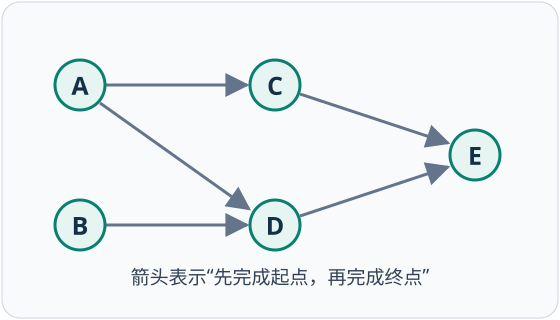

示例依赖为 `A→C、A→D、B→D、C→E、D→E`。A、B没有先修课；E要等C、D都完成。用Kahn算法：先把入度为0的顶点入队，每输出一个顶点，就删除它发出的边，使后继入度减1；**减到0**才入队。

```text
计算各顶点入度; 所有入度为0的顶点按字母顺序入队
count = 0
while 队列非空:
    取出u并输出; count加1
    for 每条u→v:
        入度[v]减1
        if 入度[v] == 0: v入队
若count < V: 图中有环，不能得到完整拓扑序
```

队列采用先进先出，同一顶点的后继按字母顺序处理。

| 刚输出 | 剩余入度变化 | 本轮结束队列 |
| --- | --- | --- |
| 初始化 | A0、B0、C1、D2、E2 | [A,B] |
| A | C：1→0；D：2→1 | [B,C] |
| B | D：1→0 | [C,D] |
| C | E：2→1 | [D] |
| D | E：1→0 | [E] |
| E | 没有后继 | [] |

得到 `A、B、C、D、E`。检查答案时，对每条边核对“起点在终点之前”，不必与参考序列逐字相同。邻接表实现时间 `O(V+E)`，辅助空间 `O(V)`。

**预测：** 输出C之后，能否立即输出E？如果额外加入 `E→A`，又会发生什么？

<details>
<summary>展开依赖与环的判断</summary>

不能立即输出E，因为D还没完成，E入度仍为1。加入E→A后，初始只有B入度为0；输出B后其余顶点均无零入度顶点，队列提前为空，输出数量1小于5，因此存在环，如 `A→C→E→A`。剩余未输出的点可能只是被环阻塞，不代表每个点本身都在环上。

</details>

### 7. 拿到题目先判断目标

| 题目要求 | 选择 | 手算时必须记录 |
| --- | --- | --- |
| 无权图最少经过几条边 | BFS | 队列、层数、访问标记 |
| 全部站点接通，总造价最低 | Prim / Kruskal | 已接通集合或连通分量、所选边 |
| 一个起点出发，边权非负 | Dijkstra | 已确定集合、距离、前驱 |
| 一个起点出发，存在负权边 | Bellman-Ford | 松弛轮次、更新方式、负环检查 |
| 任意两点的最短距离 | Floyd | 当前允许的中转点、距离矩阵 |
| 先修关系、施工依赖 | 拓扑排序 | 入度、零入度队列、输出数量 |

大学期末与岗位笔试都可能直接给图，要求写执行过程、补中间状态或计算结果。复习时应能遮住表格独立重算，不只记算法名称。

## 第6章 查找
<!-- exam: B | 单选、判断、计算、场景题 -->

### 1. 顺序与折半查找

顺序查找逐个比较，适用于有序或无序表，时间复杂度 O(n)。折半查找每次排除一半范围，要求有序顺序表，时间复杂度 O(log n)，不适合普通链表。

例如在有序数组 `[3, 8, 12, 20, 27]` 中查找 20，先比较中间元素 12，再只在右半部分继续。折半查找快的前提既有“有序”，也有“能够高效随机访问”。

```text
low = 0, high = n-1
while low <= high:
    mid = low + (high-low)//2
    if a[mid] == key: 返回 mid
    if a[mid] < key: low = mid+1
    else: high = mid-1
```

在 `[3,8,12,20,27]` 中查20：第一次 `low=0,high=4,mid=2`，比较12后令 `low=3`；第二次 `mid=3`，找到20。循环条件必须包含 `low=high` 的最后一个候选位置。

### 2. 散列查找

散列函数把关键字映射为存储地址。不同关键字映射到同一地址称冲突。

常见冲突处理：

- 开放定址：发生冲突后按规则寻找其他空位置。
- 拉链法：同一地址的记录用链表连接。

装填因子表示表中记录数与表长之比。开放定址中装填因子越大，冲突通常越多。删除开放定址元素常使用“删除标记”，直接置空可能导致后续元素无法找到。

例如表长7，散列函数 `h(k)=k mod 7`，采用线性探测插入 `10、17、24`：三者初始地址都为3，最终分别放在3、4、5。查找24必须依次检查3、4、5；若删除17时直接把位置4置空，查找可能错误地提前结束，因此应使用专门的删除标记。

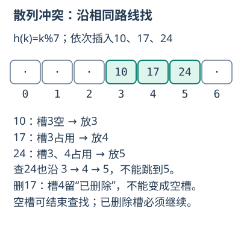

**通俗理解：** 散列函数像按姓名首字母分柜，理想情况能直接走到目标柜，但多人可能被分到同一柜，这就是冲突。平均 O(1) 建立在散列较均匀、装填因子受控的条件上；极端情况下大量关键字落入同一位置，查找仍会退化为线性比较。

### 例题

**题目：** 说明散列冲突为什么不能完全避免，并比较开放定址法与拉链法的基本处理思路。

<details>
<summary>查看答案与解析</summary>

**答案：** 关键字空间通常大于地址空间，不同关键字可能映射同址。开放定址在表内继续探测其他槽；拉链法把同址记录连接在桶链中。

**解析：** 得分点为冲突原因和两种处理思路。开放定址装填因子过高会增加探测，删除常需标记。

</details>

## 第7章 内部排序
<!-- exam: B | 单选、判断、多选、计算、场景题 -->

排序是按关键字把记录重新排列。若相等关键字排序后相对次序不变，称稳定排序。

理解排序不能只背复杂度，还要会跟踪每一趟：

- 直接插入排序处理 `[5,2,4,3]`：插入2得 `[2,5,4,3]`，插入4得 `[2,4,5,3]`，插入3得 `[2,3,4,5]`。
- 冒泡排序第一趟从左向右交换相邻逆序对，把当前最大元素送到末尾；若一趟没有交换，可以提前结束。
- 快速排序选枢轴后把序列划分为较小和较大两部分，再递归处理。一次划分只保证枢轴到达最终位置，不保证两侧已经有序。
- 归并排序先把子序列分别排好，再用两个指针按序合并。它容易保持稳定，但需要辅助空间。
- 希尔排序按逐渐缩小的增量做分组插入，常规实现不稳定；基数排序按位分配和收集，适合位数有限的整数或字符串键。

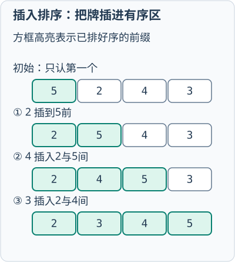

| 排序 | 平均时间 | 最坏时间 | 稳定性 | 主要特点 |
|---|---:|---:|:---:|---|
| 直接插入 | O(n²) | O(n²) | 稳定 | 基本有序时较好 |
| 冒泡 | O(n²) | O(n²) | 稳定 | 相邻逆序交换 |
| 简单选择 | O(n²) | O(n²) | 不稳定 | 每趟选择极值 |
| 快速 | O(n log n) | O(n²) | 不稳定 | 枢轴分区，平均较快 |
| 堆排序 | O(n log n) | O(n log n) | 不稳定 | 原地、最坏有保证 |
| 归并 | O(n log n) | O(n log n) | 稳定 | 需 O(n) 辅助空间 |
| 希尔 | 与增量有关 | 常见实现可达O(n²) | 不稳定 | 分组插入、原地 |
| 基数 | O(d(n+r)) | O(d(n+r)) | 稳定 | 依赖位数d和基数r |

稳定性是算法性质，不等于“排序结果稳定不变”。同一次输入中相等元素未交换，也不能证明该算法稳定。

选择方法时应综合数据规模、初始有序程度、稳定性、额外空间和最坏时间要求。

例如记录按“部门”排序后还要保持原来的“到达顺序”，需要稳定排序；数据已经基本有序且规模不大时，直接插入排序通常比复杂算法更合适。快速排序平均效率高，但枢轴选择不佳时会退化；归并排序稳定且最坏 O(n log n)，代价是额外空间。

### 例题

**题目：** 报表按部门排序时，要求同一部门内继续保持原来的录入顺序。选择排序算法时应重点关注什么性质？举一种合适算法并说明边界。

<details>
<summary>查看答案与解析</summary>

**答案：** 应关注稳定性，可选择归并排序或直接插入排序等稳定算法；还要结合数据规模、初始有序度、时间和额外空间，例如归并稳定且O(nlogn)但需O(n)辅助空间。

**解析：** 得分点为稳定性含义、一个稳定算法和代价边界。不能把“稳定”解释为程序不崩溃。

</details>

### 手算：不要把“一趟”当成“全部排好”

同一组数 `[5,2,4,3]`，先遮住下面的结果，分别预测一趟之后的状态：

| 算法与本题规则 | 一趟中的变化 | 本趟结束保证什么 |
| --- | --- | --- |
| 冒泡：从左向右比较相邻项 | `[2,5,4,3]` → `[2,4,5,3]` → `[2,4,3,5]` | 最大值5到末尾，前面仍未有序 |
| 简单选择：找最小值与首项交换 | 最小值2在下标1，交换得`[2,5,4,3]` | 最小值2到首位，其余未有序 |
| 快速：末项3作枢轴，扫描区内小于枢轴的项放左边 | 扫到5不动；扫到2把它与5交换为`[2,5,4,3]`；扫到4不动；最后将枢轴与5交换为`[2,3,4,5]` | 枢轴3到最终位置；本例两边恰好有序，不代表一般都如此 |

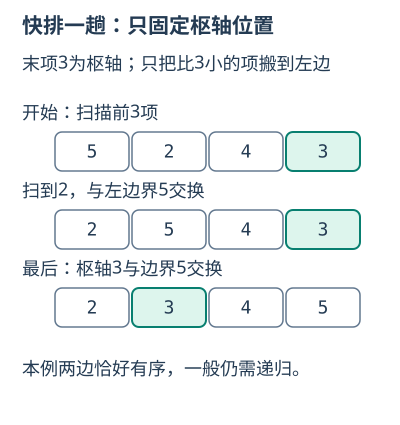

本题快排采用如下划分规则，数组下标从0开始。它与“左右指针挖坑法”的中间序列可能不同，考试须按给定规则：

```text
partition(a, low, high):
    pivot = a[high]; i = low
    for j = low .. high-1:
        if a[j] < pivot:
            交换a[i]与a[j]; i加1
    交换a[i]与a[high]
    返回i
```

接着分别排序`low..i-1`与`i+1..high`；区间少于两个元素就返回。枢轴若长期取到极值，会分成0个与n−1个元素，最坏退化到O(n²)。

**归并像合并两队排好的人。** 合并`[2,5]`与`[3,4]`：先比较2与3取2，再比较5与3取3，再比较5与4取4，右段耗尽后复制5，得到`[2,3,4,5]`。两段必须事先有序；相等关键字优先取左段，才能保留原先次序。

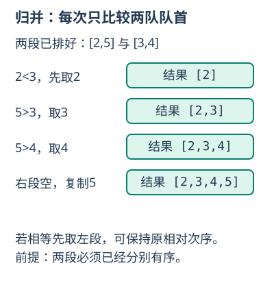

**堆排序先建大根堆，再把最大值送到末尾。** 对`[5,2,4,3]`从最后一个非叶结点向前下沉：结点2与孩子3交换，得到`[5,3,4,2]`。交换堆顶5与末项2，得到`[2,3,4 | 5]`；只在竖线左侧下沉2，与较大孩子4交换，成为`[4,3,2 | 5]`。下次取出的最大值就是4，已排好的5不再参加调整。下沉时若只与较小孩子交换，可能仍不满足大根堆。

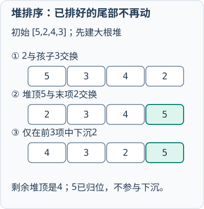

**希尔按间隔分组，基数按位稳定分配。** `[5,2,4,3]`取增量2时，分组`(5,4)`和`(2,3)`分别插入排序，交错放回为`[4,2,5,3]`；最后增量1再做直接插入。基数排序如`[21,13,12]`，先按个位稳定分配收集为`[21,12,13]`，再按十位稳定分配收集为`[12,13,21]`；后处理的位优先级更高，每一位都必须保持稳定。

<details><summary>再做一次：按上面的快排规则划分[4,1,3,2]，枢轴落在哪？堆[4,3,2]取出4后呢？</summary>

快排先把1移到左侧，再交换枢轴2与4，得到`[1,2,3,4]`，枢轴下标1。大根堆取出4后以2补根，剩余堆为`[2,3]`，下沉得到`[3,2]`，下次取3。

</details>

## 第8章 数据结构与算法选择
<!-- exam: A | 单选、多选、场景题、简答 -->

复杂度结论必须说明采用的口径：最坏复杂度给出任何输入下的上界，平均复杂度描述某种输入分布下的期望代价，均摊复杂度把一串操作的总成本平均到每次操作。动态数组尾部追加通常是均摊 O(1)，因为偶尔一次 O(n) 扩容会被大量普通追加分摊；散列查找通常是平均 O(1)，冲突严重时最坏可退化为 O(n)。

结构选择取决于是否更重视平均效率还是最坏保证。散列表适合平均很快的等值查询，平衡查找树能提供较稳定的 O(log n) 查找并保持有序；对响应时间上界要求严格时，不能只依据平均 O(1) 作决定。

一种结构很难同时优化所有操作。系统可用主结构保存顺序，再用辅助索引加速查询，例如顺序容器保存记录的展示次序、散列表建立“编号→记录位置”的索引。组合结构会增加空间、更新成本和一致性维护：插入、删除记录时必须同步更新索引。

做综合选型时按四步判断：先列出最频繁操作，再写出时间上限和是否需要有序，随后比较内存与更新成本，最后说明边界。例如 LRU 缓存需要按键快速定位和按最近使用顺序淘汰，可以把散列表与双向链表组合；任务既要按优先级处理又要稳定保留同优先级到达顺序，可在堆中使用“优先级+序号”复合键。


### 1. 从操作特征选择数据结构

| 题目特征 | 优先考虑 | 选择理由与边界 |
|---|---|---|
| 按下标频繁随机访问，较少中间插删 | 顺序表或动态数组 | 下标访问O(1)；中间插删通常O(n) |
| 已知结点附近频繁插删 | 链表 | 改指针可O(1)；按位置查找仍是O(n) |
| 最近操作先撤销、括号匹配、函数调用 | 栈 | 后进先出；不适合按到达顺序处理 |
| 请求按到达顺序处理、层次遍历 | 队列 | 先进先出；带优先级时改用优先队列 |
| 实时维护当前最大/最小项、Top K | 堆或优先队列 | 取堆顶O(1)，插入和删除堆顶O(log n)；不支持任意元素有序遍历 |
| 按唯一键快速等值查询、去重、缓存 | 散列表 | 平均查询接近O(1)；不保持顺序，最坏情况会退化 |
| 动态数据既要查找又要保持有序 | 平衡查找树 | 查找、插入、删除通常O(log n)，可做范围查询 |
| 数据库存储在磁盘，等值和范围查询都多 | B+树 | 分支多、树高低，叶结点有序相连，减少外存访问 |
| 字符串前缀检索、自动补全 | Trie前缀树 | 时间主要取决于字符串长度；字符集大时指针空间较多 |
| 判断元素是否属于同一集合、动态合并集合 | 并查集 | 路径压缩和按秩合并后操作近似常数；不能给出具体路径 |

### 2. 从图问题选择算法

| 场景 | 算法 | 必须检查的条件 |
|---|---|---|
| 无权图最少经过几条边 | BFS | 边不带不同权值；首次发现即得到最少边数 |
| 判断连通、检测路径、枚举一个解 | DFS | 图有环时必须使用visited；递归过深可改显式栈 |
| 有向无环图的课程先修、任务依赖 | 拓扑排序 | 只适用于DAG；不能输出全部顶点说明存在环 |
| 非负边权的单源最短路 | Dijkstra | 不能直接处理普通负权边 |
| 允许负权边的单源最短路 | Bellman-Ford | 可检测从源点可达的负权环，时间通常为O(VE) |
| 顶点较少、要求任意两点最短路 | Floyd | 时间O(V³)、空间O(V²)，不适合超大稀疏图 |
| 以最小总代价连接全部站点 | 最小生成树 | 对象通常是连通无向带权图，不等于最短路径树 |
| 稠密图求最小生成树 | Prim | 从顶点集合向外扩张，矩阵实现较直观 |
| 稀疏图求最小生成树 | Kruskal | 按边排序并用并查集防止成环 |

题目出现“从A到B代价最小”是在求最短路径；出现“铺设线路连接全部地点且总成本最低”是在求最小生成树。两者都出现“最小”二字，但优化目标不同。

### 3. 从数据特点选择排序与查找

| 数据特点 | 合适方法 | 说明 |
|---|---|---|
| 小规模或基本有序 | 直接插入排序 | 实现简单，基本有序时移动较少 |
| 内存中一般数据，重视平均效率 | 快速排序 | 平均O(n log n)，但最坏O(n²)且通常不稳定 |
| 必须稳定，能接受辅助空间 | 归并排序 | 最坏O(n log n)，适合稳定排序和外部排序的归并阶段 |
| 内存受限且要求最坏O(n log n) | 堆排序 | 原地且最坏有保证，但通常不稳定、缓存局部性较弱 |
| 键是范围较小的整数 | 计数排序 | 可接近O(n+k)，但需要与键范围k相关的额外空间 |
| 键由有限位组成，如定长编号 | 基数排序 | 按位稳定分配和收集，复杂度与位数及基数有关 |
| 有序顺序表中做精确查询 | 折半查找 | 需要有序并支持随机访问；普通链表不合适 |
| 单调答案空间中寻找最小可行值 | 二分答案 | 必须能定义单调的“是否可行”判定函数 |

大文件无法一次装入内存时，通常采用外部归并排序：先把能装入内存的块分别排序形成有序段，再多路归并。此时单纯选择内存中的快速排序不能解决全部问题。

### 4. 从问题结构选择算法思想

- **分治**：问题可拆成相互独立的同类子问题，再合并结果，如归并排序、快速排序。
- **贪心**：每一步选择当前最优且能够证明得到全局最优，如Kruskal、Prim、哈夫曼编码。只凭“每次选最大/最小”不能证明贪心正确。
- **动态规划**：子问题重复出现并具有最优子结构，需要保存子问题结果，如背包问题、最长公共子序列。应明确状态、转移、初值和计算顺序。
- **回溯**：需要枚举候选并在违反约束时撤销选择，如排列、迷宫、N皇后。剪枝能减少搜索，但最坏复杂度仍可能很高。
- **滑动窗口或双指针**：连续区间满足单调扩缩条件时，可避免重复扫描；含负数或非单调约束时不能机械套用。

### 5. 考试中的选型步骤

1. 圈出结果要求：等值、范围、最短、最小总成本、全部方案还是任意一个方案。
2. 判断数据条件：是否有序、是否带权、是否有负权、图是否有向、是否可能不连通。
3. 判断规模和资源：能否全部放入内存，是否要求稳定，是否要求最坏时间上界。
4. 写出算法并补一句适用条件。例如“选BFS，因为图无权且要求最少边数”；只写算法名称通常不够完整。

### 例题

**题目：** 一个系统需要实现三个功能：撤销最近一次操作、按到达顺序处理打印任务、按学号快速等值查找。分别选择合适的数据结构并说明理由。

<details>
<summary>查看答案与解析</summary>

**答案：** 撤销最近操作用栈，因为后执行的操作先撤销；打印任务用队列，因为先到先处理；按学号快速等值查找可用散列表，因为平均情况下可快速定位。

**解析：** 结构选择必须从所需操作和性能目标出发，不能只背结构名称。

</details>

### 场景例题

**题目：** 某城市要在若干站点之间铺设光纤，候选线路及造价已知，要求所有站点连通且总造价最低。应选择最短路径还是最小生成树算法？若候选线路较少，优先考虑哪种实现？

<details>
<summary>查看答案与解析</summary>

**答案：** 应求最小生成树；候选线路较少时图较稀疏，可优先采用Kruskal算法并用并查集判断加入边后是否成环。

**解析：** 题目要求连接全部站点并最小化所有选中线路的总成本，不是求某两个站点之间的最短路线。若图较稠密，也可考虑Prim算法。

</details>
