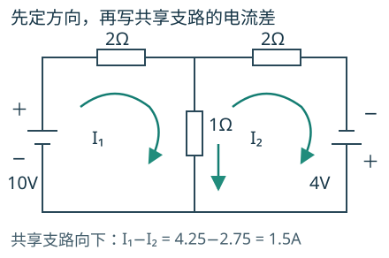

# 电路分析与电工技术

## 第1章 电路模型和基本物理量
<!-- exam: A | 单选、判断、填空、计算 -->

### 1. 电路的组成与作用

- 🔴 **电路**：电路是由电气元件按一定方式连接组成、==用于传输和转换电能或处理电信号的系统==，通常包括电源、负载、导线及控制保护装置。开路仍是一种电路状态，不能因电流为零就说它不属于电路。

- 🔴 **电源**：把其他形式的能量转换为电能，如电池、发电机。
- 🔴 **负载**：消耗电能并转换为光、热、机械能等，如灯泡、电动机。
- 🔴 **导线**：连接各部分并传输电能或信号。
- 🔴 **控制和保护装置**：控制通断并在异常时保护设备，如开关、熔断器、断路器。

- 🔴 **开路**：通路断开，电流为0，但断口两端可以有电压。
- 🔴 **短路**：两点被理想零电阻或实际很小电阻连接；理想短路电压为0，实际电流由剩余电路限制，可能很大。

### 2. 电压、电流、电阻和功率

- 🔴 **电流i**：通过某截面的电荷量对时间的变化率，`i=dq/dt`，单位安培（A）；恒定直流常记I。
- 🔴 **电压uab**：a点相对b点的电位差，`uab=va−vb`，单位伏特（V）；正负由规定极性确定。
- 🔴 **电阻 `R`**：导体对电流的阻碍作用，单位欧姆（Ω）。
- 🔴 **电功率 `P`**：单位时间内转换的电能，单位瓦特（W）。

- 🔵 **欧姆定律与功率**：恒定线性电阻、关联方向下`U=IR`；吸收功率`P=UI=I²R=U²/R`。后两种功率表达式只适用于电阻，不能无条件套到电感、电容或电源。使用前统一单位。

#### 关联参考方向与功率符号

- 🔵 **关联参考方向**：先在元件两端规定电压“+、−”，再画电流参考箭头。若电流箭头从电压正端进入元件，称关联参考方向，此时`p=ui`：p>0表示吸收电能，p<0表示发出电能。参考箭头只规定正方向，计算出负电流表示实际流向相反。若参考电流从负端进入，应按`p=−ui`判断吸收功率，不能忽略方向直接乘。

- 🔵 **先算再核对：** 关联参考方向下u=3 V、i=−2 A，p=−6 W，表示元件发出6 W；若只看电压和电流绝对值，会把供能元件误当成耗能元件。

- 🔵 **示波器时基**：示波器横轴读时间：`T=一个周期所占格数×s/div`，`f=1/T`。0.2 ms/div下一个周期占5格，先得到T=1 ms=0.001 s，再得f=1000 Hz。纵轴读峰峰电压，探头倍率是否已补偿要单独核对。

### 3. 直流与交流

- 🔴 **直流与交流**：直流电的方向通常不随时间改变；交流电的大小和方向随时间周期性变化。电池提供直流，日常电网通常提供正弦交流。

### 电路模型、物理量与正弦参数
<!-- test: 填空、单选、计算 | 识别集总模型，按关联方向判断功率，把正弦峰值换为有效值 -->
- 🔴 **电路模型**：用理想电路元件及其连接关系描述实际电路主要电磁性质的模型。集总参数模型忽略信号沿导线传播所需时间，元件尺寸及连接长度应远小于所研究信号的波长。
- 🔵 **正弦式**：`u(t)=Um cos(ωt+φu)`；Um为峰值（V），ω为角频率（rad/s），φu为初相位；`ω=2πf，T=1/f，U=Um/√2`。有效值一般定义为一个周期内平方平均值的平方根，峰值除√2只适用于正弦量。
- 🔵 **完整换算**：`u=100√2 cos(100πt+π/6) V`，先读Um=100√2 V、ω=100π rad/s；再得U=100 V、f=50 Hz、T=20 ms、初相30°。
- ⚫ **单位与边界**：恒定直流的大小、方向均不随时间变化；一般直流可含单向脉动。交流分量不能一概当作正弦量；非正弦波的有效值须回到定义计算。

### 例题

**题目：** 示波器垂直刻度为1 V/div，尚未补偿10倍探头的衰减，波形峰峰值占3格，则被测信号峰峰值为____V。

查看答案与解析

**答案：** 30

**解析：** 刻度未补偿，Upp=3×1×10=30 V；若通道已设置相应探头倍率、显示的是补偿后的刻度，则不能再乘10。

## 第2章 电路定律与等效连接
<!-- exam: A | 单选、判断、多选、计算 -->

### 1. 欧姆定律

- 🔴 **欧姆定律与功率**：==恒定线性电阻、关联参考方向下==，两端电压与电流成正比：==`I=U/R`==。电阻不变时，电压越大，电流越大；电压不变时，电阻越大，电流越小。

- ⚫ **线性模型边界**：欧姆定律不是所有元件在任何状态下的普遍关系。线性电阻的伏安特性是一条过原点的直线；二极管、三极管等非线性器件不能在全部工作范围内机械套用 `U=IR`。

### 2. 串联和并联

- 🔴 **串联**：串联电路只有一条电流路径，各元件电流相同，总电压等于各部分电压之和：

- 🔵 **等效电阻**：`R=R1+R2+…`
- 电阻越大，分得的电压越大。

- 🔴 **并联**：并联电路各支路接在相同两点之间，各支路电压相同，总电流等于各支路电流之和：

- 🔵 **并联等效**：`1/R=1/R1+1/R2+…`
- 🔵 **相同的 `n` 个电阻并联**：`R总=R/n`
- 支路电阻越小，分得的电流越大。

- 🔵 **数值例**：例：三个 `6 Ω` 电阻并联，`R总=6/3=2 Ω`。

- ⚫ **分压与连接条件**：串联分压的直接公式是 `U1=U×R1/(R1+R2)`；两个电阻并联也可直接写成 `R总=R1R2/(R1+R2)`。这些公式的边界是连接方式确实为串联或并联：中间节点若还接有其他支路，就不能机械套串联分压；两个元件若并非接在同一对节点上，也不能按并联处理。

- 🔵 **单位与结果检查**：计算前应先判断连接关系并统一 `kΩ、mA、μF` 等单位，再代入公式并检查数量级。例如并联后的等效电阻一定小于任一支路电阻，结果若更大，通常是公式或连接关系判断有误。

- 🔵 **并联图示计算**：并联要先找共同节点：下面三个6 Ω支路都跨接6 V，每路1 A、合计3 A，反推等效电阻2 Ω。

### 分流、三端等效与理想源连接
- 🔵 **两支路分流**：总电流I流入R1、R2并联网络时，`I1=I R2/(R1+R2)`、`I2=I R1/(R1+R2)`；结果与支路电阻成反比。I=3 A、R1=2 Ω、R2=4 Ω时，I1=2 A、I2=1 A，共同电压为4 V。
- 🔴 **Y形与Δ形**：Y形有共同中心节点，Δ形三电阻围成三角形；两者变换要求三个外端口电压、电流关系相同。对称情况下，每臂RY的Y形等效为每边`RΔ=3RY`的Δ形；反向`RY=RΔ/3`。
- 🔵 **验证三端等效**：Y形每臂2 Ω，第三外端悬空时，另两端看入为2+2=4 Ω；Δ形每边6 Ω，同一端口看入`6∥(6+6)=4 Ω`。不能把两端测得的4 Ω误写成Δ每边阻值。
- ⚫ **理想源相容条件**：并联的理想电压源必须端电压及极性相容；串联的理想电流源必须电流大小及方向相容，否则理想模型无解。两个相同理想电压源并联也不能唯一确定各自分流。

### 3. 基尔霍夫定律

- 🔴 **KCL（电流定律）**：任一节点流入电流之和等于流出电流之和，体现电荷守恒。例如某节点流入 `2 A` 和 `3 A`，只有一条流出支路时，该支路电流为 `5 A`。
- 🔴 **KVL（电压定律）**：任一闭合回路中各段电压代数和为零，体现能量守恒。例如电源为 `12 V`，两个串联元件的电压分别为 `5 V` 和 `7 V`。

- ⚫ **通俗理解：** KCL要求集总节点不积累净电荷；KVL按闭合绕行把电压升降记为代数和0。参考方向只负责统一符号，不负责预言实际方向。

先计算：流入节点2 A和3 A，流出一支路1 A，另一流出支路多大？

由KCL，流入总和5 A等于流出总和，所以未知流出支路为4 A。

- ⚫ **通俗理解：** 负电流表示实际方向与箭头相反；像先规定向东为正，位移为负只是朝西。方程中的方向约定必须始终一致。

## 第3章 电阻电路的分析方法与电路定理
<!-- exam: B | 单选、判断、计算 -->

### 1. 理想电源与等效变换

- 🔴 **理想电压源**：==端电压由源规定，与外电路无关==；内阻为0，输出电流由外电路确定，不能任意短路。
- 🔴 **理想电流源**：支路电流由源规定，与外电路无关；内阻无穷大，端电压由外电路确定，不能任意开路。
- 🔴 **实际电源模型**：电压源串联内阻或电流源并联内阻；互换须保持端口伏安关系，源方向必须对应。

- 🔵 **实际电源变换**：电压源 `Us` 串联 `R` 等效为电流源 `Is=Us/R` 并联同一个 `R`。
- 等效变换只保证端口外部的电压、电流关系相同，内部各支路量不一定相同。
- 理想电压源不能直接短路，理想电流源不能直接开路。

### 受控源与列方程的数量
<!-- test: 填空、简答、计算 | 写出四类受控源关系，保留受控源列节点方程 -->
- 🔴 **独立源与受控源**：独立源的规定值不由电路中其他电压、电流控制；受控源的输出由指定控制量决定。受控源通常画为菱形，电压源标极性、电流源标箭头，控制量须另标参考方向。

| 类型 | 控制关系 | 系数及单位 |
| --- | --- | --- |
| 电压控制电压源VCVS | us=μux | μ无量纲 |
| 电流控制电压源CCVS | us=r ix | 转移电阻r，Ω |
| 电压控制电流源VCCS | is=g ux | 转移电导g，S |
| 电流控制电流源CCCS | is=βix | β无量纲 |

- 🔵 **受控节点例**：节点u经1 kΩ接地，另有向节点注入的VCCS，其电流为`gux`，g=2 mS、ux=1 V。KCL先写`u/1kΩ=2mS×1V=2mA`，再得u=2 V。独立源置零时受控关系仍应保留；控制量也可能随电路变化，不能任意固定。
- 🔴 **独立方程数**：连通电路有n个节点、b条支路时，独立KCL为n−1个，独立KVL为b−n+1个，再配合元件关系求解。网孔法要求可画成平面电路；一般回路法并不限于网孔。
- 🔵 **叠加实际计算**：节点经两个1 kΩ分别接10 V、4 V独立电压源。共同作用u=7 V；仅10 V源作用时另一源短路，u1=5 V；仅4 V源作用得u2=2 V，故u=u1+u2。1 kΩ对地测试负载若加入，须在三个电路中都保留。
- ⚫ **替代定理的范围**：已知某支路在给定工作状态下为U、I，可用同电压理想电压源或同电流理想电流源替代，其他支路状态保持不变须以替代后电路解唯一为前提；它不保证任意外部改变后的端口特性，不能替代戴维南定理。

### 根据电路选列式方法
<!-- test: 场景题、简答 | 从未知量数量和连接条件选择节点法、网孔法或端口等效 -->
- 🔵 **选择例**：电路只有一个未知节点、多个支路接向已知电位，优先节点法，因为只需一个KCL方程；两个平面网孔且主要为电压源时，网孔法可少设未知量。若只关心换接不同负载后的端口电流，先求戴维南等效更便于重复使用。
- ⚫ **排除依据**：电阻之间有分支不能只套串联分压；非平面电路不按网孔法直接套式；非线性器件电路不能未经线性化直接套叠加。

#### 节点电压与回路列式

- 🔴 **支路电流法**：以支路电流为未知量，用KCL、KVL及元件关系列式。
- 🔴 **节点电压法**：以节点对参考节点的电压为未知量，用支路电流表达式列KCL，适合未知节点少的网络。
- 🔴 **网孔电流法**：以平面电路各网孔电流为未知量列KVL，适合网孔少的网络；共享支路电流须由网孔电流合成。

- 🔵 **节点支路电流**：对简单节点，若各支路通过电阻连接到已知电位，可把流出节点的电流写成 `(U节点-U已知)/R`，再用KCL求节点电压。参考节点电位取0只是计算基准，不表示该点一定与大地相连。

- 🔵 **一步步列节点方程：** 某节点电压为U，一支经2 Ω连到已知10 V点，另一支经2 Ω连到0 V点，没有其他支路。把两股电流都先假设为“流出U节点”，可列`(U−10)/2+(U−0)/2=0`。乘2后得到`2U−10=0`，所以U=5 V。

- 🔵 **KCL回代**：回代检查：第一支电流`(5−10)/2=−2.5 A`，表示实际有2.5 A流入；第二支`5/2=2.5 A`流出，正好满足KCL。已知某支路实际流入，也可以另选方向，只要全程保持同一套符号规则。

换一组数据：10 V点经1 Ω连接U，U经3 Ω接0 V，节点电压是多少？

`(U−10)/1+U/3=0`，解得U=7.5 V。两支实际电流均为2.5 A。两电阻不相等时，不能再凭“取中间值”写5 V。

#### 共享电阻的网孔列式

- ⚫ **网孔与共享支路**：网孔是平面电路中内部不再含其他回路的最小回路。相邻两个网孔共用一只1 Ω电阻，各自外侧另有2 Ω电阻；给两网孔都规定顺时针电流I1、I2。沿左网孔方向看，共享支路实际参考电流是`I1−I2`；沿右网孔方向则为`I2−I1`，因为两个顺时针网孔在共同边上方向相反。

- 🔴 **网孔KVL**：假设沿各自网孔顺时针方向，左电源提供10 V电压升、右电源提供4 V电压升，KVL给出：

- 🔴 **左**：`2I1+1×(I1−I2)=10`，即`3I1−I2=10`。
- 🔴 **右**：`2I2+1×(I2−I1)=4`，即`−I1+3I2=4`。

- 🔵 **网孔解与回代**：解得I1=4.25 A、I2=2.75 A。共享支路沿左网孔方向的电流是1.5 A，不是4.25 A或7 A。回代左侧`8.5+1.5=10 V`，右侧`5.5−1.5=4 V`，两式都满足。电源若沿选定方向表现为电压降，右端应改负；节点较少、非平面电路或含电流源时，应另按条件选择节点法或超网孔，不能照抄这组数。

#### 叠加、戴维南与最大功率

- 🔴 **叠加定理**：在线性电路中，多个独立电源共同作用的响应等于各独立电源单独作用响应的代数和。某独立电压源置零时用短路代替，某独立电流源置零时用开路代替；受控源不能随意置零。功率是电压或电流的非线性函数，不能直接叠加功率。
- 🔴 **戴维南定理**：任意线性含源二端网络对外可等效为一个电压源 `Uth` 串联电阻 `Rth`。
- 🔴 **诺顿定理**：同一网络也可等效为一个电流源 `In` 并联电阻 `Rn`，并有 `Rn=Rth`、`In=Uth/Rth`。

- 🔵 **最大功率传输**：求戴维南等效时，`Uth` 是端口开路电压；独立源置零后从端口看进去得到 `Rth`。纯电阻负载获得最大功率的条件是 `RL=Rth`，此时 `Pmax=Uth²/(4Rth)`。

#### 戴维南端口参数求法

- ⚫ **开路电压与看入电阻**：先移去外接负载，求端口开路电压`Uoc=Uth`。仅含独立源和线性电阻时，将独立电压源短路、独立电流源开路，从端口看入可求Rth。电源置零不等于把所有元件删除，也不等于带着原负载求电阻。

- 🔵 **测试源与短路电流**：含受控源时必须保留受控源。可将独立源置零，在端口加测试电压Ut，求流入网络的测试电流It，再得`Rth=Ut/It`；也可在可求且非退化的线性网络中用`Rth=Uoc/Isc`，其中Isc参考方向取网络向端口外短路支路供出的电流。若Uoc和Isc都为0，不能把0/0当成0 Ω，应改用测试源法。

- 🔵 **跟算：** Uoc=12 V、Isc=3 A时，Rth=4 Ω；接RL=4 Ω最大功率为`12²/(4×4)=9 W`。例如测试源法中加2 V、测得流入0.5 A，同样得到4 Ω。短路电流用于理论模型分析；实际电源不可随意短接测量。

- ⚫ **通俗理解：** 戴维南把复杂内部关系压成两个端口参数，便于算外接负载；它不保证内部每条支路的电流或损耗保持相同。

- 🔵 **小例子：** 若某二端网络测得开路电压为 `12 V`，独立源置零后从端口看进去为 `3 Ω`，那么它对任意外接负载都可等效为 `12 V` 电压源串联 `3 Ω`。

## 第4章 电阻、电容与电感元件
<!-- exam: A | 单选、判断、计算、状态判断 -->

### 1. 电阻

- ⚫ **电阻用途与额定功率**：电阻主要起限流、分压、偏置和将电能转换为热能等作用。额定功率表示电阻在规定条件下允许长期承受的功率，实际功率不应超过额定值。

### 2. 电容

- 🔴 **电容稳态**：电容器具有储存电荷和电场能量的作用。其基本特性可概括为“隔直通交”：==在稳定直流状态下理想电容相当于开路==，对变化信号则表现出容抗。

- 🔵 **容抗公式**：容抗：`XC=1/(2πfC)`。频率 `f` 越高或电容量 `C` 越大，容抗越小。计算时注意把微法换成法：`1 μF=10⁻⁶ F`。

- 🔵 **数值例**：例：`f=50 Hz，C=100 μF`，则 `XC≈31.8 Ω`。代入前要把 `100 μF` 换算为 `100×10⁻⁶ F`。

- 🔵 **频率变化比较**：当频率变为原来的2倍而电容量不变时，由反比关系可知容抗变为原来的 `1/2`；感抗 `XL=2πfL` 与频率成正比，同样条件下变为原来的2倍。

### 3. 电感

- 🔴 **电感稳态**：电感器能储存磁场能量，基本特性可概括为“通直阻交”。感抗 `XL=2πfL`，频率或电感量越大，感抗越大。

### 储能元件的时域方程
<!-- test: 填空、计算、过程推演 | 按关联方向由斜率求电流/电压，计算储能与换路初值 -->
- 🔴 **线性电容**：`q=CuC，iC=C duC/dt，WC=CuC²/2`；C为电容量（F），WC为电场能量（J）。采用关联参考方向，C恒定；电压下降时iC可能为负。
- 🔴 **线性电感**：`uL=L diL/dt，WL=LiL²/2`；L为电感量（H），WL为磁场能量（J）。这些式子忽略漏电、绕组电阻及饱和等非理想因素。
- 🔵 **斜率计算**：C=10 μF，电压在2 ms内从1 V线性升到5 V，斜率`4/(2×10⁻³)=2000 V/s`，故iC=20 mA；末态能量`10×10⁻⁶×25/2=125 μJ`。L=2 mH、电流以3 A/ms上升，则uL=6 V。
- 🔵 **等效连接**：理想电容并联相加、串联倒数相加；无互感理想电感串联相加、并联倒数相加。两个10 μF电容串联得5 μF，并联得20 μF。
- ⚫ **连续条件**：没有冲激电流时uC连续；没有冲激电压时iL连续。“电容开路、电感短路”是恒定直流稳态等效，不是任意换路瞬间的等效。

## 第5章 正弦稳态、电工控制与安全
<!-- exam: A | 单选、判断、多选、计算、状态判断、场景题、简答 -->

### 1. RLC 基本相位关系

- 🔴 **纯电阻**：==电压与电流同相==。
- 🔴 **纯电感**：正弦稳态电流滞后电压90°。
- 🔴 **纯电容**：正弦稳态电流超前电压90°。
- 🔴 **串联 RLC 谐振**：`XL=XC`，总电路呈电阻性，电压与电流同相，功率因数为1。

- 🔴 **复阻抗与导纳**：正弦稳态中可用相量和复阻抗统一表示元件关系：`ZR=R`、`ZL=jωL`、`ZC=1/(jωC)`。串联阻抗直接相加，并联支路更适合先求导纳 `Y=1/Z`。在串联RLC中，`XL>XC` 时整体呈感性，电流滞后电压；`XL<XC` 时整体呈容性，电流超前电压。

#### 电阻6Ω、感抗8Ω，为什么不能直接相加？

- 🔵 **RL相量全过程**：20 V有效值、50 Hz的交流接在6 Ω电阻与感抗8 Ω串联电路上，电流为什么不是20÷14？因为电阻压降跟电流同相，电感压降比电流早四分之一周期，两段电压不能当同方向长度直接相加。用j标记垂直的电抗分量：Z=6+j8，模长√(6²+8²)=10 Ω，相角arctan(8/6)≈53.1°。把电源相位定为0°，电流为20∠0°÷10∠53.1°=2∠−53.1° A：有效值2 A，滞后电压53.1°。若回到时间波形，i(t)=2√2 cos(100πt−53.1°) A。这里是同频正弦稳态，不能用来直接算刚合闸的暂态。

同样20V有效值，若把感抗8Ω换成容抗8Ω，电流有效值与相位怎样变？

Z=6−j8Ω，模仍10Ω、角为−53.1°。I=20∠0°/10∠−53.1°=2∠+53.1°A，电流超前电压，幅值未变。

- 🔵 **串联RLC列式**：串联RLC先求净电抗X=XL−XC，再写`Z=R+jX`，阻抗模为`|Z|=√(R²+X²)`；若U是端电压有效值，则电流有效值`I=U/|Z|`。例如R=6 Ω、XL=12 Ω、XC=4 Ω、U=20 V，净电抗为8 Ω，Z=6+j8 Ω，模为10 Ω，所以I=2 A，整体感性。R和X是复数的两个垂直分量，不能把6+8当作阻抗模。

- ⚫ **通俗理解：** 相量把同频正弦的幅值和相位变成复数运算；电感、电容的相位关系使电抗不能与电阻直接按长度相加。开关暂态仍须另算。

先判断：串联RLC中XL大于XC时，电流超前还是滞后总电压？

整体呈感性，电流滞后总电压；XL=XC谐振时二者同相。

### 2. 交流功率与功率因数

- 🔴 **有功功率 `P`**：真正转化为机械能、热能等并被负载利用的平均功率，单位是瓦（W）。
- 🔴 **无功功率 `Q`**：电源与电感、电容之间往返交换的功率，单位是乏（var）；它本身不直接做有用功，但维持电动机、变压器等设备的电磁场需要无功功率。
- 🔴 **视在功率 `S`**：按交流电压、电流有效值衡量的总供电容量，单位是伏安（VA）。
- 🔴 **功率因数**：有功功率占视在功率的比例，即 `P/S`；正弦稳态中常写作 `cosφ`。功率因数越接近1，同样有功功率所需电流通常越小。

- 🔵 **正弦功率计算**：单相正弦交流中有 `S=UI`、`P=UIcosφ`、`Q=UIsinφ`，其中 `U、I` 都取有效值，并有 `S²=P²+Q²`。例如 `U=220 V、I=5 A、cosφ=0.8`，有功功率 `P=220×5×0.8=880 W`。不要把 `VA、W、var` 三种单位混用。

- ⚫ **功率因数补偿**：提高功率因数可以减小线路电流和线路损耗，降低电压损失，并提高供电设备容量的利用率。感性负载常采用并联电容补偿，但补偿不是“增加负载有功功率”，也不是越多越好；过度补偿会使系统呈容性。

### 3. 三相交流和电动机

- 🔴 **线量与相量**：UL为两根相线间电压、IL为相线电流；UP为每相负载两端电压、IP为每相负载电流，P下标在此表示一相。
- 🔵 **对称星形Y连接**：UL=√3UP，IL=IP；对称三角形Δ连接UL=UP，IL=√3IP。
- ⚫ **名称区别**：此处“相电压/相电流”是一相的物理量，和复数运算工具“相量”不同；功率P也不能当这个下标。

- 🔴 **异步电动机**：三相异步电动机主要由定子和转子组成。其基本原理是定子三相绕组产生旋转磁场，转子因电磁感应产生转矩。异步电动机在通常的电动运行状态下，转子转速低于同步转速；发电等其他运行状态不能直接照搬。

### 4. 变压器与电压表、电流表接法

- ⚫ **变压器原理**：变压器利用电磁感应传递交流电能，基本作用是升高或降低交流电压，还可用于电气隔离和阻抗变换。变压器不能直接变换恒定直流电压；理想变压器升压时二次侧电流相应减小，降压时二次侧电流相应增大。

- 电压表测量元件两端的电压，应与被测元件并联；其内阻应尽量大，以减小对原电路的影响。
- 电流表测量支路中的电流，应串联接入被测支路；其内阻应尽量小，以减小附加压降。

- ⚫ **仪表接线边界**：判断接法时抓住“电压表跨两端、电流表进支路”。电流表不能直接并接在电源两端，否则可能形成近似短路；电压表也不能串联代替电流表。

### 5. 常用低压电器

- 🔴 **熔断器**：主要用于短路保护，熔体熔断后需要更换。
- 🔴 **断路器**：发生过载或短路时可自动切断，并可复位使用。
- 🔴 **热继电器**：主要用于电动机长期过载保护，不适合代替短路保护。
- 🔴 **接触器**：利用电磁机构频繁接通或断开主电路。
- 🔴 **按钮**：发出控制命令，常开和常闭触点状态按未按下时判断。

- 🔴 **自锁与互锁**：自锁使启动按钮松开后接触器仍保持吸合；互锁用于防止两个不允许同时工作的接触器同时吸合。

### 复功率、三相总功率与控制顺序
- 🔵 **复功率**：有效值相量取关联方向，`S复=U相量×I相量的共轭=P+jQ`，其模为视在功率S；感性Q>0，容性Q<0。上例Z=6+j8 Ω、I=2 A时，`S复=I²Z=24+j32 VA`，P=24 W、Q=32 var、S=40 VA、功率因数0.6。
- 🔵 **对称三相**：总有功功率`P=√3 UL IL cosφ=3UP IP cosφ`，φ为每相负载电压与电流的相位差。星形电阻负载每相22 Ω、线电压380 V：UP≈219.4 V、IP=IL≈9.97 A，总功率约6.56 kW。三角形换算须先按实际连接求相电流。
- 🔴 **中性线作用**：三相四线星形不对称负载中，中性线给不平衡电流提供通路，帮助保持各相负载电压；中性线断开可使负载中性点位移，各相电压不再相等。
- 🔵 **理想变压器**：同名端电压参考一致时`U1/U2=N1/N2=k`，电流大小比`I1/I2=1/k`，忽略损耗有P1=P2；负载折算到一次侧为`Z入=k²Z负载`。220/22 V变比10，二次负载11 Ω折算为1100 Ω，不是110 Ω。
- 🔵 **自锁回路逐步看**：停止常闭触点与线圈串联，启动常开按钮与接触器常开辅助触点并联。按启动→线圈得电→主触点与辅助触点闭合→松启动后辅助支路仍供电；按停止→串联通路断开→线圈释放→辅助触点断开。失电后不能仅因恢复电源就自动保持原吸合状态。
- ⚫ **理解**：相量把同频正弦的幅值与相位合在一起计算；复功率中的共轭负责保留电压与电流的相位差，不能直接把两个相角相加。

### 6. 安全用电

- ⚫ **接地与保护**：安全用电包括正确接地、使用合适的保护装置、保持绝缘完好、避免湿手操作、检修前断电验电等。保护接地用于降低设备外壳意外带电时的触电风险；不能把保险丝换成粗铜丝。

- 🔵 **额定值**：电气设备的额定电压、额定电流和额定功率表示制造者规定的正常工作条件。实际使用时应选择与电源和负载相匹配的额定值，并为启动冲击、温升和环境条件留出合理余量。“额定值越大越安全”并不成立，例如保护装置额定电流过大会失去应有的保护作用。

## 第6章 工程可靠性基础
<!-- exam: C | 单选、判断、计算 -->

- ⚫ **串联系统**：若若干独立元件必须全部正常，系统才正常，这是串联系统，系统可靠度等于各元件可靠度的乘积：`R=R1×R2×…`。

- 🔵 **数值例**：例：两个可靠度均为0.9的元件组成串联系统，系统可靠度为 `0.9×0.9=0.81`。这里的“串联”是可靠性逻辑，不是计算电阻串联值。

### 可靠度与失效概率
- 🔴 **可靠度R(t)**：==在规定条件和规定时间内完成规定功能的概率==，0≤R≤1；失效概率`F(t)=1−R(t)`。讨论某个R数值时必须使用相同任务时间与环境条件。
- 🔵 **并联系统完整计算**：两独立支路可靠度0.9、0.8，只要一路正常即可工作。先求两路同时失效概率`(1−0.9)(1−0.8)=0.02`，再取补集R=0.98；不是0.9+0.8，也不是它们的乘积。
- ⚫ **共同原因**：两支路共用同一电源，电源故障可同时使它们失效；不能把共用电源遗漏后宣称两支路完全独立。可靠性逻辑图的串并联按功能成功条件确定，与导线怎样连接没有一一对应关系。

## 第7章 一阶动态电路
<!-- exam: A | 单选、判断、计算、状态判断 -->

- 🔴 **一阶动态电路**：只需==一个独立储能状态==描述，微分方程最高阶为1；多个储能元件经约束后也可能只剩一个独立状态。
- 🔵 **时间常数**：RC电路τ=R等效C，RL电路τ=L/R等效，单位s，R从换路后储能端口看入；τ越大响应越慢。

- 🔵 **三要素公式**：x(t)=x(∞)+[x(0+)−x(∞)]e^(−t/τ)，t≥0；适用于换路后参数恒定、常值激励的一阶线性电路。

- 🔴 **初值与终值**：其中 `x(0+)` 是换路后的初值，`x(∞)` 是新稳态的终值。对从0开始充电的RC电路，经过一个 `τ`，电容电压约达到最终值的63.2%；放电一个 `τ` 后约剩初值的36.8%。

- 🔵 **换路分析顺序**：电容电压满足 `uC(0+)=uC(0-)`，电感电流满足 `iL(0+)=iL(0-)`。分析时先求换路前稳态，再利用连续性确定初值，随后求换路后的终值和从储能元件端口看进去的等效电阻。复杂多储能元件网络一般不是一阶电路，不能机械套用单个时间常数。

- ⚫ **放电比例**：对比同样τ=1 s的放电：从10 V向0下降，一个τ后不是剩下63.2%，而是剩下36.8%。

先预测：电容从0充电，一个时间常数后达到最终值的50%吗？

不是，约为63.2%；放电一个时间常数后约剩36.8%。

### 三要素法的完整充放电过程
<!-- test: 计算、过程推演 | 求换路初值、终值、看入电阻并写完整响应 -->
- 🔵 **过程例**：10 V电源经20 kΩ给50 μF电容充电，换路前电容已放空。先由连续性得uC(0+)=0；恒定直流终态电容开路，uC(∞)=10 V；源置零后从电容端口看入20 kΩ，τ=1 s。因此`uC(t)=10(1−e^(−t)) V，t≥0`，`i(t)=(10−uC)/20kΩ=0.5e^(−t) mA`。
- 🔵 **中间状态**：t=0+，uC=0 V、i=0.5 mA；t=1 s，uC≈6.32 V、i≈0.184 mA；t→∞，uC→10 V、i→0。若在充到10 V后改经同一电阻放电，`uC=10e^(−t) V`；仍以充电方向规定电流则i为负。
- ⚫ **公式范围**：三要素指数式适用于换路后参数恒定、常值激励的一阶线性电路；τ中的R是换路后储能端口看入的等效电阻，受控源保留。任意随时间变化的输入不能仅凭初终值套同一指数式。

### 例题

**题目：** 电阻为20 kΩ、电容为50 μF的一阶RC电路，时间常数为____s。

查看答案与解析

**答案：** 1

**解析：** τ=RC=20×10³×50×10⁻⁶=1 s。

## 第8章 万用表、示波器与安全测量
<!-- exam: B | 单选、判断、状态判断、场景题、排障题 -->

### 1. 万用表的基本使用

- 🔴 **测电压**：选择交、直流类型和合适量程，==表笔并联在被测两端==；未知大小时先用较大量程。
- 🔴 **测电流**：断开原支路后把电流表串入，表笔插孔和量程必须正确；严禁用电流挡直接跨接电源两端。
- 🔴 **测电阻或通断**：被测电路必须断电，含电容时先确认安全放电；否则既可能损坏仪表，也可能得到错误读数。
- 🔴 **二极管挡**：可比较两个方向的压降，正常PN结通常一个方向可测得正向压降，反向显示截止；在路测量还会受并联支路影响。

- 🔴 **量程与接线检查**：测量前按“测什么—交直流—预计范围—表笔插孔—接法—安全”检查。量程太小可能过载，量程过大则分辨率较低；“量程越大越准确”不成立。

### 2. 示波器怎样读波形

- 🔴 **示波器用途**：示波器用于观察电压随时间的变化，常用读数关系是：

- 🔵 **幅值读数与探头倍率**：峰峰值先由垂直格数乘V/div得到；刻度尚未补偿探头衰减时，再乘探头倍率。若示波器已经按探头倍率显示补偿后的刻度，就不能重复乘。幅值对称时 `Um=Upp/2`。
- 🔵 **周期与频率**：周期 `T=水平格数×s/div`，频率 `f=1/T`。
- 调整触发电平和触发源可使周期波形稳定显示；触发不稳不等于被测电路一定无信号。

- ⚫ **地夹与测量参考点**：普通台式示波器探头地夹常与保护地相连。把地夹随意夹到带电高电位点可能造成短路，测量前必须确认参考地和隔离条件。示波器主要看波形，万用表更适合快速测稳态电压、电流或电阻，两者用途不能简单互换。

### 幅值、有效值与仪表负载
- 🔵 **同一正弦波读数**：无直流偏置的正弦峰峰值Upp=8 V，则Um=4 V、U≈2.83 V；若水平每格0.5 ms、一周期4格，则T=2 ms、f=500 Hz。Upp/2只给峰值，不能直接当有效值；带偏置时还要区分交流分量与总有效值。
- 🔵 **负载误差例**：10 V电源串联100 kΩ给100 kΩ负载，本应测得5 V。接入内阻100 kΩ电压表后，负载变为`100k∥100k=50kΩ`，显示`10×50/(100+50)=3.33 V`。换成更高内阻电压表可减小此误差。
- ⚫ **理解**：测量表并不在电路之外；一接入，就增加了分流通路或串联阻抗。先判断仪表怎样改变电路，才能解释“读数正常或偏低”。

### 例题

**题目：** 说明电压表和电流表应怎样接入电路、理想内阻分别是多少，以及实际内阻会怎样影响被测电路。

查看答案与解析

**答案：** 电压表并联在被测两端，理想内阻无穷大；实际内阻有限，会分流并产生负载效应。电流表串联在被测支路，理想内阻为0；实际内阻非零，会增加支路电阻并改变电流。

**解析：** 测量仪表也是电路的一部分，实际内阻会改变原电路工作状态。

## 第9章 电路故障分析
<!-- exam: B | 单选、判断、场景题、排障题 -->

- 🔵 **故障定位顺序**：面对“灯不亮、输出为零、波形异常”类场景，不要直接换元件。先断电观察是否有烧焦、松脱或接错，再按“==电源—保护—输入—中间节点—负载==”逐段测量：

1. 确认供电电压、极性、保险和接地正常。
2. 对照原理图确认开路、短路和连接位置。
3. 通电测量时先选安全参考点，从已知正常节点向故障点推进。
4. 用万用表判断直流工作状态，用示波器比较各级输入输出波形。
5. 更换器件后复测，并确认故障原因而非只恢复现象。

- 🔵 **数值例**：例如电源正常但负载两端始终为0 V，应继续检查控制开关、连接线和负载两端是否被短接；若保险反复熔断，不应直接换更大保险，而应先排查短路和过载。

### 用电位表区分开路与短路
- 🔵 **有条件的定位例**：安全低压12 V直流电源，正端→闭合开关→1 kΩ负载→0 V回线，以回线作参考。正常时开关两端均12 V、负载下端0 V、电流12 mA。若开关触点开路且负载与回线完好，开关输入12 V、输出0 V、开关跨压12 V；可据此把故障范围缩到触点及接线。
- 🔵 **再验证**：断电确认放电后，隔离相关并联通路并测触点通断；若闭合触点低阻却通电输出仍异常，再查带载接触电阻和供电回路。若负载被短接，可能触发限流或保护，不能预设电源仍理想保持12 V。
- ⚫ **证据边界**：只有“某点为0 V”==不足以唯一确定开路、短路或无供电==；必须给出参考点、应有状态和上下游读数。故障判断用来确定下一步测量，不代替验证。

### 例题

**题目：** 串联控制回路不能工作。已确认电源正常，测得开关输入端有电压、输出端无电压，且开关应处于闭合状态。优先判断哪里故障？
- A. 电源
- B. 开关或其接线
- C. 负载之后的回线
- D. 测量仪表一定损坏

查看答案与解析

**答案：** B

**解析：** 分段测量显示电压在开关两端中断，且开关应闭合，因此优先检查开关触点和接线。

