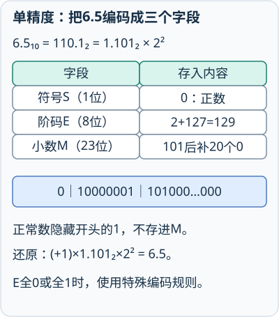
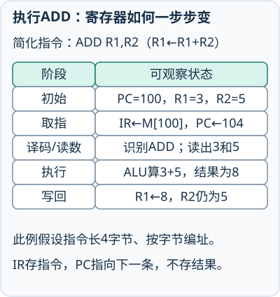
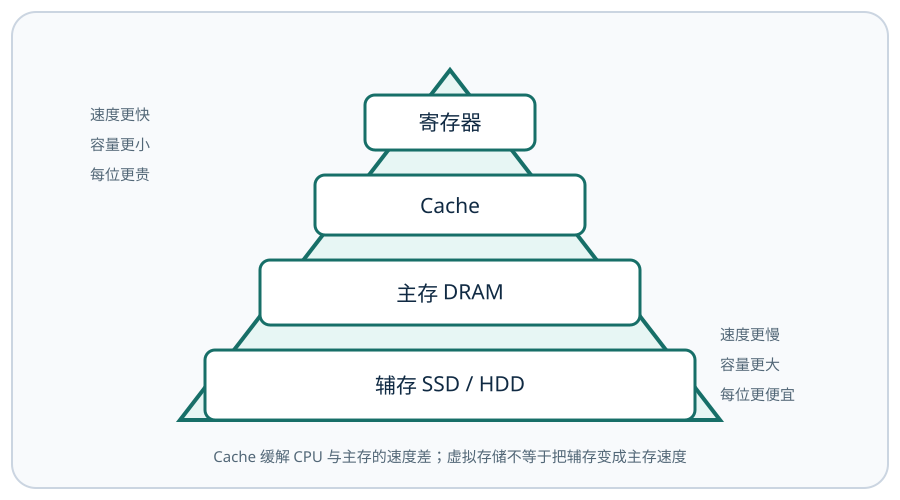
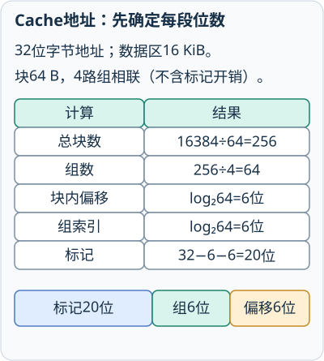
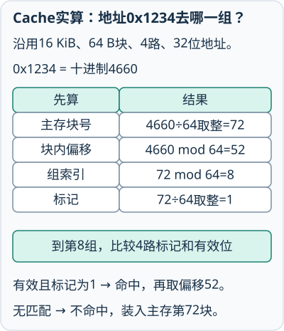
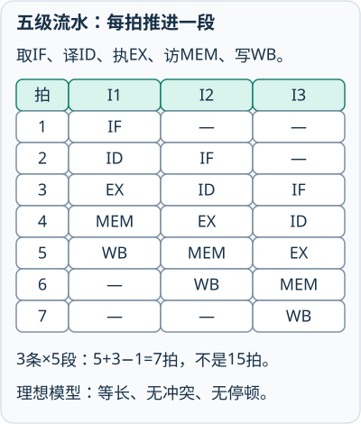
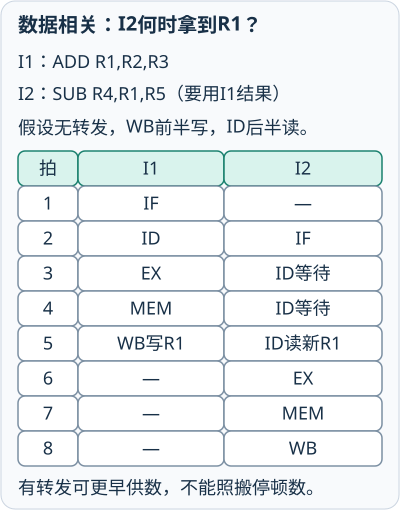
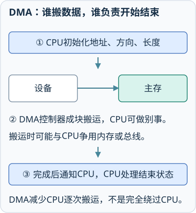
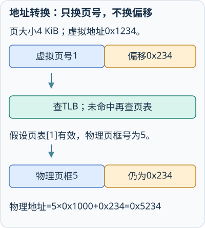

# 计算机组成原理讲义

## 第1章 计算机系统概论
<!-- exam: A | 单选、判断、计算 -->

### 1. 冯·诺依曼结构

冯·诺依曼计算机的核心是“存储程序、程序控制”：指令和数据都以二进制形式存放在存储器中，计算机按照指令地址自动顺序执行，遇到转移指令时改变执行顺序。

五大部件：

- 运算器：完成算术和逻辑运算。
- 控制器：解释指令并发出控制信号。
- 存储器：保存程序和数据。
- 输入设备：把外部信息送入计算机。
- 输出设备：把处理结果送到外部。

运算器和控制器通常合称中央处理器 CPU。现代 CPU 还包含寄存器、Cache 等部件。

### 2. 体系结构与组成

指令集体系结构 ISA 是程序员可见的指令、寄存器、数据类型和寻址规则，回答“计算机能做什么”；计算机组成研究部件连接和实现方式，回答“怎样实现”。

硬件是物理设备，软件是程序、数据和文档。裸机是尚未配置软件的计算机。

### 3. 性能指标

- 主频：CPU 时钟频率，表示时钟脉冲快慢。
- 时钟周期：主频的倒数。
- 字长：CPU 一次能够处理的二进制位数，通常影响数据表示范围和运算能力。
- 吞吐量：单位时间完成的工作量。
- 响应时间：完成一次任务所需时间。

主频高不必然代表整机更快，性能还受指令数、每条指令周期数、存储速度和程序特点影响。

CPU 性能的基本关系是 `CPU执行时间＝指令数×平均CPI÷主频`。比较时必须保证执行的是同一任务：编译优化可能减少指令数，体系结构和存储等待会改变 CPI，提高主频也可能伴随其他因素变化。因此主频只是影响性能的一个量，不能单独代表整机速度。

CPI是每条指令平均需要的时钟周期数，不是每秒指令数。若一半指令各用1拍、另一半各用3拍，平均CPI为`0.5×1+0.5×3=2`；100万条指令共200万拍，主频1 GHz即每拍1 ns，CPU时间为2 ms。加权平均要按执行次数比例，而不能把不同指令种类简单等权。

### 4. 计算机中的基本单位

位 bit 是计算机中最小的信息单位，只能取 0 或 1；字节 Byte 由 8 位组成，是常用存储计量单位。字是 CPU 一次处理的一组二进制位，字长由处理器设计决定，不必等于一个字节。

容量换算常见两种口径：十进制单位按 1000 倍换算，二进制单位按 1024 倍换算。KB 在传统存储计算中常按 `1 KB=1024 B` 处理，KiB 则明确表示 1024 B；网络速率中的 kbit/s 通常按十进制理解。

总线位宽、字长、存储单元位数和地址长度是不同概念。数据总线宽度影响一次传送量，地址长度影响可选择的编址单元数量，字长主要影响 CPU 运算和寄存器宽度。

先计算：100万条指令、CPI为2、主频1GHz，CPU时间是多少？

`10^6×2÷10^9=2×10^-3 s=2 ms`。先统一数量级，再代入指令数×CPI÷频率；这只计算CPU时间。

## 第2章 数据表示与运算
<!-- exam: A | 单选、判断、填空、计算 -->

### 1. 数制与编码

计算机内部采用二进制，因为电子器件容易稳定表示两种状态。八进制和十六进制常作为二进制的简写：一位八进制对应三位二进制，一位十六进制对应四位二进制。

常见编码：

- ASCII：常用英文字符编码，标准 ASCII 使用 7 位。
- Unicode：为不同语言文字提供统一编码空间。
- BCD：用四位二进制表示一位十进制数。

编码只是表示规则，不等同于加密。

### 2. 原码、反码和补码

原码用最高位表示符号，其余位表示数值；反码和补码便于用加法电路统一处理加减法。正数的原码、反码和补码相同；负数补码可由对应正数二进制按位取反再加 1 得到。

n 位无符号整数范围是 0～2^n−1；n 位补码整数范围是 −2^(n−1)～2^(n−1)−1。例如 8 位无符号数最大为 255，8 位补码范围为 −128～127。

进位和溢出不是同一概念：进位常用于无符号运算判断，溢出表示有符号结果超出可表示范围。

机器数把符号和数值一起编码。原码存在正零和负零，补码只有一个零，因此补码能多表示一个最小负数，并便于统一加减电路。符号扩展补码时应复制符号位，无符号数扩展时在高位补 0。

**通俗理解：** 补码可以想成固定刻度的环形计数器，超过最大刻度会从最小刻度继续。这样“减 1”可改成“加上 -1 的补码”，同一套加法电路就能处理加减；边界是机器字长固定，绕回后的位模式若超出有符号范围就发生溢出，不能当作真实数学结果。

大端方式把一个多字节数据的高字节放在低地址，小端方式把低字节放在低地址。端序只影响多字节数据的字节排列，不改变每个字节内部的位编号，也不决定网络传输速度。

### 3. 定点整数运算与溢出

补码加减法可以使用同一加法器：减去一个数等价于加上它的补码。运算结果只保留机器字长内的位，超出的最高进位被丢弃，再按有符号或无符号规则解释。

两个同号补码数相加得到异号结果，通常说明发生有符号溢出；异号数相加一般不会发生有符号溢出。例如 8 位补码的 `127+1` 得到位模式 `10000000`，若解释为有符号数就是 -128，真实结果 128 超出范围，因此发生溢出。无符号运算更关注最高位的进位或借位。

ALU 的减法通常转化为补码加法，因此加法器可以复用来完成加减。二进制乘法的基本思想是根据乘数各位产生部分积，再移位相加；除法的基本思想是让部分余数与除数比较、移位并逐位确定商。硬件可使用串行移位加减降低电路规模，也可并行处理提高速度，二者是面积与性能的取舍。

### 4. 定点数与浮点数

定点数的小数点位置固定，结构简单；浮点数的小数点位置可随阶码变化，表示范围大，但存在舍入误差。

IEEE 754 浮点数由符号、阶码和尾数组成。阶码主要影响范围，尾数主要影响精度。浮点运算通常需要对阶、尾数运算、规格化和舍入，因此小数比较不能总是假设数学上的精确相等。

以常见规格化二进制模型理解：数值由符号`S`、带偏置阶码`E`和有效数`1.M`共同决定，可写成`(−1)^S × 1.M × 2^(E−Bias)`；具体位数、偏置和特殊值规则以题目给出的格式为准。加减时先让小阶尾数右移完成对阶，再做尾数运算、规格化和舍入。对阶会丢弃低位，所以大数与很小的数相加，小数部分可能无法保留。

IEEE 754单精度共32位：1位符号、8位阶码、23位小数字段，正常数偏置为127并隐含最高位1。阶码全0用于零和非规格化数，阶码全1配合小数字段表示无穷或NaN，不能套正常数公式。例如`0｜10000001｜010000...`中实际阶为129−127=2，有效数为二进制1.01=1.25，所以数值为`1.25×2²=5`。

**先预测：** 再编码6.5：110.1₂=1.101₂×2²，IEEE单精度的S、E和小数字段怎样填写？

看图核对中间步骤

S=0，E=2+127=129（二进制10000001），小数字段为101后补20个0；最高位1隐含不存。

先判断：浮点范围很大，是否表示范围内每个实数都精确？

否。阶码扩大范围，有限尾数限制精度；例如许多十进制小数不能用有限二进制位精确表示。

## 第3章 指令系统与CPU
<!-- exam: A | 单选、判断、填空、场景题、简答 -->

### 1. CPU 内部部件

- 算术逻辑单元 ALU：执行算术和逻辑运算。
- 控制器 CU：取出、分析指令并控制执行。
- 寄存器组：高速保存指令、地址、操作数和中间结果。

常见专用寄存器：

- PC 程序计数器：保存下一条要执行指令的地址。
- IR 指令寄存器：保存当前正在执行的指令。
- MAR 存储器地址寄存器：保存将要访问的存储地址。
- MDR 存储器数据寄存器：保存从存储器读出或准备写入的数据。

简化的取指过程可概括为：PC 给出地址，存储器读出指令送入 IR，PC 更新到下一条指令。

CPU 执行一条指令通常经历取指、译码和执行。取指取得指令，译码确定操作和操作数位置，执行阶段由 ALU、寄存器和存储系统完成实际操作。若设备提出请求，CPU 还可能在适当时机处理中断。

**先预测：** 简化ADD R1,R2执行前R1=3、R2=5，PC=100且每条4字节；执行后R1和PC各是多少？

看图核对中间步骤

R1变8，R2仍5；PC在取指后前进到104。PC保存指令地址，不能把运算结果8写进PC。

**通俗理解：** 指令执行像照着操作单工作：PC 指向下一张操作单，IR 暂存当前操作单，控制器读懂动作，ALU 和存储部件完成工作。指令和数据在存储器里都是二进制，CPU 依据当前执行阶段和地址用途解释它们，并不是某种位模式天生就是指令。

**小例子：** `ADD R1,R2` 的操作码表示“相加”，寄存器字段指出数据位置；若同一串二进制被当作普通内存数据读取，它只是一组数值位，不会自行执行。

数据通路是数据在寄存器、ALU、总线和存储接口之间流动的通道，控制器产生控制信号决定“谁送出、谁接收、ALU 做什么”。以取指为例，可概括为 `PC → MAR → 主存 → MDR → IR`：地址先送 MAR，读出的指令经 MDR 进入 IR。不同机器的内部通路可以不同，但 MAR 保存访问地址、MDR 暂存读写数据的基本分工不变。

机器周期通常对应一次较完整的基本操作，时钟周期是处理器最基本的节拍，指令周期是完成一条指令的全部时间。一般一条指令周期包含一个或多个机器周期，一个机器周期又包含若干时钟周期，具体划分依处理器而定。

先排序：取指时PC、MAR、MDR、IR怎样传递？

可概括为`PC→MAR→主存→MDR→IR`，随后PC更新。PC给地址，MDR暂存读出的指令位，IR保存当前指令。

### 2. 指令系统

一条指令通常由操作码和地址码组成。操作码指出做什么，地址码指出操作数在哪里或如何寻找。

按地址数可分零地址、一地址、二地址和三地址指令。地址数少不等于功能弱，某些操作数可以隐含在累加器或栈顶。

### 3. 常见寻址方式

- 立即寻址：操作数直接在指令中，速度快，数值通常不能在运行中作为存储单元修改。
- 直接寻址：指令地址字段直接给出操作数地址。
- 间接寻址：地址字段指向一个保存有效地址的单元，访问范围大但需多访存。
- 寄存器寻址：操作数在寄存器中，速度快。
- 寄存器间接寻址：寄存器中保存操作数地址。
- 基址寻址：基址寄存器内容加位移，便于程序重定位。
- 变址寻址：变址寄存器内容加位移，常用于数组。
- 相对寻址：程序计数器内容加位移，常用于转移指令。

区分寻址方式的关键是“指令字段或寄存器中保存的是操作数还是地址”“得到操作数还需要几次访存”。例如访问数组 `a[i]` 常把数组首地址作为基址或位移基础，把下标形成的偏移量参与有效地址计算。

### 4. RISC 与 CISC

RISC 指令较少且规整，寻址方式较少，常采用 Load/Store 结构，有利于流水执行；CISC 指令功能和寻址方式较丰富，指令长度可能不固定。现代处理器会融合两者思想，不能绝对判断谁一定更快。

## 第4章 存储器
<!-- exam: A | 单选、判断、计算、场景题、简答 -->

### 1. 存储层次

从上到下通常为：寄存器 → Cache → 主存 → 辅存。越靠上速度越快、容量越小、每位价格越高；越靠下容量越大、速度越慢。

**先预测：** 从寄存器、Cache、主存到辅存，越靠近CPU通常有哪三个变化？

看图核对中间步骤

通常更快、容量更小、每位更贵；Cache保存主存块副本，靠局部性提高平均访问效率。

Cache 利用时间局部性和空间局部性，缓存 CPU 近期可能访问的主存内容，以缓解 CPU 与主存速度差。

### 2. RAM、ROM 与外存

- SRAM：速度快、无需刷新、价格较高，常用于 Cache。
- DRAM：密度高、需要刷新，常用于主存。
- ROM：断电后信息通常不丢失，适合保存固定程序。
- Flash：可电擦写的非易失性存储器，用于固态硬盘、U 盘等。

RAM 通常是易失性存储器；ROM、Flash 和磁盘属于非易失性存储。

### 3. 容量与地址线的简单判断

存储芯片常写成“字数×位数”，例如 1K×8 位表示有 1024 个存储单元，每个单元 8 位。两片 1K×8 位并行扩展为 1K×16 位属于位扩展；串接成 2K×8 位属于字扩展。

n 根地址线最多能选择 2^n 个编址单元。若按字节编址，16 根地址线可寻址 2^16 B，即 64 KB。若按字编址，则还要结合每个字包含的字节数换算总容量。

芯片扩展先分别计算字数倍数和位数倍数。例如用8K×8芯片组成32K×16：字数需扩4倍，位数需扩2倍，共需4×2=8片；片内8K单元需要13根地址线，另用2根高位地址选择4个字扩展组。

### 4. Cache 基础

- 直接映射：一个主存块只能放到固定 Cache 行，硬件简单但冲突较多。
- 全相联：主存块可放任意行，冲突少但硬件复杂。
- 组相联：先映射到固定组，再放在组内任意行，是两者折中。

Cache 写策略有写直达和写回。写直达同时更新 Cache 与主存；写回先改 Cache，淘汰脏块时再写主存。Cache 未命中通常访问主存，不等于发生缺页。

命中率是访问在 Cache 中找到的比例。平均访问时间由命中时间、未命中率和未命中代价共同决定；提高容量或相联度可能减少某些未命中，但也会增加成本和电路复杂度。直接映射的冲突多不等于命中率一定低，仍取决于程序访问模式。

Cache地址通常拆成`标记｜组索引｜块内偏移`。`组数=Cache数据容量÷(块大小×路数)`；块大小为2^b字节时偏移占b位，组数为2^s时组索引占s位，剩余高位为标记。平均访问时间常写作`命中时间+失效率×失效额外代价`，若题目把未命中总时间定义为已含首次查询，则公式要按题意调整。

先计算：16KB、64B块、4路组相联有多少组？

总块数`16KB÷64B=256`，每组4块，所以有64组，需要6位组索引；64B块还需要6位块内偏移。

**先预测：** 16 KiB数据区、64 B块、4路组相联，32位字节地址应该从低位起分成几位？

看图核对中间步骤

偏移6位，64组需要索引6位，剩余20位作标记。图中的容量仅计算数据区。

**先自己定位：** 沿用32位字节地址、16 KiB数据区、64 B块、4路组相联，地址`0x1234`的块内偏移、组号和标记各是多少？

从地址到第8组，逐步核对

`0x1234=4660`，除以64得到块号72、余数52；块号72对64取余得组号8，再除以64取整得标记1。到组8后要同时检查有效位和4路标记，不能只凭组号宣布命中。

**访问序列要逐次判断，不能只看地址重复。** 设直接映射Cache有2行，初始均无效，题目直接给主存块号，读取序列为`0、1、0、2、0`。映射行号为`块号 mod 2`，一次未命中就把该块装入对应行：

| 访问块 | 对应行 | 命中？ | 访问后两行的块号 |
| --- | --- | --- | --- |
| 0 | 0 | 否，初始为空 | [0,空] |
| 1 | 1 | 否，初始为空 | [0,1] |
| 0 | 0 | 是 | [0,1] |
| 2 | 0 | 否，替换块0 | [2,1] |
| 0 | 0 | 否，块0已被替换 | [0,1] |

因此命中率是`1/5=20%`，不是“块0出现三次，所以后两次都命中”。若给的是字节地址，应先用`⌊地址/块大小⌋`取得块号；判断命中还必须核对有效位和标记，行号相同并不够。组相联Cache若该组已满，才依据题目给定的LRU/FIFO等替换规则选牺牲块；直接映射没有选择哪一行的余地。

先算：命中时间2ns，失效率20%，失效后额外花50ns，平均时间多少？若52ns已是未命中总时间呢？

第一种为`2+0.2×50=12ns`；第二种为`0.8×2+0.2×52=12ns`。不能把已包含首次查询的52ns再当额外代价，写成`2+0.2×52`会重复计时。

**通俗理解：** Cache 像书桌，主存像书架：最近用过的书和相邻资料先放桌上，下一次就少走一趟。时间局部性对应“刚用过还会再用”，空间局部性对应“附近内容很可能接着用”；桌面变大不等于任何程序都更快，访问完全随机或不断碰到同一映射位置时仍会频繁未命中。

### 5. 主存的读写与刷新

主存通过地址线选择单元，通过数据线传送数据，通过控制线区分读、写等操作。读操作把选中单元内容送到数据线上，通常不破坏原内容；写操作把数据线内容写入选中单元。

DRAM 用电容电荷表示信息，电荷会泄漏，所以必须周期刷新。DRAM 读取通常会破坏存储电容原有电荷，读出后需由感知放大器把该行内容恢复写回；这种读后恢复属于一次访问过程，周期刷新则是在没有普通读取时也必须定期重写各行，二者原因相关但不是同一操作。SRAM 用双稳态电路保存信息，正常读出不破坏内容，也不需要周期刷新。

**通俗理解：** DRAM 单元像会慢慢漏水的小杯子，读取时还要把极少的水量交给感知电路判断，因此读后要恢复原状态；即使一直不读，水也会漏，所以仍需周期刷新。读后恢复服务于本次读访问，刷新服务于长期保持数据，两者不能合并成一个概念。

集中刷新统一安排一段刷新时间，可能出现停止正常访问的时间；分散刷新把刷新操作分布到各存取周期；异步刷新在最大刷新间隔内均匀安排各行刷新。刷新会占用存储器访问时间，因此 DRAM 控制器需要协调普通读写与刷新请求。

只读存储器并不都意味着出厂后永远不能修改。PROM 可一次编程，EPROM 可用紫外线擦除，EEPROM 可电擦除，Flash 是常见的可电擦写非易失性存储器。

## 第5章 控制单元与指令流水
<!-- exam: B | 单选、判断、多选、场景题、简答 -->

硬布线控制器由逻辑电路直接产生控制信号，速度快但修改困难；微程序控制器以微指令产生控制信号，结构规整、易扩展，但通常速度较慢。

指令流水线把取指、译码、执行等过程分成多个阶段，使多条指令重叠执行，主要提高吞吐率，不一定缩短单条指令的完成时间。

**先预测：** 理想等长五级流水处理3条指令，各1拍，最后一条第几拍完成？

看图核对中间步骤

第7拍：第一条用5拍，后两条再各延后1拍。图只表示无冲突、无停顿的理想情况。

流水线常见问题：

- 结构冲突：多条指令争用同一硬件。
- 数据冲突：后一条指令依赖前一条结果。
- 控制冲突：分支转移改变后续指令地址。

常见处理办法是增加资源、暂停、数据转发和分支预测。结构冲突来自硬件资源竞争，数据冲突来自指令间依赖，控制冲突来自执行流方向尚未确定，三者原因不同。

**先预测等待位置：** `ADD R1,R2,R3`后立即执行`SUB R4,R1,R5`，后一条要读前一条刚产生的R1。若没有转发，SUB能在第3拍读到新R1吗？

按写回和读寄存器的时间核对

不能。下面明确假定WB在时钟前半拍写入、ID在后半拍读取：SUB第3、4拍都在ID等待，直到第5拍才能读到新值。若有转发，或写入/读取时序不同，停顿数也可能不同；考试必须先看题设。

流水线节拍通常受最慢阶段限制。若取指、译码、执行等阶段耗时差异很大，较短阶段会等待，吞吐收益低于理想情况；增加流水级数也会增加级间寄存器、分支失败和控制开销。因此“级数越多性能一定越好”同样错误。

若各段不等长，时钟周期取“最慢阶段时间+级间寄存器开销”。总拍数先用`k+n−1`得到理想值，再加数据等待、资源争用和分支失败造成的停顿拍。例如5段流水处理10条指令的理想14拍，若共插入2拍停顿就是16拍；若周期1.6ns，总时间25.6ns。

### 例题

**题目：** 理想5段等长流水线，每段1 ns，完成20条指令所需时间为（ ）。
- A. 24 ns
- B. 100 ns
- C. 20 ns
- D. 25 ns

查看答案与解析

**答案：** A

**解析：** 理想k段流水完成n条指令时间为(k+n−1)Δt=(5+20−1)×1=24 ns。

## 第6章 系统总线与输入输出
<!-- exam: B | 单选、判断、填空、计算、场景题、简答 -->

### 1. 总线分类

- 数据总线：传输数据，通常双向，宽度影响一次传输的数据量。
- 地址总线：传输地址，宽度影响可寻址范围。
- 控制总线：传输读写、中断、请求、应答等控制信号，各信号方向不完全相同。

总线仲裁解决多个主设备同时申请总线的问题。链式查询连线少、优先级固定；独立请求速度快、连线多。

### 2. I/O 编址与控制

统一编址把设备寄存器放入内存地址空间，可用访存指令访问；独立编址为 I/O 设置单独地址空间和专用指令。

- 程序查询：CPU 反复检查设备状态。
- 中断：设备完成后通知 CPU。
- DMA：控制器在设备与主存间成块传送，CPU 负责初始化和结束处理。

DMA的“周期挪用”指设备传输时短暂取得总线或存储器周期，用完归还CPU；CPU相应访存可能等待。它不等于数据都先送进CPU寄存器，也不等于整块传输期间CPU必须始终完全停机，具体取决于总线仲裁和传送方式。

中断通常在一条指令结束后响应。异常常由当前指令内部原因产生，中断多由外部事件产生。

### 3. 中断处理为什么能提高效率

**先分工：** 把磁盘一个数据块搬进内存，采用DMA时每个字节都必须先经过CPU寄存器吗？

区分搬数据与管理传输

不必。CPU初始化传送参数，DMA控制器在设备与主存间成块传送，CPU处理完成状态。数据传输可以不逐字节经过CPU寄存器，但仍会占用相应总线和内存资源。

程序查询要求 CPU 反复询问慢速设备是否完成；中断方式让 CPU 先执行其他工作，设备就绪后再通知 CPU。基本过程是：设备提出请求 → CPU 在允许的时机响应 → 保存断点和现场 → 根据中断向量转入服务程序 → 处理并恢复现场 → 返回原程序。

“中断”解决的是通知与控制转移，不等于数据一定由中断传送；大量成块数据更常配合 DMA。DMA 也不是 CPU 永远不参与，CPU 仍负责初始化参数、处理结束状态，DMA 传送时还可能与 CPU 争用总线。

中断向量用于找到相应中断服务程序入口，中断屏蔽用于暂时禁止某些可屏蔽中断。不可屏蔽中断通常用于严重硬件事件，“优先级高”与“不可屏蔽”不是所有中断共有的属性。

### 4. 部件选型与带宽估算

- 频繁访问、容量很小的临时结果放寄存器；近期热点块由 Cache 缓存；正在运行的大量程序数据放主存；长期保存放辅存。
- 需要快速随机读写且容量较小可考虑 SRAM；主存通常选密度更高的 DRAM；断电仍保留的固件或存储介质用 ROM/Flash 类非易失存储。
- 地址线决定可选单元数，数据线决定一次传送位数。按字节编址时，`n` 根地址线的范围为 `2^n B`；总容量还必须结合每个单元位数和编址单位。
- 总线带宽的估算关系为“每次传送字节数×每秒传送次数”。例如 32 位总线每次传 4 B，每秒有效传送 100 万次，理论数据量约 4 MB/s；若已知总线利用率，还要再乘以利用率。

先选择：偶发键盘输入和高速磁盘成块传输各用什么方式？

键盘适合中断，设备就绪后通知CPU；高速磁盘块传输适合DMA，由控制器成块搬运，CPU负责初始化和完成处理。

## 第7章 存储系统扩展
<!-- exam: C | 单选、判断、场景题 -->

虚拟存储把主存和辅存结合起来，使程序看到更大的逻辑空间。页表记录虚页到物理页框的映射，TLB 缓存近期页表项。

它利用程序访问的局部性，只把当前需要的页保留在主存，其余页暂存在辅存。CPU给出虚拟地址后，地址转换机构查找页表或TLB得到物理页框；若页面尚未调入主存，就产生缺页异常，由操作系统选择空闲页框或置换某个页面，再从辅存调入所需页并更新页表。

虚拟地址空间大于主存容量并不表示程序的全部页面能同时驻留主存。缺页过于频繁会使系统主要时间花在页面换入换出上，形成抖动。页面置换策略、分配给进程的页框数量和程序局部性都会影响缺页率。

三个事件应严格区分：

1. Cache 未命中：所需数据不在 Cache，通常去主存。
2. TLB 未命中：地址转换项不在 TLB，去查页表。
3. 缺页：页面不在主存，需要访问辅存。

三者代价差异很大，不能混为同一故障。

**通俗理解：** 虚拟地址像书的统一页码，页表像“页码到书架位置”的目录，TLB 是手边常用目录的小抄。TLB 未命中只需重新查页表；缺页表示对应内容根本不在主存，必须从辅存调入，代价远大于普通地址转换。虚拟空间看起来更大，不代表物理内存真的变大或访问都一样快。

例：TLB中没有某虚页的转换项，但页表显示该页已经在主存，这是TLB未命中而不是缺页；完成页表查询并把转换项写入TLB后即可继续。只有页表表明页面不在主存时，才需要访问辅存处理缺页。

页面大小为4KiB即2^12B，因此虚拟地址低12位是页内偏移，其余高位组成虚拟页号。页表把页号替换为物理页框号，偏移原样拼接到低位。

例如虚拟地址`0x12345`在4KiB页面下拆成虚拟页号`0x12`和偏移`0x345`；若页表把虚页`0x12`映射到页框`0x5A`，物理地址就是`0x5A345`。不命中TLB但页已在主存时，需要先访存查页表再访存取数据；若TLB查询时间为ε、主存一次为T且忽略Cache与缺页，常见串行模型的有效访问时间为`h(ε+T)+(1−h)(ε+2T)`，具体是否并行查询仍以题意为准。

**先预测：** 页大小4 KiB，虚拟地址0x1234，页1映射到有效物理页框5，物理地址是什么？

看图核对中间步骤

虚拟页号1被换为页框5，偏移0x234保持不变，得到0x5234。TLB未命中不等于缺页。

先区分：TLB未命中、Cache未命中、缺页分别去哪里？

通常依次去页表、下一层Cache或主存、辅存调页。三者分属地址转换、数据缓存和虚拟存储，代价相差很大。

