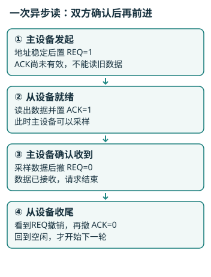
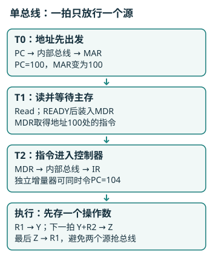

# 计算机组成原理讲义

## 第1章 计算机系统概论
<!-- exam: A | 单选、判断、简答、计算 -->

### 1.1 计算机系统简介

#### 计算机系统、硬件与软件
- 🔴 **计算机系统**：由硬件系统和软件系统组成。硬件是构成计算机的物理实体；软件是程序及其相关数据、文档的集合。
- 🔵 **程序怎样运行**：高级语言经编译器翻译，或由解释器解释执行；CPU（中央处理器）最终执行机器指令。汇编语言也要先经汇编器处理。
- ⚫ **系统与应用**：操作系统管理CPU、内存和设备，属于系统软件；文档编辑器解决具体任务，属于应用软件。裸机有硬件指令能力，但没有完整的软件使用环境。

#### 体系结构与组成
- 🔴 **计算机体系结构**：程序员所见的计算机属性，包括指令系统、数据表示、寻址方式等；计算机组成研究这些属性的具体实现。
- 🔵 **指令集体系结构（ISA）**：规定软件与硬件之间的接口，包括指令、程序员可见寄存器和寻址方式等。ISA不等同于全部计算机组成细节。
- ⚫ **寄存器与虚拟机**：寄存器是CPU内部少量、快速的存储位置；虚拟机层次是向上提供另一套抽象接口，不等于每层都有一台实体电脑。

### 1.2 计算机的基本组成
<!-- test: 简答 | 解释计算机自动连续工作的原因与五部件分工 -->

#### 冯·诺依曼结构：存储程序与程序控制
- 🔴 **存储程序**：将编好的程序和所需数据预先存入存储器；程序中的指令与数据均采用二进制表示。
- 🔴 **程序控制**：计算机按照程序规定的执行顺序，自动取出并执行指令，完成预定任务。
- ⚫ **理解**：“存储程序”强调程序预先保存在哪里；“程序控制”强调机器按程序自动工作。执行顺序由程序决定，遇转移指令可转向目标地址，并非始终按相邻地址执行。

#### 五大部件及其功能
- 🔴 **五大部件**：运算器、控制器、存储器、输入设备和输出设备。
- 🔵 **运算器**：对数据进行算术运算和逻辑运算。
- 🔵 **控制器**：根据指令的要求，控制计算机各部件协调工作。
- 🔵 **存储器**：存放程序和数据。
- 🔵 **输入设备**：将程序和数据转换成计算机能识别并接收的形式。
- 🔵 **输出设备**：将处理结果转换成人们熟悉的形式输出。
- ⚫ **范围区别**：CPU主要含运算器、控制器和寄存器；主机还包括主存；完整系统再加外设与软件。CPU不能等同整台计算机。

#### 先跟踪一次3+5
- 🔴 **程序计数器（PC）与指令寄存器（IR）**：PC存放下一条将要执行的指令的地址；IR存放当前正在执行的指令。
- 🔵 **完整例子**：PC=100，每条指令4B；R1、R2是寄存器，分别存3、5。约定`ADD R1,R2`将和写回R1：从地址100取指→装IR，PC更新104→译码为相加→ALU算3+5→R1=8，R2仍5。
- ⚫ **如何区分指令与数据**：存储器中都是位串，由当前取指/数据访问用途解释；不是某种位模式天生会执行。连接部件、传送数据的路径叫数据通路。

### 1.3 计算机硬件的主要技术指标
<!-- test: 计算、简答 | 计算CPU时间，说明指令数、CPI与主频的作用 -->

#### 单位、字长和编址
- 🔴 **机器字长**：CPU进行一次整数运算所能处理的二进制数据位数。bit表示位，1B=8bit；机器字长、地址宽度和数据总线宽度是不同概念。
- 🔵 **容量**：容量=单元数×每单元位数；n位地址可选2^n个单元，按字节编址才是2^n B。KiB=1024B；传统KB及总线MB/s应按给定口径统一单位。

#### 每条几拍，整个程序多久
- 🔴 **CPI与主频**：CPI是执行每条指令所需的平均时钟周期数；主频f是CPU的时钟频率，单位Hz，时钟周期T=1/f。
- 🔵 **公式与参数**：CPU时间=指令数IC×平均CPI÷f；平均CPI=各类“执行比例×该类周期数”之和。
- 🔵 **完整例题**：100万条指令，一半1拍、一半3拍，主频1GHz：CPI=0.5×1+0.5×3=2，总200万拍，时间=2×10⁶/10⁹=2ms。
- ⚫ **性能比较**：吞吐量看单位时间完成多少，响应时间看单任务多久；MIPS为每秒百万条指令，跨指令集可能失真。主频高不保证任务快，CPU时间通常不含I/O等待。

## 第2章 计算机的发展及应用
<!-- exam: B | 单选、判断、简答、计算 -->

### 2.1 计算机的发展史

#### 四代按什么划分
- 🔴 **主要电子器件**：电子管→晶体管→集成电路→大规模/超大规模集成电路。
- 🔵 **发展联系**：器件集成通常使体积、功耗、成本下降，可靠性和能力提升；软件从机器语言、汇编发展到高级语言、操作系统和工具链。
- ⚫ **限定条件**：电子、通用、可编程、运行存储程序的“第一”不是同一概念；器件代际也不代表某机器主频或执行效率必然更高。

### 2.2 计算机的应用和展望

#### 根据主要任务识别应用
- 🔴 **任务区别**：科学计算偏数值运算；数据处理偏记录管理；实时控制要求在截止时间内响应。
- 🔵 **例子**：工业传感器必须毫秒级响应，属实时控制；每天汇总业务记录，偏数据处理。CAD辅助设计，CAM辅助制造，CAI辅助教学。
- ⚫ **边界**：应用可跨类；人工智能输出不保证正确。微型化、网络化、智能化和高性能计算可并存，量子/光计算也有专门条件，不能视为已全面替代CPU。

#### 多核为何未必快同样倍数
- 🔵 **公式**：可并行部分占p、这部分加速n倍，忽略开销时S=1/[(1−p)+p/n]。
- 🔵 **例题**：80%可4倍加速、20%串行，新时间比例0.2+0.8/4=0.4，所以整体快2.5倍。通信、同步开销会进一步限制收益。

## 第3章 系统总线
<!-- exam: A | 单选、判断、简答、计算、状态判断 -->

### 3.1 总线的基本概念

#### 共享通路与主从设备
- 🔴 **总线**：多个部件共享的传输通路及通信规则；发起传输者为主设备，被访问者为从设备。CPU、获准的DMA控制器都可作主设备。
- ⚫ **共享限制**：同一组数据线通常不能由多个源同时驱动，否则电气冲突；仲裁确定使用权，三态控制避免未获准设备输出。

**通俗理解：** 同一车道要先决定谁通行；增加车辆速度不能消除同一位置的争用。总线还要用时序确认数据何时有效。

### 3.2 总线的分类
- 🔴 **按范围**：片内总线连接芯片内部；系统总线连接CPU、主存、接口；通信总线连接设备或系统。
- 🔵 **按职责**：地址线选位置，数据线传内容，控制线传读写、请求、应答、中断。数据线通常双向，控制信号方向不完全相同。
- ⚫ **串行与并行**：串行逐位传、线少；并行多位同时传，但有线间偏斜等约束，不能直接断言并行一定更快。

### 3.3 总线性能及性能指标
<!-- test: 计算 | 从位宽、频率、每拍次数计算带宽 -->

#### 带宽先换成每次多少字节
- 🔵 **公式**：理论B=(数据位宽w/8)×频率f×每周期传输次数d；有效带宽≈理论B×利用率η。单位为B/s，不是bit/s。
- 🔵 **例题**：32bit、100MHz、每拍2次：4B×10⁸×2=800MB/s；利用率80%则640MB/s。
- ⚫ **口径**：实际还有仲裁、地址、等待及协议开销；已给有效传输率时不要重复乘同一利用率。地址线宽度决定寻址范围，不决定单次数据量。

### 3.4 总线结构
- 🔴 **单总线**：CPU、主存、I/O共享通路，成本低，但访存和I/O易争资源。
- 🔵 **多总线**：把主存、I/O等路径分层，经桥接器转换；独立路径可并行，共享桥或主存端口仍会争用。
- ⚫ **标准与实现**：标准规定机械、电气、功能、时序等规则；USB用于外设串行连接，PCIe采用高速串行点对点互连，名称有“总线”不代表都共享并行线。

### 3.5 总线控制
<!-- test: 简答、过程推演 | 比较仲裁方法，按REQ/ACK跟踪一次读传输 -->

#### 仲裁决定谁先用
- 🔴 **链式查询**：允许信号逐级传，近端优先；线少，但优先级固定、链路故障影响后级，远端可能饥饿。
- 🔵 **计数与独立请求**：计数器逐号查询，可改起点但要等待；独立请求每设备有请求/允许线，裁决快、策略灵活，连线多。
- ⚫ **例子**：链式设备1比3靠近仲裁器，同时申请则1先；独立请求也不是允许所有设备同时驱动共享数据线。总线优先级与中断优先级不同。

#### 通信控制决定何时有效
- 🔴 **同步/异步/半同步**：同步按统一时钟；异步用请求应答推进；半同步保留时钟，用WAIT/READY延长慢设备访问。
- 🔵 **四相全互锁读**：地址先稳定→主设备置REQ→从设备数据有效后置ACK→主设备采样、撤REQ→从设备撤ACK。
- ⚫ **判断**：REQ=1、ACK=0时还不能采样；请求仅表示想读，应答才表示数据已准备好。

## 第4章 存储器
<!-- exam: A | 单选、判断、填空、简答、计算 -->

### 4.1 概述

#### 先备好地址算术
- 🔵 **位数**：n位可区分2^n种状态，8个位置需3位、64个位置需6位；不是64个位置要64位。
- 🔵 **十六进制**：0x为十六进制前缀，A…F=10…15；0x2B=2×16+11=43。
- 🔵 **整除取余**：43÷8=5余3，写作⌊43/8⌋=5、43 mod 8=3。每块8B时，地址43落第5块、块内偏移3，编号从0起。

#### 层次与局部性
- 🔴 **层次**：寄存器→Cache→主存→辅存；越近CPU通常越快、容量越小、每位越贵。
- 🔵 **为何缓存有效**：时间局部性=刚访问的可能再访问；空间局部性=邻近地址可能接着访问。重复遍历数组同时体现两者。
- ⚫ **区别**：Cache缓存主存块副本，缓解CPU与主存速度差；不是所有访问同样快，也不是靠Cache扩大永久保存容量。

### 4.2 主存储器

#### 芯片类型和刷新
- 🔴 **SRAM与DRAM**：SRAM速度快、无需周期刷新，常用于Cache；DRAM密度高、需刷新，常作主存；二者通常断电丢失。
- 🔵 **DRAM读后恢复与刷新**：读出会扰动电荷，需恢复所读行；即使不读取，电荷也泄漏，仍须定期刷新。集中刷新有较长暂停，分散刷新摊入周期，异步刷新在期限内分散安排各行。
- ⚫ **非易失介质**：ROM类通常断电保留；PROM一次编程，EPROM紫外擦除，EEPROM电擦除，Flash可电擦写。不能说所有ROM出厂后绝不可改。

**通俗理解：** DRAM像会漏水的小杯，取样后要恢复，放着也要定期补水；“读后恢复”和“周期刷新”是两件事。

<!-- test: 计算 | 按字数和位数扩展芯片，确定片内地址与片选 -->
#### 容量、编址与芯片扩展
- 🔴 **芯片规格**：“字数×位数”，1K×8为1024个单元、每个8位。位扩展增字长，字扩展增单元数。
- 🔵 **完整例题**：8K×8组成32K×16：字扩4倍、位扩2倍，共8片；8K=2¹³，片内13根地址线；4组再用2根高地址线译码片选。
- ⚫ **连线**：位扩展芯片共享地址和片选，接不同数据位；字扩展以片选区别各组。按字编址的容量还要乘字长，不能一律当字节。
- 🔵 **读写与周期**：地址译码选单元，片选选芯片，控制线分读写。存取时间从请求到数据有效，存储周期还含恢复等，通常不短于存取时间。

#### 低位交叉存储
- 🔴 **定位**：m模块时，模块号=字地址mod m，模块内地址=⌊字地址/m⌋。
- 🔵 **例子**：4路地址10→模块2、内地址2；0、1、2、3分散到四模块，0、4、8、12却都落模块0。
- ⚫ **并行条件**：单模块周期T、发起间隔τ时，顺序流充分重叠需mτ≥T；同模块仍会等。双端口提供两套入口，也需处理同单元写冲突。

<!-- test: 计算、过程推演 | 求汉明校验位并由失败组定位单错 -->
#### 校验怎样分组
- 🔴 **奇偶校验**：偶校验使含校验位的1总数为偶数；能检奇数个位错，不能定位，也不能保证发现偶数位错。
- 🔵 **汉明位数**：k数据位加r校验位，需2^r≥k+r+1；4位数据至少3校验位。
- 🔵 **位置分组**：校验位放1、2、4…；看位置编号二进制，最低位1归p1，中间位1归p2，最高位1归p4。

| 位置 | 二进制 | 内容 | 参加组 |
| --- | --- | --- | --- |
| 1 | 001 | p1 | p1 |
| 2 | 010 | p2 | p2 |
| 3 | 011 | 数据1 | p1、p2 |
| 4 | 100 | p4 | p4 |
| 5 | 101 | 数据2 | p1、p4 |
| 6 | 110 | 数据3 | p2、p4 |
| 7 | 111 | 数据4 | p1、p2、p4 |

- 🔵 **编码例题**：数据1011依次放3、5、6、7。p1查{1,3,5,7}，已有1/0/1，取0；p2查{2,3,6,7}，已有1/1/1，取1；p4查{4,5,6,7}，已有0/1/1，取0。按位置1→7读为0110011。
- 🔵 **定位例题**：位置6翻转，p2、p4失败，综合值110₂=6；单错时可翻回该位。
- ⚫ **能力边界**：普通汉明码可纠单错，双错可能误纠；加整体奇偶位可实现SECDED（单错纠正、双错检测）。先声明位置方向，别把左右编号倒过来。

### 4.3 高速缓冲存储器

#### 先分清块、行、组、路
- 🔴 **概念**：主存按块复制；Cache容纳一个块的位置为行；几行分一组，每组几行就是几路。有效位0表示该行内容无效，标记识别所放主存块。
- 🔵 **小例子**：两行直接映射、每块4B；地址13÷4→块号3、偏移1；3 mod 2→行1，⌊3/2⌋→标记1。到行1后，须有效位1且标记1才命中。
- ⚫ **组相联**：先找组，再在该组各路查有效位与标记；“两路”不是两条数据总线。

#### 放哪里、换谁、何时写主存
- 🔴 **三类映射**：直接映射只能放固定行；全相联可放任意行；组相联固定组、组内任意行。
- 🔵 **取舍**：直接映射简单但易冲突；全相联灵活、比较硬件多；组相联折中。组满时按指定LRU/FIFO等规则换，直接映射没有选行余地。
- 🔵 **写策略**：写直达同步更新Cache和主存；写回先改Cache并标脏，淘汰脏块再写主存。
- ⚫ **边界**：容量或相联度增大可能减少某些失效，也增加成本；映射到同一行不等于命中，Cache失效也不等于缺页。

<!-- test: 计算、过程推演 | 拆地址、查标记，逐次追踪命中与替换 -->
#### 地址拆分与一次查找
- 🔵 **公式**：组数=Cache数据容量÷块大小÷路数；块2^b B→偏移b位，2^s组→组索引s位；标记=总地址位数−s−b。
- 🔵 **完整例题**：32位字节地址，16KiB数据区、64B块、4路：256行/4=64组，偏移6位、索引6位、标记20位。

- 🔵 **实际定位**：0x1234=1×16³+2×16²+3×16+4=4660；4660÷64→块72余52；72÷64→标记1余组8。到组8同时查四路，不是直接宣布命中。

- 🔵 **序列例题**：两行直接映射初始无效，块序列0、1、0、2、0，行号=块mod2：

| 访问块 | 命中？ | 访问后两行 |
| --- | --- | --- |
| 0 | 否 | [0,空] |
| 1 | 否 | [0,1] |
| 0 | 是 | [0,1] |
| 2 | 否，替换0 | [2,1] |
| 0 | 否，0已被换走 | [0,1] |

- ⚫ **结论**：命中1/5=20%；重复出现不保证仍在Cache中。

#### 平均访存时间
- 🔵 **额外代价口径**：AMAT=命中时间+失效率×额外失效代价；2ns、失效20%、额外50ns→2+0.2×50=12ns。
- 🔵 **总时间口径**：若52ns已含初次查询，则0.8×2+0.2×52=12ns。
- ⚫ **易错**：不能把52ns总失效时间再当“额外”加入；串并行、写回、缺页是否计入按模型确定。

### 4.4 辅助存储器
<!-- test: 计算 | 计算磁盘平均延迟与传统CHS定位 -->

#### 磁盘位置和访问时间
- 🔴 **结构**：盘面有磁道，磁道分扇区；同半径各盘面磁道合为柱面。LBA是连续逻辑块编号，未必暴露真实几何结构。
- 🔵 **时间**：访问≈寻道+旋转等待+传输；r转/分时，一转60/r秒，随机扇区平均等半转30/r秒。
- 🔵 **例题**：7200rpm→每转8.33ms、平均等4.17ms；寻道8ms、传输1ms，共13.17ms，尚未计控制器开销。

#### 容量与CHS定位
- 🔵 **容量**：柱面数×每柱面磁头数H×每磁道扇区数S×每扇区字节数。
- 🔵 **定位**：柱面=⌊LBA/(H×S)⌋，余数除S得磁头，最终余数为从0起的扇区偏移。H=4、S=16、LBA70→柱面1余6→磁头0；扇区从1起则为7。
- ⚫ **介质边界**：光盘可只读、一次写或重写；SSD常用Flash，没有机械寻道旋转，但有擦写寿命、页写块擦等开销，不能套半转公式。

#### 扩展：虚拟存储与TLB
- 🔴 **分工**：页表映射虚页到物理页框；TLB缓存近期页表项；MMU（地址转换部件）换页号，页内偏移不变。
- 🔵 **过程**：TLB未命中先查页表；页已驻主存则可继续取数，未驻主存才缺页，由操作系统调页、更新页表并重试。频繁调页可能抖动。
- 🔵 **地址例题**：4KiB=2¹²B，低12位偏移。0x12345拆页号0x12、偏移0x345；页0x12→框0x5A，物理地址0x5A345。

- 🔵 **平均时间**：串行TLB、一级页表，命中率h、查TLB时间ε、一次主存T，忽略Cache/缺页：EAT=h(ε+T)+(1−h)(ε+2T)。h=90%、ε=1ns、T=100ns→111ns。
- ⚫ **三者不能混**：Cache未命中查下级Cache/主存；TLB未命中查页表；缺页才需辅存调页。虚拟空间更大不代表物理主存变大，页表本身也占存储空间。

**通俗理解：** 页号像书页编号，页框像实际架位；TLB是常用目录小抄。没有小抄不代表书没在架上，后者才类似缺页。

## 第5章 输入输出系统
<!-- exam: A | 单选、判断、简答、场景题、状态判断 -->

### 5.1 概述
- 🔴 **I/O系统**：把CPU、主存与外设连接，协调速度、格式和工作方式差异；接口负责缓冲、译码和同步。
- 🔵 **编址**：统一编址把设备寄存器纳入主存地址空间，用访存指令；独立编址有单独I/O空间及专用指令。
- ⚫ **两组分类**：查询/中断/DMA是控制方式，串行/并行是传输组织，可组合。通道或I/O处理机承担更多管理任务，不只是按指定块搬运。

### 5.2 I/O设备
- 🔴 **输入与输出**：键盘、扫描仪输入；显示器、打印机输出；触摸屏兼有。磁盘常按块交换，终端常按字符流交换。
- 🔵 **显示缓存**：像素数×每像素位数；如640×480、每像素8bit，需307200B（未计控制信息）。
- ⚫ **参数区别**：分辨率决定像素个数，颜色位数决定可编码颜色数，刷新率不是二者替代值。

### 5.3 I/O接口
<!-- test: 简答、场景应用 | 区分数据、状态、控制寄存器与输入顺序 -->
- 🔴 **三类寄存器**：数据寄存器放内容；状态寄存器报ready/busy/error；控制寄存器接启动、允许中断等命令。
- 🔵 **一次输入**：写启动→设备采集→数据锁存、置READY→CPU确认就绪→读数据→按设备协议清就绪。
- ⚫ **边界**：有限缓冲只能吸收瞬时速差，长期生产快于消费仍会溢出；并非所有设备都读后自动清状态。

### 5.4 程序查询方式
- 🔴 **忙等流程**：读状态→未就绪继续查→就绪后传数、更新计数→处理下一项。
- 🔵 **成本公式**：每秒N次、每次c拍、主频f，查询占CPU比例≈Nc/f；1000次×20拍÷1MHz=2%，另计数据处理开销。
- ⚫ **条件**：查太频浪费CPU，间隔太长可能覆盖或丢数据；READY=0时不能把数据寄存器旧值当新输入。

### 5.5 程序中断方式
<!-- test: 简答、过程推演 | 说明中断响应、现场保护和返回 -->
- 🔴 **基本过程**：设备请求→CPU在允许边界响应→保存断点/状态→按中断向量找入口→服务→恢复现场、中断返回。
- 🔵 **为什么提高利用率**：设备未就绪时CPU可执行其他工作，无须持续轮询；服务程序还要保护会改动的通用寄存器、处理设备并按协议确认请求。
- ⚫ **概念区别**：向量找入口，屏蔽暂禁指定可屏蔽请求；被屏蔽不等于已处理。外部中断多来自设备，异常来自当前指令；保存及恢复地址按具体体系规定。

### 5.6 DMA方式
<!-- test: 简答、过程推演 | 说明DMA分工，跟踪地址和计数变化 -->
- 🔴 **CPU分工**：初始化首地址、长度、方向，启动并处理结束；逐字数据可直接在设备与主存间传，不必经过CPU寄存器。
- 🔵 **控制器流程**：申请总线→获准传送→地址递增、字计数递减→结束记录状态，通常中断通知CPU。控制器含地址、计数、控制状态寄存器和缓冲。
- 🔵 **例题**：按字节地址1000开始传256B，每次1B；传10B后下一地址1010、剩246B；完成时下一地址1256、剩0。

- 🔵 **方式**：突发连续占用总线搬一块；周期挪用短暂借一个存取周期，用后归还；与CPU交替访问需满足相应总线/存储时序。
- ⚫ **易混**：DMA仍会争总线和主存，CPU访存可能等，但不等于CPU全程停机；中断负责通知，DMA负责搬运，两者可配合。偶发键盘适合中断，高速磁盘大块适合DMA。

## 第6章 计算机的运算方法
<!-- exam: A | 单选、判断、填空、简答、计算 -->

### 6.1 无符号数和有符号数
<!-- test: 单选、计算 | 数制互换，写出原码/反码/补码，判断定长整数范围 -->

#### 数制与编码
- 🔴 **位权**：二进制整数从右向左权为1、2、4、8…，小数点右为1/2、1/4、1/8…；101101₂=45，0.101₂=0.625。
- 🔵 **互换**：二进制每3位一组对应八进制、每4位对应十六进制，从小数点向两边分组；0010 1101₂=2D₁₆。整数高位、小数低位可补0。
- 🔵 **十进制转二进制**：整数除2倒读余数，13→1101；小数乘2顺取整数，0.625→1.25取1→0.5取0→1取1，得0.101。不能有限表示的小数需指定精度。
- ⚫ **编码**：标准ASCII 7位，Unicode统一字符空间，BCD每4bit编码一位十进制；数值45、字符“45”、BCD45位串不同，编码不是加密。

#### 机器数与真值
- 🔴 **原码与反码**：原码最高位表示符号（0正1负），其余位存绝对值；负数反码保留符号位，其余位取反。正数的原码、反码、补码相同。
- 🔵 **同数对照**：8位−5的原码10000101→反码11111010→补码11111011（反码加1）。真值是实际数值−5，机器数是它的编码位串。
- 🔴 **范围**：n位无符号0…2^n−1；n位补码整数−2^(n−1)…2^(n−1)−1；8位分别为0…255、−128…127。
- 🔵 **负数补码**：对应正数按固定字长取反加1；8位5=00000101，所以−5=11111011。正数原/反/补码相同，补码扩宽复制符号位，无符号扩宽补0。
- ⚫ **零与最小负数**：原码有±0，补码只有一个0，能多表示一个最小负数；最小负数在原位宽下没有对应正数。
- 🔵 **端序**：0x12345678小端按低地址→高地址为78、56、34、12；大端为12、34、56、78。只改变字节排列，不改变字节内部位序。

**通俗理解：** 补码像固定刻度的环，减法可改加负数；环绕后的位串若越过有符号范围，就是溢出，不能当真实数学值。

### 6.2 数的定点表示和浮点表示
<!-- test: 计算、简答 | 解读IEEE字段，区别范围与精度 -->

#### 定点位置决定范围
- 🔴 **定点**：小数点位置固定；n位补码纯小数符号权−1，其余为2^-1…2^-(n−1)，范围−1…1−2^-(n−1)，不能套整数范围。
- 🔴 **浮点**：符号、阶码、尾数组合；阶码主要决定范围，尾数主要决定精度。范围大不等于范围内所有实数都精确。

#### IEEE 754单精度
- 🔵 **字段**：32位=符号S一位+阶码E八位+小数字段M二十三位。正常数值=(−1)^S×1.M×2^(E−127)，最高1隐含不存。
- 🔵 **解码例题**：0｜10000001｜010…：S=0、E=129，实际阶2，1.01₂=1.25，得1.25×2²=5。
- 🔵 **编码例题**：6.5=110.1₂=1.101₂×2²；S=0，E=129=10000001，M为101后补20个0。

- ⚫ **特殊值**：E全0表示零/非规格化数，E全1表示无穷/NaN；不能套正常数隐藏1公式。许多十进制小数不能有限二进制表示。

### 6.3 定点运算
<!-- test: 计算、过程推演 | 写中间状态，判断移位与补码运算越界 -->

#### 先选移位规则
- 🔴 **逻辑/算术/循环**：逻辑空位补0；补码算术右移复制符号位；算术左移低位补0并查溢出；循环把移出位送回另一端，带进位循环还含CF。
- 🔵 **例题**：11110100（−12）算术右移1→11111010（−6）；逻辑右移→01111010（无符号122）。01111110（126）左移→11111100，已超补码范围。
- ⚫ **边界**：固定字长左移会丢有效位；负奇数右移涉及舍入约定，不能一律当精确除2。

#### 补码加减与溢出
- 🔵 **减法变加法**：A−B=A+(−B)。8位7−10：00000111+11110110=11111101，即−3，只留字长内结果。
- 🔴 **有符号溢出**：同号相加得异号；相减时两操作数异号、结果与被减数异号。127+1→10000000、−128−1→01111111，均越界。
- ⚫ **进位不同于溢出**：CF看无符号进/借位，OF看有符号范围；异号数相加不会发生有符号溢出。

#### 无符号移位相加乘法
- 🔴 **每轮动作**：看乘数Q最低位，1则部分积P加当前被乘数M；再M左移、Q右移，依次处理各位。
- 🔵 **3×5全过程**：M初值3、Q=0101、P=0；各轮分别加3、跳过6、加12、跳过24，P依次3、3、15、15，积00001111。
- ⚫ **位宽**：两个n位无符号数积最多2n位；15×15=225=11100001，只留4位0001会截断。原码可先异或符号，再乘绝对值。

#### Booth补码乘法
- 🔴 **规则**：A存部分积、M存被乘数、Q存乘数；附加位q初0。看(Q最低位,q)：01加M，10减M，00/11不加；再整体算术右移A/Q/q，共n轮。
- 🔵 **为什么移位**：把乘数下一位送来判断，同时把部分积移到对应位权；整体移位时A最高端复制符号位，不能把A和Q分别逻辑右移。
- 🔵 **−3×2例题**：4位M=1101、Q=0010，A=0000、q=0；表内均为本轮右移后状态。

| 轮 | 位对 | 移位前对A操作 | 移位后A/Q/q |
| --- | --- | --- | --- |
| 1 | 00 | 不变 | 0000/0001/0 |
| 2 | 10 | A−M=0011 | 0001/1000/1 |
| 3 | 01 | A+M=1110 | 1111/0100/0 |
| 4 | 00 | 不变 | 1111/1010/0 |

- 🔵 **核验**：A与Q拼成11111010，即8位−6。换−2×3时，每轮A/Q/q为0001/0001/1→0000/1000/1→1111/0100/0→1111/1010/0，也得−6。
- ⚫ **最小负数**：原宽度取相反数会越界，须扩展一位或按足够位宽算法，不能无条件套表。

#### 恢复余数法逐位试商
- 🔴 **规则**：余数R左移并带入下一被除数位→试减除数D；非负商1并保留，负则商0、恢复原R。
- 🔵 **13÷3例题**：被除数1101逐位带入：

| 带入位 | 左移带位后R | 试减3 | 商位 | 保留R |
| --- | --- | --- | --- | --- |
| 1 | 1 | −2 | 0 | 1 |
| 1 | 3 | 0 | 1 | 0 |
| 0 | 0 | −3 | 0 | 0 |
| 1 | 1 | −2 | 0 | 1 |

- 🔵 **结果核验**：商0100=4，余1；13=3×4+1，且0≤1<3。试减负数只是中间状态，不是最终余数。

#### 不恢复法与带符号结果
- 🔵 **加减交替规则**：前R非负，下轮左移带位后减D；前R负则加D。新R非负商1，否则商0；结束R负要再加D恢复。
- 🔵 **同例13÷3**：四轮R为−2、0、−3、−2，商0100；末尾−2+3=1。
- 🔵 **带符号例**：若商向0截断，11÷(−3)先取绝对值商3余2，再补商负号→商−3余2，验证11=(−3)×(−3)+2；−11÷3则商−3余−2。
- ⚫ **异常**：除数0、最小负数除−1须处理；商/余数符号规则按指定约定，不是任意给余数补正号。

### 6.4 浮点四则运算
<!-- test: 计算、过程推演 | 完成对阶、尾数运算、规格化与舍入 -->

#### 浮点加减五步
- 🔴 **步骤**：先检查特殊值，再对阶→尾数加减→规格化→舍入→检查阶码越界。
- 🔵 **加法例题**：6=1.1₂×2²，2.5=1.01₂×2¹；小阶右移成0.101₂×2²，尾数1.100+0.101=10.001，右规为1.0001₂×2³=8.5。
- 🔵 **减法例题**：1.100−0.101=0.111，左规为1.11₂×2¹=3.5。右规阶加1，左规阶减1，保持值不变。
- ⚫ **零与精度**：结果为0须单独处理，不可无限左规；对阶会丢低位，大数加很小数可能无法保留小数贡献。

#### 舍入与乘除
- 🔵 **最近偶数**：若只留隐藏1加3位小数，1.0001恰在1.000与1.001中间，取末位偶的1.000；保护/舍入/粘滞位帮助判断大于半还是正好半。
- 🔵 **乘除规则**：符号均异或；乘法实际阶相加、尾数相乘，偏置阶E=E1+E2−Bias；除法实际阶相减、尾数相除，E=E1−E2+Bias；最后规格化、舍入和查范围。
- ⚫ **特殊值**：零、无穷、NaN、除0独立处理；舍入不是出现任何被丢弃1都进位，正常数公式也不覆盖全部编码。

### 6.5 算术逻辑单元

#### 一位全加器怎样产生进位
- 🔴 **输入输出**：第i位输入Ai、Bi及低位进位Ci，输出本位Si和高位进位Ci+1。下标表示位号，不是乘数。
- 🔵 **逻辑式**：Si=Ai⊕Bi⊕Ci；Ci+1=AiBi+(Ai⊕Bi)Ci。⊕是异或，不同为1、相同为0；相乘写“与”，加号写“或”，不是普通算术。
- 🔵 **例题**：Ai=1、Bi=0、Ci=1→和0、进位1；三输入全1→和1、进位仍1。串行进位逐位等待；先行进位用产生G=AiBi、传递P=Ai⊕Bi展开，用电路换速度。

#### 复用加法器与标志位
- 🔵 **统一加减**：SUB=0时B原样、初始进位0；SUB=1时B逐位异或变反B、初始进位1，完成A+反B+1。
- 🔴 **四个标志**：ZF零，SF符号，CF无符号进位，OF有符号溢出；补码加法OF可由符号位输入/输出进位异或得到。
- ⚫ **例子**：4位0111+0001=1000，CF=0、OF=1；符号位1也不必然溢出，正常负数本来就可能如此。

## 第7章 指令系统
<!-- exam: A | 单选、判断、填空、简答、计算 -->

### 7.1 机器指令

#### 指令由哪些字段组成
- 🔴 **操作码与地址码**：操作码说明做什么；地址字段给操作数位置或寻找方式。指令字长是整条指令位数，不必等于机器字长。
- 🔵 **地址数**：可有零、一、二、三地址；少地址可隐含累加器或栈顶，不等于功能弱。定长操作码m位最多2^m种编码，k位寄存器字段最多区分2^k个寄存器。

#### 扩展操作码要保留前缀
- 🔵 **16位例子**：原为4位操作码+三个4位地址。0000…1110给15种三地址指令，1111留作扩展；前缀1111后再看4位，可编码16种二地址指令，余8位存两个地址。
- ⚫ **边界**：若继续保留某8位前缀往下扩展，二地址可用数量须减少；同一前缀不能重复算给两类指令。

### 7.2 操作数类型和操作类型
- 🔴 **数据类型**：整数、浮点、字符、逻辑位串、地址；同一位串可因类型不同解释不同。
- 🔵 **操作类型**：传送、算术逻辑、移位、转移、调用返回、I/O。条件转移先查标志再改PC；调用还保存返回地址，返回用它续接。
- ⚫ **栈机顺序**：零地址运算隐含栈顶；先压7再压2，SUB一般计算7−2，先弹出的2是右操作数，不能颠倒成2−7。

### 7.3 寻址方式
<!-- test: 计算、过程推演 | 算有效地址、取得操作数并数数据访存 -->

#### 先辨数值还是地址
- 🔴 **记号**：A为地址字段，R为寄存器内容，M[x]为地址x处内容，EA为最终有效地址。

| 方式 | 如何得到操作数/地址 | 典型用途 |
| --- | --- | --- |
| 立即 | 操作数=A | 常量 |
| 直接 | EA=A，读M[A] | 固定单元 |
| 一次间接 | EA=M[A]，再读M[EA] | 指针 |
| 寄存器 | 操作数=R | 快速临时值 |
| 寄存器间接 | EA=R，读M[R] | 指针访问 |
| 基址 | EA=BR+A | 重定位 |
| 变址 | EA=IX+A | 数组 |
| 相对 | EA=取完指令后的PC+符号位移 | 分支 |

- 🔵 **取数例题**：A=100、M[100]=400、M[400]=9、R=400：立即得100，直接得400，一次间接得9，寄存器得400，寄存器间接得9。
- 🔵 **算址例题**：基址1000+位移20→1020；相对PC104+位移−8→96。数组按字节编址时，元素下标还要乘元素字节数。
- ⚫ **访存与约定**：不计取指，立即/寄存器额外0次，直接/寄存器间接1次，一次内存间接2次；相对PC取值按指定体系。基址与变址公式可同为相加，使用目的不同。

### 7.4 指令格式举例
- 🔵 **编码例题**：16位规定[15:12]操作码，[11:9]目的，[8:6]源，[5:0]保留0；ADD为0001，R3←R3+R2，编码0001 011 010 000000=0x1680。
- 🔵 **字段范围例题**：32位扣6位操作码和两个5位寄存器字段，剩16位；若作补码立即数，范围−32768…32767。
- ⚫ **易混**：先按字段切分再解释，不能把十六进制每位直接当寄存器号；字段另分模式位时，立即数范围也会缩小。

### 7.5 RISC技术
- 🔴 **设计取向**：RISC通常指令规整、寻址较少、强调Load/Store；CISC指令功能和寻址更丰富，长度可能变化。现代实现会融合技术。
- 🔵 **Load/Store例子**：内存A加1写回：LOAD R1,[A]→ADD R1,#1→STORE [A],R1，先取到寄存器再运算。
- ⚫ **性能边界**：规整有利译码和流水，但时间还看指令数、CPI、频率、存储等待；不能断言RISC每条永远一拍或一定更快。

## 第8章 CPU的结构和功能
<!-- exam: A | 单选、判断、简答、计算、状态判断 -->

### 8.1 CPU的结构

#### 跟踪取指就能分清寄存器
- 🔴 **分工**：PC下一指令地址，IR当前指令，MAR本次访存地址，MDR本次读写数据；ALU算术逻辑运算，CU控制器产生时序信号。
- 🔵 **取指例子**：PC100→MAR100→主存读到MDR→装IR；4B定长指令令PC104。执行ADD R1,R2，若R1=3、R2=5，最后R1=8，R2不变。

#### 单总线怎样凑齐两个输入
- 🔵 **三拍过程**：Y/Z为暂存寄存器；R1→Y，再R2与Y相加→Z，最后Z→R1。同拍不能让R1、R2同时驱动同一内部总线。
- ⚫ **周期区别**：时钟周期是基本拍；机器周期常完成一次基本操作；指令周期覆盖完成整条指令的时间。具体层次按机器规定，不可把三者等同。

### 8.2 指令周期
<!-- test: 简答、过程推演 | 识别取指、间址、执行、中断周期并追踪有效地址 -->
- 🔴 **可能阶段**：取指→必要时间址→执行→满足条件时中断；不是每条都含全部阶段。
- 🔵 **间接ADD例子**：地址字段A100，M[100]=400、M[400]=9、ACC累加器初3；间址周期读400作为EA，执行再读9，ACC←3+9=12。

| 阶段 | 寄存器传送 |
| --- | --- |
| 取指 | MAR←PC；MDR←M[MAR]；IR←MDR；PC←PC+指令长度 |
| 间址 | MAR←A；MDR←M[MAR]；EA←MDR |
| 执行 | MAR←EA；MDR←M[MAR]；ACC←ACC+MDR |
| 中断 | 保存PC/状态；PC←服务入口 |

- ⚫ **易错**：400是地址、9才是数；算成403意味着漏了一次访存。中断周期是控制转移，不是每次ADD都必执行。

### 8.3 指令流水
<!-- test: 计算、过程推演 | 算填充排空和停顿时间，识别三类冲突 -->

#### 理想流水时间
- 🔴 **目标**：多条指令分阶段重叠，提高吞吐；不保证缩短单条延迟。
- 🔵 **公式**：k段等长、n条、无停顿时，拍数=k+n−1；时间=(k+n−1)×节拍。5段20条、每拍1ns→24ns；3条则7拍。

#### 冲突与实际时间
- 🔴 **三类原因**：结构冲突争同一资源；数据冲突等前条结果；控制冲突等分支方向。
- 🔵 **处理**：增加资源、暂停、数据转发、分支预测分别缓解相应问题；5段10条理想14拍，加2停顿为16拍，1.6ns/拍则25.6ns。
- 🔵 **实际节拍**：不等长时取最慢阶段时间+级间寄存器开销；不是把各段耗时之和当每拍。

- 🔵 **相关例子**：ADD产R1，紧随SUB读R1；无转发，约定WB前半拍写、ID后半拍读，则SUB第3、4拍在ID等待，第5拍读到新值。
- ⚫ **条件**：停顿取决于转发与读写时序；已有停顿的表不能再加一次。加级数会增寄存器、分支失败等代价，转发也不消除所有等待。

### 8.4 中断系统
- 🔴 **两种优先级**：请求优先级选同时请求先响应谁；处理优先级可用屏蔽字决定服务时允许谁打断。
- 🔵 **嵌套例子**：B服务时更高A到来且允许嵌套：主程序→B前半→A→B后半→主程序。约定屏蔽位1为禁，可屏蔽自身和低级、放行高级。
- ⚫ **前提**：先保存现场再开嵌套；高优先级仍受中断开关和屏蔽限制。硬件保存部分断点/状态，软件保护其余寄存器；异常、不可屏蔽中断另有规则。

## 第9章 控制单元的功能
<!-- exam: A | 单选、判断、简答、状态判断 -->

### 9.1 操作命令的分析
<!-- test: 简答、过程推演 | 把指令拆成微操作，检查同拍资源冲突 -->

#### 机器指令怎样拆小
- 🔴 **微操作**：寄存器传送、ALU计算、发读写等基本动作；控制信号使动作发生。是否可同拍，看依赖、端口、总线和锁存时序。
- 🔵 **读控制名**：out=允许向总线输出；in=目的寄存器接收锁存；Read=读请求；READY=存储器数据就绪。Y/Z暂存操作数和结果。
- 🔵 **单总线取指**：T0 PCout、MARin；T1发Read、等READY后锁存MDR；T2 MDRout、IRin。PC加指令长度若有独立增量器可并行，否则另占ALU拍。

#### 执行与并行条件
- 🔵 **直接ADD [A]**：IR地址→MAR→读并等待→MDR→Y→ACC与Y相加进Z→Z写回ACC；用暂存器避免两个源抢总线。
- ⚫ **能否同拍**：R1→Y和R2→Z都需同一总线，不能；MDR→IR与独立PC增量可并行。Read不保证一拍结束，未READY直接读会取到旧值。

### 9.2 控制单元的功能
- 🔴 **输入决定输出**：操作码说明做什么，时序状态说明做到哪步，标志/READY等说明条件；三者共同决定控制信号，单看ADD操作码不够。
- 🔵 **输出**：内部有寄存器装入、总线输出、ALU选择；外部有读写、I/O应答。复位给确定入口，执行结束回取指，等待态未就绪自环。
- 🔵 **等待例题**：READ_WAIT中READY0→留本态；READY1→锁存数据并推进。同步按统一时钟，异步按完成应答，联合控制用时钟加等待协调慢操作。
- ⚫ **时钟条件**：一拍至少覆盖最长组合路径延迟、建立时间等；不能通过提前采样“强行加速”。指令/机器/节拍层次按具体结构规定。

## 第10章 控制单元的设计
<!-- exam: A | 单选、判断、简答、计算、状态判断 -->

### 10.1 组合逻辑设计
<!-- test: 简答、过程推演 | 从微操作与状态表写控制条件 -->

#### 硬布线设计顺序
- 🔴 **机制**：将操作码译码、状态、条件直接组合成控制信号；速度快，但修改指令可能要改逻辑连线。
- 🔵 **步骤**：确定数据通路→列微操作→按资源分拍→建状态表→写控制方程→检查复位、等待、非法状态。
- ⚫ **本节模型**：LOAD有MDR经总线到ACC；ADD另有ACC、MDR专用ALU输入及结果写ACC路径。若换第9章单总线Y/Z，ADD必须拆拍。

#### 先装IR，后分派
- 🔴 **分派含义**：F2末才锁存新IR，下一拍DISPATCH再按稳定操作码选执行入口，避免用旧指令决定入口。

| 状态 | 输出/动作 | 下一状态 |
| --- | --- | --- |
| F0 | PCout、MARin | F1 |
| F1 | MemRead；READY时MDRin | 未就绪F1，就绪F2 |
| F2 | MDRout、IRin、独立PC增量 | DISPATCH |
| DISPATCH | 译码已锁存IR | LOAD/ADD到E0，非法码异常态 |
| E0 | IR地址out、MARin | E1 |
| E1 | MemRead；READY时MDRin | 未就绪E1，就绪E2 |
| E2 | LOAD：MDRout+ACCin；ADD：专用ALU相加写ACC | F0 |

#### 把“什么时候有效”写成逻辑式
- 🔴 **记号**：1=条件成立/控制有效，0=无效；F1等状态线仅当前处于该态时为1，LOAD/ADD为操作码译码线；∨是逻辑或，∧是逻辑与。
- 🔵 **推式**：MemRead=F1∨E1；MDRin=(F1∨E1)∧READY；ACC_Load=E2∧LOAD；ACC_Add=E2∧ADD。
- 🔵 **STORE扩展示例**：若S1为持续写等待态，MemWrite=S1，READY0留S1、READY1回F0，写数据提前稳定；若设备要求单拍脉冲，就分开发命令态和等待态。
- ⚫ **边界**：非法操作码不能随机写存储器；控制方程必须符合该接口协议与数据通路，不能跨模型照搬。

### 10.2 微程序设计
<!-- test: 简答、计算、过程推演 | 区分机器/微地址，跟踪微步并计算编码位数 -->

#### 控制信号也能按步保存
- 🔴 **控存CM**：存微指令；一条机器指令通常由一段微程序实现，一条微指令可发若干允许并行的控制动作。
- 🔵 **工作链**：微PC选控存地址→读入微指令寄存器μIR→操作字段驱动通路→顺序控制字段和条件选下一微地址。
- ⚫ **两个空间**：机器PC找用户机器指令，微PC找控制步骤；控存不是普通主存，回微取指入口也不等于把机器PC清0。

**通俗理解：** 机器指令是一项任务，微指令是完成任务的几个动作；“第20个动作”不是“用户程序地址20”。

#### 下一微地址从哪里来
- 🔵 **来源**：微PC+1顺序、显式下地址、条件分支、操作码入口映射、微子程序返回。未READY可指向自己；执行结束回公共取指入口。
- 🔵 **完整微程序例**：以下执行部分采用第9章单总线Y/Z，取指使用独立PC增量器；ADD为直接寻址。

| 微地址 | 本拍动作 | 下一地址 |
| --- | --- | --- |
| 00 | PC→MAR | 01 |
| 01 | Read，就绪锁存MDR | 未就绪01，就绪02 |
| 02 | MDR→IR，PC加指令长度 | 03 |
| 03 | 对稳定IR译码分派 | ADD到20 |
| 20 | IR地址→MAR | 21 |
| 21 | Read，就绪锁存MDR | 未就绪21，就绪22 |
| 22 | MDRout、Yin | 23 |
| 23 | ACCout，ACC+Y→Z | 24 |
| 24 | Zout、ACCin | 00 |

- 🔵 **数值核验**：MDR读到9、ACC原3；22后Y9，23后Z12，24后ACC12。22/23/24逐拍只有一个总线源，不会争线。

#### 水平、垂直与字段编码
- 🔴 **取舍**：水平通常字宽、并行性高；垂直以编码操作为主，较短但需译码，可能多步。二者都受数据通路限制。
- 🔵 **字段位数**：k个互斥动作加“不动作”，至少⌈log₂(k+1)⌉位，即找最小r使2^r≥k+1；4动作加空共5种，要3位，不是2位。
- 🔵 **分字段**：同总线R1out、R2out互斥，可同一源字段；源输出和目的锁存可并行，应放不同字段。
- 🔵 **计算例题**：4源加空3位；3目的加空2位；ALU共4种含不动作2位；下址6位，共13位，条件字段另加。直接控制9线+6下址则15位。
- 🔵 **控存容量**：64条×24bit=1536bit=192B；直接选64地址需6位。微指令总位数含操作、下址、条件等全部字段。
- ⚫ **可修改边界**：微程序规整、易扩展，但ROM控存不能任意写；固件更新须平台支持，用户不能随意改全部控制步骤。
