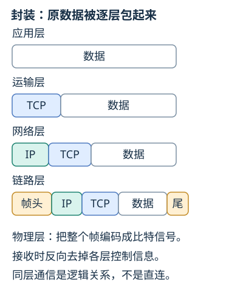
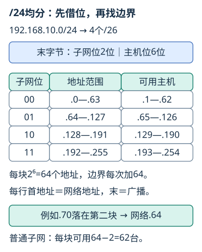
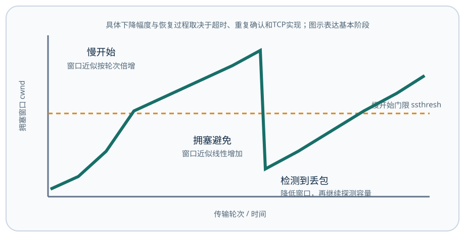
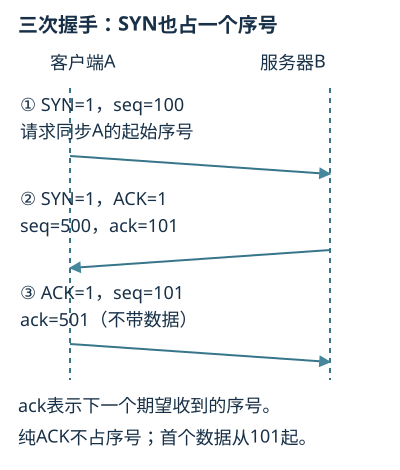

# 计算机网络讲义

## 第1章 概述
<!-- exam: A | 单选、判断、计算、简答 -->

### 1.2 计算机网络的定义与类别

计算机网络是利用通信设备和线路，把地理位置不同、功能独立的计算机系统连接起来，在网络协议控制下实现数据通信和资源共享的系统。

主要功能：数据通信、资源共享、分布式处理、提高可靠性和负载均衡。

常见分类：

- 按范围：个人区域网 PAN、局域网 LAN、城域网 MAN、广域网 WAN。
- 按传输介质：有线网络和无线网络。
- 按拓扑：总线、星形、环形、树形、网状。
- 按交换方式：电路交换、报文交换、分组交换。

电路交换先建立专用通路，时延稳定但空闲时也占资源；分组交换把数据分组共享链路，线路利用率高，是互联网的基础，但会有排队和乱序。

存储转发表示节点收到完整分组后，再在下一条链路上发送。一个12000 bit分组经过两条1 Mbit/s链路，忽略传播、处理与排队，两次发送共需24 ms；如果是多个分组，链路之间可以流水线工作，需要按各分组的到达和发送时间计算。

### 1.3 互联网的组成、功能与拓扑

- 总线型：各节点共享一条主干线路，结构简单，但主干故障影响范围大，故障定位较困难。
- 星型：各节点连接中心设备，便于管理和扩展，单条支路故障通常只影响一个节点，但中心设备是关键点。
- 环型：节点首尾相连形成环，数据沿环传送，某处故障可能影响整个环。
- 树型：由星型分层扩展，便于组织较大网络，但上层节点故障会影响下层。
- 网状：节点间有多条路径，可靠性高，但连接、建设和管理成本较大。

现代以太局域网常采用以交换机为中心的星型物理拓扑。物理拓扑描述线路怎样连接，逻辑拓扑描述数据怎样流动，两者不一定完全相同。

### 1.4 网络性能与时延计算

- 带宽：链路的标称传输能力，常用 bit/s。
- 吞吐量：实际单位时间传送的数据量，通常不高于带宽。
- 时延：发送、传播、处理和排队时延之和。
- 丢包率：丢失分组占发送分组的比例。

“带宽”有两种常见语境：讨论链路传输能力时常用bit/s；讨论通信信道的频带宽度、奈氏和香农公式时用Hz。做题必须根据单位判断含义，不能直接混用。

发送时延等于数据量除以链路速率，即 `发送时延=数据长度(bit)/发送速率(bit/s)`。例如在 10 Mbit/s 链路上发送 1 MB 数据，只计算发送时延约为 `8 Mbit÷10 Mbit/s=0.8 s`；传播时延还取决于距离和信号传播速度。

### 1.5 分层、协议与体系结构

**五层模型与 OSI/TCP-IP 对照**

OSI 七层自下而上为：物理层、数据链路层、网络层、运输层、会话层、表示层、应用层。

常用五层模型：

| 层次 | 主要作用 | 常见对象或协议 |
|---|---|---|
| 应用层 | 直接为应用提供网络服务 | HTTP、DNS、SMTP、FTP |
| 运输层 | 进程到进程通信 | TCP、UDP、端口 |
| 网络层 | 跨网络寻址和路由 | IP、ICMP、路由器 |
| 数据链路层 | 相邻节点成帧与差错检测 | Ethernet、MAC、交换机 |
| 物理层 | 传输比特 | 网线、光纤、集线器 |

发送时数据逐层封装，接收时逐层解封装。应用数据经过运输层形成 TCP 段或 UDP 用户数据报，网络层形成 IP 数据报，链路层形成帧，物理层传输比特。

协议规定同层实体通信的语法、语义和同步规则；服务是下层通过接口向上层提供的能力。协议是“同层之间怎样约定”，服务是“下层能为上层做什么”，二者不能混同。

**通俗理解：** 分层像快递的多级包装与转运：应用只关心要发送的内容，运输层加上进程通信信息，网络层加上跨网地址，链路层再加本跳交付信息；接收方按相反顺序拆封。封装不是把原数据反复复制，而是在各层数据前后加入本层控制信息；每一跳通常更换链路层首部，端到端的上层信息则按协议继续传递。

**域名、IP、MAC 和端口**

- 域名：便于人记忆，由 DNS 解析为 IP 地址。
- IP 地址：标识网络中的逻辑接口，用于跨网寻址。
- MAC 地址：标识本地链路接口，用于同一链路交付。
- 端口号：标识主机中的应用进程。

三类地址作用在不同范围：IP 解决“到哪台主机或接口”，端口解决“交给哪个进程”，MAC 解决“本跳交给哪个接口”。

### 1.6 本章小结与自测

本章主线是“端系统通过分组交换网络，按分层协议完成通信”。看到性能计算题，先统一 bit、Byte、s、ms 等单位，再分别计算发送、传播、处理和排队时延。

1. 电路交换与分组交换各适合什么场景？
2. 1 MB 数据通过 10 Mbit/s 链路，仅发送时延是多少？
3. 协议与服务有什么区别？

参考答案

1. 电路交换适合持续、稳定且需要固定资源的通信；分组交换适合突发数据和链路共享。2. 按 1 MB=8 Mbit 估算，发送时延为 0.8 s。3. 协议规定同层实体怎样通信，服务描述下层向上层提供什么能力。

## 第2章 物理层
<!-- exam: B | 单选、判断、填空、计算 -->

### 2.2 通信方向

- 单工：只能单向，例如传统广播。
- 半双工：双向但不能同时，例如对讲机。
- 全双工：可以同时双向，例如交换式以太网。

### 2.3 传输介质

- 双绞线：价格低、布线方便，常用于局域网。
- 同轴电缆：屏蔽性能较好，曾广泛用于有线电视和早期网络。
- 光纤：带宽高、衰减低、抗电磁干扰，分单模和多模。
- 无线：部署灵活，但易受遮挡、干扰和安全风险影响。

### 2.4 无线传输与频段

WLAN是无线局域网，常采用IEEE 802.11系列技术，也就是日常所说的Wi-Fi。无线终端通常通过接入点AP接入有线网络；无线路由器一般集成了AP、路由、交换和NAT等功能，AP不等同于完整路由器。

SSID是无线网络名称，用于标识一个无线局域网。隐藏SSID只能降低被普通扫描直接看到的概率，不等于加密或安全防护；接入安全仍应使用合适的认证和加密方式。

常见频段比较：

- 2.4 GHz：传播距离和穿墙能力通常较好，但可用信道较少、同频干扰较多。
- 5 GHz：可用信道多、通常可提供更高速度且干扰较少，但覆盖和穿墙通常弱于2.4 GHz。

频段特点是一般规律，实际速度和覆盖还受标准版本、信道宽度、发射功率、障碍物和终端能力影响。“5 GHz一定比2.4 GHz覆盖远”是错误判断。

### 2.5 T568A/B 网线标准

八芯线序从 1 到 8：

- T568A：白绿、绿、白橙、蓝、白蓝、橙、白棕、棕。
- T568B：白橙、橙、白绿、蓝、白蓝、绿、白棕、棕。

两端采用同一标准是直通线，一端 A、一端 B 是交叉线。现代设备常支持 Auto-MDI/MDIX，但规范布线仍应遵守线序。

### 2.6 码元、比特率与复用

频分复用 FDM 按频带划分，时分复用 TDM 按时隙划分，波分复用 WDM 是光纤中的频分思想，码分复用 CDM 用不同码片区分用户。

比特率表示每秒传送的二进制位数，单位 bit/s；码元速率表示每秒传送的码元数，单位 Baud。一个码元若有 M 种有效状态，理想情况下可携带 `log₂M` bit 信息，因此二者数值不必相同。

**看一次分时：** 两路终端A、B各以1 kbit/s稳定发送，同步TDM每帧给A、B各1 bit时隙。帧结构反复为`[A位][B位]`，每秒需1000帧，每帧2 bit，忽略开销的总速率为2 kbit/s；A暂时没数据时，它的固定时隙仍会占用。统计TDM才会按实际需求动态分配时隙，通常还需地址等额外控制信息。FDM则像两人用不同音高同时发声，每路占不同频带，并非轮流占同一时隙。

### 2.7 信道容量与信噪比

奈氏准则讨论理想无噪声、带宽受限信道的码元速率上限。在M种码元状态、带宽B Hz的简化条件下，比特率上限为`2B log₂M bit/s`。香农公式讨论有噪声、带宽受限信道的理论容量：`C=B log₂(1+S/N)`。C表示理论容量上限，单位bit/s；B表示信道带宽，单位Hz；S是信号平均功率，N是噪声平均功率，二者使用相同功率单位；S/N是无量纲线性功率比。若给出分贝数，则`信噪比(dB)=10 log₁₀(S/N)`，所以`S/N=10^(dB/10)`。

例如带宽2000 Hz、线性信噪比31，香农容量为`2000×log₂32=10000 bit/s`。理论容量不是应用吞吐量，也不能把20 dB直接作为线性信噪比20代入。若题目同时给出码元状态数和噪声条件，需要分别看约束。

例如每个码元采用4种可区分状态，且无编码冗余，2000 Baud的理想比特率为`2000×log₂4=4000 bit/s`。这个数值还不能直接当作应用有效吞吐量，因为协议首部、冗余和重传等都会占用传输资源。频带宽度的单位是Hz，与bit/s表示的数据速率含义不同。

**先选约束再计算：** 信道带宽3 kHz，信噪比为63（线性比），采用4种码元状态。按教材的理想上限模型，速率同时受两种条件限制，应选哪一个上限？

查看计算过程

奈氏上限为`2×3000×log₂4=12000 bit/s`；香农上限为`3000×log₂(1+63)=18000 bit/s`。同时受限时取较小值12000 bit/s。即使噪声条件容许18000 bit/s，当前4状态调制也不能据此突破12000 bit/s；实际系统还受编码、实现和其他开销影响，理论上限不是保证能达到的业务速率。

### 2.8 本章小结与自测

物理层只负责透明传送比特，不解释比特属于哪个应用。计算题必须先辨认题目给的是 Hz、Baud、bit/s 还是 dB，再选择公式。

1. 码元速率与比特率何时数值相同？
2. 带宽 3 kHz、线性信噪比 63 时，香农容量是多少？
3. 为什么 20 dB 不能直接把 20 代入香农公式？

参考答案

1. 每个码元只携带 1 bit 信息时相同。2. `C=3000×log₂(64)=18000 bit/s`。3. dB 是对数值，应先换成线性比值 `10^(20/10)=100`。

## 第3章 数据链路层
<!-- exam: A | 单选、判断、计算、场景题、排障题 -->

### 3.2 PPP 与链路层的三个基本问题

链路层面对的是一段相邻链路。它需要解决三个基本问题：怎样划分帧边界，怎样让数据中的特殊比特不被误认成边界，以及怎样发现传输差错。PPP 常用于点到点链路，帧中包含标志、地址、控制、协议、信息和检验字段；它提供成帧与差错检测，但不依靠序号和确认实现可靠传输。

透明传输的意思是：无论上层交来什么比特模式，都能作为数据传送。面向字节的协议可用字节填充，面向比特的协议可用零比特填充。二者都是为了避免数据内容与帧定界符冲突。

### 3.3 CRC 的计算过程

将生成多项式写成比特串；若最高次数为r，先在原数据后补r个0，再用模2除法求余数。模2减法等同于逐位异或，不借位。余数不足r位时补前导0，再用这个r位余数替换末尾补上的0。

例如原数据为1101，生成串为1011，对应最高次数3。将1101000与1011000异或得0110000，再与0101100异或得0011100，最后与0010110异或得0001010，再与0001011异或得0000001。因此余数为001，发送串为1101001。接收端以相同生成串验证；余数非0表示检测到差错，余数为0不等于绝对无误。

成帧是在连续比特流中划分帧的边界；透明传输保证数据中即使出现与控制标志相同的内容，也不会被误当成帧边界。可靠链路协议常结合编号、确认和超时重传：停等协议每发送一帧便等待确认，滑动窗口允许多帧连续发送以提高链路利用率。并非所有链路层都承诺可靠交付，以太网主要提供尽力而为的帧传输。

### 3.4 停等与滑动窗口

停等发送方在等待确认期间不能发送下一帧。在无丢失、确认发送与处理时间可忽略的简化模型中，利用率为`一帧发送时间/(一帧发送时间+往返传播时间)`。一帧发送需1 ms、往返传播需9 ms时，利用率为10%；如果给的是单程传播时间，需要先乘2。

滑动窗口允许多个未确认帧同时在途，减少链路闲置。发送窗口大小表示允许在途而未确认的数据量；实际还能发送多少，需扣除已有在途数据。GBN通常采用累积确认，超时后重传相应未确认帧及后续帧；选择重传分别确认并缓存合规的乱序帧，只重传缺失或超时的帧。二者对序号空间和窗口大小的限制也不同。

### 3.5 以太网与交换机

以太网 MAC 地址通常为 48 位。交换机根据收到帧的源 MAC 学习“地址—端口”表项，再根据目的 MAC 转发：

- 已知单播：只发往对应端口。
- 未知单播：向除入端口外的端口泛洪。
- 广播：向除入端口外的端口泛洪。

CSMA/CD 用于传统共享、半双工以太网。交换式全双工以太网不存在冲突，不再使用 CSMA/CD。

传统共享半双工以太网要求发送端在最远端碰撞发生后仍有机会发现碰撞，因此检测窗口与往返传播时延有关。两端单程传播时延为10微秒时，从开始发送到发现最远端碰撞的最长时间接近20微秒。二进制指数退避用于碰撞后的重试，不能当作流量控制算法。

802.11无线局域网主要依靠冲突避免、退避和确认机制。无线终端通常无法像共享有线链路那样可靠地边发边检测碰撞；RTS/CTS可帮助缓解隐藏站，但不能保证绝对无碰撞。题目要求比较802.3与802.11时，先限定为共享半双工以太网与无线接入的经典模型，现代交换式全双工以太网另论。

### 3.6 设备、冲突域、广播域与 VLAN

- 中继器、集线器：物理层设备，集线器所有端口共享冲突域。
- 网桥、交换机：数据链路层设备，交换机每端口通常是独立冲突域。
- 路由器：网络层设备，连接不同网络并隔离广播域。
- 网关：广义上完成不同协议或系统间转换，日常“默认网关”通常指路由器接口。

VLAN 在交换网络中逻辑划分广播域；不同 VLAN 之间通信需要三层设备。STP 用于防止二层环路导致广播风暴和 MAC 表震荡。

### 3.7 本章小结与自测

链路层的核心是“一跳交付”：先成帧，再检错，需要时通过确认、编号和重传提高可靠性。交换机学习源 MAC，根据目的 MAC 决定单播转发或泛洪。

1. CRC 检错与纠错有何区别？
2. 交换机收到未知单播帧时怎样处理？
3. VLAN 改变了冲突域还是广播域？

参考答案

1. CRC 能发现许多错误但不能直接恢复正确数据。2. 向除入端口外的同 VLAN 端口泛洪。3. VLAN 划分广播域；交换机端口本身通常已划分冲突域。

## 第4章 网络层
<!-- exam: A | 单选、判断、填空、计算、场景题 -->

### 4.2 IPv4、CIDR 与子网划分

IPv4 地址长 32 位，采用点分十进制表示。子网掩码中连续的 1 表示网络部分，连续的 0 表示主机部分。IP 地址与掩码逐位 AND 可得网络地址，CIDR 前缀 `/n` 表示前 n 位属于网络前缀。

例如 192.168.1.20/24 的网络地址是 192.168.1.0，广播地址是 192.168.1.255，传统可用主机范围是 192.168.1.1～192.168.1.254。

#### 规则子网划分四步法

1. 根据所需子网数借位：借 `n` 位可得到 `2^n` 个等长子网，新前缀为原前缀加 `n`。
2. 根据前缀求主机位：IPv4主机位数 `h=32-前缀长度`，每块共 `2^h` 个地址。
3. 求块大小和边界：在发生变化的八位组中，块大小可用 `256-掩码值`；网络地址按块大小递增。
4. 写范围：网络地址主机位全0，广播地址主机位全1；传统普通子网可用主机数为 `2^h-2`。

例：把192.168.10.0/24平均分成4个子网，需要借2位，新前缀为/26，掩码为255.255.255.192。每块64个地址，传统可用62台主机；网络地址依次为192.168.10.0、.64、.128、.192，对应广播地址依次为.63、.127、.191、.255。

**通俗理解：** 子网划分像把一排连续门牌分成若干街区。前缀越长，相当于拿更多位标识街区，街区数量增多，但每个街区可分给主机的门牌减少；网络地址和广播地址是街区边界标识，普通主机不能随意占用。

**小例子：** `/24` 变成 `/26` 是从主机位借 2 位，因此得到 `2²=4` 个等长子网；剩 6 个主机位，每块有 `2⁶=64` 个地址。这两个“2的幂”分别对应子网数和块大小，不能混用。

若某网段要求至少50台普通主机，需要满足 `2^h-2≥50`，取 `h=6`，因此前缀为/26。`2^h-2` 是传统普通子网的可用主机数，点到点链路使用 `/31` 等特殊情况不机械套用减 2。

VLSM按实际主机需求分配不同大小的子网。做题时先把需求按主机数从大到小排序，为每个子网选择能容纳需求的最小地址块，再按块边界依次分配。例如把192.168.10.0/24分给100、50、20台普通主机，可依次使用192.168.10.0/25、192.168.10.128/26、192.168.10.192/27。分配顺序可以有其他合法方案，但每个网络地址必须落在相应块边界，地址块不能重叠。

路由聚合把连续且对齐、具有相同高位前缀的多个网络合成更短前缀。例如192.168.0.0/24与192.168.1.0/24可聚合为192.168.0.0/23。聚合时先写二进制，找到从左开始连续相同的前缀位；不能只因为网络数量相同就合并不连续或未对齐的地址块。

私有 IPv4 地址范围：

- 10.0.0.0/8
- 172.16.0.0/12
- 192.168.0.0/16

传统分类编址中，A类地址首个八位组通常为1—126，默认前缀/8；B类为128—191，默认前缀/16；C类为192—223，默认前缀/24；D类224—239用于组播，E类240—255保留作实验等用途。127.0.0.0/8是环回地址，不能机械地当作普通A类网络。现代互联网转发主要采用CIDR，A/B/C分类仍用于理解传统编址和默认掩码。

127.0.0.0/8 用于环回测试；169.254.0.0/16 常是自动私有地址。公网传输私有地址通常需要 NAT 转换。

### 4.3 ARP、ICMP 与分组转发

ARP 根据同一局域网内的 IPv4 地址查询 MAC 地址。请求通常广播，应答通常单播，ARP 不跨路由器。

**通俗理解：** IP 地址像最终收件地址，MAC 地址像当前运输站内的交接位置。ARP 只解决本地链路“下一跳交给谁”：目的主机同网时查目的主机 MAC，异网时查默认网关 MAC；它不会沿整条互联网查询远端主机的 MAC。

主机发送数据前先判断目的是否同网：同网时寻找目的主机 MAC，异网时寻找默认网关 MAC。每经过一个路由器，帧的 MAC 地址通常改变，端到端 IP 地址通常保持不变，NAT 除外。

**先决定下一跳：** 主机A为`192.168.1.10/24`，网关为`192.168.1.1`，要发给`192.168.2.20`。第一帧的目的IP和目的MAC分别是谁？

沿一跳检查

按/24比较，A的网络地址是192.168.1.0，目的网络是192.168.2.0，二者不同。A先通过ARP查询网关192.168.1.1的MAC。第一帧的目的MAC是网关MAC，帧内IP数据报的目的IP仍为192.168.2.20。网关收到后去掉这一跳的帧首部，按路由表选下一跳，再使用出接口和下一跳的MAC重新封装；没有NAT时不能把目的IP也改成网关IP。

ICMP 用于差错报告和诊断。ping 使用回显请求/应答；tracert/traceroute 利用 TTL 逐跳减到 0 的超时报文显示路径。

### 4.4 路由选择协议

- RIP：距离向量协议，以跳数为主要度量，适合较小网络。
- OSPF：链路状态协议，收敛较快，适合自治系统内部。
- BGP：自治系统之间的路径向量协议，强调策略和可达性。

路由器转发采用最长前缀匹配；默认路由 0.0.0.0/0 在没有更具体匹配时使用。例如目的地址同时匹配 `/16` 和 `/24` 路由时，应选择前缀更长、范围更具体的 `/24` 路由。

### 4.5 RIP 路由更新

距离向量更新时，路由器把邻居报告的目标距离加上到该邻居的距离。RIP中每经过一个邻居通常加1跳，16跳表示不可达。若原路径的下一跳正是发送更新的邻居，应根据邻居的新报告更新原条目，即使距离变大；其他邻居若有更短路径，则仍可选更优者。

例如R1原来经R2到某网为2跳，R2最新报告该网为4跳，则R1经R2的候选距离变为5跳。若R3同时报告到该网为2跳，R1经R3为3跳，应转为R3。计算题要记录目的网、旧下一跳、各邻居候选距离和最终下一跳，不能机械地只保留旧值。

### 4.6 IPv6

IPv6 地址长 128 位，使用十六进制冒号表示。它扩大地址空间、简化基本首部并支持自动配置。连续的全 0 段可压缩为一次“::”，每段前导 0 可省略。

IPv6 没有广播，使用组播和任播；路由器不对 IPv6 数据报分片。

IPv4首部常见字段包括版本、首部长度IHL、总长度、标识、标志、片偏移、TTL、协议、首部校验和、源地址和目的地址。IHL以4 B为单位，总长度以B为单位；TTL每经一个路由器至少减1；协议字段说明上层是TCP、UDP、ICMP等。标识字段把同一原始数据报的分片关联起来，DF表示禁止分片，MF表示后面还有分片，片偏移以8 B为单位。

分片题先用`MTU-首部长度`求每片最大数据量；除最后一片外，数据量必须是8 B的整数倍。若数据部分2000 B、MTU 620 B、首部20 B，则前三片各装600 B，最后一片装200 B；片偏移依次为0、75、150、225，MF依次为1、1、1、0，总长度依次为620、620、620、220 B。不要把IPv4的32位地址长度与首部长度混淆；IPv6的128位地址也不等于基本首部长度，IPv6基本首部为40 B，IPv6路由器不分片。

### 4.7 NAT、VPN、MPLS 与 SDN 概览

NAT 在边界设备上转换地址和端口，使多个私有地址共享公网地址；它缓解 IPv4 地址不足，但也改变了端到端直接可达性。VPN 通过隧道和加密等机制，让分散节点像处在受保护的专用网络中。MPLS 用短标签指导转发，常用于运营网络中的流量工程。SDN 把控制逻辑与数据转发分离，通过集中控制器下发规则；考试通常要求理解思想和组成，不要求分析控制器源码。

### 4.8 本章小结与自测

网络层负责跨网络寻址和转发。计算子网先确定前缀与块大小，转发时按最长前缀匹配选路；ARP 只解决本地链路下一跳 MAC。

1. `192.168.1.130/26` 的网络地址和广播地址是什么？
2. 目的主机不在本地网段时，主机通过 ARP 查询谁的 MAC？
3. 路由表有 `/16` 与 `/24` 两条匹配项时选择哪条？

参考答案

1. 网络地址 `192.168.1.128`，广播地址 `192.168.1.191`。2. 默认网关接口。3. 选择前缀更长的 `/24` 项。

## 第5章 运输层
<!-- exam: A | 单选、判断、填空、计算、简答 -->

### 5.2 端口、UDP 与 TCP

UDP 无连接、尽最大努力交付、面向报文、首部小，适合实时通信、简单查询或由应用自己保证可靠性的场景。

TCP 面向连接、可靠、有序、全双工、面向字节流，通过序号、确认、重传和窗口实现可靠传输。TCP 不保留应用消息边界。

收银或订单系统常使用 TCP，是因为交易数据通常要求可靠、按序到达：校验和用于检测传输差错，序号支持按序重组，确认与重传处理丢失，窗口协调发送速度。TCP 保证的是一条连接上的字节流可靠、有序，不保留应用消息边界，也不承诺同一业务请求只执行一次或多台终端的业务状态自动同步。

**通俗理解：** TCP 像给连续字节编号并要求签收：丢失的部分可以重发，乱序到达的部分可以重新排好。它保证“这条连接上的字节怎样到达”，不理解字节代表一张订单还是两条命令，因此应用仍要自行划分消息边界和解释业务含义。

### 5.3 可靠传输为何需要编号、确认和定时器

网络可能丢包、重复、乱序。发送方给字节或报文编号，接收方用确认说明已经收到的范围；发送方在定时器到期后重传未确认数据。仅有校验和只能发现损坏，不能处理丢失；仅有确认也不能处理确认本身丢失，因此协议还需要编号来识别重复数据。

停止等待每次只允许一个未确认分组在途，实现简单，但当往返时延远大于发送时延时链路大部分时间空闲。滑动窗口允许多个数据连续发送，窗口大小限制未确认数据量。累计确认表示确认号之前的数据均已正确收到；选择确认 SACK 可额外指出不连续到达的数据块。

### 5.4 TCP 报文段、序号与确认号

TCP 首部的重要字段包括源端口、目的端口、序号、确认号、首部长度、标志位、窗口、校验和与选项。序号按字节编号，不是按报文段编号。若某段首字节序号为 1000、携带 500 B 数据，则下一段首字节通常从 1500 开始；接收方确认号 1500 表示期望下一个字节是 1500。

SYN 用于建立连接，FIN 用于释放连接，ACK 表示确认号有效，RST 表示异常复位。SYN 和 FIN 虽不携带普通应用数据，也各占用一个序号。

### 5.5 超时重传与滑动窗口

重传超时时间 RTO 要根据 RTT 动态估计。太短会产生不必要重传，太长会使丢包恢复缓慢。TCP 发送方实际可用窗口受到接收窗口 `rwnd` 和拥塞窗口 `cwnd` 的共同限制，粗略可写为 `发送上限=min(rwnd,cwnd)`。

**小例子：** 发送窗口允许序号 1000—1999 共 1000 B 数据在途，已经发送到 1599 且尚未收到新确认，则还能发送 400 B。若随后收到确认号 1300，窗口左边界右移到 1300；确认号表示“下一期待字节”，不是“最后收到字节”。

### 5.6 流量控制与拥塞控制

流量控制保护接收方，避免发送过快淹没接收缓冲；拥塞控制保护网络，避免注入过多数据。慢开始、拥塞避免、快速重传和快速恢复属于 TCP 拥塞控制机制。流量控制依据接收窗口协调通信双方，拥塞控制依据网络状态调整发送速率，二者作用对象不同。

发送方同时受接收窗口rwnd和拥塞窗口cwnd限制。在忽略其他限制的模型中，当前可新增发送量为`max(0, min(rwnd, cwnd)-在途未确认数据量)`。例如rwnd为12 KB、cwnd为8 KB、已有3 KB在途，则还能发送5 KB。窗口以字节表示还是以报文段数表示，需要结合具体条件换算。

**通俗理解：** 流量控制像收货方说“我的仓库只剩多少空间”，拥塞控制像运输方看到道路堵塞后主动减车。前者关注接收端缓存能力，后者关注网络整体承载状态；接收窗口很大并不代表网络一定不拥塞。

### 5.7 TCP 连接建立与释放

三次握手的作用是确认双方收发能力并同步初始序号。可概括为：客户端请求连接，服务器确认并请求连接，客户端再次确认。

若客户端初始序号100、服务器初始序号500，且握手均不携带应用数据，三次报文可写为：`SYN(seq=100)`、`SYN+ACK(seq=500, ack=101)`、`ACK(seq=101, ack=501)`。SYN占一个序号，纯ACK不占序号；FIN也占一个序号。

TCP的数据字节依次编号，累积确认号表示下一期待的字节。若前面的字节已连续到达，收到序号101且载荷20字节的数据段后，应确认121。若中间仍有缺失，则确认号不能仅依据最后收到的段向前推进。

连接释放通常需要四次挥手，因为 TCP 两个方向独立关闭。主动关闭方进入 TIME_WAIT，一方面可以重发最后确认，另一方面让旧报文在网络中消失。

### 5.8 本章小结与自测

UDP 保留报文边界、首部小、机制简单；TCP 提供可靠有序的字节流。可靠传输依靠校验、编号、确认、定时器和窗口配合；发送能力同时受到接收端流量控制和网络拥塞控制约束。

1. TCP 为什么需要三次握手而不是只交换一次请求和确认？
2. 某段首字节序号为 2000，载荷 600 B，接收方连续收到后应确认多少？
3. `rwnd=16 KB`、`cwnd=10 KB`、已有 4 KB 未确认时，忽略其他限制还能新增发送多少？

参考答案

1. 双方需要分别确认自己的发送与接收方向可用，并同步双方初始序号。2. 确认号为 2600。3. 发送上限为 `min(16,10)=10 KB`，扣除 4 KB 在途数据后还能发送 6 KB。

### 5.9 实验：观察一次 TCP 连接

使用 Wireshark 开始抓包，再访问一个测试网站并按 `tcp.flags.syn == 1` 过滤。依次记录客户端和服务器的 SYN、ACK、序号与确认号，检查第三次握手是否满足 `ack=对方初始序号+1`。随后用 `tcp.stream eq n` 跟踪同一连接，观察窗口字段和连接释放报文。实验只在自己有权观察的设备与网络中进行。

## 第6章 应用层
<!-- exam: A | 单选、判断、多选、场景题、简答 -->

### 6.2 DNS、DHCP 与应用排障

- 能ping通公网IP，却不能用域名访问：IP连通性可能正常，优先检查DNS服务器配置并用`nslookup`验证解析。
- 获得169.254.x.x地址且无法正常上网：常见原因是没有取得DHCP租约，应检查链路、DHCP服务和中继，不应先把问题归因于DNS。
- 同一网段出现地址冲突：可能是重复静态地址或DHCP地址池管理不当，应核对租约、静态地址规划和保留范围。
- DHCP负责自动提供IP、掩码、网关、DNS等参数；DNS负责名称解析。两者经常配合，但功能不同，DNS故障不会直接把主机IP改成169.254地址。

### 6.3 HTTP、URL 与状态码

URL常见结构为`协议://主机:端口/路径?查询参数#片段`。HTTP请求通常包含请求行、首部和可选消息体，响应通常包含状态行、首部和可选消息体。GET用于获取资源，HEAD只请求响应首部，POST常用于提交数据；具体语义还取决于服务端实现。

简化时延题必须先看题目假设。忽略DNS、处理和排队时延时，一个新的非持续TCP连接获取一个小对象，通常需要1个RTT建立TCP连接、1个RTT发送HTTP请求并收到首字节，再加对象发送时延，即约`2RTT+L/R`。持续连接可以复用已建立的连接，后续对象通常省去新的握手RTT；HTTP/2、HTTP/3、并行连接和缓存会改变简单模型，必须按题目条件计算。

HTTP状态码是对一次请求的响应结果。`404 Not Found`表示请求的目标未找到；`403 Forbidden`表示服务器拒绝请求；`500`类状态通常表示服务器处理请求时出现问题。收到HTTP响应意味着请求已经走到返回响应的一步，但不保证业务内容可用。网页访问异常时，先确认是否收到响应，再依次检查URL路径和请求方法、域名解析、代理与路由、目标服务及权限；不能把404一概归因于DNS或物理链路故障。

DHCP 典型过程 DORA：Discover、Offer、Request、ACK。DNS 递归查询由受托服务器继续查询，迭代查询返回下一步服务器地址。

### 6.4 FTP、电子邮件与 Socket 接口

FTP 使用控制连接传命令、数据连接传文件；它与只建立请求—响应连接的 HTTP 工作方式不同。电子邮件发送通常使用 SMTP，接收可使用 POP3 或 IMAP；MIME 扩展了非纯文本内容的表示。协议分工题应先判断动作是“发送、读取还是展示”。

Socket 是应用访问运输层服务的编程接口。服务器通常经历创建套接字、绑定地址、监听和接收连接；客户端创建套接字后主动连接。Socket 不是一种新的网络层协议，而是应用调用 TCP/UDP 的接口。

### 6.5 本章小结与自测

应用层协议直接面向用户任务，但仍依赖下层提供的端到端传输。排障时应沿“配置 → 连通 → 名字解析 → 端口 → 应用响应”逐层定位。

1. 浏览器输入域名后，DNS 和 HTTP 的先后关系是什么？
2. `404` 与 `503` 分别说明什么？
3. SMTP、POP3、IMAP 的主要用途是什么？

参考答案

1. 通常先通过 DNS 得到服务器 IP，再建立运输连接并发送 HTTP 请求。2. 404 表示资源不存在，503 表示服务暂不可用。3. SMTP 用于发送和转发邮件，POP3/IMAP 用于读取邮件，IMAP 更强调服务器端同步管理。

## 第7章 网络安全
<!-- exam: B | 单选、判断、简答、场景题 -->

### 7.2 加密、摘要、签名与证书

对称加密使用同一把密钥完成加密和解密，速度快，适合保护大量数据，但通信双方要先安全共享密钥。非对称密码使用公钥和私钥，便于密钥分发和身份鉴别，但计算开销通常更大。实际安全协议常用非对称机制协商身份和会话密钥，再用对称算法传输数据。

哈希函数把任意长度消息映射为固定长度摘要，主要用于检测内容变化；普通摘要本身不能证明是谁生成了消息。数字签名通常先计算摘要，再由私钥产生签名，验证者用公钥核验。数字证书由受信任机构把主体身份与公钥绑定，避免攻击者随意替换公钥。

加密主要解决通信内容的机密性，签名主要提供来源鉴别、完整性证据和不可否认性。签名不自动隐藏内容，加密也不自动证明发送者身份。历史试卷中的 MD5 和 DES 可用于识别老题背景，不作为现代系统部署推荐。

### 7.3 TLS、防火墙与入侵检测

- TLS：在应用数据传输前协商版本、密码参数和密钥，并验证服务器证书；HTTPS 是 HTTP 运行在 TLS 保护的连接上。
- 防火墙：根据地址、端口、连接状态或应用规则允许和拒绝流量。
- IDS：检测可疑活动并告警。
- IPS：在检测基础上主动阻断。
- VPN：构建逻辑专用通信网络；是否加密取决于具体实现，不能把所有 VPN 一概等同于加密隧道。
- 代理服务器：代表客户端或服务器转发请求，可用于缓存、访问控制和隐藏内部结构。

VPN 不会自动保证终端、账号和业务系统本身安全；HTTPS 保护传输过程，也不代表网站内容必然真实可信。安全分析应分别检查通信、身份、终端和业务权限。

### 7.4 课程应用：分层排障

先判断故障影响一台机器、一个网段还是整个服务，再依次核对链路状态、IP地址和掩码、默认网关、名称解析、目标端口及应用响应。同网段通而跨网段不通时，网关和路由是排查方向；直接访问IP可用而域名失败时，名称解析值得优先检查，但还不能排除代理或应用配置问题。

ping使用ICMP检查可达性，失败可能只是ICMP被过滤，成功也不能证明HTTP等业务端口开放。路径探测、DNS查询和端口测试各提供一部分证据，需结合起来判断。HTTP/3使用QUIC，不能把所有版本的HTTP都描述为直接运行在TCP上；这里依据协议机制区分，不作为湖南题型或考频判断。

### 7.5 常用排障命令

- `ipconfig`：查看 Windows 的 IP、掩码、网关、DNS 等配置。
- `ping`：检查基本可达性和时延。
- `tracert`：查看到目的地的大致路径。
- `nslookup`：查询 DNS 解析。
- `arp -a`：查看 ARP 缓存。
- `netstat`：查看连接、监听端口和统计信息。

排障应从近到远、从底层到上层：链路灯或无线连接 → 本机 IP 配置 → `ping 127.0.0.1` → 本机地址 → 默认网关 → 公网 IP → 域名 → 路径和目标端口。若公网 IP 可达而域名不可用，重点检查 DNS；若网关都不可达，先检查本地链路、地址和掩码，不应直接归因于远端服务器。

### 7.6 本章小结与自测

安全机制要按目标组合：加密解决保密，摘要帮助检测变化，签名提供来源鉴别与完整性证据，证书把身份和公钥绑定，防火墙实施边界访问控制。

1. 数字签名能否自动提供报文保密？
2. 哈希值能否反推出原文？
3. 防火墙与入侵检测的作用有何不同？

参考答案

1. 不能，签名主要用于鉴别来源、完整性和不可否认性，保密还需加密。2. 安全哈希设计目标之一是难以逆推原文。3. 防火墙按规则控制流量，入侵检测侧重发现异常行为和攻击迹象。

## 第8章 互联网上的音频/视频服务
<!-- exam: C | 单选、判断、简答、计算 -->

### 8.2 流式存储音视频

普通下载常等待文件大部分或全部到达后再使用；流式服务让客户端边接收、边缓冲、边播放。服务器发送速率长期低于媒体平均码率时，缓冲最终会耗尽；短时速率波动可以由播放缓冲吸收。自适应码率会根据带宽和缓冲状态切换不同清晰度，目标是减少卡顿并维持合适画质。

**小例子：** 视频码率为 4 Mbit/s，初始缓冲 8 s，缓冲区中约有 32 Mbit 视频数据。若后续网络只能持续提供 3 Mbit/s，缓冲以约 1 Mbit/s 的速度净减少，理论上约 32 s 后耗尽；实际还需考虑协议开销和码率波动。

### 8.3 实时交互与 RTP/RTCP/SIP

实时语音和视频更关注端到端时延与抖动。RTP 为实时媒体携带序号和时间戳，帮助接收方排序和按正确节奏播放；RTCP 传递质量统计与参与者信息。SIP 用于建立、修改和结束会话。它们各有分工，RTP 本身不保证可靠重传，实时媒体也常宁可容忍少量丢失而避免等待重传造成更大时延。

### 8.4 服务质量 QoS

尽最大努力网络不承诺固定带宽和时延。QoS 机制可通过分类、调度、整形、监管和资源预留区分不同流量。优先队列能让实时包更快发送，但若长期无约束地给予最高优先级，其他业务可能饥饿，因此还需公平性和限速策略。

### 8.5 本章小结与自测

1. 为什么平均带宽足够，视频仍可能卡顿？
2. RTP 的序号和时间戳分别帮助解决什么问题？
3. 实时音视频为什么不总是等待丢失分组重传？

参考答案

1. 短时吞吐波动、抖动、丢包或缓冲太小都可能导致卡顿。2. 序号帮助发现丢失和恢复顺序，时间戳帮助按采样时间播放。3. 重传等待可能使数据错过播放时刻，实时业务常在完整性和及时性间取舍。

## 第9章 无线网络和移动网络
<!-- exam: C | 单选、判断、简答、场景题 -->

### 9.2 WLAN 的组成

基础设施模式中，无线站通过接入点 AP 接入分布系统。SSID 是网络名称，BSSID 通常标识一个基本服务集中的 AP 接口。无线路由器往往集成 AP、以太网交换、路由、DHCP 和 NAT，不能把 AP 与完整路由器视为同一设备。

2.4 GHz 通常覆盖较好但干扰较多，5 GHz 和更高频段可提供更多信道与更高数据率，但传播和穿墙能力通常更弱。实际表现还受信道宽度、功率、障碍物、终端能力和周围网络影响。

### 9.3 802.11 的介质访问

无线站难以在发送时可靠检测碰撞，因此经典 802.11 使用 CSMA/CA：发送前侦听信道，空闲后还要执行随机退避，成功接收通常返回 ACK。RTS/CTS 可缓解隐藏站问题，但会增加控制开销，并不保证所有环境绝对无碰撞。

**通俗理解：** 有线共享网络中的站点较容易一边发送一边监听碰撞；无线设备自身发射信号会压过远处微弱信号，还可能彼此听不到，因此更适合在发送前尽量避免冲突，并在发送后依靠确认判断是否成功。

### 9.4 蜂窝移动网络与移动性

蜂窝网络把覆盖区域划分为小区，通过频率复用提高容量。移动终端跨小区时需要切换连接；移动 IP 的核心问题是：节点移动后怎样保持可达，而不要求通信对端随时知道其当前位置。无线只说明接入介质，移动还涉及地址、路由、位置登记和切换。

移动环境会影响高层协议。无线随机丢包不一定表示网络拥塞，但传统 TCP 可能把丢包解释为拥塞并降低发送速率；链路层重传可隐藏部分无线差错，却也可能增加时延。

### 9.5 本章小结与自测

1. AP 与无线路由器有什么区别？
2. 为什么 802.11 使用冲突避免而不是直接照搬 CSMA/CD？
3. “无线网络”与“移动网络”为什么不是同义词？

参考答案

1. AP 主要完成无线接入和二层桥接，无线路由器通常还集成路由、交换、NAT 和 DHCP。2. 无线站难以边发边可靠检测碰撞，并存在隐藏站等问题。3. 无线描述传输介质，移动描述节点位置变化后仍保持通信所需的地址、路由和切换机制。

### 9.6 课程版本与延伸阅读

- 主结构对应：谢希仁《计算机网络》第8版，第1—9章。
- 辅助视角：Kurose、Ross《Computer Networking: A Top-Down Approach》，用于应用层到链路层的流程理解。
- 关键规范：TCP 参考 RFC 9293，UDP 参考 RFC 768，IPv6 参考 RFC 8200，HTTP 语义参考 RFC 9110。
- 内容边界：掌握概念、流程、报文关键字段、基础计算、抓包与简单 Socket；不展开完整 RFC、复杂拥塞算法数学模型和协议源码。
- 更新日期：2026-10-14。
