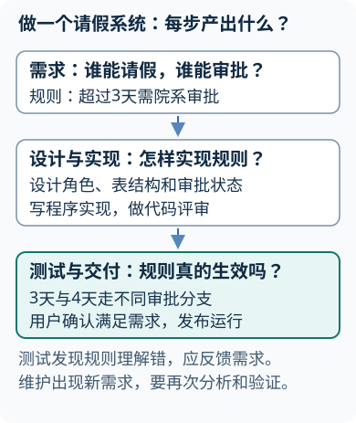
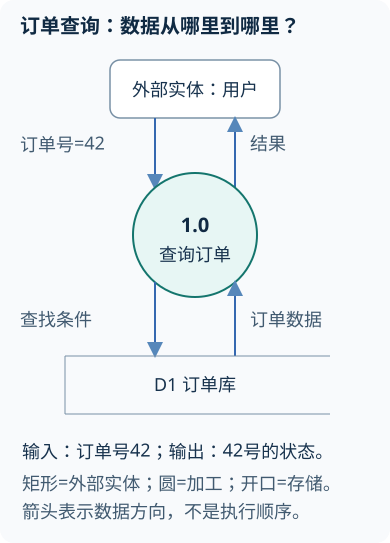
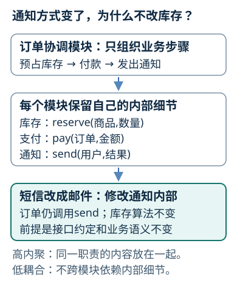
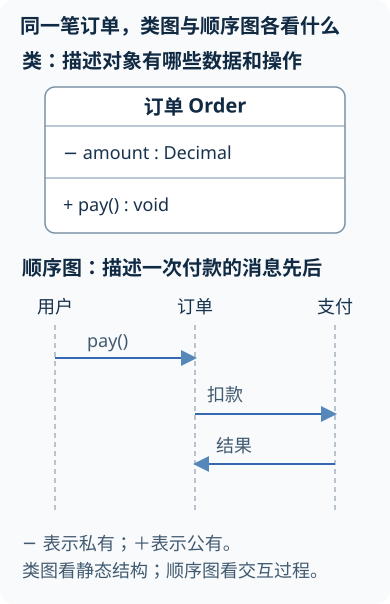
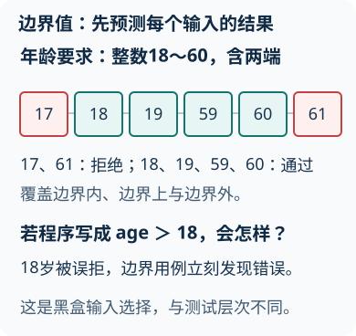
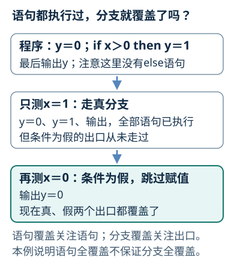
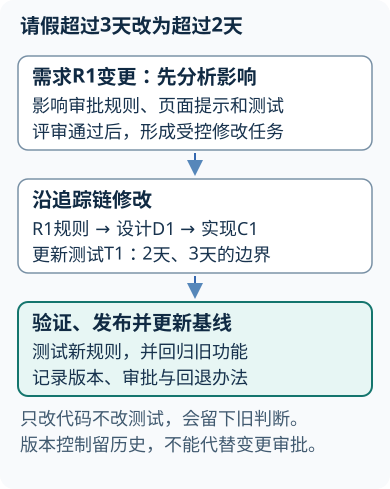
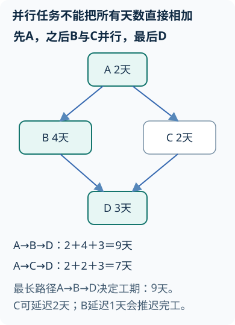

# 软件工程讲义

## 第1章 软件工程概述
<!-- exam: A | 单选、判断、场景题、简答 -->

### 软件危机与工程化

- 🔴 **软件与软件工程**：软件是==程序、数据及相关文档的完整集合==。软件工程将==系统化、规范化、可度量的方法==用于软件开发、运行和维护；目标是在成本、进度等约束下获得并维护满足需求的高质量软件。
- 🔴 **软件危机**：开发与维护中出现的成本超支、进度延期、质量难保、维护困难、文档不足等问题。复杂性、需求不清和变化、方法工具及管理不足共同造成，不能仅归因于程序员水平。
- ⚫ **三要素**：方法提供技术做法，工具提供自动或半自动支持，过程组织活动及质量控制；软件无物理磨损，但修改缺陷、结构退化和环境变化仍会使其失效。
<!-- test: 填空、简答 | 完整说明软件构成、危机表现与工程三要素 -->

<details><summary>先判断：一个系统代码能运行，但没有需求记录、测试记录和部署说明，能否称为完整的软件交付？</summary>

不能。可运行程序只是软件的一部分。完整交付还应包含必要的数据、需求与设计说明、测试证据、部署和使用维护资料，具体文档深度随项目风险和约束确定。
</details>

### 基本原理与生命周期

工程化开发强调分阶段、评审、验证、变更控制和持续改进。软件生命周期覆盖提出问题、可行性研究、需求、设计、实现、测试、交付、运行维护直到退役。阶段不是互不往来的直线：测试发现设计错误要反馈，维护中的新需求会再次进入分析和设计。

验证检查工作产品是否符合规定要求，确认检查软件是否满足用户的预期用途。例如按钮按规格生成报表，可通过这项验证；若用户实际需要可编辑数据，仍未满足用途确认，需要澄清需求并受控修改。



### 过程、产品与角色

软件过程规定活动、角色、工作产品和质量控制。工作产品可以是需求规格、模型、代码、测试用例和发布包。项目经理、需求人员、设计开发人员、测试人员、运维人员和用户代表从不同角度协作；角色可以由同一人兼任，但职责和检查点仍要明确。

过程不是文档数量竞赛。小型低风险项目可以简化形式，大型、高风险或受监管项目需要更严格的基线、评审、追踪和审计。

## 第2章 软件过程与生命周期模型
<!-- exam: A | 单选、判断、场景题、简答 -->

### 生命周期与过程组织

- 🔴 **生命周期与过程模型**：==生命周期从问题提出、开发、使用维护直到退役==；过程规定活动、角色、产物和控制，过程模型是组织这些活动的一种抽象。
- 🔴 **阶段产物**：可行性研究形成可行性报告，需求分析形成软件需求规格说明（SRS），总体设计形成架构/接口方案，详细设计形成模块算法与数据设计，实现测试产生软件及验证记录，运行维护持续演化。
- ⚫ **迭代与增量**：迭代重在重复完善，增量重在逐步增加可交付功能，可同时采用；原型用于学习需求或技术，不必等同交付增量。
<!-- test: 单选、简答 | 给过程模型写出特征、适用条件、优点及局限 -->

### 瀑布、原型与增量

- 瀑布模型按需求、设计、实现、测试等阶段推进，阶段成果清晰，适合需求较稳定、技术成熟、强调合同和评审的项目；需求晚变时返工代价较大。
- 快速原型先构造可观察版本以澄清需求或验证方案。抛弃式原型完成学习后废弃，演化式原型在工程控制下继续发展。低质量演示代码不能未经整理直接当生产系统。
- 增量模型把系统分成若干可运行部分，先交付高价值核心功能，再逐步扩充。每个增量仍需分析、设计和测试。

### 螺旋、统一过程与敏捷

螺旋模型以风险为驱动，每轮经历目标确定、风险分析、开发验证和下一轮计划，适合大型、复杂、高风险项目。它的代价是需要风险分析能力和较高管理成本。

统一过程强调迭代、用例驱动和体系结构中心，通常经历初始、细化、构造、移交阶段。喷泉模型用活动重叠描述面向对象开发的迭代特征。

敏捷方法使用短周期、持续反馈和可工作软件响应变化。Scrum组织产品待办、迭代和评审；产品负责人维护价值和待办顺序，Scrum Master促进流程并移除障碍，开发人员共同完成可用增量。XP强调测试驱动、结对编程、持续集成和重构。敏捷仍然需要目标、设计、测试和必要文档。

### 根据证据选模型

| 项目信号 | 优先考虑 | 主要边界 |
|---|---|---|
| 需求稳定、阶段审查严格 | 瀑布式过程 | 变化晚出现时返工较大 |
| 用户说不清业务或界面 | 原型 | 原型质量不自动达到产品标准 |
| 需要尽早交付核心价值 | 增量 | 各增量仍需完整质量活动 |
| 技术和业务风险高 | 螺旋 | 风险分析与管理成本较高 |
| 需求频繁变化、反馈及时 | 敏捷迭代 | 不能省略约束、测试和追踪 |

<details><summary>先选择：核心功能可分批上线、用户每两周反馈，同时支付安全风险很高，应怎样组织过程？</summary>

可采用迭代增量交付，每轮邀请用户评审；同时对支付安全单独进行风险分析、威胁评审和严格测试。模型可以组合，不能因采用敏捷迭代而降低高风险功能的质量控制。
</details>

### 持续集成与迭代反馈

持续集成要求频繁合并代码，并自动构建和执行快速测试，尽早暴露接口和集成问题。一次迭代形成“选择目标—实现—验证—评审—调整待办”的反馈环。自动构建成功不能代替系统测试和验收，也不能发现所有需求错误。

## 第3章 可行性研究与需求工程
<!-- exam: A | 单选、判断、计算、场景题、简答 -->

### 需求工程基本任务

- 🔴 **可行性研究**：以较低成本判断候选方案在==技术、经济、操作及社会等条件==下能否实施，比较方案并提出继续、调整或停止建议；不同项目可细分法律、组织与进度条件。
- 🔴 **需求工程活动**：获取、分析、规格化、验证、管理。功能需求描述服务和行为，非功能需求规定性能、可靠性等质量约束，外部约束限定必须遵守的条件。
- 🔴 **结构化分析三类模型**：数据模型描述实体及联系，功能模型描述数据处理与流动，行为模型描述状态与事件；数据流图（DFD）表示外部实体、加工、数据流和数据存储，数据字典精确定义数据。
<!-- test: 填空、简答、过程推演 | 写可验证需求，检查DFD平衡并执行状态转移 -->

### 可行性与成本效益

可行性研究用较小代价判断项目是否值得继续。技术可行性看技术、设备和人员；经济可行性看成本、收益和资金；操作可行性看组织和用户能否接受；还要考虑法律、进度和社会影响。

基本过程是：明确问题与目标，调查现状，提出候选方案，分析技术和风险，估算成本收益，比较方案并给出继续、调整或终止建议。系统流程图描述现有或候选系统中人员、设备、处理和数据的总体流转，不等同于程序流程图。

经济分析要说明口径和时间。若初始投入20万元，每年净收益8万元，忽略资金时间价值，静态回收期为`20÷8=2.5年`。完整项目还应计入开发、采购、培训、运行、维护和退出成本；无法量化的合规或公共价值也要单独说明。

### 需求获取、分类与质量

- 🔴 **需求质量**：正确、完整、一致、明确、可验证、可追踪，并标明优先级；准确阈值须经有权干系人确认。

性能验收还须约定响应计时的起止点、统计时间窗口及失败请求如何计入，保证双方在相同负载、数据量和环境下按同一口径复测。

需求获取常用访谈、观察、问卷、工作坊、文档分析和原型。单一方法容易遗漏隐性规则，应让不同干系人共同确认。

<details><summary>先改写：“系统应安全、响应快”怎样变成可验证需求？</summary>

应拆成可测规则。例如：“在500个并发会话、数据量100万条时，95%的查询在2秒内返回；连续5次登录失败后账号锁定15分钟，敏感操作写入不可由普通用户修改的审计日志。”具体阈值需由业务和技术人员确认。
</details>

### 分析模型、DFD与数据字典

数据流图DFD从数据角度描述外部实体、加工、数据流和数据存储。上下层图必须平衡：父加工的外部输入输出，应与分解后的子图边界一致。DFD不描述语句执行先后，箭头表示数据流，不是控制流。



数据字典统一定义数据项、数据结构、数据流和数据存储。例如“订单号”应说明类型、长度、格式、取值规则和来源，避免不同人员用同名表达不同含义。

### SRS、验证、追踪与变更

软件需求规格说明SRS是设计、开发、测试和验收的共同依据。需求验证从正确性、完整性、一致性、可行性和可验证性检查，并邀请有权确认的干系人参与。

追踪关系把业务目标、需求、设计、代码、测试和变更连接起来。变更应经历申请、影响分析、审批、实施、验证和文档更新。不同部门需求冲突时，应记录目标与风险、组织协商并形成可验证规则，不能由开发人员私自选择一方。

#### 有穷状态机与需求约束
- 🔴 **有穷状态机**：由有限状态、事件/输入、初态及转移规则等描述行为；带守卫的转移只有条件成立才发生，动作说明转移的效果。形式化说明利用数学符号及明确语义减少自然语言歧义。
- 🔵 **借阅状态表**：以一册实体图书为对象，初态“可借”；可借+借出[用户有资格]→借出，动作建立借阅记录；借出+归还→可借，动作登记归还日；借出+报损→停用，动作登记损坏。路径“可借→借出→可借”合法；“借出时再次借出”未定义，不能默认允许。
- 🔴 **前置、后置与不变式**：借书前置条件为图书可借且用户合格，后置条件为新增有效借阅并使图书借出；不变式可为同一册图书最多一条未归还记录。执行函数返回成功不证明不变式仍成立，需要设计和测试核验。
- ⚫ **方法范围**：Petri网用库所、变迁和标识表达并发及同步，Z等形式规格语言用集合、逻辑等描述状态和操作；本课教状态转移及约束判定，未展开这些语言的完整语法或证明。

## 第4章 总体设计与详细设计
<!-- exam: A | 单选、判断、场景题、简答 -->

### 总体设计与详细设计

- 🔴 **软件设计**：包括总体设计与详细设计。==总体设计确定体系结构、模块划分、全局数据结构和接口==；==详细设计确定模块内部算法、局部数据结构及具体处理过程==。
- 🔴 **模块独立性**：用内聚和耦合衡量。内聚描述模块内部元素联系的紧密程度，耦合描述模块之间相互依赖程度；高内聚、低耦合有利于理解、测试和修改。
- ⚫ **抽象与信息隐藏**：抽象突出必要特征，信息隐藏把可能变化的设计决定封装在接口之后；封装是一种实现手段，private修饰符本身不证明职责设计合理。
<!-- test: 单选、简答、过程推演 | 按依据分内聚耦合，从需求构造模块、对象和判定表 -->

### 从分析到体系结构

分层、客户端/服务器和MVC等结构各有边界。清晰分层可限制依赖方向，并在接口稳定时替换或复用某一层；层次过多也会增加调用和性能开销。选择时要结合部署、性能、安全、修改方向和团队能力，不存在适合所有系统的唯一架构。

MVC把职责分为模型Model、视图View、控制器Controller：模型管理业务数据与规则，视图展示结果，控制器接收请求并协调处理。例如查成绩时，用户发起查询→控制器检查请求并调用模型→模型按权限与规则取成绩→视图呈现结果。改变表格颜色主要影响视图，改变成绩计算规则主要影响模型；这是逻辑职责划分，不要求分成三台服务器，具体框架的调用细节可不同。

### 模块化、内聚、耦合与信息隐藏

设计时可按四步检查：写出模块职责；列出输入、输出和异常；标出依赖；观察一次需求变化会影响哪些模块。把余额计算、数据库写入、界面刷新和邮件发送塞进同一函数，内聚低且难以独立修改；拆分后仍需接口通信，低耦合不是零通信。



### 结构化设计与详细设计工具

<details><summary>先设计：订单处理模块同时校验库存、扣款、发短信，应如何降低修改牵连？</summary>

可拆为订单协调、库存、支付和通知模块，通过明确接口传递订单号、金额和结果。支付失败由协调模块决定回滚或补偿，通知不直接修改库存。这样短信渠道变化不会迫使库存逻辑一起修改。
</details>

### 面向对象分析、设计与UML

#### 借阅数据属于哪个对象


<details><summary>两名学生先后借同一册书，各次的归还日期应放在学生、图书还是某次借阅记录中？</summary>

放在具体借阅记录中。一条记录表示一次借阅，不会被同一本书的下一次借阅覆盖；本例把图书对象按可借出的实体副本管理。

</details>

统一建模语言（UML，Unified Modeling Language）常用图各自回答不同问题：用例图描述参与者目标，类图描述静态结构，顺序图描述一次场景中按时间发生的消息，状态图描述对象状态迁移，活动图描述工作流，部署图描述软件到硬件结点的分布。DFD不是UML图，程序流程图也不等同活动图。



**通俗理解：** 先读类图：`amount`是订单的数据，`pay()`是它提供的操作；`−`与`+`分别表示私有和公有。再沿顺序图从上往下读：用户请求付款，订单向支付服务发出扣款请求，支付服务返回结果。类图不告诉你谁先发消息，顺序图也不能替代所有类的静态结构。图中的调用是简化示例，实际支付还需要处理失败、幂等与结果核验。

#### 内聚、耦合与信息隐藏
- 🔴 **内聚由弱到强的常见序列**：偶然（无关操作凑合）、逻辑（同类操作靠标志选择）、时间（同一时刻执行）、过程（按同一流程次序）、通信（使用同一输入/输出数据）、顺序（前者输出是后者输入）、功能（共同完成单一功能）。分类依据是组合原因，不能凭模块名判断。
- 🔴 **耦合由强到弱的常见序列**：内容耦合（直接依赖或改动另一模块内部）、公共耦合（共享全局数据）、外部耦合（共同依赖外部格式/协议等）、控制耦合（传控制标志影响对方逻辑）、标记耦合（传完整复合结构但只用部分）、数据耦合（传必要简单数据）、非直接耦合。不同教材对外部耦合位置可能另分，归类须说明具体依赖。
- 🔵 **例**：税额函数只需amount却传整份Customer结构，是标记耦合；改传amount可减少接口依赖；传mode让对方按标志决定完全不同流程体现控制耦合；直接修改另一模块私有变量是内容耦合。

#### 从DFD到模块与判定表
- 🔵 **变换分析步骤**：划分输入流、变换中心、输出流→映射为输入/变换/输出模块→逐层分解→检查接口与内聚。成绩报表DFD“读原始成绩→校验并计算均分→生成报表”可映射main调用readScores、computeAverage、writeReport，传递成绩集合、统计结果；main负责协调，不代替三者内部计算。
- 🔵 **事务分析**：若输入“借书/还书/查询”先按事务类型分派，则设事务中心dispatch，分别调用borrowBook、returnBook、queryBook。事务中心不是数据库事务提交的同义词。
- 🔴 **详细设计工具**：程序流程图用结点与控制线表示执行；N-S图用嵌套框表达顺序/选择/循环；PAD图用层次树形结构表达算法；判定表枚举条件组合及对应动作。
- 🔵 **二条件判定表**：条件A=账号有效，B=余额足够。规则TT→扣款成功；TF→拒绝并提示余额不足；FT、FF→拒绝并提示账号无效。构表先列全部2²=4组合，再填动作，必要时合并同动作规则。短路检查账号后才查余额不改变业务判定表的结果要求。

#### 借阅对象与协作建模
- 🔴 **对象、类与多态**：对象具有身份、状态和行为；类描述同类对象共同属性与操作；封装把状态和操作组合并控制访问；继承表达is-a一般/特殊关系，多态使同一接口对不同对象执行不同实现。
- 🔵 **从需求到类**：“学生每次借一本实体图书并记录日期”，选择Student、BookCopy、Loan。Student到Loan为1对0..*，每个Loan恰属1名Student及1册BookCopy；BookCopy可有多次历史Loan，但未归还的至多1条。日期放Loan，避免后次借阅覆盖前次。
- 🔴 **关联、聚合、组合、依赖**：关联表示稳定联系，聚合为整体/部分的弱拥有关系，组合强调部件生命周期受整体强约束，依赖表示使用对方服务。不可只凭“有一个”就使用组合，更不能把has-a误作继承。
- 🔵 **职责与协作**：Loan负责登记借出/归还及日期，BookCopy维护可借状态，借阅服务协调资格校验、创建Loan及状态修改。顺序为请求→检查资格/状态→建立记录→更新状态→返回结果；失败时不能留下“记录成功但图书仍可借”的半完成状态。
- 🔵 **对象测试**：先对Loan单元测试“借出后归还”状态转移，再集成测试服务与BookCopy一致更新；加反例“已借出再借”“重复归还”。若子类替换父类，应保持调用方承诺的前后置约束，并对动态绑定到的实现分别测试，继承代码不表示免测。

## 第5章 软件实现与软件测试
<!-- exam: A | 单选、判断、多选、计算、场景题、简答 -->

### 验证、确认与测试分类

- 🔴 **验证与确认**：==验证检查工作产品是否符合上一阶段或规定要求==，==确认检查最终软件是否满足预期用途和用户需要==；测试只是其中一类活动，评审、分析也提供证据。
- 🔴 **测试方法与层次**：黑盒依据规格看输入输出，白盒依据内部结构设计用例；静态检查不执行程序，动态测试执行程序。单元、集成、系统、验收按测试对象和目的区分，不与黑盒/白盒分类互斥。
- ⚫ **测试原则**：尽早计划与执行检查、追溯需求、关注边界和异常、重视缺陷集中处；有限用例能揭示缺陷，不能普遍证明无缺陷。调试负责定位和修复原因。
<!-- test: 单选、计算、过程推演 | 设计等价类/边界用例，检查逻辑覆盖与基本路径 -->

### 黑盒测试设计

等价类把输入划分为预期处理相同的有效类和无效类，每类选代表值；边界值选择边界及其相邻值；判定表覆盖多个条件组合；错误推测依据历史经验补充容易出错的位置。

例如年龄允许18到60，等价类有“小于18、18到60、大于60”，边界值可取17、18、19、59、60、61。只测30属于一个有效类，无法验证两个边界。



### 白盒覆盖与基本路径

#### 控制流图环形复杂度

- 🔴 **环形复杂度**：单连通控制流图V(G)=E−N+2，其中E为边数、N为结点数，表示线性独立路径数；每判定只有真假两出口时也等于判定数+1。E=15、N=12得V=5。多出口分支用图公式，基本路径不等全部路径，不可达路径无法靠输入覆盖。




**通俗理解：** 分别把`x=1`和`x=0`代入`y=0; if x>0: y=1; 输出y`。前者输出1，后者输出0；注意只有`y=1`受条件控制。只测前者，所有语句虽然都执行过，仍不知道条件为假时程序是否正确。

**从代码列出基本路径。** 上图只含一个判定。另看下面两个独立判定的小程序，x、z均为给定整数：

```text
① y = 0
② 如果 x > 0：
    ③ y = y + 1
④ 如果 z > 0：
    ⑤ y = y + 2
⑥ 输出 y
```

控制流结点按①—⑥编号；边为①→②、②真→③、②假→④、③→④、④真→⑤、④假→⑥、⑤→⑥，共N=6、E=7，所以V=7−6+2=3。

| 基本路径 | 输入(x,z) | 输出 | 本次增加的分支 |
|---|---|---|---|
| ①②④⑥ | (0,0) | 0 | 两个判定均假，作为第一条路径 |
| ①②③④⑥ | (1,0) | 1 | 增加②的真分支及③→④ |
| ①②④⑤⑥ | (0,1) | 2 | 增加④的真分支及⑤→⑥ |

线性独立可先这样检查：新增路径引入了此前路径组合不能表达的边；本例每次都走到新分支。全部可行路径还有两判定均真的①②③④⑤⑥，输入(1,1)输出3；它没有增加独立路径数。因此基本路径数为3，而全部真假组合路径数为4。选择这3个基本路径用例不等于完成全部组合测试；循环还可能产生更多执行路径。

<details><summary>先设计：密码长度要求8到20，至少选择哪些边界值？</summary>

可选7、8、9、19、20、21，分别覆盖下边界外、下边界、下边界内、上边界内、上边界和上边界外。空串、超长输入和字符规则还应根据其他需求另建用例。
</details>

### 测试层次、集成和确认

单元测试检查函数、类或模块；集成测试检查接口和协作；系统测试检查完整系统的功能与质量属性；验收测试由用户或代表确认业务目标。回归测试是在修改后重新执行受影响测试，不是独立于这些层次的第五层。

自顶向下集成用桩模块模拟尚未完成的下层，自底向上集成用驱动模块模拟上层调用。Alpha测试通常在开发方环境由受控用户进行，Beta测试由外部用户在实际环境试用。确认测试关注是否满足SRS。

### 调试、可靠性与测试闭环

失败不等于缺陷位置。调试应稳定复现、缩小范围、寻找最早错误状态、修复根因并进行回归。平均无故障时间（MTTF，Mean Time To Failure）描述平均正常运行时长，平均修复时间（MTTR，Mean Time To Repair）描述恢复用时，简化稳态可用度可写作`MTTF÷(MTTF+MTTR)`；指标口径和故障定义必须一致。

#### 条件与判定覆盖辨析
<!-- test: 场景题、程序阅读 | 按规格边界或内部结构选择黑盒/白盒与逻辑覆盖 -->
- 🔵 **选择依据**：需求限定年龄18…60时，以17/18/19和59/60/61检边界；要知道代码if两出口是否执行，检查判定覆盖。若怀疑遗漏了“过期账号禁止登录”的需求，即使现有语句100%覆盖，也须补规格用例，继续加路径不能自动发现代码未实现的要求。
- 🔴 **逻辑覆盖要求**：语句覆盖要求每条可执行语句至少一次；判定覆盖要求每个判定真假各一次；条件覆盖要求每个基本条件真假各一次；判定/条件覆盖同时满足后两者；条件组合覆盖要求基本条件取值组合按约定覆盖，路径覆盖要求程序路径被执行。
- 🔵 **反例**：判定A or B，用例(T,F)、(F,T)让A、B各真各假，达到条件覆盖，但判定均为真，未达判定覆盖。若语言短路，须说明是逻辑取值覆盖还是实际求值覆盖，未执行的B不可当已经实际覆盖。
- ⚫ **包含边界**：在通常可达二分控制流模型下，判定覆盖可包含语句覆盖；条件覆盖与判定覆盖一般互不包含。路径数可能因循环无界，不能把有限基本路径集合等同全部路径。

## 第6章 软件维护、质量与配置管理
<!-- exam: B | 单选、判断、场景题、简答 -->

### 维护、重构与再工程

- 🔴 **维护四类**：==改正性修复错误==，==适应性适应环境变化==，==完善性增加功能或改善性能==等，==预防性改善内部质量以减少未来问题==；按变更目的分类，同次变更可含多类目的。
- 🔴 **质量保证与配置管理**：质量保证通过计划、标准、评审、测试和审计等建立信心；配置管理识别并控制软件配置项的版本、变更、状态和一致性。
- ⚫ **维护相关术语**：逆向工程从现有实现恢复设计/规格，正向工程由抽象描述走向实现，再工程检查并改造既有系统，重构改善内部结构且保持外部可观察行为。
<!-- test: 填空、简答 | 按目的分类维护，说明基线和受控变更全过程 -->

### 维护类型、过程与再工程

维护不是直接改代码。应先理解请求和现有系统，分析影响，修改设计与实现，执行测试并更新文档。重构在不改变外部可观察行为的前提下改善内部结构；再工程还可能包括逆向理解、数据重构和重新实现。

软件交付后的运行维护阶段通常持续时间最长，并可能占据生命周期成本的大部分，因为环境、缺陷和业务需求会长期变化；这不表示前期需求与设计可以省略，前期质量会直接影响后续维护代价。

<details><summary>先分类：升级数据库驱动以适配新平台，同时清理重复代码，分别属于什么维护？</summary>

适配新平台主要属于适应性维护；在行为不变前提下清理重复代码、降低未来修改风险主要属于预防性维护。同一次变更可以包含多种目的，应分别记录。
</details>

### 软件质量、保证与文档

质量属性包括正确性、可靠性、可用性、效率、可维护性、可移植性、安全性和可复用性。属性可能权衡，例如更强认证可能增加操作步骤。质量保证通过标准、评审、测试、审计、度量和持续改进预防并发现问题，不是测试团队单独承担的活动。

文档保存需求、设计、接口、测试、部署和维护知识。文档应服务沟通和追踪，既不能缺失关键决定，也不应堆积无人维护的重复材料。

### 配置项、版本、基线与变更控制

配置管理包括配置项识别、版本控制、变更控制、状态记录、配置审计、构建和发布。配置项可以是代码、需求、模型、测试、构建脚本和环境定义。

基线是经过正式评审批准、后续只能按控制流程修改的配置项集合。分支支持并行工作，标签标识重要版本；它们是版本控制机制，不能替代审批、构建、发布和环境备份。



变更流程为申请、影响分析、审批、实施、测试验证、更新基线和文档。紧急修复可压缩等待时间，但仍要保留授权、受控版本、必要测试、回退方案、发布验证和事后记录。

#### 质量模型的完整分组
- 🔴 **McCall十一因素**：产品运行包括正确性、可靠性、效率、完整性（安全保护）、可使用性；产品修订包括可维护性、灵活性、可测试性；产品转移包括可移植性、可复用性、互操作性。这里的完整性是该模型保护属性，不等同数据库三类完整性约束。
- 🔵 **从因素到指标**：可维护性可观察平均定位/修改耗时，可使用性可观察新用户任务完成率；先约定测试任务和统计口径。模型分类帮助找遗漏，不能把“高可靠”四字当验收标准。

## 第7章 项目管理与风险管理
<!-- exam: B | 单选、判断、计算、场景题、简答 -->

### 项目估算与风险暴露

- 🔴 **项目管理**：对范围、进度、成本、质量、人员、沟通和风险进行计划、组织、监控与调整。工作分解结构（WBS）分解交付范围，==工作量估算以人月等表示投入==，==工期以日/月表示持续时间==，二者不能直接等同。
- 🔴 **风险管理**：识别→分析概率及影响→制定应对→监控；风险尚未发生，问题已经发生。规避、减轻、转移、接受须落实责任人和触发条件。
- 🔵 **期望损失**：风险暴露RE=P×L，P为发生概率，L为该风险造成的损失；P=0.2、损失10万元，RE=2万元。此为排序依据之一，不代表项目一定损失2万元。
<!-- test: 计算、简答 | 求关键路径和时差，区分规模、工作量、工期及风险暴露 -->

### 范围、规模与工作量估算

规模可以用代码行、功能点或故事点等估计。代码行依赖语言且早期难准确；功能点从输入、输出、查询、内部数据和外部接口等用户功能估算，相对独立于语言。工作量模型只能辅助决策，必须记录假设并随项目进展更新。

### 进度网络与关键路径

甘特图显示任务在时间轴上的安排，里程碑标志重要结果，工程网络表达任务依赖。关键路径是总工期最长的依赖路径，其任务总时差通常为0；关键任务延误会直接推迟项目，缩短非关键任务不一定缩短总工期。



**通俗理解：** 图中路径`A→B→D`用时9天，`A→C→D`用时7天，因此前者是关键路径。若只把C缩短1天，总工期仍由9天路径决定。

<details><summary>先计算：A需2天；A完成后并行进行B(4天)和C(2天)，二者完成后才能做D(3天)。总工期和关键路径是什么？</summary>

`A-B-D`为2+4+3=9天，`A-C-D`为2+2+3=7天；总工期9天，关键路径为A-B-D。计算前必须确认网络中的结点表示任务还是事件，以及工期标在何处。
</details>

### 人员组织与沟通

任务不是都能任意并行。增加人员会带来培训、沟通和集成成本，晚期向延期项目加人可能进一步拖慢。团队应明确职责、接口、决策方式和沟通节奏，并让知识不过度集中在单个人身上。

### 风险管理

应对方式包括规避、降低、转移和接受。例如第三方接口可能延期，可提前提供适配层和模拟服务以降低影响。概率乘损失可辅助排序，但安全、法律和声誉等维度不能只用一个金额替代。

#### 关键路径与总时差
- 🔴 **时刻含义**：ES为最早开始、EF为最早完成、LS为不推迟项目完工的最迟开始、LF为最迟完成；均从项目起点0计时。下例每个区间按[开始时刻,完成时刻]记录，前推得最早区间，后推得最迟区间。
- 🔵 **前推/后推**：用任务为结点的无环依赖网，ES=max(前驱EF)，EF=ES+工期d；终点LF=总工期，LS=LF−d，逆序LF=min(后继LS)，总时差TF=LS−ES。多前驱取最大、多后继取最小，起点ES=0。
- 🔵 **完整状态**：A2天→B4天与C2天并行→D3天。前推A[0,2]、B[2,6]、C[2,4]、D[6,9]；后推D[6,9]、B[2,6]、C[4,6]、A[0,2]。TF分别0、0、2、0，关键路径A-B-D为9天；C可晚2天而不推迟D。
- ⚫ **限制**：这里不加资源冲突，若B、C只能由同一个人完成则需重新排程；关键任务总时差0并不代表只允许存在一条关键路径。

#### 工作量估算的量纲
- 🔴 **COCOMO基础识别**：基本模型可写E=a×(KLOC)^b，E为人月、KLOC为千行交付源代码，a、b由项目类型及校准决定；工期可另用T=c×E^d估算。不能在无系数和项目类型时直接算具体人月。
- 🔵 **给定模型例**：若题设E=2×KLOC^1.1，规模10KLOC，则E≈25.18人月；即使平均5人，也不能简单断言实际工期恰为5.04月，因为依赖、沟通及人员能力影响可并行程度。

## 第8章 面向变化的软件开发方法
<!-- exam: B | 场景题、简答 -->

### 按证据组合过程方法

- 🔴 **面向变化的组合方法**：==不确定需求用原型反馈澄清==，==可分功能用增量交付==，==技术风险用试验和风险分析==，频繁集成用自动构建和回归测试，重大变更仍需影响分析与追踪。
- 🔴 **追踪链**：业务目标→需求→设计→实现→测试→发布；双向追踪帮助判断实现是否有需求依据、需求是否有验证证据，并分析修改影响。
- ⚫ **持续集成、交付与部署**：持续集成频繁合入并自动检查，持续交付使软件保持可发布，持续部署进一步自动把通过检查的变更发布到目标环境；具体发布门槛按风险设置。

### 从业务变化选择工程方法

面对变化时，先判断变化来源和代价：需求是否尚未澄清，系统能否拆成独立增量，技术风险是否需要先验证，是否存在严格审查和合规基线。然后组合原型、迭代增量、风险分析、自动化测试和变更控制。

- 界面流程模糊：先用原型取得反馈。
- 核心功能可独立交付：按价值做增量。
- 新技术风险高：先做风险验证或试验性原型。
- 规则稳定且需正式审查：保留清晰阶段和基线。
- 频繁发布：使用持续集成、自动测试和可回退部署。

### 贯穿生命周期的追踪

可用一条最小链检查完整性：业务目标 → 可验证需求 → 设计责任 → 实现提交 → 测试证据 → 发布版本。任何一环缺失，变更影响和责任边界都会变得模糊。

<details><summary>先决策：报表字段每周变化，但结算规则受监管且必须审计，能否整套系统都用同样轻量流程？</summary>

不宜。报表可用短迭代和自动回归快速交付；结算规则应保留正式需求、审批、追踪、严格测试和发布审计。共同基础仍是版本控制、持续集成和可回退发布，但控制强度按风险调整。
</details>

### 用反馈持续改进

迭代结束后应比较计划与结果、缺陷、交付周期和用户反馈，找出可操作改进。度量用于发现趋势而不是惩罚个人；只追求代码行、缺陷数或速度，可能诱导错误行为。工程方法的价值在于让变化可理解、可验证、可追踪和可恢复。
