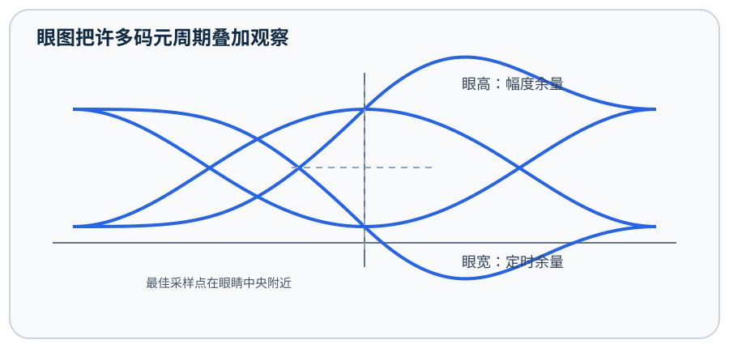

# 通信原理与高频电子线路

## 第1章 通信系统概论
<!-- exam: A | 单选、判断、多选、填空 -->

### 1. 通信的基本任务

通信的基本任务是可靠、有效地把信息从发送端传到接收端。一个典型通信系统包括：

1. 信源：产生消息。
2. 发送设备：把消息转换、调制和放大成适合传输的信号。
3. 信道：信号传播的媒介。
4. 噪声源：传输中引入的不希望出现的干扰。
5. 接收设备：选择、放大、解调并恢复消息。
6. 信宿：信息的最终接收者。

消息是要表达的内容，信息是消息中消除不确定性的部分，信号是承载信息的物理量。三者相关但不是同义词。


### 2. 模拟通信与数字通信

- 模拟通信：传输的信号参数连续变化，系统较直观，但抗噪声和再生能力通常较弱。
- 数字通信：以离散符号传输，抗干扰能力较强，便于加密、存储、处理和复用，但需要编码、同步和数模/模数转换等环节。

数字通信不是绝对没有噪声或误码，只是可以通过再生、编码和差错控制提高可靠性。

### 3. 单工、半双工和全双工

- 单工：信息只能单向传输，如广播电台向听众播送。
- 半双工：双方都能发送，但不能同时发送，如普通对讲机。
- 全双工：双方能同时双向传输，如普通电话通话。

三者的区别同时取决于传输方向和双方能否同时发送。半双工允许双向传输，但同一时刻只有一方发送。

### 例题

**题目：** 以手机语音通话为例，按顺序写出通信系统的六个基本组成，并说明信号在哪个环节受到噪声影响。

<details>
<summary>查看答案与解析</summary>

**答案：** 讲话者及语音消息属于信源，手机中的编码、调制和射频电路属于发送设备，无线传播空间属于信道，传播和接收电路会叠加噪声，对方手机的选择、解调和译码属于接收设备，听话者属于信宿。

**解析：** 先按信源→发送设备→信道与噪声→接收设备→信宿组织，不要把消息、信号和设备混为同一对象。

</details>

## 第2章 信号、信道与噪声
<!-- exam: A | 单选、判断、填空、计算 -->

### 1. 频率、周期与波长

频率表示单位时间内重复次数，单位赫兹（Hz）；周期是完成一次重复所需时间，`T=1/f`。在传播速度一定时，波长 `λ=v/f`，因此频率越高，波长越短。

### 2. 码元速率与信息速率

- 码元速率：每秒传输的码元数，单位Baud。
- 信息速率：每秒传输的比特数，单位bit/s。

二进制中一个码元通常携带1 bit，所以数值可能相等；多进制中一个码元可携带多个比特，两者不能混为一谈。

若每个码元有 `M` 种等可能状态，每个码元可携带 `log₂M` bit，信息速率与码元速率的关系为 `Rb=RB log₂M`。例如四进制传输的码元速率为 `1200 Baud`，则理想信息速率为 `2400 bit/s`。

### 3. 有效性与可靠性

- 有效性：常看传输速率、带宽利用率等，强调“传得快、占得少”。
- 可靠性：常看误码率、信噪比等，强调“传得准”。

带宽越宽通常可支持更高传输速率，但还受信噪比、调制方式、编码和设备性能影响。

### 4. 香农公式

香农公式：`C=B log₂(1+S/N)`。

- `C`：有噪声信道的理论极限容量。
- `B`：信道带宽。
- `S/N`：线性信噪比。

公式说明提高带宽或信噪比都能提高理论容量，但信噪比的收益是对数增长。香农容量是理论上限，不等于任何实际系统必然达到的速率。

**通俗理解：** 可以把信道想成一条有噪声的运输通道：带宽 `B` 类似可同时通行的通道宽度，信噪比 `S/N` 类似货物标识相对背景干扰的清晰程度。加宽通道和提高辨识度都能增加可靠传送的信息量，但辨识度继续提高时收益逐渐变小，这对应对数关系。香农公式给出在理想编码、任意小误码率意义下的容量上限，不是某种具体调制设备的保证速率，也不说明超过容量就完全不能传输。

信噪比为线性值时可直接代入；若给出 `SNRdB`，应先用 `S/N=10^(SNRdB/10)` 换成线性比，不能把“20 dB”直接写进 `1+S/N`。例如 `B=1 MHz、S/N=3`，则 `C=1×10⁶×log₂4=2 Mbit/s`。

**例题：** 物理链路给出 `B=200 kHz`、`S/N=10`（线性值）。  
按香农公式，容量 `C=200000×log₂(1+10)≈692000 bit/s`，约 `692 kbit/s`，这是理论上限。  
若采用理想无码间串扰、`M=16` 的码元体系，奈奎斯特关系给出的信息速率上限为 `Rb=2B log₂M=1.6 Mbit/s`，对应码元速率上限为 `2B=400 kBaud`。这与香农容量是不同约束；若仍受上面的同一带宽和噪声条件限制，可靠信息速率还不能超过约692 kbit/s，不能只靠提高码元状态数达到1.6 Mbit/s。

### 5. 奈奎斯特无码间串扰关系

对带宽为 `B` Hz 的理想低通信道，在无码间串扰条件下，最高码元速率为 `RB=2B` Baud。若采用 `M` 进制且每个码元携带 `log₂M` bit，理想最高信息速率为：

`Rb=2B log₂M`

例如带宽 `3 kHz` 的理想低通信道采用二进制传输，无码间串扰的最高信息速率为 `6 kbit/s`。奈奎斯特关系讨论带宽限制下的码元间隔，香农公式讨论带噪信道的理论容量；它也不同于模拟信号数字化中的抽样定理 `fs≥2fH`。

## 第3章 模拟信号数字化与调制
<!-- exam: A | 单选、判断、多选、填空、计算、场景题、简答 -->

### 1. 模拟信号数字化

模拟信号数字化的常见过程是抽样、量化和编码：

- 抽样：在离散时刻取得信号样值。
- 量化：把连续幅值归入有限等级，会产生量化误差。
- 编码：把量化等级表示成二进制代码。

抽样定理的基础表述：对最高频率为 `fH` 的带限信号，为避免混叠，奈奎斯特速率为 `2fH`，一般取抽样频率高于该边界。实际系统通常留有余量。

**通俗理解：** 抽样像连续拍摄运动过程：拍得太慢，不同运动会留下相同的一组照片，回放时便可能把快速转动误认为慢速甚至反向转动，这就是混叠。对最高频率受限为 `fH` 的信号，一般需 `fs>2fH` 并满足带限等条件才能保证唯一恢复；工程中还要先用抗混叠滤波器限制带宽并给非理想滤波器留过渡带，因此通常不会把采样率恰好卡在两倍。

以收银员讲话或扫码器产生的现实信号为例，完整链路可写为：物理量（声音、光）→传感器转换为模拟电信号→放大与抗混叠滤波→ADC抽样、量化、编码→数字数据→处理、存储或传输。输出到扬声器时则需经过DAC和功率放大，把数字数据重新变成可驱动设备的模拟电信号。


PCM未计帧头和纠错时，码率为`Rb=fs×N×通道数`。例如最高频率3.4 kHz的带限语音以8 kHz采样、每样值8 bit、单声道编码，得到`8 k×8=64 kbit/s`。采样率高于6.8 kHz临界值，仍需采样前限带。计算前分别检查采样条件、量化位数和声道数。

计算机内部常用高、低电平承载二进制信息，是因为半导体开关适合高速、低成本、大规模集成，离散电平也便于设置判决阈值和恢复信号，从而获得较好的抗小扰动能力。准确说法是“二进制数据由电压、电流或光等物理信号承载”，不能把“数字信息”和“电信号”当成同一个概念，也不能说计算机内部只有电子传输而不存在光、电磁等其他互连形式。

### 2. 为什么要调制

调制是让高频载波的某个参数随消息信号变化。主要作用包括：

- 便于使用实际尺寸的天线和实现远距离无线传输；
- 把不同信号搬移到不同频段，便于多路复用；
- 适应信道特性，提高传输和抗干扰性能。

解调是在接收端从已调信号中恢复原消息。混频只改变信号中心频率，通常保留原调制信息，不能与解调混淆。

**通俗理解：** 调制像把原本不适合直接远行的消息装到一辆高速载波“车”上，并通过改变车的幅度、频率或相位携带消息；不同载波频段又像不同车道，使多路信号可以共享媒介。准确地说，消息并不是简单与载波并排相加，而是按调制规律改变载波参数并产生相应频谱；混频只把已调信号搬到另一中心频率，解调才是取回原消息。

### 3. 常见模拟调制

- AM（调幅）：载波幅度随消息变化。
- FM（调频）：载波瞬时频率随消息变化。
- PM（调相）：载波相位随消息变化。

一般条件下FM比AM抗幅度干扰能力强。AM把信息直接放在包络幅度上，幅度噪声会改变有用信息；FM把信息放在瞬时频率变化上，接收机可在解调前用限幅器削弱幅度波动，并利用捕获效应改善强信号接收。FM并非不受噪声影响，弱信号时仍会明显恶化，而且通常需要比AM更宽的带宽和更复杂的设备。

若基带最高频率为`fm`，普通AM和DSB-SC双边带信号带宽约为`2fm`，SSB只保留一个边带，带宽约为`fm`。DSB-SC载波被抑制，通常需相干解调；普通AM含载波且不过调制时可包络检波。FM常用卡森公式估算带宽：`BT≈2(Δf+fm)=2fm(β+1)`，其中`Δf`是最大频偏，`β=Δf/fm`是调频指数。公式是工程近似，必须写明最大频偏和最高调制频率。

<details><summary>先算：Δf=75 kHz、fm=15 kHz，FM带宽约多少？</summary>

`BT≈2(75+15)=180 kHz`。不能只取两倍最高调制频率，因为FM带宽还取决于频偏。
</details>

**包络检波的条件：** 单音普通AM可写为` s(t)=Ac[1+m cos(2πfmt)]cos(2πfct)`，m是调制度。当0≤m≤1时，方括号非负，包络与消息幅度保持对应；m=1时谷底可刚好到0。若m>1，部分区间方括号变负，实际包络变成绝对值，出现反转和畸变，普通包络检波不能直接恢复原消息。DSB-SC没有保留强载波，不能把它当普通AM无条件使用包络检波。

### 4. 常见数字调制

- ASK：用载波幅度的不同状态表示数字信息。
- FSK：用不同频率表示数字信息。
- PSK：用不同相位表示数字信息。
- QAM：同时改变幅度和相位，提高频谱利用率。

数字调制仍使用模拟载波传输数字信息，因此“数字通信中不存在模拟波形”是错误的。


`M`进制调制每码元携带`log₂M` bit，所以QPSK为2 bit/码元，16QAM为4 bit/码元。在相同码元速率下，高阶调制可提高比特率，但星座点更密，达到相同误码率通常需要更高信噪比。

### 5. FDM、TDM、WDM与CDM

复用是让多路信息共享同一传输媒介，以提高信道利用率：

- FDM（频分复用）：把不同信号安排在不同频带，可同时传输；各频带之间通常要留保护间隔。
- TDM（时分复用）：各路轮流占用不同时隙，共享同一频带；接收端需要保持时隙同步。
- WDM（波分复用）：在同一根光纤中使用不同光波长同时传送多路信号，可看作光通信中的频分思想。
- CDM（码分复用）：各路可同时、同频传输，用不同扩频码区分；接收端利用匹配的码分离目标用户。

四者使用的区分资源不同：FDM分频率、TDM分时间、WDM分光波长、CDM分码字。

#### 同步TDM怎样计算帧与开销

帧是一轮时隙的集合，不是一条支路的单个比特。4路都以8 kHz采样，每帧从每路各取一个8 bit样值：一帧有4个时隙、32 bit有效数据；要让每路每秒8000个样值都送完，每秒需要8000帧，不是32000帧。

有效数据速率为`8000×32=256 kbit/s`。若每帧另有1 bit同步位，则每帧共33 bit，线路速率为`8000×33=264 kbit/s`。增加的8 kbit/s来自帧开销，不会增加每路采样率。帧同步让接收端知道一轮从哪里开始，再按约定时隙把样值送回相应支路。若题目改为每时隙只放1 bit，帧结构、帧率都要重新推算，不能固定照用8000帧。

<details><summary>先算：2路各1 kbit/s，每帧各取1 bit，再加1 bit同步位，线路速率是多少？</summary>

每秒1000帧，每帧2 bit有效数据加1 bit同步，共3 bit，线路速率3 kbit/s；有效数据仍2 kbit/s。
</details>

### 6. NRZ与曼彻斯特码

- NRZ（不归零码）：一个码元期间电平通常保持不变，码元之间不要求回到零电平。它的带宽利用较好，但连续相同比特时缺少跳变，时钟提取较困难，并可能含较强直流成分。
- 曼彻斯特码：每个码元中间必有一次电平跳变，跳变既用于表示数据又便于提取时钟，自同步能力和抗同步丢失能力较好；代价是通常需要更宽带宽。

不同标准对“向上跳变代表0还是1”的约定可能相反，因此辨认曼彻斯特码应先抓“每位中间必有跳变”，不能只死记跳变方向。

### 7. 同步为什么重要

数字接收端不仅要收到电平，还要知道“何时抽样、哪几位属于一个码字、哪一段属于一帧”。常见层次包括载波同步、位（码元）同步、帧同步等。时钟或帧边界判断错误会导致数据错位，即使链路没有丢包也可能解释出错误信息。

**通俗理解：** 一串没有空格和标点的文字即使每个字都收到了，也可能因断句位置不同而被错误理解；同步就是让收发双方对“节拍、字符边界和段落边界”取得共同基准。位同步确定何时判决一个码元，帧同步确定一组数据从哪里开始，载波同步则为相干解调提供频率和相位参考。它们保证通信信号被正确分段和判决，但不能单独保证订单只执行一次或数据库一致，这些还需要事务、幂等和应用协议。

同步通常依靠时钟恢复、训练序列、帧头或同步字、序号与缓冲等机制。不同层次不能混为一谈：物理/链路层的时钟和帧同步保证正确识别信号边界；应用系统中的订单一致性还需协议、事务、幂等和数据库机制共同保证，不能仅靠一种线路编码解决。

### 临界采样的边界

“两倍最高频率”是理论边界，并非任何信号恰好在两倍处采样都可恢复。例如正弦波恰在每半周期过零点被采样，得到的样值可能全为零，无法辨认原幅度。基础计算可先求奈奎斯特速率，具体系统还需留出滤波过渡带，并说明信号带限和重建条件。

## 第4章 传输媒质与电磁波谱
<!-- exam: A | 单选、判断、多选、填空、场景题 -->

### 1. 有线传输介质

- 双绞线：成本低、布线方便，常用于电话和局域网，传输距离和抗干扰能力有限。
- 同轴电缆：屏蔽较好、带宽较宽，常用于有线电视、射频连接等。
- 光纤：以光传输，带宽大、损耗低、抗电磁干扰、保密性较好，但施工和接续要求较高。

### 2. 无线传播

无线电波在空间传播，常见方式包括地波、天波和视距传播。频段不同，传播特点和适用场景不同。微波和卫星通信多依赖视距传播。

### 3. 电磁波谱排序

按频率由低到高、波长由长到短排列为：

无线电波 → 微波 → 红外线 → 可见光 → 紫外线 → X射线 → γ射线。

微波本身属于无线电波的一部分。按较细分类描述时，可以把普通无线电波频段和微波频段并列比较，但不能把微波理解成无线电波之外的独立波种。


### 4. 光纤通信窗口

光纤通信常用的两个低损耗窗口是：

- `1.31 μm`（1310 nm）：色散较小，适合一定距离传输。
- `1.55 μm`（1550 nm）：损耗最低，广泛用于长距离高速光纤通信。

光纤传输利用的是近红外光，不是人眼可见光。

## 第5章 数字调制与移动通信
<!-- exam: B | 单选、判断、多选 -->

- 1G：模拟蜂窝移动通信，以语音为主。
- 2G：数字蜂窝通信，支持数字语音和短信，代表有GSM、CDMA等。
- 3G：提高移动数据能力，支持更丰富的多媒体业务。
- 4G：以全IP高速移动宽带为突出特点，代表LTE。
- 5G：突出增强移动宽带、海量机器类通信和低时延高可靠通信三类场景。

代际划分不只看下载速度，还涉及空中接口、网络结构和业务能力。Wi‑Fi不是某一代蜂窝移动通信制式。

### 相位调制如何比较

BPSK使用相差π的两种相位，每码元1 bit；QPSK使用四种相位，每码元2 bit。因此同为1200 Bd时分别为1200、2400 bit/s；相同比特率下QPSK只需一半码元速率。这里未计编码和帧开销，不能据此断言任何信道上吞吐量都翻倍。

在教材常用的加性白高斯噪声、等概比特、相同每比特能量Eb和相干检测条件下，BPSK通常比二进制通断键控2ASK具有更好的误码性能。原因是判决信号的区分距离与每比特能量利用不同；不是因为BPSK没有噪声。相干PSK需要载波频率和相位参考，较大相位误差会损害判决；不能把这个固定条件比较推广到任意ASK形式、不同能量或不同接收机。

### 例题

**题目：** QPSK每个码元携带（ ）bit。
- A. 1
- B. 2
- C. 3
- D. 4

<details>
<summary>查看答案与解析</summary>

**答案：** B

**解析：** QPSK有4种相位状态，每码元信息量log₂4=2 bit。

</details>

## 第6章 高频小信号、功率放大与混频
<!-- exam: B | 单选、判断、多选、状态判断 -->

### 1. 无线接收机基本环节

典型超外差接收机可概括为：高频选频与放大 → 混频 → 中频放大 → 解调 → 低频放大。

- 高频选频：选出目标信号并抑制带外干扰。
- 混频：把不同射频变到固定中频。
- 中频放大：提供主要增益和选择性。
- 解调：恢复基带消息。
- 低频放大：把恢复的音频等信号放大到可用程度。

超外差采用固定中频，便于在固定频率上获得较稳定的增益和选择性。

调谐放大器利用LC谐振回路选择所需频率，谐振频率为 `f0=1/(2π√LC)`。品质因数较高时选择性较好、通带较窄；若通带过窄，也可能削弱已调信号的边带而产生失真。

例如`L=10 μH、C=100 pF`时，`LC=10^-15`，`f0≈1/(2π×3.162×10^-8)≈5.03 MHz`。计算先统一亨和法拉，再开平方；单位数量级错一位会让结果明显偏离。

混频器利用非线性器件产生输入频率的和频与差频，再由选频网络取出所需中频。它完成频率搬移但保留调制信息。普通AM信号可用包络检波恢复消息，FM则需要鉴频或相位相关的解调方法，两者不能混用。

高侧本振时`fLO=fRF+fIF`，与目标频率关于本振相隔同样中频的镜像为`fimage=fRF+2fIF`；低侧本振时方向相反。例如接收1000 kHz、`fIF=465 kHz`且采用高侧本振，本振为1465 kHz，镜像为1930 kHz。镜像也会变到同一中频，所以需由前端选频抑制。


沿用1000 kHz目标、1465 kHz高侧本振和465 kHz中频，先预测：1930 kHz输入与本振相减会得到什么？它同样落到465 kHz，所以镜像要在混频之前抑制。


### 2. 振荡器与锁相环

振荡器在没有外加周期输入时产生周期信号，通常依靠放大、正反馈、选频网络和直流电源。振荡器不是“没有能量输入”，它仍从直流电源取得能量。

锁相环（PLL）常由鉴相器、环路滤波器和压控振荡器组成，可用于频率合成、同步和解调等。

#### 锁相环怎样动态纠偏

锁相环按“输入与VCO比较相位→鉴相器形成误差→环路滤波器平滑→控制VCO频率→再比较”闭合。以设计成负反馈的环路为例，参考频率1 MHz、VCO当前990 kHz，双方相位差会持续积累；误差经滤波使控制电压沿提高VCO频率的方向变化，直到两者频率一致、相位差保持在可稳定跟踪的状态。锁定不一定要求相位误差严格为0，取决于环路结构。

突然改变参考频率后需要重新调整，变化过大、超过捕获或跟踪能力可能失锁。环路滤波器在响应速度与噪声抑制间折中，VCO也不是任何控制电压都能产生任意频率。

捕获范围指环路从未锁定状态能够进入锁定的频差范围；保持或跟踪范围指已锁定后还能维持跟踪的范围，两者定义不同，不能先把未锁定分析当成始终同频。具体大小依环路结构和参数，通常捕获约束更严格。

#### 高频功率放大为何常用调谐回路

高频小信号放大侧重噪声、增益和选择性；发射机末级功率放大侧重向天线提供功率、效率和散热。丙类功放的导通角小于180°，晶体管输出电流像每周期一小段脉冲，LC调谐回路选择目标基波，把它形成近似正弦电压；高次谐波需抑制。

它适合近似恒包络的高频信号场景，但普通线性AM的包络若直接经过强非线性丙类级，会产生失真，不能把“效率较高”当成所有调制均适用。甲类、甲乙类等线性功放通常以效率换线性；具体选型还要看输出功率、允许失真、带宽和热条件。


## 第7章 信源编码与信道编码
<!-- exam: A | 单选、判断、多选、场景题、简答 -->

信源编码主要去除冗余、提高压缩效率，例如语音或图像压缩；信道编码有意增加受控冗余，以便检测或纠正传输差错。两者目的相反但可配合使用，不能把压缩率高直接等同于抗干扰强。

离散信源符号概率为`pi`时，平均信息量即熵为`H(X)=−Σ pi log₂pi` bit/符号。等概率`M`符号信源熵为`log₂M`；概率越集中，不确定性通常越低。信源编码平均码长受熵约束，但熵是理论平均信息量，不等于每个符号都必须使用相同位数。

<details><summary>先算：A、B、C概率为1/2、1/4、1/4，熵是多少？</summary>

`H=−[0.5log₂0.5+0.25log₂0.25+0.25log₂0.25]=1.5 bit/符号`。
</details>

- 奇偶校验结构简单，能发现奇数个比特错误，但不能可靠发现偶数个错误，通常也不能定位并纠正错误。
- CRC擅长检测突发错误，接收端把数据按约定生成多项式校验；普通CRC主要负责检错，发现错误后常由上层请求重传。
- 纠错码可在一定能力范围内直接纠正错误，但需要更多冗余和处理复杂度。
- ARQ依靠确认、序号、超时和重传处理差错，适合允许反馈和一定时延的链路。

#### 用一个CRC把检错做出来

采用模2除法时，每位减法就是异或，不进位也不借位。数据1101、生成串1011的最高次数r=3，先补3个0成1101000。每次让生成串最高1对齐当前最高1：

```text
1101000 XOR 1011000 = 0110000
0110000 XOR 0101100 = 0011100
0011100 XOR 0010110 = 0001010
0001010 XOR 0001011 = 0000001
```

余数按r位补齐为001，发送串是原始1101后接001，即1101001。接收端以同一生成串相除，余数非0可判检测到错误；余数0仍可能有未检出的特定错误模式，不能保证绝对正确。这是CRC检错，不是在恢复被翻转的哪一位。

熵计算也要区别平均信息与码长：概率1/2、1/4、1/4时，三项贡献分别0.5、0.5、0.5，H=1.5 bit/符号；可用码0、10、11实现平均码长1.5，但并不是每个符号都使用1.5个物理比特。

**ACK丢了怎么办？** 停等ARQ中，发送方发编号0，接收方收到后交付并回复ACK，但ACK丢失。发送方等到超时后重发0；接收方依据序号识别它是重复帧，不再重复交付，只重新确认。发送方收到有效确认后再发下一编号。没有超时会一直等待，没有序号可能把同一数据交付两次；实际序号空间和迟到报文处理还要按具体协议规定。

误码率是错误比特数占总传输比特数的比例。任何检错或纠错方案都有适用能力，“用了CRC就绝不出错”“有重传就不需要超时和序号”均错误。

### 例题

**题目：** 比较信源编码和信道编码对冗余的处理方向及主要目的。

<details>
<summary>查看答案与解析</summary>

**答案：** 信源编码尽量去除信息中的统计冗余，以降低码率或压缩数据；信道编码有控制地加入冗余，以便接收端检测或纠正传输错误，提高可靠性。

**解析：** 两者都涉及冗余，但目标相反：一个主要压缩，一个主要抗差错。

</details>

## 第8章 基带传输、同步与眼图
<!-- exam: B | 单选、判断、状态判断、场景题、排障题、简答 -->

位同步确定每个码元的最佳判决时刻，帧同步确定数据块起止位置，载波同步为相干解调提供频率和相位参考。时钟偏差积累会使采样点逐渐偏离码元中心；帧边界错误会造成整组数据错位。

### 无码间串扰的抽样点条件

令码元间隔为T、码元速率Rs=1/T，整个发送滤波、信道与接收滤波形成的等效脉冲为p(t)。接收信号可写成各码元加权脉冲的叠加；在理想定时抽样、已归一化条件下，奈奎斯特第一准则要求`p(0)=1，p(kT)=0（非零整数k）`。这样在一个码元的判决时刻，其他码元脉冲贡献为0。它不是要求所有时刻脉冲互不重叠，也不是模拟采样定理fs>2fm。

理想低通最小单边带宽为`B=Rs/2`。矩形频响对应sinc型时域脉冲，零点可落在其他码元抽样位置，但脉冲延伸无限时间、难以理想实现且对定时误差敏感。

升余弦谱用滚降系数α在0～1间控制过渡带，单边基带带宽为`B=(1+α)Rs/2`。Rs=2000 Bd、α=0.5时，B=1500 Hz；α=0时回到1000 Hz边界，α=1时需2000 Hz。这里B只计正频率一侧，双边支撑范围为−B到+B，不能再混作已经翻倍的总谱宽。

增大α占用更多带宽，但时域尾部衰减通常更快、实现和定时容差较有利；并不意味着任意时钟偏差和噪声都可消除。眼图中心开口仍需结合滤波、信道、时钟共同检查。


码间串扰是前后码元波形相互影响。眼图把许多码元波形叠加显示：眼睛张得越大，通常可用的判决余量越大；眼睛闭合说明噪声、带宽限制、失真或同步误差更严重。眼图用于直观评价，不等于只看一张图就能唯一确定故障器件。



若垂直开口近似不变，但交叉点水平散开，优先怀疑定时抖动增大。下面只改变交叉时刻作示意，仍需配合时钟与分段测量确认原因。


判读时先找眼睛中央的最佳采样点，再看垂直开口、水平开口和交叉点散布：轨迹变厚多与噪声有关，交叉位置横向散开提示定时抖动，整体闭合还可能来自带宽不足或均衡不当。比较两幅眼图必须保证码元速率和观察尺度一致。

链路定位可按“有无载波或光功率—时钟与同步—信号幅度和眼图—帧格式—校验结果”逐层推进，并区分物理同步和业务一致性：通信层按时收齐比特，不代表订单等业务一定只执行一次。

## 第9章 光纤通信与链路分析
<!-- exam: B | 单选、判断、多选、场景题、排障题 -->

光纤通信链路可概括为电发送端→光源/调制器→光纤及连接器→光检测器→电接收端。发送端把电信号转换为受调制光信号，接收端常用光电二极管把光转换为电流，再经放大、判决恢复数据。

衰减使接收光功率下降，色散使不同成分到达时间不同、脉冲展宽；前者主要限制功率预算，后者会加重码间串扰并限制距离和速率。连接器脏污、弯曲半径过小、熔接不良和光源故障都可能导致无光或光功率不足。

- 光功率计测量某点接收光功率。
- 稳定光源配合光功率计可测链路插入损耗。
- OTDR可估计故障距离并观察熔接点、连接点和断点，但近端存在盲区，读图也需结合链路资料。

检修光纤时不要直视可能正在工作的光纤端面；清洁、弯曲半径和连接操作应符合安全规范。

### 链路预算：把功率单位先说清

`dBm=10log₁₀(P/1mW)`是以1 mW为参考的绝对功率，0 dBm就是1 mW，不是零功率；dB表达功率比`10log₁₀(P2/P1)`。沿链路计算时，接收功率(dBm)=发射功率(dBm)+各项增益(dB)−各项正值损耗(dB)。不能把两项dBm功率直接相加当成增益。

**光纤例：** 发射0 dBm，光纤衰减5 dB、连接熔接合计2 dB、设计余量预留1 dB，按这份预算可用接收功率为−8 dBm。若接收灵敏度为−12 dBm，则尚有4 dB预算余量；若预计接收变成−14 dBm，则不满足灵敏度。余量不能消除色散，还需查最大接收功率与过载条件。下一例使用无线天线增益，计算遵循同样的加增益、减损耗规则。

### 例题

**题目：** 链路发射功率10 dBm，发射和接收天线增益各2 dB，路径损耗80 dB，其他系统损耗2 dB。接收功率是多少dBm？只填写数字。

<details>
<summary>查看答案与解析</summary>

**答案：** -68

**解析：** 接收功率=10+2+2-80-2=-68 dBm。增益相加，损耗相减。

</details>
